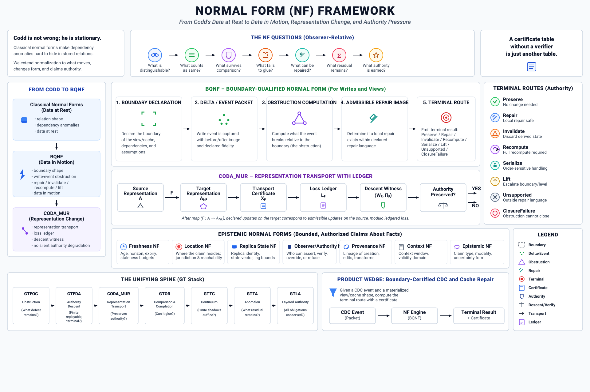
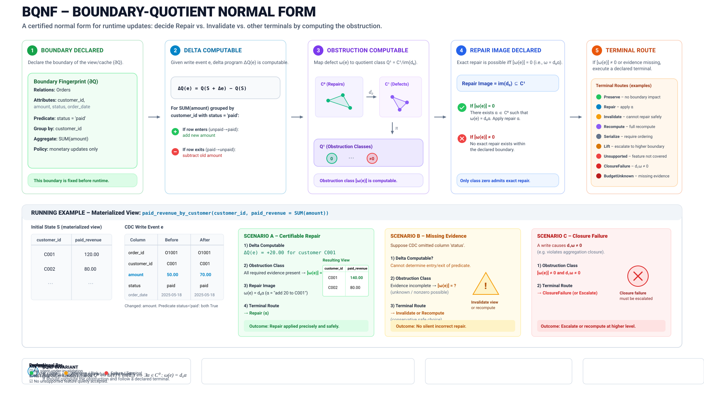
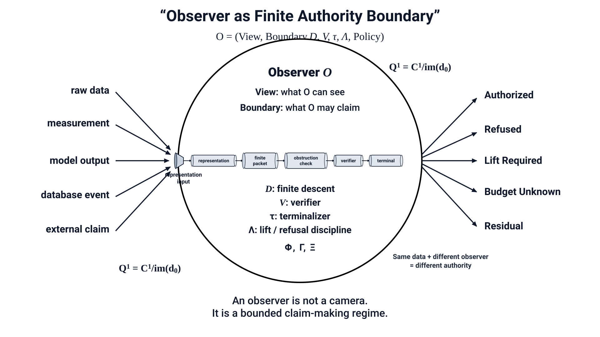

# Simplex Normal Forms

**Boundary-Certified Data Architecture, Relational Normalization, Cochain Retraction & Representation Transport (`CODA_MUR`)**  
**AuthorityEffect:** `None` (`certified_implies_authorized: false`)

[](https://github.com/dbccpage/simplex-normal-forms/wiki)
[](contracts/)
[](images/)



---

## 1. What Is Simplex Normal Forms?

Classical database theory (Codd 1970–1974, Fagin 1977–1981, Date & Darwen 2002–2012) defines normal forms (`1NF` through `6NF`, `BCNF`, `EKNF`, `ETNF`, `DKNF`) for **data at rest**: a single relational schema evaluated against functional, multivalued, and join dependencies.

Modern software and scientific computing architectures operate across four additional regimes where classical at-rest normalization is silent:
1. **Data at Rest (`shape`):** Eliminating update/insertion/deletion anomalies with lossless join reconstruction (`1NF`–`6NF`, `BCNF`, `EKNF`, `ETNF`, `RFNF`, `SKNF`).
2. **Data in Motion (`change` / `BQNF`):** Incremental view and cache maintenance under Change Data Capture (`INSERT`/`UPDATE`/`DELETE`) streams via the homological quotient $Q^1 = C^1 / \operatorname{im}(d^0)$, priority-queue extrema cochains, and $\epsilon$-BQNF quantile sketches.
3. **Data in Representation (`coda` / `CODA_MUR`, `representation`, `transport`, `compilation`):** Certified representation transport ([`nf.coda.mur.transport`](contracts/nf.coda.mur.transport.yaml), replacing legacy `CODA_MUR`), enforcing that updates commute with representation changes up to an explicit **Loss Ledger** (`coda_mur.unmapped_field_drop`).
4. **Data under Observation (`epistemic`, `authority`, `evidence`):** Observer-relative freshness posets, epistemic quotient kernels (`EQNF`), observer distinguishability pseudometrics (`ODNF`), cryptographic Merkle trace receipts (`TMNF`), and strict separation of certification from authorization (`certified_implies_authorized: false`).
5. **Simplicial, Cochain & Physical Substrates (`topology`, `physics`, `runtime`, `derivation`):** Simplicial boundary nilpotency ($\partial^2 = 0$), discrete Hodge decomposition ($C^1 = \operatorname{im} d_0 \oplus H^1 \oplus \operatorname{im} d_1^*$), exact rational zero-duality-gap witnesses (`ZFNF`), discrete Regge calculus, Lorentzian CDT foliation, and Fermion Sign Problem normal forms (`BSS-NF`, `MIC-NF`, `BQNF-FSIGN`).

---

## 2. Visual Overview

| Boundary-Quotient Normal Form (`BQNF`) | Observer-Relative Ontology |
| :---: | :---: |
|  |  |

---

## 3. Repository Structure

```text
simplex-normal-forms/
├── contracts/                  # 112 canonical YAML normal-form contracts (smplx.nf.contract.v1 / v0)
│   ├── _golden_nfs/            # Meta-schemas (standard.yaml, normal_form_definitions.yaml, SQLite schema)
│   ├── bqnf/                   # BQNF & Fermion Sign contracts and boundary quotient SVGs
│   ├── data/                   # JSON fixtures for CDC events, observers, orders, and certificates
│   └── nf.<family>.<name>.yaml # Individual machine-checkable normal form contracts
├── normal_forms/               # Standalone Python verifier, SQLite cochain evaluator & domain library
│   ├── catalog.py              # CLI & library validator checking all 112 contracts against standard.yaml
│   ├── evaluator.py            # SQLite session evaluator (0NF->1NF, 5NF witness, BQNF CDC repair, S_N)
│   ├── domain/                 # Pure-Python relational (2NF/3NF/BCNF/4NF), BQNF, ASRF, Hodge & ZFNF verifiers
│   └── *_example.py            # Executable demos for BQNF, Observer Freshness, Certificates & Reconciliation
├── docs/research_forum/        # 6-document Research Forum & Commercial Strategy Dossier (SimpleCache vs IVM)
├── images/                     # 112 per-contract visual SVG diagrams + architectural overview SVGs
├── wiki/                       # Complete mirror of the GitHub Wiki (one markdown page per normal form)
└── tests/                      # Automated verification suite (catalog totality, evaluator, claim hygiene)
```

---

## 4. Quickstart: Validate Contracts & Run Demos

Requires Python 3.10+ with `pyyaml` and `pydantic`:

```bash
# 1. Validate all 112 normal-form contracts against contracts/_golden_nfs/standard.yaml
python -m normal_forms.catalog

# 2. Run Demo 01: BQNF (Boundary-Quotient Normal Form) CDC Stream Evaluation
python -m normal_forms.paid_revenue_example

# 3. Run Demo 02: Unverified Certificate Refusal Gate (certified != authorized)
python -m normal_forms.unverified_certificate_example

# 4. Run Demo 03: Observer-Relative Freshness SLA Poset Monotonicity
python -m normal_forms.observer_freshness_example

# 5. Run Cross-Domain Reconciliation & Loss Ledger Verification
python -m normal_forms.reconciliation_example

# 6. Run the full test suite
python -m unittest discover -s tests -v
```

---

## 5. Wiki: One Page Per Normal Form (with Visual SVG Examples)

Explore the **[GitHub Wiki](https://github.com/dbccpage/simplex-normal-forms/wiki)** (also mirrored locally in [`wiki/`](wiki/)):
- **[Wiki Home & Master Index](https://github.com/dbccpage/simplex-normal-forms/wiki/Home)** ([local `wiki/Home.md`](wiki/Home.md))
- **[Theory and Cochain Substrate](https://github.com/dbccpage/simplex-normal-forms/wiki/Theory-and-Cochain-Substrate)** ([local](wiki/Theory-and-Cochain-Substrate.md))
- **[Observer-Relative Ontology](https://github.com/dbccpage/simplex-normal-forms/wiki/Observer-Relative-Ontology)** ([local](wiki/Observer-Relative-Ontology.md))
- **[Concrete Worked Examples](https://github.com/dbccpage/simplex-normal-forms/wiki/Concrete-Examples)** ([local](wiki/Concrete-Examples.md))
- **[Relational Geometrodynamics & Physics Substrate](https://github.com/dbccpage/simplex-normal-forms/wiki/Relational-Geometrodynamics-and-Physics-Substrate)** ([local](wiki/Relational-Geometrodynamics-and-Physics-Substrate.md))
- **[SimpleCache Research Forum & Commercial Strategy Dossier](docs/research_forum/README.md)** ([Executive Whitepaper](docs/research_forum/01_executive_whitepaper.md) • [Competitive Analysis](docs/research_forum/02_competitive_analysis.md) • [5 Commercial Upgrades](docs/research_forum/03_commercial_upgrades.md) • [Cross-Program Foundations](docs/research_forum/04_cross_program_foundations.md) • [Forum Proceedings](docs/research_forum/05_research_forum_proceedings.md))

---

## 6. Complete Normal Form Contract Register (112 Contracts)

112 contract files (`index.yaml` lists 25 active and 86 draft contracts). Every contract includes a dedicated Wiki page and visual SVG diagram:

| Contract YAML | Short Name | Full Name | Family | Status | Theory | Verification | Wiki & SVG Diagram |
| :--- | :--- | :--- | :--- | :--- | :--- | :--- | :--- |
| [`nf.change.bqnf.fermion_sign`](contracts/bqnf/nf.change.bqnf.fermion_sign.yaml) | `BQNF-FSIGN` | Boundary-Quotient Normal Form Instance for the Fermion Sign Problem | `change` | `active` | proposed | executable | [Wiki](wiki/nf.change.bqnf.fermion_sign.md) • [SVG](images/nf.change.bqnf.fermion_sign.svg) |
| [`nf.change.rational_quotient`](contracts/nf.change.rational_quotient.yaml) | `RATIONAL_QUOTIENT` | Rational cochain quotient section | `change` | `active` | proposed | executable | [Wiki](wiki/nf.change.rational_quotient.md) • [SVG](images/nf.change.rational_quotient.svg) |
| [`nf.change.sign_switching`](contracts/nf.change.sign_switching.yaml) | `SIGN_SWITCHING` | Binary graph sign switching section | `change` | `active` | proposed | executable | [Wiki](wiki/nf.change.sign_switching.md) • [SVG](images/nf.change.sign_switching.svg) |
| [`nf.classical.1nf`](contracts/nf.classical.1nf.yaml) | `1NF` | Atomic Domain First Normal Form | `shape` | `active` | established | absent | [Wiki](wiki/nf.classical.1nf.md) • [SVG](images/nf.classical.1nf.svg) |
| [`nf.classical.2nf`](contracts/nf.classical.2nf.yaml) | `2NF` | Full Functional Dependency Second Normal Form | `shape` | `active` | established | absent | [Wiki](wiki/nf.classical.2nf.md) • [SVG](images/nf.classical.2nf.svg) |
| [`nf.classical.3nf`](contracts/nf.classical.3nf.yaml) | `3NF` | Third Normal Form | `shape` | `active` | established | executable | [Wiki](wiki/nf.classical.3nf.md) • [SVG](images/nf.classical.3nf.svg) |
| [`nf.classical.4nf`](contracts/nf.classical.4nf.yaml) | `4NF` | Multivalued Dependency Fourth Normal Form | `shape` | `active` | established | absent | [Wiki](wiki/nf.classical.4nf.md) • [SVG](images/nf.classical.4nf.svg) |
| [`nf.classical.5nf`](contracts/nf.classical.5nf.yaml) | `5NF` | Project-Join Normal Form / Fifth Normal Form | `shape` | `active` | established | absent | [Wiki](wiki/nf.classical.5nf.md) • [SVG](images/nf.classical.5nf.svg) |
| [`nf.classical.6nf`](contracts/nf.classical.6nf.yaml) | `6NF` | Sixth Normal Form | `shape` | `active` | established | executable | [Wiki](wiki/nf.classical.6nf.md) • [SVG](images/nf.classical.6nf.svg) |
| [`nf.classical.bcnf`](contracts/nf.classical.bcnf.yaml) | `BCNF` | Boyce-Codd Normal Form | `shape` | `active` | established | absent | [Wiki](wiki/nf.classical.bcnf.md) • [SVG](images/nf.classical.bcnf.svg) |
| [`nf.classical.dknf`](contracts/nf.classical.dknf.yaml) | `DKNF` | Domain-Key Normal Form | `shape` | `active` | established | absent | [Wiki](wiki/nf.classical.dknf.md) • [SVG](images/nf.classical.dknf.svg) |
| [`nf.classical.eknf`](contracts/nf.classical.eknf.yaml) | `EKNF` | Elementary Key Normal Form | `shape` | `active` | established | absent | [Wiki](wiki/nf.classical.eknf.md) • [SVG](images/nf.classical.eknf.svg) |
| [`nf.classical.etnf`](contracts/nf.classical.etnf.yaml) | `ETNF` | Essential Tuple Normal Form | `shape` | `active` | established | absent | [Wiki](wiki/nf.classical.etnf.md) • [SVG](images/nf.classical.etnf.svg) |
| [`nf.classical.rfnf`](contracts/nf.classical.rfnf.yaml) | `RFNF` | Redundancy-Free Normal Form / Key-Component Normal Form | `shape` | `active` | established | absent | [Wiki](wiki/nf.classical.rfnf.md) • [SVG](images/nf.classical.rfnf.svg) |
| [`nf.classical.sknf`](contracts/nf.classical.sknf.yaml) | `SKNF` | Superkey Normal Form / Fifth Normal Form Restricted | `shape` | `active` | established | absent | [Wiki](wiki/nf.classical.sknf.md) • [SVG](images/nf.classical.sknf.svg) |
| [`nf.ddc.context_boundary`](contracts/nf.ddc.context_boundary.yaml) | `CBNF` | Context Boundary Normal Form | `topology` | `active` | established | executable | [Wiki](wiki/nf.ddc.context_boundary.md) • [SVG](images/nf.ddc.context_boundary.svg) |
| [`nf.ddc.dual_witness`](contracts/nf.ddc.dual_witness.yaml) | `DWNF` | Dual Witness Normal Form | `evidence` | `active` | established | executable | [Wiki](wiki/nf.ddc.dual_witness.md) • [SVG](images/nf.ddc.dual_witness.svg) |
| [`nf.ddc.hodge_canonical`](contracts/nf.ddc.hodge_canonical.yaml) | `HCNF` | Hodge Canonical Normal Form | `shape` | `active` | established | executable | [Wiki](wiki/nf.ddc.hodge_canonical.md) • [SVG](images/nf.ddc.hodge_canonical.svg) |
| [`nf.ddc.lift_ledger`](contracts/nf.ddc.lift_ledger.yaml) | `LNLF` | Lift Ledger Normal Form | `transport` | `active` | established | executable | [Wiki](wiki/nf.ddc.lift_ledger.md) • [SVG](images/nf.ddc.lift_ledger.svg) |
| [`nf.ddc.loss_ledger`](contracts/nf.ddc.loss_ledger.yaml) | `LLNF` | Loss Ledger Normal Form | `transport` | `active` | established | executable | [Wiki](wiki/nf.ddc.loss_ledger.md) • [SVG](images/nf.ddc.loss_ledger.svg) |
| [`nf.ddc.refusal_receipt`](contracts/nf.ddc.refusal_receipt.yaml) | `RRNF` | Refusal Receipt Normal Form | `evidence` | `active` | established | executable | [Wiki](wiki/nf.ddc.refusal_receipt.md) • [SVG](images/nf.ddc.refusal_receipt.svg) |
| [`nf.ddc.terminal_partition`](contracts/nf.ddc.terminal_partition.yaml) | `TPNF` | Terminal Partition Normal Form | `authority` | `active` | established | executable | [Wiki](wiki/nf.ddc.terminal_partition.md) • [SVG](images/nf.ddc.terminal_partition.svg) |
| [`nf.ddc.trace_merkle`](contracts/nf.ddc.trace_merkle.yaml) | `TMNF` | Trace Merkle Normal Form | `runtime` | `active` | established | executable | [Wiki](wiki/nf.ddc.trace_merkle.md) • [SVG](images/nf.ddc.trace_merkle.svg) |
| [`nf.experimental.qm_classical`](contracts/nf.experimental.qm_classical.yaml) | `QCNF` | Quantum-Classical Experiment Normal Form | `experimental` | `active` | experimental | executable | [Wiki](wiki/nf.experimental.qm_classical.md) • [SVG](images/nf.experimental.qm_classical.svg) |
| [`nf.operational.schema-totality`](contracts/nf.operational.schema-totality.yaml) | `SQL-TOTAL` | Declared SQL Key Projection and Candidate Totality Profile | `evidence` | `active` |  |  | [Wiki](wiki/nf.operational.schema-totality.md) • [SVG](images/nf.operational.schema-totality.svg) |
| [`nf.ai.ascnf`](contracts/nf.ai.ascnf.yaml) | `ASCNF` | Agent-State Cohomology Normal Form | `experimental` | `draft` | proposed | absent | [Wiki](wiki/nf.ai.ascnf.md) • [SVG](images/nf.ai.ascnf.svg) |
| [`nf.bridge.wir_relvar`](contracts/nf.bridge.wir_relvar.yaml) | `WIR-Relvar Bridge` | WIR to Relvar Bridge Contract | `bridge` | `draft` | proposed | absent | [Wiki](wiki/nf.bridge.wir_relvar.md) • [SVG](images/nf.bridge.wir_relvar.svg) |
| [`nf.change.bqnf`](contracts/bqnf/nf.change.bqnf.yaml) | `BQNF` | Boundary-Quotient Normal Form | `change` | `draft` | proposed | absent | [Wiki](wiki/nf.change.bqnf.md) • [SVG](images/nf.change.bqnf.svg) |
| [`nf.classical.0nf`](contracts/nf.classical.0nf.yaml) | `0NF` | Raw / Unnormalized Form | `shape` | `draft` | established | executable | [Wiki](wiki/nf.classical.0nf.md) • [SVG](images/nf.classical.0nf.svg) |
| [`nf.classical.nf2`](contracts/nf.classical.nf2.yaml) | `NF2` | Non-First Normal Form Nested Relation Form | `shape` | `draft` | proposed | absent | [Wiki](wiki/nf.classical.nf2.md) • [SVG](images/nf.classical.nf2.svg) |
| [`nf.cochain.dhnf`](contracts/nf.cochain.dhnf.yaml) | `DHNF` | Discrete Hodge Normal Form | `shape` | `draft` | established | absent | [Wiki](wiki/nf.cochain.dhnf.md) • [SVG](images/nf.cochain.dhnf.svg) |
| [`nf.coda.eqnf`](contracts/nf.coda.eqnf.yaml) | `EQNF` | Epistemic Quotient Normal Form | `epistemic` | `draft` | established | executable | [Wiki](wiki/nf.coda.eqnf.md) • [SVG](images/nf.coda.eqnf.svg) |
| [`nf.coda.gbqnf`](contracts/nf.coda.gbqnf.yaml) | `GBQNF` | Generalized Boundary-Quotient Normal Form | `change` | `draft` | established | executable | [Wiki](wiki/nf.coda.gbqnf.md) • [SVG](images/nf.coda.gbqnf.svg) |
| [`nf.coda.mur.transport`](contracts/nf.coda.mur.transport.yaml) | `coda_mur` | CODA-MUR Representation Transport Contract | `coda` | `draft` | proposed | absent | [Wiki](wiki/nf.coda.mur.transport.md) • [SVG](images/nf.coda.mur.transport.svg) |
| [`nf.coda.tsnf`](contracts/nf.coda.tsnf.yaml) | `TSNF` | Topological Simplex Normal Form | `topology` | `draft` | established | executable | [Wiki](wiki/nf.coda.tsnf.md) • [SVG](images/nf.coda.tsnf.svg) |
| [`nf.cohomology.acnf`](contracts/nf.cohomology.acnf.yaml) | `ACNF` | Autopoietic Cohomology Normal Form | `experimental` | `deprecated` | proposed | absent | [Wiki](wiki/nf.cohomology.acnf.md) • [SVG](images/nf.cohomology.acnf.svg) |
| [`nf.compilation.cpnf`](contracts/nf.compilation.cpnf.yaml) | `CpNF` | Compilation Normal Form | `compilation` | `draft` |  |  | [Wiki](wiki/nf.compilation.cpnf.md) • [SVG](images/nf.compilation.cpnf.svg) |
| [`nf.derivation.aonf`](contracts/nf.derivation.aonf.yaml) | `AONF` | Active Obstruction Normal Form | `derivation` | `draft` | established | executable | [Wiki](wiki/nf.derivation.aonf.md) • [SVG](images/nf.derivation.aonf.svg) |
| [`nf.derivation.apnf`](contracts/nf.derivation.apnf.yaml) | `APNF` | Constructive Apartness Normal Form | `derivation` | `draft` | established | absent | [Wiki](wiki/nf.derivation.apnf.md) • [SVG](images/nf.derivation.apnf.svg) |
| [`nf.derivation.ignf`](contracts/nf.derivation.ignf.yaml) | `IGNF` | Isomorphism Gauge Normal Form | `derivation` | `draft` | established | absent | [Wiki](wiki/nf.derivation.ignf.md) • [SVG](images/nf.derivation.ignf.svg) |
| [`nf.derivation.irnf`](contracts/nf.derivation.irnf.yaml) | `IRNF` | Integer Ray Normal Form | `derivation` | `draft` | established | absent | [Wiki](wiki/nf.derivation.irnf.md) • [SVG](images/nf.derivation.irnf.svg) |
| [`nf.derivation.lsnf`](contracts/nf.derivation.lsnf.yaml) | `LSNF` | Lawful Skeletal Filtration Normal Form | `derivation` | `draft` | established | absent | [Wiki](wiki/nf.derivation.lsnf.md) • [SVG](images/nf.derivation.lsnf.svg) |
| [`nf.derivation.obnf`](contracts/nf.derivation.obnf.yaml) | `OBNF` | Obstruction Relativization Normal Form | `derivation` | `draft` | established | executable | [Wiki](wiki/nf.derivation.obnf.md) • [SVG](images/nf.derivation.obnf.svg) |
| [`nf.derivation.pdnf`](contracts/nf.derivation.pdnf.yaml) | `PDNF` | Primitive Difference Normal Form | `derivation` | `draft` | established | executable | [Wiki](wiki/nf.derivation.pdnf.md) • [SVG](images/nf.derivation.pdnf.svg) |
| [`nf.derivation.rpnf`](contracts/nf.derivation.rpnf.yaml) | `RPNF` | Replay Provenance Normal Form | `derivation` | `draft` | established | executable | [Wiki](wiki/nf.derivation.rpnf.md) • [SVG](images/nf.derivation.rpnf.svg) |
| [`nf.derivation.scnf`](contracts/nf.derivation.scnf.yaml) | `SCNF` | Separation Cost Normal Form | `derivation` | `draft` | established | executable | [Wiki](wiki/nf.derivation.scnf.md) • [SVG](images/nf.derivation.scnf.svg) |
| [`nf.derivation.sernf`](contracts/nf.derivation.sernf.yaml) | `SERNF` | Split Extension-Retraction Normal Form | `derivation` | `draft` | established | executable | [Wiki](wiki/nf.derivation.sernf.md) • [SVG](images/nf.derivation.sernf.svg) |
| [`nf.epistemic.authority`](contracts/nf.epistemic.authority.yaml) | `ANF` | Authority Normal Form | `epistemic` | `draft` | proposed | absent | [Wiki](wiki/nf.epistemic.authority.md) • [SVG](images/nf.epistemic.authority.svg) |
| [`nf.epistemic.cnf`](contracts/nf.epistemic.cnf.yaml) | `CNF` | Context Normal Form | `epistemic` | `draft` | proposed | absent | [Wiki](wiki/nf.epistemic.cnf.md) • [SVG](images/nf.epistemic.cnf.svg) |
| [`nf.epistemic.efnf`](contracts/nf.epistemic.efnf.yaml) | `EFNF` | Endogenous Fidelity Normal Form | `epistemic` | `draft` | established | absent | [Wiki](wiki/nf.epistemic.efnf.md) • [SVG](images/nf.epistemic.efnf.svg) |
| [`nf.epistemic.enf`](contracts/nf.epistemic.enf.yaml) | `ENF` | Epistemic Normal Form | `epistemic` | `draft` | proposed | absent | [Wiki](wiki/nf.epistemic.enf.md) • [SVG](images/nf.epistemic.enf.svg) |
| [`nf.epistemic.freshness`](contracts/nf.epistemic.freshness.yaml) | `FNF` | Freshness Normal Form | `epistemic` | `draft` | proposed | absent | [Wiki](wiki/nf.epistemic.freshness.md) • [SVG](images/nf.epistemic.freshness.svg) |
| [`nf.epistemic.location`](contracts/nf.epistemic.location.yaml) | `LNF` | Location Normal Form | `epistemic` | `draft` | proposed | absent | [Wiki](wiki/nf.epistemic.location.md) • [SVG](images/nf.epistemic.location.svg) |
| [`nf.epistemic.nar_nf`](contracts/nf.epistemic.nar_nf.yaml) | `NAR-NF` | Non-Authoritative Realization Normal Form | `epistemic` | `draft` | established | executable | [Wiki](wiki/nf.epistemic.nar_nf.md) • [SVG](images/nf.epistemic.nar_nf.svg) |
| [`nf.epistemic.observer`](contracts/nf.epistemic.observer.yaml) | `ObsNF` | Observer Normal Form | `epistemic` | `draft` | proposed | absent | [Wiki](wiki/nf.epistemic.observer.md) • [SVG](images/nf.epistemic.observer.svg) |
| [`nf.epistemic.odnf`](contracts/nf.epistemic.odnf.yaml) | `ODNF` | Observer Distinguishability Normal Form | `epistemic` | `draft` | proposed | absent | [Wiki](wiki/nf.epistemic.odnf.md) • [SVG](images/nf.epistemic.odnf.svg) |
| [`nf.epistemic.onf`](contracts/nf.epistemic.onf.yaml) | `ONF` | Orchestration Normal Form | `epistemic` | `draft` | proposed | absent | [Wiki](wiki/nf.epistemic.onf.md) • [SVG](images/nf.epistemic.onf.svg) |
| [`nf.epistemic.pvnf`](contracts/nf.epistemic.pvnf.yaml) | `PvNF` | Provenance Normal Form | `epistemic` | `draft` | proposed | absent | [Wiki](wiki/nf.epistemic.pvnf.md) • [SVG](images/nf.epistemic.pvnf.svg) |
| [`nf.epistemic.replica`](contracts/nf.epistemic.replica.yaml) | `RNF` | Replica Normal Form | `epistemic` | `draft` | proposed | absent | [Wiki](wiki/nf.epistemic.replica.md) • [SVG](images/nf.epistemic.replica.svg) |
| [`nf.epistemic.snnf`](contracts/nf.epistemic.snnf.yaml) | `SnNF` | Stripe Normal Form | `epistemic` | `draft` | proposed | absent | [Wiki](wiki/nf.epistemic.snnf.md) • [SVG](images/nf.epistemic.snnf.svg) |
| [`nf.epistemic.state`](contracts/nf.epistemic.state.yaml) | `StNF` | State Normal Form | `epistemic` | `draft` | proposed | absent | [Wiki](wiki/nf.epistemic.state.md) • [SVG](images/nf.epistemic.state.svg) |
| [`nf.evidence.cdc`](contracts/nf.evidence.cdc.yaml) | `CDCEF` | CDC Evidence Form | `evidence` | `draft` | proposed | absent | [Wiki](wiki/nf.evidence.cdc.md) • [SVG](images/nf.evidence.cdc.svg) |
| [`nf.evidence.certificate`](contracts/nf.evidence.certificate.yaml) | `CertF` | Certificate Form | `evidence` | `draft` | proposed | absent | [Wiki](wiki/nf.evidence.certificate.md) • [SVG](images/nf.evidence.certificate.svg) |
| [`nf.evidence.ddanf`](contracts/nf.evidence.ddanf.yaml) | `DDANF` | Deterministic Data-Flow Architecture Normal Form | `evidence` | `draft` | proposed | absent | [Wiki](wiki/nf.evidence.ddanf.md) • [SVG](images/nf.evidence.ddanf.svg) |
| [`nf.evidence.loss_ledger`](contracts/nf.evidence.loss_ledger.yaml) | `LLF` | Loss Ledger Form | `evidence` | `draft` | proposed | absent | [Wiki](wiki/nf.evidence.loss_ledger.md) • [SVG](images/nf.evidence.loss_ledger.svg) |
| [`nf.evidence.provenance`](contracts/nf.evidence.provenance.yaml) | `ProvF` | Provenance Form | `evidence` | `draft` | proposed | absent | [Wiki](wiki/nf.evidence.provenance.md) • [SVG](images/nf.evidence.provenance.svg) |
| [`nf.experimental.7nf`](contracts/nf.experimental.7nf.yaml) | `7NF` | Observer-Separable Fact Normal Form | `experimental` | `draft` | experimental | absent | [Wiki](wiki/nf.experimental.7nf.md) • [SVG](images/nf.experimental.7nf.svg) |
| [`nf.experimental.bell_contextuality`](contracts/nf.experimental.bell_contextuality.yaml) | `BellCNF` | Bell Contextuality Observer Contract | `experimental` | `draft` | experimental | absent | [Wiki](wiki/nf.experimental.bell_contextuality.md) • [SVG](images/nf.experimental.bell_contextuality.svg) |
| [`nf.experimental.gauge`](contracts/nf.experimental.gauge.yaml) | `XGauge` | Gauge Experimental Extension | `experimental` | `draft` | experimental | absent | [Wiki](wiki/nf.experimental.gauge.md) • [SVG](images/nf.experimental.gauge.svg) |
| [`nf.experimental.quantum_observer_ontology`](contracts/nf.experimental.quantum_observer_ontology.yaml) | `QONF` | Quantum Observer-Ontology Contract | `experimental` | `draft` | experimental | absent | [Wiki](wiki/nf.experimental.quantum_observer_ontology.md) • [SVG](images/nf.experimental.quantum_observer_ontology.svg) |
| [`nf.fsp.bssnf`](contracts/nf.fsp.bssnf.yaml) | `BSS-NF` | Binary Sign-Switching Normal Form | `representation` | `draft` | proposed | absent | [Wiki](wiki/nf.fsp.bssnf.md) • [SVG](images/nf.fsp.bssnf.svg) |
| [`nf.fsp.micnf`](contracts/nf.fsp.micnf.yaml) | `MIC-NF` | Meron Involutive Cancellation Normal Form | `representation` | `draft` | proposed | absent | [Wiki](wiki/nf.fsp.micnf.md) • [SVG](images/nf.fsp.micnf.svg) |
| [`nf.logic.qanf`](contracts/nf.logic.qanf.yaml) | `QANF` | Quantifier Alternation Normal Form | `experimental` | `draft` | proposed | absent | [Wiki](wiki/nf.logic.qanf.md) • [SVG](images/nf.logic.qanf.svg) |
| [`nf.motion.flow_control`](contracts/nf.motion.flow_control.yaml) | `FCNF` | Flow Control Normal Form | `motion` | `draft` | proposed | absent | [Wiki](wiki/nf.motion.flow_control.md) • [SVG](images/nf.motion.flow_control.svg) |
| [`nf.motion.horizon_emission`](contracts/nf.motion.horizon_emission.yaml) | `HENF` | Horizon Emission Normal Form | `motion` | `draft` | proposed | absent | [Wiki](wiki/nf.motion.horizon_emission.md) • [SVG](images/nf.motion.horizon_emission.svg) |
| [`nf.motion.locality_lrb`](contracts/nf.motion.locality_lrb.yaml) | `LRBNF` | Lieb-Robinson Locality Normal Form | `motion` | `draft` | proposed | absent | [Wiki](wiki/nf.motion.locality_lrb.md) • [SVG](images/nf.motion.locality_lrb.svg) |
| [`nf.mssn`](contracts/nf.mssn.yaml) | `MSSNF` | Minimal Symbol System Normal Form | `shape` | `draft` | proposed | executable | [Wiki](wiki/nf.mssn.md) • [SVG](images/nf.mssn.svg) |
| [`nf.mssn.bqnf`](contracts/nf.mssn.bqnf.yaml) | `MSSN-BQNF` | MSS-N Boundary-Quotient Normal Form | `change` | `draft` | proposed | executable | [Wiki](wiki/nf.mssn.bqnf.md) • [SVG](images/nf.mssn.bqnf.svg) |
| [`nf.ontology.ainf`](contracts/nf.ontology.ainf.yaml) | `AINF` | Adjoint-Invariant Normal Form | `derivation` | `draft` | proposed | absent | [Wiki](wiki/nf.ontology.ainf.md) • [SVG](images/nf.ontology.ainf.svg) |
| [`nf.pfp.pfnf`](contracts/nf.pfp.pfnf.yaml) | `PFNF` | Proposal Fidelity Normal Form | `coda` | `draft` | established | executable | [Wiki](wiki/nf.pfp.pfnf.md) • [SVG](images/nf.pfp.pfnf.svg) |
| [`nf.physics.bianchi_regge`](contracts/nf.physics.bianchi_regge.yaml) | `RBNF` | Regge-Bianchi Normal Form (arXiv:1904.01966 Recovery) | `physics` | `draft` | admitted | absent | [Wiki](wiki/nf.physics.bianchi_regge.md) • [SVG](images/nf.physics.bianchi_regge.svg) |
| [`nf.physics.bqnf_fsign`](contracts/nf.physics.bqnf_fsign.yaml) | `BQNF-FSIGN` | Fermion Sign Problem Boundary-Quotient Normal Form | `representation` | `draft` | experimental | executable | [Wiki](wiki/nf.physics.bqnf_fsign.md) • [SVG](images/nf.physics.bqnf_fsign.svg) |
| [`nf.physics.bqnf_regge`](contracts/nf.physics.bqnf_regge.yaml) | `BQNF-REGGE` | Boundary-Quotient Normal Form for Regge Geometrodynamics | `physics` | `draft` | admitted | absent | [Wiki](wiki/nf.physics.bqnf_regge.md) • [SVG](images/nf.physics.bqnf_regge.svg) |
| [`nf.physics.cdt_fermion_sign`](contracts/nf.physics.cdt_fermion_sign.yaml) | `CDT-FSIGN-NF` | 4D CDT Fermionic Grassmann Path Integrals & BQNF Sign Normal Form | `physics` | `draft` | admitted | absent | [Wiki](wiki/nf.physics.cdt_fermion_sign.md) • [SVG](images/nf.physics.cdt_fermion_sign.svg) |
| [`nf.physics.cdt_kd_doubling`](contracts/nf.physics.cdt_kd_doubling.yaml) | `CDT-KD-DOUBLING-NF` | 4D CDT Kähler-Dirac Fermion Doubling Resolution & Topological Spin Normal Form | `physics` | `draft` | admitted | absent | [Wiki](wiki/nf.physics.cdt_kd_doubling.md) • [SVG](images/nf.physics.cdt_kd_doubling.svg) |
| [`nf.physics.cdt_matter_coupling`](contracts/nf.physics.cdt_matter_coupling.yaml) | `CDT-MATTER-NF` | CDT Dynamical Matter Field & Lattice Gauge Coupling Normal Form | `physics` | `draft` | admitted | absent | [Wiki](wiki/nf.physics.cdt_matter_coupling.md) • [SVG](images/nf.physics.cdt_matter_coupling.svg) |
| [`nf.physics.cdt_overlap_fermions`](contracts/nf.physics.cdt_overlap_fermions.yaml) | `CDT-OVERLAP-NF` | 4D CDT Ginsparg-Wilson & Overlap Dirac Operator Normal Form | `physics` | `draft` | admitted | absent | [Wiki](wiki/nf.physics.cdt_overlap_fermions.md) • [SVG](images/nf.physics.cdt_overlap_fermions.svg) |
| [`nf.physics.cdt_spectral_dimension`](contracts/nf.physics.cdt_spectral_dimension.yaml) | `CDT-SPEC-NF` | CDT Spectral Dimension & Dynamical Dimensional Reduction Normal Form | `physics` | `draft` | admitted | absent | [Wiki](wiki/nf.physics.cdt_spectral_dimension.md) • [SVG](images/nf.physics.cdt_spectral_dimension.svg) |
| [`nf.physics.cdt_susy_witten`](contracts/nf.physics.cdt_susy_witten.yaml) | `CDT-SUSY-WITTEN-NF` | 4D CDT Supersymmetric Topological Witten Index, Nicolai Map & Super-WDW Normal Form | `physics` | `draft` | admitted | absent | [Wiki](wiki/nf.physics.cdt_susy_witten.md) • [SVG](images/nf.physics.cdt_susy_witten.svg) |
| [`nf.physics.cdt_topological_charge`](contracts/nf.physics.cdt_topological_charge.yaml) | `CDT-TOPO-CHARGE-NF` | 4D CDT Topological Charge Fluctuations & Instanton Susceptibility Normal Form | `physics` | `draft` | admitted | absent | [Wiki](wiki/nf.physics.cdt_topological_charge.md) • [SVG](images/nf.physics.cdt_topological_charge.svg) |
| [`nf.physics.cdt_wick_mc`](contracts/nf.physics.cdt_wick_mc.yaml) | `CDT-WMC-NF` | Wick-Rotated Lorentzian CDT Monte Carlo Statistical Weight Sampler Contract | `physics` | `draft` | experimental | absent | [Wiki](wiki/nf.physics.cdt_wick_mc.md) • [SVG](images/nf.physics.cdt_wick_mc.svg) |
| [`nf.physics.cdt_zolotarev_overlap`](contracts/nf.physics.cdt_zolotarev_overlap.yaml) | `CDT-ZOLOTAREV-NF` | 4D CDT Rational Zolotarev & Deflated Overlap Dirac Operator Contract | `physics` | `draft` | established | absent | [Wiki](wiki/nf.physics.cdt_zolotarev_overlap.md) • [SVG](images/nf.physics.cdt_zolotarev_overlap.svg) |
| [`nf.physics.dfnf`](contracts/nf.physics.dfnf.yaml) | `DFNF` | Dressing Field Normal Form | `physics` | `draft` | experimental | executable | [Wiki](wiki/nf.physics.dfnf.md) • [SVG](images/nf.physics.dfnf.svg) |
| [`nf.physics.l1_constraint_closure`](contracts/nf.physics.l1_constraint_closure.yaml) | `L1CCNF` | L1 Constraint Closure and Duality Normal Form | `physics` | `draft` | experimental | absent | [Wiki](wiki/nf.physics.l1_constraint_closure.md) • [SVG](images/nf.physics.l1_constraint_closure.svg) |
| [`nf.physics.lorentzian_cdt`](contracts/nf.physics.lorentzian_cdt.yaml) | `LCNF` | 4D Lorentzian Regge Causal Triangulation Normal Form | `physics` | `draft` | established | absent | [Wiki](wiki/nf.physics.lorentzian_cdt.md) • [SVG](images/nf.physics.lorentzian_cdt.svg) |
| [`nf.physics.pachner_lp_scaling`](contracts/nf.physics.pachner_lp_scaling.yaml) | `L1PSNF` | 4D Pachner Moves and Joint LP Scaling Normal Form | `physics` | `draft` | experimental | absent | [Wiki](wiki/nf.physics.pachner_lp_scaling.md) • [SVG](images/nf.physics.pachner_lp_scaling.svg) |
| [`nf.physics.pwnf`](contracts/nf.physics.pwnf.yaml) | `PWNF` | Page-Wootters Relational Clock Normal Form | `physics` | `draft` | established | absent | [Wiki](wiki/nf.physics.pwnf.md) • [SVG](images/nf.physics.pwnf.svg) |
| [`nf.physics.rcnf`](contracts/nf.physics.rcnf.yaml) | `RCNF` | Regge Calculus Normal Form | `physics` | `draft` | established | absent | [Wiki](wiki/nf.physics.rcnf.md) • [SVG](images/nf.physics.rcnf.svg) |
| [`nf.physics.rpcnf`](contracts/nf.physics.rpcnf.yaml) | `RPCNF` | Relational Point Coincidence Normal Form | `physics` | `draft` | experimental | executable | [Wiki](wiki/nf.physics.rpcnf.md) • [SVG](images/nf.physics.rpcnf.svg) |
| [`nf.physics.schlafli_nf`](contracts/nf.physics.schlafli_nf.yaml) | `SIDNF` | Schläfli Differential Identity Normal Form | `physics` | `draft` | established | absent | [Wiki](wiki/nf.physics.schlafli_nf.md) • [SVG](images/nf.physics.schlafli_nf.svg) |
| [`nf.physics.wdwnf`](contracts/nf.physics.wdwnf.yaml) | `WDWNF` | Wheeler-DeWitt Constraint and Kernel Normal Form | `physics` | `draft` | established | absent | [Wiki](wiki/nf.physics.wdwnf.md) • [SVG](images/nf.physics.wdwnf.svg) |
| [`nf.query.spja`](contracts/nf.query.spja.yaml) | `SPJA` | Selection Projection Join Aggregate Form | `query` | `draft` | proposed | executable | [Wiki](wiki/nf.query.spja.md) • [SVG](images/nf.query.spja.svg) |
| [`nf.recursion.asrf`](contracts/nf.recursion.asrf.yaml) | `ASRF` | Autopoietic Self-Reference Refusal Form | `recursion` | `draft` | proposed | absent | [Wiki](wiki/nf.recursion.asrf.md) • [SVG](images/nf.recursion.asrf.svg) |
| [`nf.relativistic.lightcone`](contracts/nf.relativistic.lightcone.yaml) | `LCNF` | Light-Cone Causality Normal Form | `relativistic` | `draft` | proposed | absent | [Wiki](wiki/nf.relativistic.lightcone.md) • [SVG](images/nf.relativistic.lightcone.svg) |
| [`nf.relativistic.time_sync`](contracts/nf.relativistic.time_sync.yaml) | `CSNF` | Clock-Synchronization Normal Form | `relativistic` | `draft` | proposed | absent | [Wiki](wiki/nf.relativistic.time_sync.md) • [SVG](images/nf.relativistic.time_sync.svg) |
| [`nf.representation.dbcnf`](contracts/nf.representation.dbcnf.yaml) | `DBCNF` | De Bruijn Cyclic Normal Form | `representation` | `draft` | established | absent | [Wiki](wiki/nf.representation.dbcnf.md) • [SVG](images/nf.representation.dbcnf.svg) |
| [`nf.representation.gnf`](contracts/nf.representation.gnf.yaml) | `GNF` | Gauge Normal Form | `transport` | `draft` | proposed | absent | [Wiki](wiki/nf.representation.gnf.md) • [SVG](images/nf.representation.gnf.svg) |
| [`nf.representation.tbnf`](contracts/nf.representation.tbnf.yaml) | `TBNF` | Token-Bounded Normal Form | `representation` | `draft` | proposed | absent | [Wiki](wiki/nf.representation.tbnf.md) • [SVG](images/nf.representation.tbnf.svg) |
| [`nf.runtime.mtnf`](contracts/nf.runtime.mtnf.yaml) | `MTNF` | Mazurkiewicz Trace Normal Form | `runtime` | `draft` | established | absent | [Wiki](wiki/nf.runtime.mtnf.md) • [SVG](images/nf.runtime.mtnf.svg) |
| [`nf.runtime.zfnf`](contracts/nf.runtime.zfnf.yaml) | `ZFNF` | Zero-Float Rational Normal Form | `runtime` | `draft` | established | executable | [Wiki](wiki/nf.runtime.zfnf.md) • [SVG](images/nf.runtime.zfnf.svg) |
| [`nf.security.efnf`](contracts/nf.security.efnf.yaml) | `EFNF` | Epistemic-Fibration Normal Form | `security` | `draft` | proposed | executable | [Wiki](wiki/nf.security.efnf.md) • [SVG](images/nf.security.efnf.svg) |
| [`nf.wdp.wdnf`](contracts/nf.wdp.wdnf.yaml) | `WDNF` | Witnessed Difference Normal Form | `derivation` | `draft` | established | executable | [Wiki](wiki/nf.wdp.wdnf.md) • [SVG](images/nf.wdp.wdnf.svg) |

---

## 7. Epistemic Claim Hygiene Quadrant

1. **What it supports:**
   - Supports machine validation of 112 declarative normal-form contracts against `standard.yaml`, executable SQLite/Python evaluation of relational decompositions (`0NF`–`6NF`, `BCNF`), `BQNF` incremental CDC repair, `CODA_MUR` representation transport with loss ledgers, observer-relative freshness posets, and discrete Hodge/rational duality witnesses in this repository's model.
2. **What it does not support:**
   - Does not confer operational authority (`AuthorityEffect: None`, `certified_implies_authorized: false`).
   - Does not claim that mathematical toy models or finite simplicial complexes constitute empirical physical evidence or replace production distributed consensus.
3. **The narrowest defensible claim:**
   - Every contract in `contracts/` satisfies the syntactic structure checked by `python -m normal_forms.catalog`, maps its local outcomes to canonical terminals, and is documented with an explicit Four-Pillar Quadrilateral and visual SVG diagram.
4. **The next test needed:**
   - Multi-node distributed benchmark replaying production PostgreSQL/MySQL logical replication WAL streams across concurrent observer poset tenants and diamond `CODA_MUR` representation DAGs.

---

## License

Released under the [MIT License](LICENSE).
