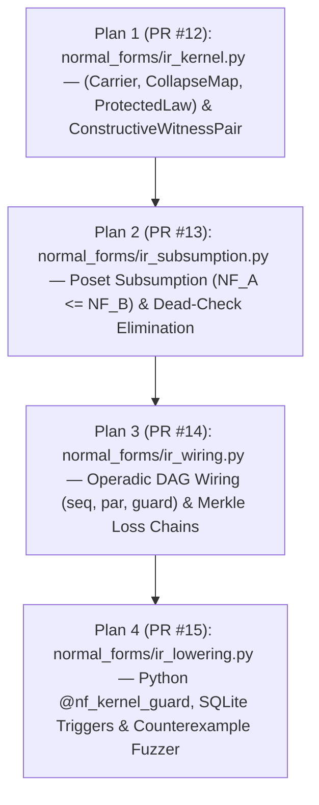

# Master Plan of Plans: Simplex Normal Forms IR (`NF-IR`) — Historical completion record

The four-plan implementation was completed at `dffdb87`. The 44-test receipt
below belongs to that milestone. For the later web MVP, correctness fixes,
packaging, CI and deployment gate, see [current project status](../PROJECT_STATUS.md).

## 1. Historical status at `dffdb87`

All 11 pull requests (**PR #5 through PR #15**) are **committed, verified (`Ran 44 tests in 31.448s — OK`), merged, and synced to `origin/main`**:

| PR | Commit | Plan / Scope | Status |
| :--- | :--- | :--- | :--- |
| **PR #5** | `4332982` | 112 YAML contracts, 112 SVGs, 112 Wiki pages, `CODA_MUR` nomenclature | **Merged** |
| **PR #6** | `288c658` | 3-hop pipeline (`3NF`/`BCNF` $\to$ `BQNF` $\to$ `CODA_MUR`) + property tests | **Merged** |
| **PR #7** | `0d4f0a7` | 4-hop pipeline (`MIN`/`MAX` cochains + $\epsilon$-BQNF quantiles + observer posets) | **Merged** |
| **PR #8** | `1392ef5` | Dynamic dyadic bucket splitting/merging + composite grouping keys | **Merged** |
| **PR #9** | `d163901` | Watermarked out-of-order late CDC streams + observer freshness shifts | **Merged** |
| **PR #10** | `3716cf8` | Competitive Research Forum dossier (`docs/research_forum/`) + Tier 1–4 tests | **Merged** |
| **PR #11** | `941bcd7` | [`normal_forms/ai.py`](../../normal_forms/ai.py) (`@coda_mur_projection`, `@observer_freshness_gate`, `WDNF` cut) + [`tests/test_ai_rag_mcp_pipeline.py`](../../tests/test_ai_rag_mcp_pipeline.py) | **Merged** |
| **PR #12** | `db4150f` | **Plan 1:** [`normal_forms/ir_kernel.py`](../../normal_forms/ir_kernel.py) + [`tests/test_ir_kernel.py`](../../tests/test_ir_kernel.py) (Primitive `WDP` / `OBNF` Witness Micro-Kernel) | **Merged** |
| **PR #13** | `d0e834c` | **Plan 2:** [`normal_forms/ir_subsumption.py`](../../normal_forms/ir_subsumption.py) + [`tests/test_ir_subsumption.py`](../../tests/test_ir_subsumption.py) (Subsumption Lattice & Dead-Check Elimination) | **Merged** |
| **PR #14** | `ce90d22` | **Plan 3:** [`normal_forms/ir_wiring.py`](../../normal_forms/ir_wiring.py) + [`tests/test_ir_wiring.py`](../../tests/test_ir_wiring.py) (Operadic Pipeline Wiring Compiler) | **Merged** |
| **PR #15** | `dffdb87` | **Plan 4:** [`normal_forms/ir_lowering.py`](../../normal_forms/ir_lowering.py) + [`tests/test_ir_lowering.py`](../../tests/test_ir_lowering.py) (Multi-Target Lowering & Counterexample Fuzzer) | **Merged** |

---

## 2. Completed `NF-IR` Architecture Stack

* [**Plan 1 (`plan_01_wdp_obnf_micro_kernel.md`)**](./plan_01_wdp_obnf_micro_kernel.md) — **Merged in PR #12 (`db4150f`)**
* [**Plan 2 (`plan_02_subsumption_lattice.md`)**](./plan_02_subsumption_lattice.md) — **Merged in PR #13 (`d0e834c`)**
* [**Plan 3 (`plan_03_operadic_wiring_compiler.md`)**](./plan_03_operadic_wiring_compiler.md) — **Merged in PR #14 (`ce90d22`)**
* [**Plan 4 (`plan_04_multi_target_lowering.md`)**](./plan_04_multi_target_lowering.md) — **Merged in PR #15 (`dffdb87`)**

