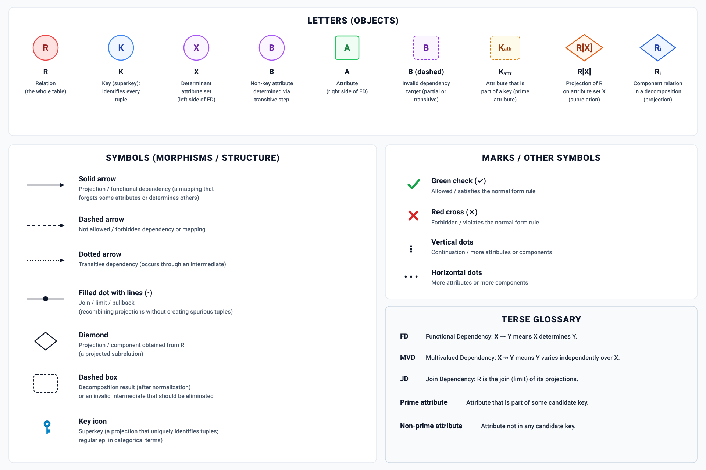

# Concrete Worked Examples & Executable Python Suite

**AuthorityEffect:** `None` (`certified_implies_authorized: false`)  
**[⬅ Back to Wiki Home](Home)**



---

## 1. Running the Standalone Python Verifier & Examples

All examples and contract validators live in the standalone `normal_forms/` Python package and `contracts/` directory:

```bash
# 1. Validate all 112 YAML normal form contracts against standard.yaml
python -m normal_forms.catalog

# 2. Run Demo 01: BQNF Incremental Revenue Repair on CDC Events
python -m normal_forms.paid_revenue_example

# 3. Run Demo 02: Unverified Certificate Refusal Gate
python -m normal_forms.unverified_certificate_example

# 4. Run Demo 03: Observer-Relative Freshness SLA Poset Evaluation
python -m normal_forms.observer_freshness_example

# 5. Run Cross-Domain Reconciliation & Loss Ledger Example
python -m normal_forms.reconciliation_example

# 6. Run Demo 05: 4-Hop Composition (3NF/BCNF -> Extrema & Quantile Cochains -> CODA_MUR -> Observer Poset)
python -m normal_forms.multi_hop_composition
```

---

## 2. Example A: Classical `0NF` $\to$ `1NF` Flattening & `5NF` Consulting Witness (`NormalFormsEvaluator`)

```python
from normal_forms import NormalFormsEvaluator

with NormalFormsEvaluator() as ev:
    # 1. Flatten repeating CSV groups (0NF -> 1NF)
    rows_1nf = ev.normalize_0nf_to_1nf([
        (1, "Alice", "Math,Physics"),
        (2, "Bob", "Chemistry"),
    ])
    print("1NF rows:", rows_1nf)

    # 2. Check 5NF Project-Join witness (Shell2 EXCEPT Fill2)
    witness = ev.evaluate_5nf_project_join_integrity([
        ("Alice", "Acme", "Widget"),
        ("Alice", "Globex", "Gadget"),
        ("Bob", "Acme", "Gadget"),
        ("Alice", "Acme", "Gadget"),  # closes the 3-way cycle
    ])
    print("5NF witness:", witness)
```

---

## 3. Example B: `3NF` Bernstein Synthesis vs `BCNF` (`normal_forms.domain`)

Consider the classic `Address(street, city, zip)` schema (Date & Darwen's `street_journal_title` isomorphism) with functional dependencies $\{(\text{street}, \text{city}) \to \text{zip},\; \text{zip} \to \text{city}\}:$

- Candidate keys: $\{(\text{street}, \text{city}),\; (\text{street}, \text{zip})\}$.
- Every attribute (`street`, `city`, `zip`) is **prime** (belongs to at least one candidate key).
- Therefore, `Address` **passes [`3NF`](nf.classical.3nf)** ($\text{zip} \to \text{city}$ has a prime dependent `city`), but **fails [`BCNF`](nf.classical.bcnf)** because determinant `zip` is not a superkey!
- Decomposing into $R_1(\text{zip}, \text{city})$ and $R_2(\text{street}, \text{zip})$ achieves [`BCNF`](nf.classical.bcnf) losslessly by Heath's Theorem, while illustrating why `BCNF` does not always preserve all original functional dependencies within single tables.

```python
from normal_forms.domain import (
    street_journal_title,
    street_journal_title_passes_third_and_fails_boyce_codd,
)

print("Passes 3NF and fails BCNF:", street_journal_title_passes_third_and_fails_boyce_codd())
```

---

## 4. Example C: `BQNF` Change Data Capture Incremental Repair ([`nf.change.bqnf`](nf.change.bqnf))

Given base relation `Orders(order_id, customer_id, status, amount, updated_at)` and boundary view:

```sql
SELECT customer_id, SUM(amount) AS paid_revenue
FROM Orders
WHERE status = 'paid'
GROUP BY customer_id;
```

| Case | CDC Event | Defect Class in $Q^1$ | Terminal Route | Output Repair / Reason |
| :--- | :--- | :--- | :--- | :--- |
| **1. Pending $\to$ Paid** | `old: {status: 'pending', amount: 100}` $\to$ `new: {status: 'paid', amount: 120}` | `[0]` (Exact Coboundary) | `Repair` | `{customer_id: 7, delta_revenue: +120.0}` |
| **2. Paid Amount Update** | `old: {status: 'paid', amount: 100}` $\to$ `new: {status: 'paid', amount: 120}` | `[0]` (Exact Coboundary) | `Repair` | `{customer_id: 7, delta_revenue: +20.0}` |
| **3. Paid $\to$ Pending** | `old: {status: 'paid', amount: 100}` $\to$ `new: {status: 'pending', amount: 100}` | `[0]` (Exact Coboundary) | `Repair` | `{customer_id: 7, delta_revenue: -100.0}` |
| **4. Timestamp Only** | `updated_at` changed; `status`, `amount`, `customer_id` unchanged | `[0]` (Zero Defect) | `Preserve` | No boundary columns modified |
| **5. Missing Evidence** | `old` / `new` missing `status` and `amount` | `[NonZero - MissingEvidence]` | `Invalidate` | Fails closed when CDC before/after image is incomplete |
| **6. Unsupported Extremum** | `MAX(amount)` boundary without auxiliary extremum cochain | `[NonZero - LimitOfSubstrate]` | `Unsupported` | Requires priority-queue cochain or partition recomputation |

---

## 5. Example D: 4-Hop Composition (`3NF`/`BCNF` $\to$ Extrema & $\epsilon$-Quantile Cochains $\to$ `CODA_MUR` $\to$ Observer Poset)

`normal_forms/multi_hop_composition.py` chains four normal-form domains end to end:

1. **Hop 1 (`3NF` / `BCNF` Relational Synthesis):** Decomposes `Sales(sale_id, customer_id, customer_zip, region, amount, audit_nonce)` via Bernstein `3NF` synthesis and Tsou-Fischer `BCNF` tree decomposition, verifying lossless join reconstruction.
2. **Hop 2b (Non-Invertible `MIN`/`MAX` Priority-Queue Cochains + Dynamic $\epsilon$-`BQNF` Quantile Sketches over Composite Keys):** Streams `INSERT`/`UPDATE`/`DELETE` CDC operations through `NormalFormsEvaluator` (`normal_forms/bqnf_extrema.py`, `normal_forms/bqnf_repair.py`, `normal_forms/sales_cochain.py`), supporting canonical multi-column composite grouping keys (`encode_composite_group_key`, e.g., `("region", "channel")` or `("region", "channel", "tier")`). Repairs destructive `MIN`/`MAX` deletions in $O(\log K)$ via `region_extremum_cochain` (or routes to bounded partition `Recompute` when disabled) and repairs regional medians within tolerance $\epsilon$ via `region_quantile_cochain`. When `dynamic_buckets=True`, `rebalance_quantile_cochain` recursively bisects overloaded buckets (`count > split_threshold`) down to `min_bucket_width` in dense power-law heads and coalesces under-populated dyadic sibling/cousin sub-buckets (`combined count <= merge_threshold`) bottom-up during stream drains, while `verify_quantile_cochain_invariants` checks mass conservation, disjoint ordering, and exact point-to-bucket membership.
3. **Hop 3 (`CODA_MUR` Representation Transport [`nf.coda.mur.transport`](nf.coda.mur.transport)):** Projects across multi-hop target schemas with cryptographically sealed `LossLedger` bookings (`coda_mur.unmapped_field_drop`), authenticated target verifiers, and commutation square checks $D_{\text{target}}(F(r)) = \bar{F}(D_{\text{source}}(r))$.
4. **Hop 4 (Observer-Relative Freshness Poset [`nf.epistemic.freshness`](nf.epistemic.freshness) & Watermarked Out-of-Order Streams):** Evaluates the transported packet across a stringency-ordered observer poset chain $O_1 \le O_2 \le \dots \le O_m$, checking upward admissibility monotonicity ($O_i \text{ fresh} \implies O_{i+1} \text{ fresh}$), lag-shift anti-monotonicity ($\ell_1 \le \ell_2 \implies \text{Admitted}(\ell_2) \subseteq \text{Admitted}(\ell_1)$), and fail-closed scope/SLA enforcement. Under `evaluate_watermarked_cdc_stream_with_observer_poset` (`WatermarkSpec`), out-of-order late-arriving CDC events within the watermark horizon ($W_k \le t_{\text{event}}(e_k) < E_{\max}^{(k-1)}$) retroactively split or merge historical quantile buckets in `region_quantile_cochain` while shifting effective replica lag across observer poset SLA thresholds, whereas events falling behind the advancing watermark ($t_{\text{event}}(e_k) < W_k$) fail closed (`LateEventExceedsWatermark` $\to$ `Invalidate`) or route to `WatermarkedQuarantine`.

---

## 6. Epistemic Claim Hygiene Quadrant

1. **What it supports:**
   - Demonstrates in this toy setting that the Python evaluators reproduce the declared terminal routes for `0NF`–`5NF`, `BQNF` additive and cochain-backed extrema/quantile repair, `CODA_MUR` representation transport, and observer-relative freshness posets.
2. **What it does not support:**
   - Does not substitute for production database concurrency control or physical distributed consensus.
3. **The narrowest defensible claim:**
   - Each worked example and multi-hop property test executes deterministically against the fixtures and randomized schemas in `tests/` with `AuthorityEffect: None`.
4. **The next test needed:**
   - Concurrent multi-writer transaction interleaving over persistent disk-backed SQLite WAL journals.
