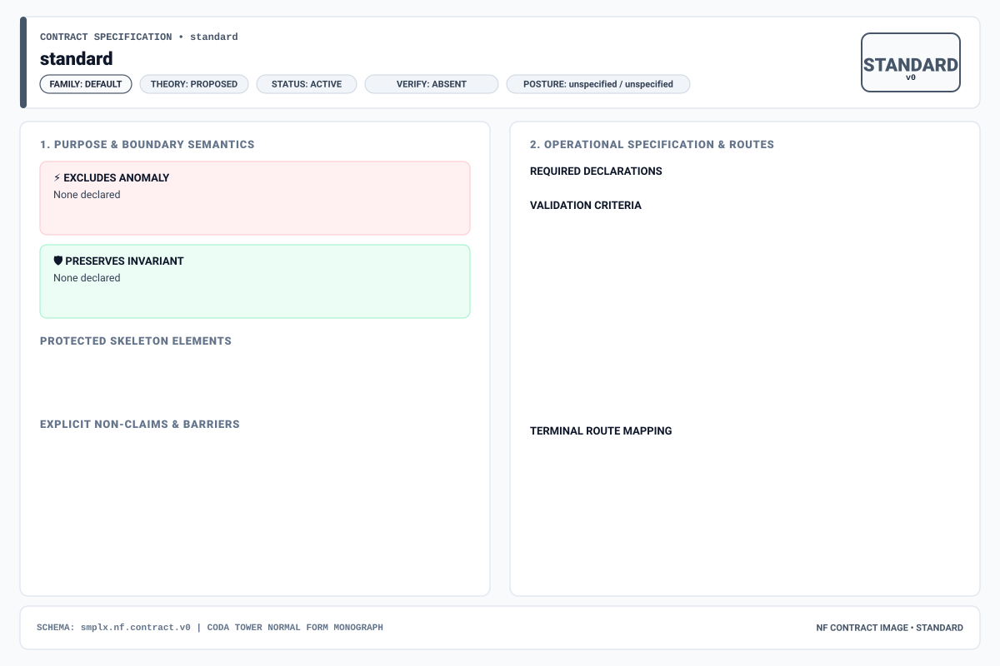
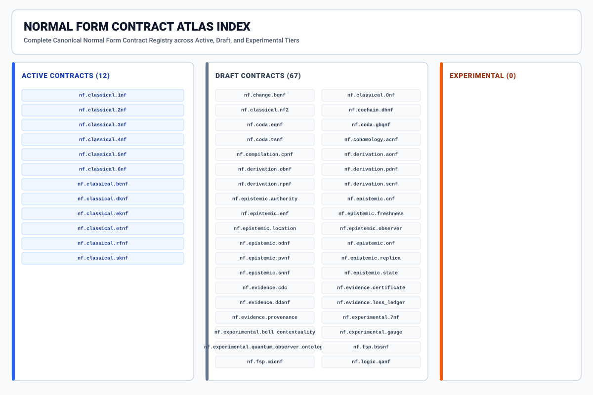

# Simplex Normal Forms: Boundary-Certified Data Architecture & Cochain Catalog

**AuthorityEffect:** `None` (`certified_implies_authorized: false`)  
**Total Canonical Normal Form Contracts:** **112** (each with its own dedicated Wiki treatise and visual SVG diagram)

---

## 1. Overview & Architectural Regimes

**Simplex Normal Forms** unifies classical relational database normalization (Codd, Boyce, Fagin, Date, Darwen) with post-Codd operational regimes: **data in motion** (Boundary-Quotient Normal Form / `BQNF`), **data in representation** (`GNF`, `CODA_MUR` representation transport, `CpNF` compilation), **data under observation** (Epistemic & Observer-Relative Normal Forms), and **simplicial, cochain, and physical substrates** (`TSNF`, `DHNF`, `ZFNF`, Regge calculus, and Fermion Sign Problem normal forms).

> **Nomenclature Note (`CODA_MUR`):** Legacy references to `CODA_MUR` have been retired across the estate. Representation transport is governed by **`CODA_MUR`** ([`nf.coda.mur.transport`](nf.coda.mur.transport)), where updates commute with representation changes up to a sealed **Loss Ledger** (`coda_mur.unmapped_field_drop`).

| Regime | Core Question | Canonical Normal Forms |
| :--- | :--- | :--- |
| **1. Data at Rest** | Does the stored schema eliminate redundancy and reconstruct losslessly? | [`nf.classical.0nf`](nf.classical.0nf), [`nf.classical.1nf`](nf.classical.1nf), [`nf.classical.2nf`](nf.classical.2nf), [`nf.classical.3nf`](nf.classical.3nf), [`nf.classical.eknf`](nf.classical.eknf), [`nf.classical.bcnf`](nf.classical.bcnf), [`nf.classical.4nf`](nf.classical.4nf), [`nf.classical.etnf`](nf.classical.etnf), [`nf.classical.rfnf`](nf.classical.rfnf), [`nf.classical.sknf`](nf.classical.sknf), [`nf.classical.5nf`](nf.classical.5nf), [`nf.classical.6nf`](nf.classical.6nf), [`nf.classical.dknf`](nf.classical.dknf), [`nf.classical.nf2`](nf.classical.nf2) |
| **2. Data in Motion** | Does a streaming write event (`INSERT`/`UPDATE`/`DELETE`) admit an exact $O(1)$ local coboundary repair $\omega = d^0\alpha$? | [`nf.change.bqnf`](nf.change.bqnf), [`nf.coda.gbqnf`](nf.coda.gbqnf), [`nf.change.bqnf.fermion_sign`](nf.change.bqnf.fermion_sign), [`nf.change.rational_quotient`](nf.change.rational_quotient), [`nf.change.sign_switching`](nf.change.sign_switching), [`nf.evidence.cdc`](nf.evidence.cdc) |
| **3. Data in Representation** | Do updates commute with representation translation $F: \text{Rep}_A \to \text{Rep}_B$ up to declared loss? | [`nf.coda.mur.transport`](nf.coda.mur.transport) (`CODA_MUR`), [`nf.representation.gnf`](nf.representation.gnf), [`nf.compilation.cpnf`](nf.compilation.cpnf), [`nf.representation.tbnf`](nf.representation.tbnf), [`nf.representation.dbcnf`](nf.representation.dbcnf), [`nf.fsp.bssnf`](nf.fsp.bssnf), [`nf.fsp.micnf`](nf.fsp.micnf) |
| **4. Data under Observation** | Is a claim fresh, provenance-chained, and distinguishable relative to the reading observer $O_i$? | [`nf.epistemic.authority`](nf.epistemic.authority), [`nf.epistemic.freshness`](nf.epistemic.freshness), [`nf.epistemic.observer`](nf.epistemic.observer), [`nf.coda.eqnf`](nf.coda.eqnf), [`nf.epistemic.odnf`](nf.epistemic.odnf), [`nf.epistemic.nar_nf`](nf.epistemic.nar_nf), [`nf.ddc.terminal_partition`](nf.ddc.terminal_partition) |
| **5. Cochain, Topological & Physics Substrate** | Does the discrete complex satisfy $\partial^2 = 0$, orthogonal Hodge decomposition, exact rational duality ($\text{gap} = 0$), and Bianchi/Regge closure? | [`nf.coda.tsnf`](nf.coda.tsnf), [`nf.cochain.dhnf`](nf.cochain.dhnf), [`nf.ddc.hodge_canonical`](nf.ddc.hodge_canonical), [`nf.runtime.zfnf`](nf.runtime.zfnf), [`nf.ddc.dual_witness`](nf.ddc.dual_witness), [`nf.physics.bianchi_regge`](nf.physics.bianchi_regge), [`nf.physics.schlafli_regge`](nf.physics.schlafli_regge), [`nf.physics.lorentzian_cdt`](nf.physics.lorentzian_cdt), [`nf.physics.wdw`](nf.physics.wdw), [`nf.physics.page_wootters`](nf.physics.page_wootters) |

---

## 2. Foundational Wiki Guides

1. **[Theory and Cochain Substrate](Theory-and-Cochain-Substrate)** — The Four-Pillar Quadrilateral, Heath/Fagin/Rissanen theorems, BQNF homological sequence $Q^1 = C^1/\operatorname{im}(d^0)$, priority-queue extrema cochains, $\epsilon$-BQNF quantile sketches, and `CODA_MUR` descent compatibility.
2. **[Observer-Relative Ontology](Observer-Relative-Ontology)** — The Table–Relation–Relvar–Boundary-Relvar triad, observer poset monotonicity, `EQNF`, `ODNF`, and the strict governance wall (`certified_implies_authorized: false`).
3. **[Concrete Worked Examples](Concrete-Examples)** — Step-by-step SQL, JSON, and Python execution walkthroughs (`NormalFormsEvaluator`, `BqnfValidator`, 0NF$\to$1NF, 3NF Bernstein synthesis, 5NF consulting witness, BQNF CDC repair, and `CODA_MUR` transport).
4. **[Relational Geometrodynamics and Physics Substrate](Relational-Geometrodynamics-and-Physics-Substrate)** — Discrete Regge calculus, Cayley-Menger metric positivity, Schläfli identity, Lorentzian CDT foliation, Wheeler-DeWitt, Page-Wootters relational time, and Fermion Sign Problem normal forms.

---

## 3. Master Architectural Diagrams

| Boundary-Quotient Normal Form (`BQNF`) | Observer-Relative Ontology |
| :---: | :---: |
|  |  |

| Four-Pillar Standard (`standard.yaml`) | Catalog Overview (`index.yaml`) |
| :---: | :---: |
|  |  |

---

## 4. Complete Directory of All 112 Normal Forms (One Page Per Normal Form)

Every Normal Form below links to its dedicated Wiki page containing prose explanations, its custom SVG visual diagram, worked examples, Four-Pillar Quadrilateral specification, terminal routing table, and canonical YAML contract.

### `shape` — Relational, Algebraic & Cochain Shape Normal Forms (Data at Rest & Structural Decompositions) (17 contracts)

| Wiki Page & Diagram | Short Name | Full Name | Status | Qualification |
| :--- | :--- | :--- | :--- | :--- |
| **[`nf.classical.0nf`](nf.classical.0nf)** ([SVG](images/nf.classical.0nf.svg)) | `0NF` | Raw / Unnormalized Form | `draft` | Extended Form |
| **[`nf.classical.1nf`](nf.classical.1nf)** ([SVG](images/nf.classical.1nf.svg)) | `1NF` | Atomic Domain First Normal Form | `active` | Extended Form |
| **[`nf.classical.2nf`](nf.classical.2nf)** ([SVG](images/nf.classical.2nf.svg)) | `2NF` | Full Functional Dependency Second Normal Form | `active` | Extended Form |
| **[`nf.classical.3nf`](nf.classical.3nf)** ([SVG](images/nf.classical.3nf.svg)) | `3NF` | Third Normal Form | `active` | Extended Form |
| **[`nf.classical.4nf`](nf.classical.4nf)** ([SVG](images/nf.classical.4nf.svg)) | `4NF` | Multivalued Dependency Fourth Normal Form | `active` | Extended Form |
| **[`nf.classical.5nf`](nf.classical.5nf)** ([SVG](images/nf.classical.5nf.svg)) | `5NF` | Project-Join Normal Form / Fifth Normal Form | `active` | Extended Form |
| **[`nf.classical.6nf`](nf.classical.6nf)** ([SVG](images/nf.classical.6nf.svg)) | `6NF` | Sixth Normal Form | `active` | Extended Form |
| **[`nf.classical.bcnf`](nf.classical.bcnf)** ([SVG](images/nf.classical.bcnf.svg)) | `BCNF` | Boyce-Codd Normal Form | `active` | Extended Form |
| **[`nf.classical.dknf`](nf.classical.dknf)** ([SVG](images/nf.classical.dknf.svg)) | `DKNF` | Domain-Key Normal Form | `active` | Extended Form |
| **[`nf.classical.eknf`](nf.classical.eknf)** ([SVG](images/nf.classical.eknf.svg)) | `EKNF` | Elementary Key Normal Form | `active` | Extended Form |
| **[`nf.classical.etnf`](nf.classical.etnf)** ([SVG](images/nf.classical.etnf.svg)) | `ETNF` | Essential Tuple Normal Form | `active` | Extended Form |
| **[`nf.classical.nf2`](nf.classical.nf2)** ([SVG](images/nf.classical.nf2.svg)) | `NF2` | Non-First Normal Form Nested Relation Form | `draft` | Extended Form |
| **[`nf.classical.rfnf`](nf.classical.rfnf)** ([SVG](images/nf.classical.rfnf.svg)) | `RFNF` | Redundancy-Free Normal Form / Key-Component Normal Form | `active` | Extended Form |
| **[`nf.classical.sknf`](nf.classical.sknf)** ([SVG](images/nf.classical.sknf.svg)) | `SKNF` | Superkey Normal Form / Fifth Normal Form Restricted | `active` | Extended Form |
| **[`nf.cochain.dhnf`](nf.cochain.dhnf)** ([SVG](images/nf.cochain.dhnf.svg)) | `DHNF` | Discrete Hodge Normal Form | `draft` | Extended Form |
| **[`nf.ddc.hodge_canonical`](nf.ddc.hodge_canonical)** ([SVG](images/nf.ddc.hodge_canonical.svg)) | `HCNF` | Hodge Canonical Normal Form | `active` | Extended Form |
| **[`nf.mssn`](nf.mssn)** ([SVG](images/nf.mssn.svg)) | `MSSNF` | Minimal Symbol System Normal Form | `draft` | Extended Form |

### `change` — Data in Motion & Boundary-Quotient Incremental Maintenance Contracts (BQNF & Cochain Repair) (6 contracts)

| Wiki Page & Diagram | Short Name | Full Name | Status | Qualification |
| :--- | :--- | :--- | :--- | :--- |
| **[`nf.change.bqnf`](nf.change.bqnf)** ([SVG](images/nf.change.bqnf.svg)) | `BQNF` | Boundary-Quotient Normal Form | `draft` | Extended Form |
| **[`nf.change.bqnf.fermion_sign`](nf.change.bqnf.fermion_sign)** ([SVG](images/nf.change.bqnf.fermion_sign.svg)) | `BQNF-FSIGN` | Boundary-Quotient Normal Form Instance for the Fermion Sign Problem | `active` | Extended Form |
| **[`nf.change.rational_quotient`](nf.change.rational_quotient)** ([SVG](images/nf.change.rational_quotient.svg)) | `RATIONAL_QUOTIENT` | Rational cochain quotient section | `active` | Extended Form |
| **[`nf.change.sign_switching`](nf.change.sign_switching)** ([SVG](images/nf.change.sign_switching.svg)) | `SIGN_SWITCHING` | Binary graph sign switching section | `active` | Extended Form |
| **[`nf.coda.gbqnf`](nf.coda.gbqnf)** ([SVG](images/nf.coda.gbqnf.svg)) | `GBQNF` | Generalized Boundary-Quotient Normal Form | `draft` | Extended Form |
| **[`nf.mssn.bqnf`](nf.mssn.bqnf)** ([SVG](images/nf.mssn.bqnf.svg)) | `MSSN-BQNF` | MSS-N Boundary-Quotient Normal Form | `draft` | Extended Form |

### `coda` — CODA Foundational Quotient, Representation Transport (`CODA_MUR`) & Proof-Fact Contracts (2 contracts)

| Wiki Page & Diagram | Short Name | Full Name | Status | Qualification |
| :--- | :--- | :--- | :--- | :--- |
| **[`nf.coda.mur.transport`](nf.coda.mur.transport)** ([SVG](images/nf.coda.mur.transport.svg)) | `coda_mur` | CODA-MUR Representation Transport Contract | `draft` | Extended Form |
| **[`nf.pfp.pfnf`](nf.pfp.pfnf)** ([SVG](images/nf.pfp.pfnf.svg)) | `PFNF` | Proposal Fidelity Normal Form | `draft` | Extended Form |

### `representation` — Data in Representation, Canonical Wire Grammars, Orbit Representatives & Gauge Fixing (5 contracts)

| Wiki Page & Diagram | Short Name | Full Name | Status | Qualification |
| :--- | :--- | :--- | :--- | :--- |
| **[`nf.fsp.bssnf`](nf.fsp.bssnf)** ([SVG](images/nf.fsp.bssnf.svg)) | `BSS-NF` | Binary Sign-Switching Normal Form | `draft` | Extended Form |
| **[`nf.fsp.micnf`](nf.fsp.micnf)** ([SVG](images/nf.fsp.micnf.svg)) | `MIC-NF` | Meron Involutive Cancellation Normal Form | `draft` | Extended Form |
| **[`nf.physics.bqnf_fsign`](nf.physics.bqnf_fsign)** ([SVG](images/nf.physics.bqnf_fsign.svg)) | `BQNF-FSIGN` | Fermion Sign Problem Boundary-Quotient Normal Form | `draft` | Extended Form |
| **[`nf.representation.dbcnf`](nf.representation.dbcnf)** ([SVG](images/nf.representation.dbcnf.svg)) | `DBCNF` | De Bruijn Cyclic Normal Form | `draft` | Extended Form |
| **[`nf.representation.tbnf`](nf.representation.tbnf)** ([SVG](images/nf.representation.tbnf.svg)) | `TBNF` | Token-Bounded Normal Form | `draft` | Extended Form |

### `transport` — Scale Ascent/Descent & Representation Transport Ledgers (`LNLF`, `LLNF`, `GNF`) (3 contracts)

| Wiki Page & Diagram | Short Name | Full Name | Status | Qualification |
| :--- | :--- | :--- | :--- | :--- |
| **[`nf.ddc.lift_ledger`](nf.ddc.lift_ledger)** ([SVG](images/nf.ddc.lift_ledger.svg)) | `LNLF` | Lift Ledger Normal Form | `active` | Extended Form |
| **[`nf.ddc.loss_ledger`](nf.ddc.loss_ledger)** ([SVG](images/nf.ddc.loss_ledger.svg)) | `LLNF` | Loss Ledger Normal Form | `active` | Extended Form |
| **[`nf.representation.gnf`](nf.representation.gnf)** ([SVG](images/nf.representation.gnf.svg)) | `GNF` | Gauge Normal Form | `draft` | Extended Form |

### `compilation` — Compilation & Query Lowering Preservation Contracts (`CpNF`) (1 contracts)

| Wiki Page & Diagram | Short Name | Full Name | Status | Qualification |
| :--- | :--- | :--- | :--- | :--- |
| **[`nf.compilation.cpnf`](nf.compilation.cpnf)** ([SVG](images/nf.compilation.cpnf.svg)) | `CpNF` | Compilation Normal Form | `draft` | Extended Form |

### `epistemic` — Observer-Relative Epistemic, Freshness, Context, Provenance & Distinguishability Contracts (15 contracts)

| Wiki Page & Diagram | Short Name | Full Name | Status | Qualification |
| :--- | :--- | :--- | :--- | :--- |
| **[`nf.coda.eqnf`](nf.coda.eqnf)** ([SVG](images/nf.coda.eqnf.svg)) | `EQNF` | Epistemic Quotient Normal Form | `draft` | Extended Form |
| **[`nf.epistemic.authority`](nf.epistemic.authority)** ([SVG](images/nf.epistemic.authority.svg)) | `ANF` | Authority Normal Form | `draft` | Extended Form |
| **[`nf.epistemic.cnf`](nf.epistemic.cnf)** ([SVG](images/nf.epistemic.cnf.svg)) | `CNF` | Context Normal Form | `draft` | Extended Form |
| **[`nf.epistemic.efnf`](nf.epistemic.efnf)** ([SVG](images/nf.epistemic.efnf.svg)) | `EFNF` | Endogenous Fidelity Normal Form | `draft` | Extended Form |
| **[`nf.epistemic.enf`](nf.epistemic.enf)** ([SVG](images/nf.epistemic.enf.svg)) | `ENF` | Epistemic Normal Form | `draft` | Extended Form |
| **[`nf.epistemic.freshness`](nf.epistemic.freshness)** ([SVG](images/nf.epistemic.freshness.svg)) | `FNF` | Freshness Normal Form | `draft` | Extended Form |
| **[`nf.epistemic.location`](nf.epistemic.location)** ([SVG](images/nf.epistemic.location.svg)) | `LNF` | Location Normal Form | `draft` | Extended Form |
| **[`nf.epistemic.nar_nf`](nf.epistemic.nar_nf)** ([SVG](images/nf.epistemic.nar_nf.svg)) | `NAR-NF` | Non-Authoritative Realization Normal Form | `draft` | Extended Form |
| **[`nf.epistemic.observer`](nf.epistemic.observer)** ([SVG](images/nf.epistemic.observer.svg)) | `ObsNF` | Observer Normal Form | `draft` | Extended Form |
| **[`nf.epistemic.odnf`](nf.epistemic.odnf)** ([SVG](images/nf.epistemic.odnf.svg)) | `ODNF` | Observer Distinguishability Normal Form | `draft` | Extended Form |
| **[`nf.epistemic.onf`](nf.epistemic.onf)** ([SVG](images/nf.epistemic.onf.svg)) | `ONF` | Orchestration Normal Form | `draft` | Extended Form |
| **[`nf.epistemic.pvnf`](nf.epistemic.pvnf)** ([SVG](images/nf.epistemic.pvnf.svg)) | `PvNF` | Provenance Normal Form | `draft` | Extended Form |
| **[`nf.epistemic.replica`](nf.epistemic.replica)** ([SVG](images/nf.epistemic.replica.svg)) | `RNF` | Replica Normal Form | `draft` | Extended Form |
| **[`nf.epistemic.snnf`](nf.epistemic.snnf)** ([SVG](images/nf.epistemic.snnf.svg)) | `SnNF` | Stripe Normal Form | `draft` | Extended Form |
| **[`nf.epistemic.state`](nf.epistemic.state)** ([SVG](images/nf.epistemic.state.svg)) | `StNF` | State Normal Form | `draft` | Extended Form |

### `authority` — Terminal Partition & Authority Boundary Contracts (`TPNF`) (1 contracts)

| Wiki Page & Diagram | Short Name | Full Name | Status | Qualification |
| :--- | :--- | :--- | :--- | :--- |
| **[`nf.ddc.terminal_partition`](nf.ddc.terminal_partition)** ([SVG](images/nf.ddc.terminal_partition.svg)) | `TPNF` | Terminal Partition Normal Form | `active` | Extended Form |

### `evidence` — Cryptographic Receipts, Dual Witnesses, Loss Ledgers, CDC Logs & Schema Totality (8 contracts)

| Wiki Page & Diagram | Short Name | Full Name | Status | Qualification |
| :--- | :--- | :--- | :--- | :--- |
| **[`nf.ddc.dual_witness`](nf.ddc.dual_witness)** ([SVG](images/nf.ddc.dual_witness.svg)) | `DWNF` | Dual Witness Normal Form | `active` | Extended Form |
| **[`nf.ddc.refusal_receipt`](nf.ddc.refusal_receipt)** ([SVG](images/nf.ddc.refusal_receipt.svg)) | `RRNF` | Refusal Receipt Normal Form | `active` | Extended Form |
| **[`nf.evidence.cdc`](nf.evidence.cdc)** ([SVG](images/nf.evidence.cdc.svg)) | `CDCEF` | CDC Evidence Form | `draft` | Extended Form |
| **[`nf.evidence.certificate`](nf.evidence.certificate)** ([SVG](images/nf.evidence.certificate.svg)) | `CertF` | Certificate Form | `draft` | Extended Form |
| **[`nf.evidence.ddanf`](nf.evidence.ddanf)** ([SVG](images/nf.evidence.ddanf.svg)) | `DDANF` | Deterministic Data-Flow Architecture Normal Form | `draft` | Extended Form |
| **[`nf.evidence.loss_ledger`](nf.evidence.loss_ledger)** ([SVG](images/nf.evidence.loss_ledger.svg)) | `LLF` | Loss Ledger Form | `draft` | Extended Form |
| **[`nf.evidence.provenance`](nf.evidence.provenance)** ([SVG](images/nf.evidence.provenance.svg)) | `ProvF` | Provenance Form | `draft` | Extended Form |
| **[`nf.operational.schema-totality`](nf.operational.schema-totality)** ([SVG](images/nf.operational.schema-totality.svg)) | `SQL-TOTAL` | Declared SQL Key Projection and Candidate Totality Profile | `active` | Extended Form |

### `derivation` — MSS-N Tower Algebraic Derivation, Split Extension-Retraction & Obstruction Contracts (12 contracts)

| Wiki Page & Diagram | Short Name | Full Name | Status | Qualification |
| :--- | :--- | :--- | :--- | :--- |
| **[`nf.derivation.aonf`](nf.derivation.aonf)** ([SVG](images/nf.derivation.aonf.svg)) | `AONF` | Active Obstruction Normal Form | `draft` | Extended Form |
| **[`nf.derivation.apnf`](nf.derivation.apnf)** ([SVG](images/nf.derivation.apnf.svg)) | `APNF` | Constructive Apartness Normal Form | `draft` | Extended Form |
| **[`nf.derivation.ignf`](nf.derivation.ignf)** ([SVG](images/nf.derivation.ignf.svg)) | `IGNF` | Isomorphism Gauge Normal Form | `draft` | Extended Form |
| **[`nf.derivation.irnf`](nf.derivation.irnf)** ([SVG](images/nf.derivation.irnf.svg)) | `IRNF` | Integer Ray Normal Form | `draft` | Extended Form |
| **[`nf.derivation.lsnf`](nf.derivation.lsnf)** ([SVG](images/nf.derivation.lsnf.svg)) | `LSNF` | Lawful Skeletal Filtration Normal Form | `draft` | Extended Form |
| **[`nf.derivation.obnf`](nf.derivation.obnf)** ([SVG](images/nf.derivation.obnf.svg)) | `OBNF` | Obstruction Relativization Normal Form | `draft` | Extended Form |
| **[`nf.derivation.pdnf`](nf.derivation.pdnf)** ([SVG](images/nf.derivation.pdnf.svg)) | `PDNF` | Primitive Difference Normal Form | `draft` | Extended Form |
| **[`nf.derivation.rpnf`](nf.derivation.rpnf)** ([SVG](images/nf.derivation.rpnf.svg)) | `RPNF` | Replay Provenance Normal Form | `draft` | Extended Form |
| **[`nf.derivation.scnf`](nf.derivation.scnf)** ([SVG](images/nf.derivation.scnf.svg)) | `SCNF` | Separation Cost Normal Form | `draft` | Extended Form |
| **[`nf.derivation.sernf`](nf.derivation.sernf)** ([SVG](images/nf.derivation.sernf.svg)) | `SERNF` | Split Extension-Retraction Normal Form | `draft` | Extended Form |
| **[`nf.ontology.ainf`](nf.ontology.ainf)** ([SVG](images/nf.ontology.ainf.svg)) | `AINF` | Adjoint-Invariant Normal Form | `draft` | Extended Form |
| **[`nf.wdp.wdnf`](nf.wdp.wdnf)** ([SVG](images/nf.wdp.wdnf.svg)) | `WDNF` | Witnessed Difference Normal Form | `draft` | Extended Form |

### `topology` — Simplicial Complexes, Boundary Nilpotency & Context Boundary Purity (`TSNF`, `CBNF`) (2 contracts)

| Wiki Page & Diagram | Short Name | Full Name | Status | Qualification |
| :--- | :--- | :--- | :--- | :--- |
| **[`nf.coda.tsnf`](nf.coda.tsnf)** ([SVG](images/nf.coda.tsnf.svg)) | `TSNF` | Topological Simplex Normal Form | `draft` | Extended Form |
| **[`nf.ddc.context_boundary`](nf.ddc.context_boundary)** ([SVG](images/nf.ddc.context_boundary.svg)) | `CBNF` | Context Boundary Normal Form | `active` | Extended Form |

### `physics` — Discrete Differential Geometry, Regge Calculus, Gauge Theory, Lattice Fermions & Quantum Gravity (20 contracts)

| Wiki Page & Diagram | Short Name | Full Name | Status | Qualification |
| :--- | :--- | :--- | :--- | :--- |
| **[`nf.physics.bianchi_regge`](nf.physics.bianchi_regge)** ([SVG](images/nf.physics.bianchi_regge.svg)) | `RBNF` | Regge-Bianchi Normal Form (arXiv:1904.01966 Recovery) | `draft` | Extended Form |
| **[`nf.physics.bqnf_regge`](nf.physics.bqnf_regge)** ([SVG](images/nf.physics.bqnf_regge.svg)) | `BQNF-REGGE` | Boundary-Quotient Normal Form for Regge Geometrodynamics | `draft` | Extended Form |
| **[`nf.physics.cdt_fermion_sign`](nf.physics.cdt_fermion_sign)** ([SVG](images/nf.physics.cdt_fermion_sign.svg)) | `CDT-FSIGN-NF` | 4D CDT Fermionic Grassmann Path Integrals & BQNF Sign Normal Form | `draft` | Extended Form |
| **[`nf.physics.cdt_kd_doubling`](nf.physics.cdt_kd_doubling)** ([SVG](images/nf.physics.cdt_kd_doubling.svg)) | `CDT-KD-DOUBLING-NF` | 4D CDT Kähler-Dirac Fermion Doubling Resolution & Topological Spin Normal Form | `draft` | Extended Form |
| **[`nf.physics.cdt_matter_coupling`](nf.physics.cdt_matter_coupling)** ([SVG](images/nf.physics.cdt_matter_coupling.svg)) | `CDT-MATTER-NF` | CDT Dynamical Matter Field & Lattice Gauge Coupling Normal Form | `draft` | Extended Form |
| **[`nf.physics.cdt_overlap_fermions`](nf.physics.cdt_overlap_fermions)** ([SVG](images/nf.physics.cdt_overlap_fermions.svg)) | `CDT-OVERLAP-NF` | 4D CDT Ginsparg-Wilson & Overlap Dirac Operator Normal Form | `draft` | Extended Form |
| **[`nf.physics.cdt_spectral_dimension`](nf.physics.cdt_spectral_dimension)** ([SVG](images/nf.physics.cdt_spectral_dimension.svg)) | `CDT-SPEC-NF` | CDT Spectral Dimension & Dynamical Dimensional Reduction Normal Form | `draft` | Extended Form |
| **[`nf.physics.cdt_susy_witten`](nf.physics.cdt_susy_witten)** ([SVG](images/nf.physics.cdt_susy_witten.svg)) | `CDT-SUSY-WITTEN-NF` | 4D CDT Supersymmetric Topological Witten Index, Nicolai Map & Super-WDW Normal Form | `draft` | Extended Form |
| **[`nf.physics.cdt_topological_charge`](nf.physics.cdt_topological_charge)** ([SVG](images/nf.physics.cdt_topological_charge.svg)) | `CDT-TOPO-CHARGE-NF` | 4D CDT Topological Charge Fluctuations & Instanton Susceptibility Normal Form | `draft` | Extended Form |
| **[`nf.physics.cdt_wick_mc`](nf.physics.cdt_wick_mc)** ([SVG](images/nf.physics.cdt_wick_mc.svg)) | `CDT-WMC-NF` | Wick-Rotated Lorentzian CDT Monte Carlo Statistical Weight Sampler Contract | `draft` | Extended Form |
| **[`nf.physics.cdt_zolotarev_overlap`](nf.physics.cdt_zolotarev_overlap)** ([SVG](images/nf.physics.cdt_zolotarev_overlap.svg)) | `CDT-ZOLOTAREV-NF` | 4D CDT Rational Zolotarev & Deflated Overlap Dirac Operator Contract | `draft` | Extended Form |
| **[`nf.physics.dfnf`](nf.physics.dfnf)** ([SVG](images/nf.physics.dfnf.svg)) | `DFNF` | Dressing Field Normal Form | `draft` | Extended Form |
| **[`nf.physics.l1_constraint_closure`](nf.physics.l1_constraint_closure)** ([SVG](images/nf.physics.l1_constraint_closure.svg)) | `L1CCNF` | L1 Constraint Closure and Duality Normal Form | `draft` | Extended Form |
| **[`nf.physics.lorentzian_cdt`](nf.physics.lorentzian_cdt)** ([SVG](images/nf.physics.lorentzian_cdt.svg)) | `LCNF` | 4D Lorentzian Regge Causal Triangulation Normal Form | `draft` | Extended Form |
| **[`nf.physics.pachner_lp_scaling`](nf.physics.pachner_lp_scaling)** ([SVG](images/nf.physics.pachner_lp_scaling.svg)) | `L1PSNF` | 4D Pachner Moves and Joint LP Scaling Normal Form | `draft` | Extended Form |
| **[`nf.physics.pwnf`](nf.physics.pwnf)** ([SVG](images/nf.physics.pwnf.svg)) | `PWNF` | Page-Wootters Relational Clock Normal Form | `draft` | Extended Form |
| **[`nf.physics.rcnf`](nf.physics.rcnf)** ([SVG](images/nf.physics.rcnf.svg)) | `RCNF` | Regge Calculus Normal Form | `draft` | Extended Form |
| **[`nf.physics.rpcnf`](nf.physics.rpcnf)** ([SVG](images/nf.physics.rpcnf.svg)) | `RPCNF` | Relational Point Coincidence Normal Form | `draft` | Extended Form |
| **[`nf.physics.schlafli_nf`](nf.physics.schlafli_nf)** ([SVG](images/nf.physics.schlafli_nf.svg)) | `SIDNF` | Schläfli Differential Identity Normal Form | `draft` | Extended Form |
| **[`nf.physics.wdwnf`](nf.physics.wdwnf)** ([SVG](images/nf.physics.wdwnf.svg)) | `WDWNF` | Wheeler-DeWitt Constraint and Kernel Normal Form | `draft` | Extended Form |

### `relativistic` — Causal Lightcone Structure & Relativistic Clock Synchronization Contracts (2 contracts)

| Wiki Page & Diagram | Short Name | Full Name | Status | Qualification |
| :--- | :--- | :--- | :--- | :--- |
| **[`nf.relativistic.lightcone`](nf.relativistic.lightcone)** ([SVG](images/nf.relativistic.lightcone.svg)) | `LCNF` | Light-Cone Causality Normal Form | `draft` | Extended Form |
| **[`nf.relativistic.time_sync`](nf.relativistic.time_sync)** ([SVG](images/nf.relativistic.time_sync.svg)) | `CSNF` | Clock-Synchronization Normal Form | `draft` | Extended Form |

### `motion` — Flow Control, Horizon Emission & Lieb-Robinson Locality Bounds (3 contracts)

| Wiki Page & Diagram | Short Name | Full Name | Status | Qualification |
| :--- | :--- | :--- | :--- | :--- |
| **[`nf.motion.flow_control`](nf.motion.flow_control)** ([SVG](images/nf.motion.flow_control.svg)) | `FCNF` | Flow Control Normal Form | `draft` | Extended Form |
| **[`nf.motion.horizon_emission`](nf.motion.horizon_emission)** ([SVG](images/nf.motion.horizon_emission.svg)) | `HENF` | Horizon Emission Normal Form | `draft` | Extended Form |
| **[`nf.motion.locality_lrb`](nf.motion.locality_lrb)** ([SVG](images/nf.motion.locality_lrb.svg)) | `LRBNF` | Lieb-Robinson Locality Normal Form | `draft` | Extended Form |

### `runtime` — Exact Rational Zero-Duality-Gap Certifiers & Merkle Trace Execution Contracts (3 contracts)

| Wiki Page & Diagram | Short Name | Full Name | Status | Qualification |
| :--- | :--- | :--- | :--- | :--- |
| **[`nf.ddc.trace_merkle`](nf.ddc.trace_merkle)** ([SVG](images/nf.ddc.trace_merkle.svg)) | `TMNF` | Trace Merkle Normal Form | `active` | Extended Form |
| **[`nf.runtime.mtnf`](nf.runtime.mtnf)** ([SVG](images/nf.runtime.mtnf.svg)) | `MTNF` | Mazurkiewicz Trace Normal Form | `draft` | Extended Form |
| **[`nf.runtime.zfnf`](nf.runtime.zfnf)** ([SVG](images/nf.runtime.zfnf.svg)) | `ZFNF` | Zero-Float Rational Normal Form | `draft` | Extended Form |

### `experimental` — Bounded Quantum-Classical, Contextuality, Quantifier Alternation & Agent-State Contracts (8 contracts)

| Wiki Page & Diagram | Short Name | Full Name | Status | Qualification |
| :--- | :--- | :--- | :--- | :--- |
| **[`nf.ai.ascnf`](nf.ai.ascnf)** ([SVG](images/nf.ai.ascnf.svg)) | `ASCNF` | Agent-State Cohomology Normal Form | `draft` | Extended Form |
| **[`nf.cohomology.acnf`](nf.cohomology.acnf)** ([SVG](images/nf.cohomology.acnf.svg)) | `ACNF` | Autopoietic Cohomology Normal Form | `deprecated` | Extended Form |
| **[`nf.experimental.7nf`](nf.experimental.7nf)** ([SVG](images/nf.experimental.7nf.svg)) | `7NF` | Observer-Separable Fact Normal Form | `draft` | Extended Form |
| **[`nf.experimental.bell_contextuality`](nf.experimental.bell_contextuality)** ([SVG](images/nf.experimental.bell_contextuality.svg)) | `BellCNF` | Bell Contextuality Observer Contract | `draft` | Extended Form |
| **[`nf.experimental.gauge`](nf.experimental.gauge)** ([SVG](images/nf.experimental.gauge.svg)) | `XGauge` | Gauge Experimental Extension | `draft` | Extended Form |
| **[`nf.experimental.qm_classical`](nf.experimental.qm_classical)** ([SVG](images/nf.experimental.qm_classical.svg)) | `QCNF` | Quantum-Classical Experiment Normal Form | `active` | Extended Form |
| **[`nf.experimental.quantum_observer_ontology`](nf.experimental.quantum_observer_ontology)** ([SVG](images/nf.experimental.quantum_observer_ontology.svg)) | `QONF` | Quantum Observer-Ontology Contract | `draft` | Extended Form |
| **[`nf.logic.qanf`](nf.logic.qanf)** ([SVG](images/nf.logic.qanf.svg)) | `QANF` | Quantifier Alternation Normal Form | `draft` | Extended Form |

### `bridge` — Cross-Substrate Bridge Contracts (`WIR` to Relational Variable Lowering) (1 contracts)

| Wiki Page & Diagram | Short Name | Full Name | Status | Qualification |
| :--- | :--- | :--- | :--- | :--- |
| **[`nf.bridge.wir_relvar`](nf.bridge.wir_relvar)** ([SVG](images/nf.bridge.wir_relvar.svg)) | `WIR-Relvar Bridge` | WIR to Relvar Bridge Contract | `draft` | Extended Form |

### `query` — Relational & Cochain Query Evaluation Normal Forms (1 contracts)

| Wiki Page & Diagram | Short Name | Full Name | Status | Qualification |
| :--- | :--- | :--- | :--- | :--- |
| **[`nf.query.spja`](nf.query.spja)** ([SVG](images/nf.query.spja.svg)) | `SPJA` | Selection Projection Join Aggregate Form | `draft` | Extended Form |

### `recursion` — Autopoietic Self-Reference Refusal & Caller-Verifier Separation (`ASRF`) (1 contracts)

| Wiki Page & Diagram | Short Name | Full Name | Status | Qualification |
| :--- | :--- | :--- | :--- | :--- |
| **[`nf.recursion.asrf`](nf.recursion.asrf)** ([SVG](images/nf.recursion.asrf.svg)) | `ASRF` | Autopoietic Self-Reference Refusal Form | `draft` | Extended Form |

### `security` — Endogenous Fidelity & Security Boundary Normal Forms (1 contracts)

| Wiki Page & Diagram | Short Name | Full Name | Status | Qualification |
| :--- | :--- | :--- | :--- | :--- |
| **[`nf.security.efnf`](nf.security.efnf)** ([SVG](images/nf.security.efnf.svg)) | `EFNF` | Epistemic-Fibration Normal Form | `draft` | Extended Form |

---

## 5. Epistemic Claim Hygiene Quadrant

1. **What it supports:**
   - Supports machine-checkable schema validation, cochain defect classification, and explicit terminal routing across all 112 normal-form contracts in this repository.
2. **What it does not support:**
   - Does not grant operational authority (`AuthorityEffect: None`) or certify unmodeled external environments.
3. **The narrowest defensible claim:**
   - Every contract in `contracts/` conforms to `standard.yaml`, maps its local routes to canonical terminals, and enforces `certified_implies_authorized: false`.
4. **The next test needed:**
   - Automated cross-contract composition testing across multi-stage relational-to-cochain pipelines.
