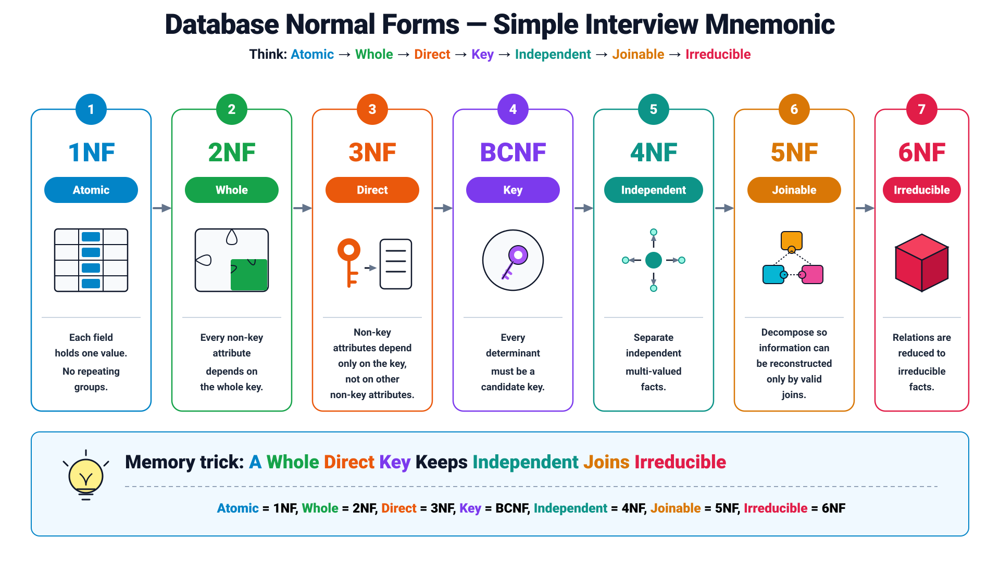
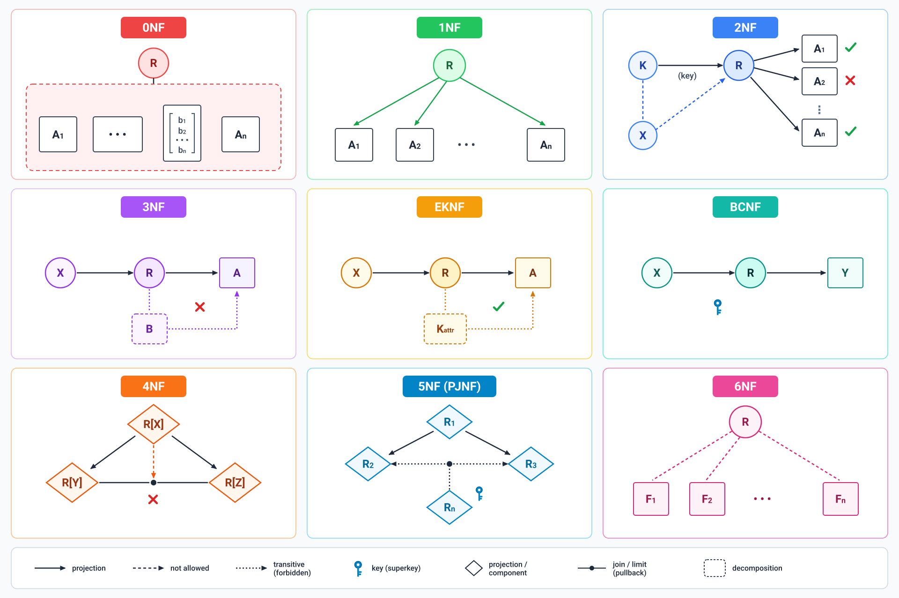
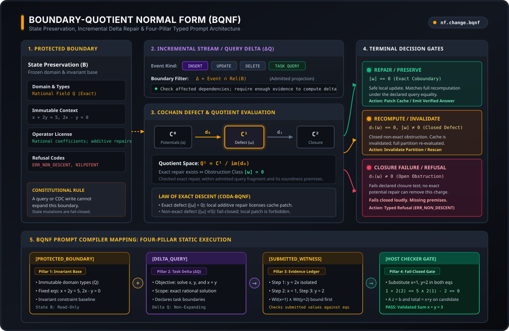
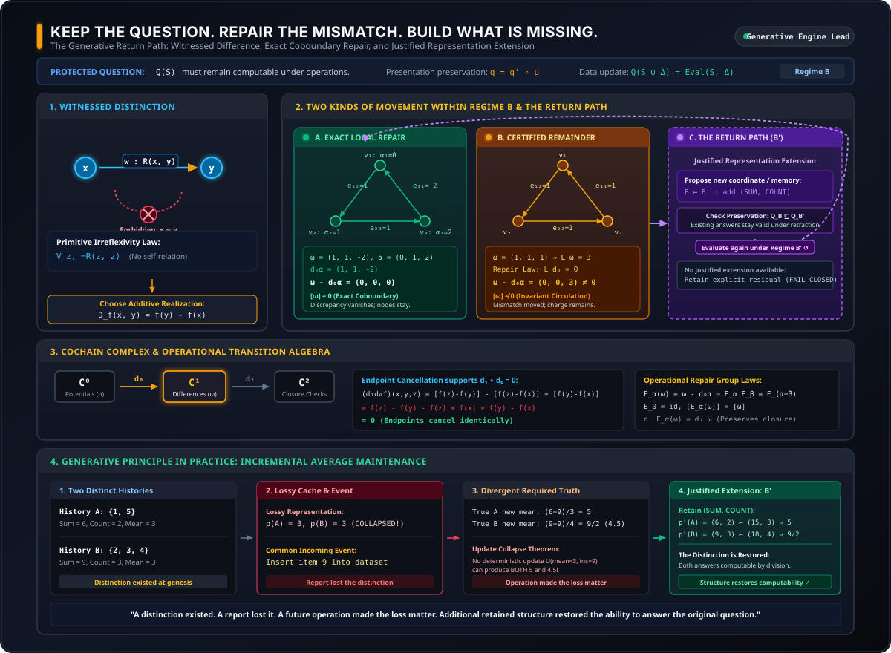

# Theory and Cochain Substrate: From Codd Relations to Boundary-Quotient Normal Forms (`BQNF` & `CODA_MUR`)

**AuthorityEffect:** `None` (`certified_implies_authorized: false`)  
**[⬅ Back to Wiki Home](Home)**

---

## 1. The Four-Pillar Quadrilateral of a Normal Form

As formalized in [`contracts/_golden_nfs/standard.yaml`](https://github.com/dbccpage/simplex-normal-forms/blob/main/contracts/_golden_nfs/standard.yaml) and [`contracts/_golden_nfs/normal_form_definitions.yaml`](https://github.com/dbccpage/simplex-normal-forms/blob/main/contracts/_golden_nfs/normal_form_definitions.yaml), a structural specification qualifies as a **True Normal Form (TNF)** when it satisfies four pillars:

1. **Pillar I — Explicit Anomaly Exclusion:** Names and eliminates a specific class of data-modification or state-transition redundancy (e.g., repeating groups in [`1NF`](nf.classical.1nf), partial-key dependence in [`2NF`](nf.classical.2nf), transitive dependence in [`3NF`](nf.classical.3nf), non-superkey determinants in [`BCNF`](nf.classical.bcnf), independent multivalued Cartesian bloat in [`4NF`](nf.classical.4nf), non-key-implied join dependencies in [`5NF`](nf.classical.5nf)).
2. **Pillar II — Lossless Reconstruction Theorem:** Establishes non-loss recovery under declared operators:
   - **Heath's Theorem (1971):** Binary projection $R = (XY, XZ)$ is lossless under functional dependencies iff $X \to Y$ or $X \to Z$.
   - **Fagin's Theorem (1977):** Binary projection $R = (XY, XZ)$ is lossless under multivalued dependencies iff $X \twoheadrightarrow Y \mid Z$.
   - **Rissanen's Theorem (1977):** $n$-ary decomposition is lossless iff the join dependency $\bowtie[R_1, \dots, R_k]$ holds.
   - **Cochain Direct Sum:** For discrete 1-cochains ([`nf.cochain.dhnf`](nf.cochain.dhnf), [`nf.ddc.hodge_canonical`](nf.ddc.hodge_canonical)), $c = d_0 p + h + d_1^* q$ reconstructs $c$ identically over $\mathbb{Q}$.
3. **Pillar III — Dependency Preservation Analysis:** Explicitly states whether the union of component dependencies implies the original dependency closure ($(\bigcup_i \pi_{R_i}(\Sigma))^+ = \Sigma^+$), as achieved by Bernstein synthesis for [`3NF`](nf.classical.3nf) and [`EKNF`](nf.classical.eknf), or whether cross-component joins are required (as can occur in [`BCNF`](nf.classical.bcnf)).
4. **Pillar IV — Syntactic Decidability from Constraints:** Conformance is decided from the declared schema $(H(R), \Sigma)$ rather than scanning a single accidental table body. Where unrestricted constraints exceed decidability ([`nf.classical.dknf`](nf.classical.dknf), [`nf.logic.qanf`](nf.logic.qanf)), bounded evaluators emit `BudgetUnknown` or `Unsupported` rather than silently guessing.

---

## 2. Data in Motion: Boundary-Quotient Normal Form ([`nf.change.bqnf`](nf.change.bqnf))

While classical normal forms govern **data at rest**, distributed caches, materialized views, and streaming pipelines operate on **data in motion** under Change Data Capture (CDC) events (`INSERT`, `UPDATE`, `DELETE`).

Over an admitted query boundary $\partial Q$, a write event induces a defect 1-cochain $\omega \in C^1$. **BQNF** evaluates the quotient class in:

$$Q^1 = C^1 / \operatorname{im}(d^0)$$

- **Zero Defect ($\omega = 0 \implies \text{Preserve}$):** Unrelated column updates outside $\partial Q$ leave the view unchanged.
- **Exact Coboundary ($\omega = d^0 \alpha \iff [\omega] = 0 \in Q^1 \implies \text{Repair}$):** The view is updated incrementally in $O(1)$ via local potential delta $\alpha$ without scanning the base table.
- **Closed Residual ($[\omega] \ne 0, d^1\omega = 0 \implies \text{Recompute} / \text{Invalidate}$):** Non-trivial cohomology defect (e.g., destructive deletion of a `MAX`/`MIN` witness without an auxiliary priority-queue cochain, or quantile drift exceeding $\epsilon$ tolerance). Routes to bounded partition recomputation.
- **Boundary Failure ($d^1\omega \ne 0$ or missing CDC evidence $\implies \text{Invalidate} / \text{ClosureFailure}$):** Fails closed when required before/after images are missing.

---

## 3. Data in Representation: `CODA_MUR` Transport ([`nf.coda.mur.transport`](nf.coda.mur.transport))

When data moves across representation boundaries $F: \operatorname{Rep}_{\text{source}} \to \operatorname{Rep}_{\text{target}}$ (e.g., relational OLTP table $\to$ document cache or search index), **`CODA_MUR`** ([`nf.coda.mur.transport`](nf.coda.mur.transport)) enforces the commutation square:

$$D_{\text{target}} \circ F = \bar{F} \circ D_{\text{source}} \oplus \operatorname{Loss}(F)$$

1. **Descent Compatibility Witness ($\chi_F$):** Verifies that applying source mutation $D_{\text{source}}$ and transporting via $\bar{F}$ agrees with transporting via $F$ and applying target mutation $D_{\text{target}}$.
2. **Sealed Loss Ledger ([`nf.evidence.loss_ledger`](nf.evidence.loss_ledger), [`nf.ddc.loss_ledger`](nf.ddc.loss_ledger)):** Every unmapped attribute or coarsened precision is recorded under trigger `coda_mur.unmapped_field_drop`. Dropping a field without a loss-ledger entry routes immediately to `LossLedgerMissing` (`Refuse`).
3. **Target Verifier Precedence:** A transport certificate never bypasses target-side verification (`AuthorityLaundering -> Refuse`).

---

## 4. Epistemic Claim Hygiene Quadrant

1. **What it supports:**
   - Supports formal classification of relational schemas, streaming CDC coboundary repairs, and loss-ledger-backed representation transport in this model.
2. **What it does not support:**
   - Does not claim that an unverified external database engine preserves constraints without executing the corresponding verifier.
3. **The narrowest defensible claim:**
   - In this model, separating data at rest (`1NF`–`6NF`), data in motion (`BQNF`), and data in representation (`CODA_MUR`) prevents silent conflation of storage redundancy, cache staleness, and translation loss.
4. **The next test needed:**
   - End-to-end property tests composing `3NF` decomposition with `BQNF` CDC maintenance and `CODA_MUR` projection transport.
