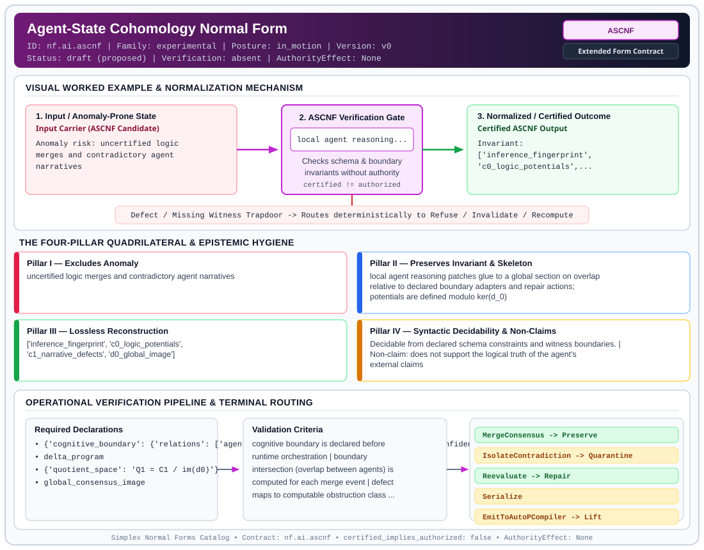

# Agent-State Cohomology Normal Form (`ASCNF`)

> **Contract ID:** `nf.ai.ascnf` | **Family:** `experimental` | **Index Status:** `draft` | **AuthorityEffect:** `None`

**[⬅ Back to Wiki Home](Home)** | **[View SVG Diagram](images/nf.ai.ascnf.svg)**

---

## 1. Executive Summary & Metadata

Agent-State Cohomology Normal Form (ASCNF) enforces structural normalization and explicit defect routing in the experimental regime.

| Property | Value |
| :--- | :--- |
| **Canonical ID** | `nf.ai.ascnf` |
| **Short Name** | `ASCNF` |
| **Full Name** | Agent-State Cohomology Normal Form |
| **Family** | `experimental` (Bounded Quantum-Classical, Contextuality, Quantifier Alternation & Agent-State Contracts) |
| **Qualification** | Extended Form Contract (Normal Form Contract) |
| **Data / Math Posture** | in_motion |
| **Index Status** | `draft` |
| **Theory Status** | `proposed` |
| **Verification Status** | `absent` |
| **Contract Version** | `v0` |
| **Governance Fence** | `AuthorityEffect: None` (`certified_implies_authorized: false`) |

---

## 2. Visual Architecture & Normalization Diagram



---

## 3. Concrete Worked Example & Mechanism

### Visual Transition Summary

| Stage | Carrier / Operator | Concrete State / Invariant |
| :--- | :--- | :--- |
| **1. Before / Candidate Input** | `Input Carrier (ASCNF Candidate)` | Anomaly risk: uncertified logic ; merges and contradictory agent ; narratives |
| **2. Normalization / Gate** | `ASCNF Verification Gate` | `local agent reasoning...` (`certified_implies_authorized: false`) |
| **3. After / Certified Output** | `Certified ASCNF Output` | Invariant: ; ['inference_fingerprint', ; 'c0_logic_potentials',... |

---

## 4. The Four-Pillar Quadrilateral & Non-Claims

Every contract in `simplex-normal-forms` is evaluated against the **Four-Pillar Quadrilateral** defined in `contracts/_golden_nfs/standard.yaml`:

| Pillar | Requirement | Contract Specification for `nf.ai.ascnf` |
| :--- | :--- | :--- |
| **Pillar I: Excludes Anomaly** | Name and eliminate a specific class of data or state defects. | uncertified logic merges and contradictory agent narratives |
| **Pillar II: Preserves Invariant** | State the structural invariant and protected skeleton preserved across transitions. | **Invariant:** local agent reasoning patches glue to a global section on overlap relative to declared boundary adapters and repair actions; potentials are defined modulo ker(d_0)<br>**Protected Skeleton:** ['inference_fingerprint', 'c0_logic_potentials', 'c1_narrative_defects', 'd0_global_image'] |
| **Pillar III: Lossless Reconstruction** | State the non-loss reconstruction operator (join, direct sum, pullback, or replay). | Lossless reconstruction under declared projection, direct sum, or pullback operators. |
| **Pillar IV: Syntactic Decidability** | State how conformance is decided from declared constraints without unbudgeted scans. | Decidable from declared schema and witness metadata within bounded evaluation budgets. |

### Explicit Non-Claims (`certified_implies_authorized: false`)

- does not support the logical truth of the agent's external claims
- does not govern execution speed or resource allocation
- does not imply authorization
- existence of potential alpha does not imply its uniqueness; potentials are defined modulo ker(d_0) and require a declared gauge selector for canonical representation
- exactness certifies repair relative only to the declared defect extraction adapter; it does not ensure under declared assumptions semantic preservation if the adapter omits protected state
- erased ephemeral memory is unsealed session scratchpad that does not alter verified semantics and is exempt from formal loss ledger tracking under the declared policy

---

## 5. Operational Verification & Terminal Routing

### 5.1 Required Declarations

- **cognitive_boundary**: {'relations': ['agent_id', 'active_context'], 'attributes': ['confidence_score', 'entropy'], 'predicates': []}
- delta_program
- **quotient_space**: Q1 = C1 / im(d0)
- global_consensus_image

### 5.2 Required Evidence

- prior_global_state
- local_agent_patch
- logical_predicate_before_after
- collision_context

### 5.3 Validation Criteria

| Criterion ID | Name | Condition |
| :--- | :--- | :--- |
| `criterion` | Check | cognitive boundary is declared before runtime orchestration |
| `criterion` | Check | boundary intersection (overlap between agents) is computed for each merge event |
| `criterion` | Check | defect maps to computable obstruction class in Q1 |
| `criterion` | Check | merge allowed only when obstruction_class is exact zero [omega] == 0 equivalently omega = d0(alpha) |
| `criterion` | Check | nonzero contradiction terminalizes into a localized reasoning loop |

### 5.4 Terminal Route Map

Every evaluation terminates in a declared local route mapped to a canonical terminal in `standard.yaml`:

| Local Terminal Route | Canonical Terminal |
| :--- | :--- |
| `MergeConsensus` | `Preserve` |
| `IsolateContradiction` | `Quarantine` |
| `Reevaluate` | `Repair` |
| `Serialize` | `Serialize` |
| `EmitToAutoPCompiler` | `Lift` |
| `ClosureFailure` | `ClosureFailure` |

### 5.5 Declared Failure Modes

- **symptom**: global state enters infinite loop resolving agent updates, **diagnosis**: defects do not commute; non-trivial cocycle detected, **terminal**: IsolateContradiction
- **symptom**: downstream AutoP compilation fails on syntax mapping, **diagnosis**: repair attempted without exact potential omega = d0 alpha, **terminal**: Reevaluate

---

## 6. Epistemic Claim Hygiene Quadrant

In accordance with the repository's epistemic claim discipline:

1. **What it supports:**
   - Supports syntactic and operational checking of `nf.ai.ascnf` (`ASCNF`) against its declared schema, boundary constraints, and witness obligations in this model.
   - Supports deterministic terminal routing (`MergeConsensus, IsolateContradiction, Reevaluate, Serialize`) when required declarations or invariants fail.
2. **What it does not support:**
   - Does not confer operational authority (`AuthorityEffect: None`, `certified_implies_authorized: false`).
   - Does not claim semantic truth of undeclared external processes or unverified upstream inputs beyond the declaredprotected skeleton.
3. **The narrowest defensible claim:**
   - Within the declared substrate `in_motion`, this contract enforces that `uncertified logic merges and contradictory agent narratives` is either excluded under `local agent reasoning patches glue to a global section on overlap relative to declared boundary adapters and repair actions; potentials are defined modulo ker(d_0)` or routed to an explicit refusal/recovery terminal.
4. **The next test needed:**
   - Property-based falsification and mutation testing across boundary edge cases and composed multi-step pipelines for `nf.ai.ascnf`.

---

## 7. Canonical YAML Contract (`contracts/nf.ai.ascnf.yaml`)

<details>
<summary><strong>Click to expand full canonical YAML contract (contracts/nf.ai.ascnf.yaml)</strong></summary>

```yaml
schema_version: smplx.nf.contract.v0
schema_ref: ./normal_form_contract_schema.yaml
contract_kind: normal_form_contract

identity:
  id: nf.ai.ascnf
  name: Agent-State Cohomology Normal Form
  short_name: ASCNF
  version: v0
  status: draft
  family: experimental
  theory_status: proposed
  contract_status: draft
  verification_status: absent

classification:
  hierarchy_level: normal_form
  subject_kind:
    - agent_context_relvar
    - inference_boundary
    - cognitive_nine_dot_boundary
  data_posture: in_motion
  mathematical_posture: operational

purpose:
  excludes_anomaly: uncertified logic merges and contradictory agent narratives
  preserves_invariant: local agent reasoning patches glue to a global section on overlap
    relative to declared boundary adapters and repair actions; potentials are defined
    modulo ker(d_0)
  protected_skeleton:
    - inference_fingerprint
    - c0_logic_potentials
    - c1_narrative_defects
    - d0_global_image
  erased_structure:
    - ephemeral_agent_memory
  non_claims:
    - does not support the logical truth of the agent's external claims
    - does not govern execution speed or resource allocation
    - does not imply authorization
    - existence of potential alpha does not imply its uniqueness; potentials are defined
      modulo ker(d_0) and require a declared gauge selector for canonical representation
    - exactness certifies repair relative only to the declared defect extraction adapter;
      it does not ensure under declared assumptions semantic preservation if the adapter omits protected state
    - erased ephemeral memory is unsealed session scratchpad that does not alter verified
      semantics and is exempt from formal loss ledger tracking under the declared policy

obstruction_substrate:
  finite_carrier:
    description: per-agent local reasoning patch; defects from overlapping narrative writes
    max_rank: null
  cochain_complex:
    C0: local_reasoning_potentials_alpha
    C1: narrative_merge_defects_omega
    C2: logical_contradiction_failures
    d0: maps local inference to global state defect
    d1: evaluates multi-agent consensus closure
    quotient: "Q1 = C1 / im(d0)"
  obstruction_class:
    notation: "[omega(e)]"
    exact: "[omega] == 0"
    residual_closed: "d1(omega) == 0 and [omega] != 0"
    open: "d1(omega) != 0"

declarations_required:
  - cognitive_boundary:
      relations: [agent_id, active_context]
      attributes: [confidence_score, entropy]
      predicates: []
  - delta_program
  - quotient_space: "Q1 = C1 / im(d0)"
  - global_consensus_image

evidence_required:
  - prior_global_state
  - local_agent_patch
  - logical_predicate_before_after
  - collision_context

validation_criteria:
  - cognitive boundary is declared before runtime orchestration
  - boundary intersection (overlap between agents) is computed for each merge event
  - defect maps to computable obstruction class in Q1
  - merge allowed only when obstruction_class is exact zero [omega] == 0 equivalently omega = d0(alpha)
  - nonzero contradiction terminalizes into a localized reasoning loop

proof_obligations:
  - id: ascnf.sheaf_gluing_exactness
    status: theorem_shaped

terminal_routes:
  - MergeConsensus
  - IsolateContradiction
  - Reevaluate
  - Serialize
  - EmitToAutoPCompiler
  - ClosureFailure

terminal_route_map:
  MergeConsensus: Preserve
  IsolateContradiction: Quarantine
  Reevaluate: Repair
  Serialize: Serialize
  EmitToAutoPCompiler: Lift
  ClosureFailure: ClosureFailure

certification:
  certificate_required: true
  certificate_kind: consensus_certificate
  obstruction_class_required: true
  loss_ledger_required: false
  loss_ledger_trigger_id: null
  verifier_required: true

authorization:
  authorized_by: null
  certified_implies_authorized: false

failure_modes:
  - symptom: global state enters infinite loop resolving agent updates
    diagnosis: defects do not commute; non-trivial cocycle detected
    terminal: IsolateContradiction
  - symptom: downstream AutoP compilation fails on syntax mapping
    diagnosis: repair attempted without exact potential omega = d0 alpha
    terminal: Reevaluate

definition:
  source: coda_all_universe/mssn_sn_tower/definitions.md
  formal_statement: >
    Under the declared cognitive boundary and defect extraction adapter, local agent
    reasoning patches admit consistent multi-agent consensus if and only if the narrative
    defect cochain omega in C^1 is exact under coboundary operator d_0 (omega = d_0 alpha).
    Potentials are unique up to ker(d_0). Non-exact closed cochains represent irreconcilable
    narrative contradictions requiring quarantine.
  quadrilateral:
    qualifies_as_true_normal_form: false
    qualification_gap: reconstruction_is_sheaf_gluing_not_a_relational_natural_join
    qualifies_as_extended_form: true
    anomaly_exclusion: uncertified logic merges and contradictory agent narratives
    lossless_join:
      status: sheaf_gluing
      statement: local reasoning patches agreeing on overlaps reconstruct a global state section
        relative to the declared adapter and gauge selector
    dependency_preservation:
      status: cocycle_condition_preserved
      statement: nilpotence of the consensus complex d1 d0 = 0 is preserved across agent boundaries
    syntactic_decision:
      status: transition_certificate
      statement: the obstruction class in Q1 is computable from declared boundary complexes,
        adapter definitions, and patch schemas
```

</details>
