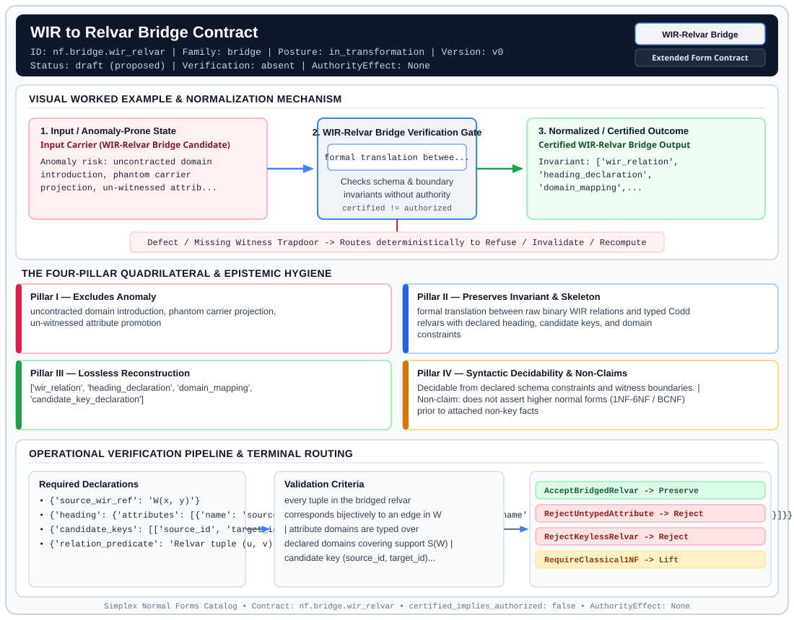

# WIR to Relvar Bridge Contract (`WIR-Relvar Bridge`)

> **Contract ID:** `nf.bridge.wir_relvar` | **Family:** `bridge` | **Index Status:** `draft` | **AuthorityEffect:** `None`

**[⬅ Back to Wiki Home](Home)** | **[View SVG Diagram](images/nf.bridge.wir_relvar.svg)**

---

## 1. Executive Summary & Metadata

WIR to Relvar Bridge Contract (WIR-Relvar Bridge) enforces structural normalization and explicit defect routing in the bridge regime.

| Property | Value |
| :--- | :--- |
| **Canonical ID** | `nf.bridge.wir_relvar` |
| **Short Name** | `WIR-Relvar Bridge` |
| **Full Name** | WIR to Relvar Bridge Contract |
| **Family** | `bridge` (Cross-Substrate Bridge Contracts (`WIR` to Relational Variable Lowering)) |
| **Qualification** | Extended Form Contract (Normal Form Contract) |
| **Data / Math Posture** | in_transformation |
| **Index Status** | `draft` |
| **Theory Status** | `proposed` |
| **Verification Status** | `absent` |
| **Contract Version** | `v0` |
| **Governance Fence** | `AuthorityEffect: None` (`certified_implies_authorized: false`) |

---

## 2. Visual Architecture & Normalization Diagram



---

## 3. Concrete Worked Example & Mechanism

### Visual Transition Summary

| Stage | Carrier / Operator | Concrete State / Invariant |
| :--- | :--- | :--- |
| **1. Before / Candidate Input** | `Input Carrier (WIR-Relvar Bridge Candidate)` | Anomaly risk: uncontracted domain ; introduction, phantom carrier ; projection, un-witnessed attrib... |
| **2. Normalization / Gate** | `WIR-Relvar Bridge Verification Gate` | `formal translation betwee...` (`certified_implies_authorized: false`) |
| **3. After / Certified Output** | `Certified WIR-Relvar Bridge Output` | Invariant: ['wir_relation', ; 'heading_declaration', ; 'domain_mapping',... |

### Contract-Declared Worked Cases

```yaml
- ref: coda_all_universe/1_the_tower/normal_forms/design_docs_000.md
  section: 2. The Genesis Relation
```

---

## 4. The Four-Pillar Quadrilateral & Non-Claims

Every contract in `simplex-normal-forms` is evaluated against the **Four-Pillar Quadrilateral** defined in `contracts/_golden_nfs/standard.yaml`:

| Pillar | Requirement | Contract Specification for `nf.bridge.wir_relvar` |
| :--- | :--- | :--- |
| **Pillar I: Excludes Anomaly** | Name and eliminate a specific class of data or state defects. | uncontracted domain introduction, phantom carrier projection, un-witnessed attribute promotion |
| **Pillar II: Preserves Invariant** | State the structural invariant and protected skeleton preserved across transitions. | **Invariant:** formal translation between raw binary WIR relations and typed Codd relvars with declared heading, candidate keys, and domain constraints<br>**Protected Skeleton:** ['wir_relation', 'heading_declaration', 'domain_mapping', 'candidate_key_declaration'] |
| **Pillar III: Lossless Reconstruction** | State the non-loss reconstruction operator (join, direct sum, pullback, or replay). | Lossless reconstruction under declared projection, direct sum, or pullback operators. |
| **Pillar IV: Syntactic Decidability** | State how conformance is decided from declared constraints without unbudgeted scans. | Decidable from declared schema and witness metadata within bounded evaluation budgets. |

### Explicit Non-Claims (`certified_implies_authorized: false`)

- does not assert higher normal forms (1NF-6NF / BCNF) prior to attached non-key facts
- attribute domains cannot be derived purely from extensional support S(W) alone; they require declared intensional domain definitions
- does not translate higher dimensional cells (see higher structure contracts for Shell2 vs Fill2)
- does not imply runtime repair without a declared cochain complex
- does not certify transactional authorization

---

## 5. Operational Verification & Terminal Routing

### 5.1 Required Declarations

- **source_wir_ref**: W(x, y)
- **heading**: {'attributes': [{'name': 'source_id', 'domain': 'DeclaredDomain(S(W))'}, {'name': 'target_id', 'domain': 'DeclaredDomain(S(W))'}]}
- **candidate_keys**: [['source_id', 'target_id']]
- **relation_predicate**: Relvar tuple (u, v) exists iff W(u, v) holds

### 5.2 Required Evidence

- **wir_source_packet**: source occurrence and presence relations
- **replay_wir_predicates**: re-execution of non-emptiness, presence DISTINCT projection, and self-loop irreflexivity queries
- heading_and_domain_bindings

### 5.3 Validation Criteria

| Criterion ID | Name | Condition |
| :--- | :--- | :--- |
| `criterion` | Check | every tuple in the bridged relvar corresponds bijectively to an edge in W |
| `criterion` | Check | attribute domains are typed over declared domains covering support S(W) |
| `criterion` | Check | candidate key (source_id, target_id) ensures under declared assumptions no duplicate directed edges |

### 5.4 Terminal Route Map

Every evaluation terminates in a declared local route mapped to a canonical terminal in `standard.yaml`:

| Local Terminal Route | Canonical Terminal |
| :--- | :--- |
| `AcceptBridgedRelvar` | `Preserve` |
| `RejectUntypedAttribute` | `Reject` |
| `RejectKeylessRelvar` | `Reject` |
| `RequireClassical1NF` | `Lift` |

### 5.5 Declared Failure Modes

- **symptom**: relvar attributes declared without intensional domain definitions, **diagnosis**: uncontracted domain introduction, **terminal**: RejectUntypedAttribute
- **symptom**: relation declared without candidate key over endpoint pair, **diagnosis**: keyless relvar violating relational foundation, **terminal**: RejectKeylessRelvar

---

## 6. Epistemic Claim Hygiene Quadrant

In accordance with the repository's epistemic claim discipline:

1. **What it supports:**
   - Supports syntactic and operational checking of `nf.bridge.wir_relvar` (`WIR-Relvar Bridge`) against its declared schema, boundary constraints, and witness obligations in this model.
   - Supports deterministic terminal routing (`AcceptBridgedRelvar, RejectUntypedAttribute, RejectKeylessRelvar, RequireClassical1NF`) when required declarations or invariants fail.
2. **What it does not support:**
   - Does not confer operational authority (`AuthorityEffect: None`, `certified_implies_authorized: false`).
   - Does not claim semantic truth of undeclared external processes or unverified upstream inputs beyond the declaredprotected skeleton.
3. **The narrowest defensible claim:**
   - Within the declared substrate `in_transformation`, this contract enforces that `uncontracted domain introduction, phantom carrier projection, un-witnessed attribute promotion` is either excluded under `formal translation between raw binary WIR relations and typed Codd relvars with declared heading, candidate keys, and domain constraints` or routed to an explicit refusal/recovery terminal.
4. **The next test needed:**
   - Property-based falsification and mutation testing across boundary edge cases and composed multi-step pipelines for `nf.bridge.wir_relvar`.

---

## 7. Canonical YAML Contract (`contracts/nf.bridge.wir_relvar.yaml`)

<details>
<summary><strong>Click to expand full canonical YAML contract (contracts/nf.bridge.wir_relvar.yaml)</strong></summary>

```yaml
schema_version: smplx.nf.contract.v0
schema_ref: ./normal_form_contract_schema.yaml
contract_kind: bridge_contract
identity:
  id: nf.bridge.wir_relvar
  name: WIR to Relvar Bridge Contract
  short_name: WIR-Relvar Bridge
  version: v0
  status: draft
  theory_status: proposed
  contract_status: draft
  verification_status: absent
  family: bridge
classification:
  hierarchy_level: bridge_form
  subject_kind:
  - witnessed_relation
  - relvar
  - heading
  data_posture: in_transformation
  mathematical_posture: formal_algebraic
purpose:
  excludes_anomaly: uncontracted domain introduction, phantom carrier projection,
    un-witnessed attribute promotion
  preserves_invariant: formal translation between raw binary WIR relations and typed
    Codd relvars with declared heading, candidate keys, and domain constraints
  protected_skeleton:
  - wir_relation
  - heading_declaration
  - domain_mapping
  - candidate_key_declaration
  erased_structure:
  - untyped_pair_representation
  non_claims:
  - does not assert higher normal forms (1NF-6NF / BCNF) prior to attached non-key
    facts
  - attribute domains cannot be derived purely from extensional support S(W) alone;
    they require declared intensional domain definitions
  - does not translate higher dimensional cells (see higher structure contracts for
    Shell2 vs Fill2)
  - does not imply runtime repair without a declared cochain complex
  - does not certify transactional authorization
declarations_required:
- source_wir_ref: W(x, y)
- heading:
    attributes:
    - name: source_id
      domain: DeclaredDomain(S(W))
    - name: target_id
      domain: DeclaredDomain(S(W))
- candidate_keys:
  - - source_id
    - target_id
- relation_predicate: Relvar tuple (u, v) exists iff W(u, v) holds
evidence_required:
- wir_source_packet: source occurrence and presence relations
- replay_wir_predicates: re-execution of non-emptiness, presence DISTINCT projection,
    and self-loop irreflexivity queries
- heading_and_domain_bindings
validation_criteria:
- every tuple in the bridged relvar corresponds bijectively to an edge in W
- attribute domains are typed over declared domains covering support S(W)
- candidate key (source_id, target_id) ensures under declared assumptions no duplicate directed edges
proof_obligations:
- id: bridge.lossless_relvar_encoding
  status: theorem_shaped
  statement: Bridging WIR into a relvar preserves all adjacency facts and introduces
    zero spurious tuples
terminal_routes:
- AcceptBridgedRelvar
- RejectUntypedAttribute
- RejectKeylessRelvar
- RequireClassical1NF
terminal_route_map:
  AcceptBridgedRelvar: Preserve
  RejectUntypedAttribute: Reject
  RejectKeylessRelvar: Reject
  RequireClassical1NF: Lift
certification:
  certificate_required: false
  certificate_kind: null
  obstruction_class_required: false
  loss_ledger_required: false
  verifier_required: false
  loss_ledger_trigger_id: null
authorization:
  authorized_by: null
  certified_implies_authorized: false
failure_modes:
- symptom: relvar attributes declared without intensional domain definitions
  diagnosis: uncontracted domain introduction
  terminal: RejectUntypedAttribute
- symptom: relation declared without candidate key over endpoint pair
  diagnosis: keyless relvar violating relational foundation
  terminal: RejectKeylessRelvar
examples:
- ref: coda_all_universe/1_the_tower/normal_forms/design_docs_000.md
  section: 2. The Genesis Relation
references:
- coda_all_universe/1_the_tower/normal_forms/design_docs_000.md
- ./nf.genesis.wir.yaml
- ./normal_form_contract_schema.yaml
extensions:
  normalization:
    kind: operational_contract
    claim_scope: Operational evidence contract; no canonical representative, idempotence,
      or equivalence completeness is established by its route predicates.
    evidence: ../docs/normal_form_audit.md
quadrilateral:
  qualifies_as_true_normal_form: false
  anomaly_exclusion: uncontracted domain introduction, phantom carrier projection,
    un-witnessed attribute promotion
  lossless_join:
    status: lossless
    statement: Bridging WIR into a relvar preserves all adjacency facts and introduces
      zero spurious tuples.
  dependency_preservation:
    status: preserved
    statement: Candidate key dependencies on endpoint pairs are preserved across the
      bridge.
  syntactic_decision:
    status: decidable
    statement: Validates bijection between bridged tuples and directed edges in W.
```

</details>
