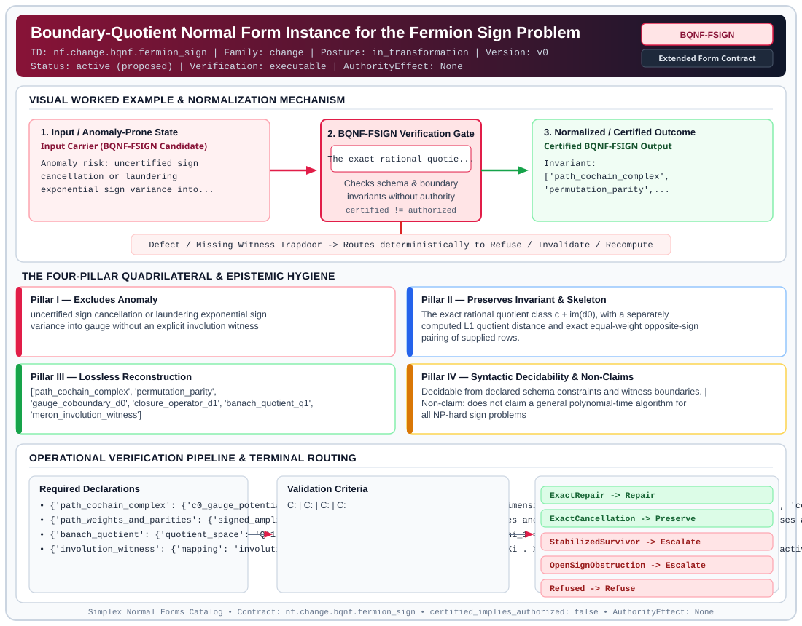

# Boundary-Quotient Normal Form Instance for the Fermion Sign Problem (`BQNF-FSIGN`)

> **Contract ID:** `nf.change.bqnf.fermion_sign` | **Family:** `change` | **Index Status:** `active` | **AuthorityEffect:** `None`

**[⬅ Back to Wiki Home](Home)** | **[View SVG Diagram](images/nf.change.bqnf.fermion_sign.svg)**

---

## 1. Executive Summary & Metadata

Boundary-Quotient Normal Form Instance for the Fermion Sign Problem (BQNF-FSIGN) enforces structural normalization and explicit defect routing in the change regime.

| Property | Value |
| :--- | :--- |
| **Canonical ID** | `nf.change.bqnf.fermion_sign` |
| **Short Name** | `BQNF-FSIGN` |
| **Full Name** | Boundary-Quotient Normal Form Instance for the Fermion Sign Problem |
| **Family** | `change` (Data in Motion & Boundary-Quotient Incremental Maintenance Contracts (BQNF & Cochain Repair)) |
| **Qualification** | Extended Form Contract (Normal Form Contract) |
| **Data / Math Posture** | in_transformation |
| **Index Status** | `active` |
| **Theory Status** | `proposed` |
| **Verification Status** | `executable` |
| **Contract Version** | `v0` |
| **Governance Fence** | `AuthorityEffect: None` (`certified_implies_authorized: false`) |

---

## 2. Visual Architecture & Normalization Diagram



---

## 3. Concrete Worked Example & Mechanism

### Visual Transition Summary

| Stage | Carrier / Operator | Concrete State / Invariant |
| :--- | :--- | :--- |
| **1. Before / Candidate Input** | `Input Carrier (BQNF-FSIGN Candidate)` | Anomaly risk: uncertified sign ; cancellation or laundering ; exponential sign variance into... |
| **2. Normalization / Gate** | `BQNF-FSIGN Verification Gate` | `The exact rational quotie...` (`certified_implies_authorized: false`) |
| **3. After / Certified Output** | `Certified BQNF-FSIGN Output` | Invariant: ; ['path_cochain_complex', ; 'permutation_parity',... |

---

## 4. The Four-Pillar Quadrilateral & Non-Claims

Every contract in `simplex-normal-forms` is evaluated against the **Four-Pillar Quadrilateral** defined in `contracts/_golden_nfs/standard.yaml`:

| Pillar | Requirement | Contract Specification for `nf.change.bqnf.fermion_sign` |
| :--- | :--- | :--- |
| **Pillar I: Excludes Anomaly** | Name and eliminate a specific class of data or state defects. | uncertified sign cancellation or laundering exponential sign variance into gauge without an explicit involution witness |
| **Pillar II: Preserves Invariant** | State the structural invariant and protected skeleton preserved across transitions. | **Invariant:** The exact rational quotient class c + im(d0), with a separately computed L1 quotient distance and exact equal-weight opposite-sign pairing of supplied rows.<br>**Protected Skeleton:** ['path_cochain_complex', 'permutation_parity', 'gauge_coboundary_d0', 'closure_operator_d1', 'banach_quotient_q1', 'meron_involution_witness'] |
| **Pillar III: Lossless Reconstruction** | State the non-loss reconstruction operator (join, direct sum, pullback, or replay). | Lossless reconstruction under declared projection, direct sum, or pullback operators. |
| **Pillar IV: Syntactic Decidability** | State how conformance is decided from declared constraints without unbudgeted scans. | Decidable from declared schema and witness metadata within bounded evaluation budgets. |

### Explicit Non-Claims (`certified_implies_authorized: false`)

- does not claim a general polynomial-time algorithm for all NP-hard sign problems
- does not eliminate the sign problem on frustrated lattices without an explicit weight-preserving sign-inverting involution
- does not claim continuous thermodynamic limit results from finite lattice models
- An arbitrary additive rational cochain boundary is not automatically a physical diagonal sign gauge.
- The L1 norm of a canonical representative need not minimize its coset.
- A vanishing finite signed sum need not admit equal-weight pairwise cancellation.
- No general bound on average sign follows from an independently chosen d0 and quotient distance.

---

## 5. Operational Verification & Terminal Routing

### 5.1 Required Declarations

- **path_cochain_complex**: {'c0_gauge_potentials': 'dimension d_0', 'c1_path_weights': 'dimension d_1', 'c2_closure_defects': 'dimension d_2', 'coboundary_d0': 'matrix d_1 x d_0', 'coboundary_d1': 'matrix d_2 x d_1', 'nilpotency': 'd1 . d0 == 0', 'coefficient_field': 'Q; finite legacy floats denote their exact binary values'}
- **path_weights_and_parities**: {'signed_amplitudes': 'Separate nonnegative path magnitudes and signs in {-1,+1}; the legacy packet adapter uses abs(c1) for magnitudes', 'permutation_parities': 'vector of phases (-1)^pi(gamma) in {+1, -1}'}
- **banach_quotient**: {'quotient_space': 'Q^1 = C^1 / im(d0)', 'residual_defect_mass': 'Phi_1 = inf_{alpha in C0} ||c1 - d0 alpha||_1'}
- **involution_witness**: {'mapping': 'involution Xi on path indices', 'involution_law': 'Xi . Xi == id', 'fixed_point_free': 'Xi(x) != x for active paths', 'sign_reversing': 'sgn(Xi(x)) == -sgn(x)', 'weight_preserving': 'weight(Xi(x)) == weight(x)'}

### 5.2 Required Evidence

- **rref_gauge_witness**: rational_vector
- **meron_involution_witness**: involution_pairing

### 5.3 Validation Criteria

| Criterion ID | Name | Condition |
| :--- | :--- | :--- |
| `` | **** |  |
| `` | **** |  |
| `` | **** |  |
| `` | **** |  |

### 5.4 Terminal Route Map

Every evaluation terminates in a declared local route mapped to a canonical terminal in `standard.yaml`:

| Local Terminal Route | Canonical Terminal |
| :--- | :--- |
| `ExactRepair` | `Repair` |
| `ExactCancellation` | `Preserve` |
| `StabilizedSurvivor` | `Escalate` |
| `OpenSignObstruction` | `Escalate` |
| `Refused` | `Refuse` |

### 5.5 Declared Failure Modes

_All defects route explicitly through the Terminal Route Map above._

---

## 6. Epistemic Claim Hygiene Quadrant

In accordance with the repository's epistemic claim discipline:

1. **What it supports:**
   - Supports syntactic and operational checking of `nf.change.bqnf.fermion_sign` (`BQNF-FSIGN`) against its declared schema, boundary constraints, and witness obligations in this model.
   - Supports deterministic terminal routing (`ExactRepair, ExactCancellation, StabilizedSurvivor, OpenSignObstruction`) when required declarations or invariants fail.
2. **What it does not support:**
   - Does not confer operational authority (`AuthorityEffect: None`, `certified_implies_authorized: false`).
   - Does not claim semantic truth of undeclared external processes or unverified upstream inputs beyond the declaredprotected skeleton.
3. **The narrowest defensible claim:**
   - Within the declared substrate `in_transformation`, this contract enforces that `uncertified sign cancellation or laundering exponential sign variance into gauge without an explicit involution witness` is either excluded under `The exact rational quotient class c + im(d0), with a separately computed L1 quotient distance and exact equal-weight opposite-sign pairing of supplied rows.` or routed to an explicit refusal/recovery terminal.
4. **The next test needed:**
   - Property-based falsification and mutation testing across boundary edge cases and composed multi-step pipelines for `nf.change.bqnf.fermion_sign`.

---

## 7. Canonical YAML Contract (`contracts/bqnf/nf.change.bqnf.fermion_sign.yaml`)

<details>
<summary><strong>Click to expand full canonical YAML contract (contracts/bqnf/nf.change.bqnf.fermion_sign.yaml)</strong></summary>

```yaml
schema_version: smplx.nf.contract.v0
schema_ref: ./normal_form_contract_schema.yaml
contract_kind: normal_form_contract
identity:
  id: nf.change.bqnf.fermion_sign
  name: Boundary-Quotient Normal Form Instance for the Fermion Sign Problem
  short_name: BQNF-FSIGN
  version: v0
  status: active
  theory_status: proposed
  contract_status: active
  verification_status: executable
  family: change
classification:
  hierarchy_level: normal_form
  subject_kind:
  - fermion_sign_problem
  - banach_quotient
  - cochain_complex
  - meron_involution
  data_posture: in_transformation
  mathematical_posture: operational
purpose:
  excludes_anomaly: uncertified sign cancellation or laundering exponential sign variance
    into gauge without an explicit involution witness
  preserves_invariant: The exact rational quotient class c + im(d0), with a separately
    computed L1 quotient distance and exact equal-weight opposite-sign pairing of
    supplied rows.
  protected_skeleton:
  - path_cochain_complex
  - permutation_parity
  - gauge_coboundary_d0
  - closure_operator_d1
  - banach_quotient_q1
  - meron_involution_witness
  erased_structure:
  - rational additive gauge redundancy in the declared im(d0) only
  non_claims:
  - does not claim a general polynomial-time algorithm for all NP-hard sign problems
  - does not eliminate the sign problem on frustrated lattices without an explicit
    weight-preserving sign-inverting involution
  - does not claim continuous thermodynamic limit results from finite lattice models
  - An arbitrary additive rational cochain boundary is not automatically a physical
    diagonal sign gauge.
  - The L1 norm of a canonical representative need not minimize its coset.
  - A vanishing finite signed sum need not admit equal-weight pairwise cancellation.
  - No general bound on average sign follows from an independently chosen d0 and quotient
    distance.
declarations_required:
- path_cochain_complex:
    c0_gauge_potentials: dimension d_0
    c1_path_weights: dimension d_1
    c2_closure_defects: dimension d_2
    coboundary_d0: matrix d_1 x d_0
    coboundary_d1: matrix d_2 x d_1
    nilpotency: d1 . d0 == 0
    coefficient_field: Q; finite legacy floats denote their exact binary values
- path_weights_and_parities:
    signed_amplitudes: Separate nonnegative path magnitudes and signs in {-1,+1};
      the legacy packet adapter uses abs(c1) for magnitudes
    permutation_parities: vector of phases (-1)^pi(gamma) in {+1, -1}
- banach_quotient:
    quotient_space: Q^1 = C^1 / im(d0)
    residual_defect_mass: Phi_1 = inf_{alpha in C0} ||c1 - d0 alpha||_1
- involution_witness:
    mapping: involution Xi on path indices
    involution_law: Xi . Xi == id
    fixed_point_free: Xi(x) != x for active paths
    sign_reversing: sgn(Xi(x)) == -sgn(x)
    weight_preserving: weight(Xi(x)) == weight(x)
evidence_required:
- rref_gauge_witness: rational_vector
- meron_involution_witness: involution_pairing
validation_criteria:
- nilpotence_verified: d1*d0 is exactly zero in Q, with matrix shapes checked
- quotient_normalization: Exact RREF section and gauge witness; see nf.change.rational_quotient
- quotient_distance: Exact rational finite vertex enumeration, or explicit budget_unknown;
    no tolerance certificate
- involution_soundness: Every active row has a distinct equal-magnitude opposite-sign
    partner; exact involution replay
terminal_routes:
- ExactRepair
- ExactCancellation
- StabilizedSurvivor
- OpenSignObstruction
- Refused
terminal_route_map:
  ExactRepair: Repair
  ExactCancellation: Preserve
  StabilizedSurvivor: Escalate
  OpenSignObstruction: Escalate
  Refused: Refuse
certification:
  certificate_required: false
  certificate_kind: null
  obstruction_class_required: false
  loss_ledger_required: false
  loss_ledger_trigger_id: null
  verifier_required: false
authorization:
  authorized_by: null
  certified_implies_authorized: false
extensions:
  normalization:
    kind: operational_contract
    claim_scope: Operational evidence contract; no canonical representative, idempotence,
      or equivalence completeness is established by its route predicates.
    evidence: ../docs/normal_form_audit.md
    withdrawal: The former verified label was unsupported as certification of normalization
      laws. Executable means local diagnostic code exists, not that its physical assumptions
      or exactness are supported.
    normalizer_scope_ref: nf.change.rational_quotient.yaml
  route_predicates:
    zero_quotient_defect: ExactRepair
    certified_meron_involution: ExactCancellation
    closed_nonzero_defect: StabilizedSurvivor
    uncancelled_sign_barrier: OpenSignObstruction
    dimension_mismatch: Refused
quadrilateral:
  qualifies_as_true_normal_form: false
  anomaly_exclusion: uncertified sign cancellation or laundering exponential sign
    variance into gauge without an explicit involution witness
  lossless_join:
    status: lossless
    statement: Sign-flip decomposition satisfies fermion sign consistency without
      loss of branch weight.
  dependency_preservation:
    status: preserved
    statement: Anticommutation relations preserved across configuration paths.
  syntactic_decision:
    status: decidable
    statement: Local cycle product test determines whether signed cycle product is
      +1 or -1.
```

</details>
