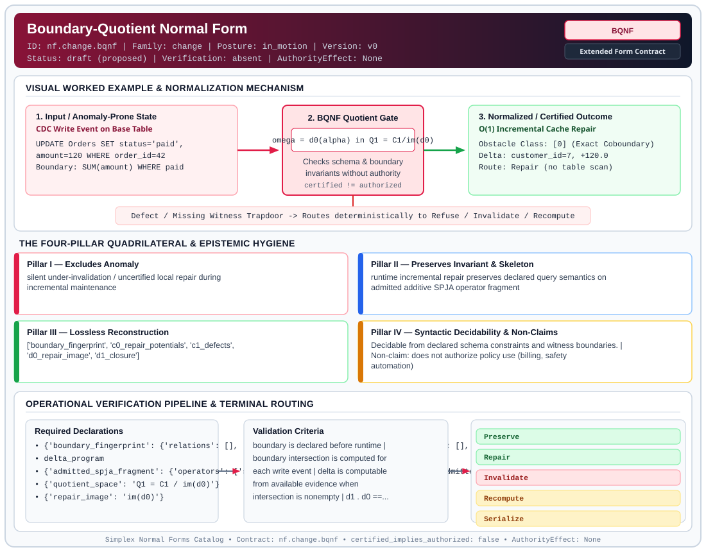

# Boundary-Quotient Normal Form (`BQNF`)

> **Contract ID:** `nf.change.bqnf` | **Family:** `change` | **Index Status:** `draft` | **AuthorityEffect:** `None`

**[⬅ Back to Wiki Home](Home)** | **[View SVG Diagram](images/nf.change.bqnf.svg)**

---

## 1. Executive Summary & Metadata

Boundary-Quotient Normal Form (BQNF) enforces structural normalization and explicit defect routing in the change regime.

| Property | Value |
| :--- | :--- |
| **Canonical ID** | `nf.change.bqnf` |
| **Short Name** | `BQNF` |
| **Full Name** | Boundary-Quotient Normal Form |
| **Family** | `change` (Data in Motion & Boundary-Quotient Incremental Maintenance Contracts (BQNF & Cochain Repair)) |
| **Qualification** | Extended Form Contract (Normal Form Contract) |
| **Data / Math Posture** | in_motion |
| **Index Status** | `draft` |
| **Theory Status** | `proposed` |
| **Verification Status** | `absent` |
| **Contract Version** | `v0` |
| **Governance Fence** | `AuthorityEffect: None` (`certified_implies_authorized: false`) |

---

## 2. Visual Architecture & Normalization Diagram



---

## 3. Concrete Worked Example & Mechanism

### Visual Transition Summary

| Stage | Carrier / Operator | Concrete State / Invariant |
| :--- | :--- | :--- |
| **1. Before / Candidate Input** | `CDC Write Event on Base Table` | UPDATE Orders SET status='paid', ;   amount=120 WHERE order_id=42 ; Boundary: SUM(amount) WHERE paid |
| **2. Normalization / Gate** | `BQNF Quotient Gate` | `omega = d0(alpha) in Q1 = C1/im(d0)` (`certified_implies_authorized: false`) |
| **3. After / Certified Output** | `O(1) Incremental Cache Repair` | Obstacle Class: [0] (Exact Coboundary) ; Delta: customer_id=7, +120.0 ; Route: Repair (no table scan) |

### Contract-Declared Worked Cases

```yaml
- ref: coda_all_universe/1_the_tower/normal_forms/contracts/_paper_a_bqnf_incremental_repair.md
  section: 3. Running example
```

---

## 4. The Four-Pillar Quadrilateral & Non-Claims

Every contract in `simplex-normal-forms` is evaluated against the **Four-Pillar Quadrilateral** defined in `contracts/_golden_nfs/standard.yaml`:

| Pillar | Requirement | Contract Specification for `nf.change.bqnf` |
| :--- | :--- | :--- |
| **Pillar I: Excludes Anomaly** | Name and eliminate a specific class of data or state defects. | silent under-invalidation / uncertified local repair during incremental maintenance |
| **Pillar II: Preserves Invariant** | State the structural invariant and protected skeleton preserved across transitions. | **Invariant:** runtime incremental repair preserves declared query semantics on admitted additive SPJA operator fragment<br>**Protected Skeleton:** ['boundary_fingerprint', 'c0_repair_potentials', 'c1_defects', 'd0_repair_image', 'd1_closure'] |
| **Pillar III: Lossless Reconstruction** | State the non-loss reconstruction operator (join, direct sum, pullback, or replay). | Lossless reconstruction under declared projection, direct sum, or pullback operators. |
| **Pillar IV: Syntactic Decidability** | State how conformance is decided from declared constraints without unbudgeted scans. | Decidable from declared schema and witness metadata within bounded evaluation budgets. |

### Explicit Non-Claims (`certified_implies_authorized: false`)

- does not authorize policy use (billing, safety automation)
- does not support transport of compiled shapes (see CODA-MUR)
- does not ensure under declared assumptions global multi-master replica consistency
- additive exactness, omega = d0 alpha, is the repair licence for SUM, COUNT, and AVG when the count is carried with the sum. MIN and MAX have no group inverse. A deletion that is not the current extremum repairs in place. A deletion of the extremum repairs from a non-empty extremum cochain, and the affected partition is recomputed when that cochain is absent or empty. A quantile sketch repairs inside its declared tolerance and recomputes when the error is larger, or when the sketch is empty or missing

---

## 5. Operational Verification & Terminal Routing

### 5.1 Required Declarations

- **boundary_fingerprint**: {'relations': [], 'attributes': [], 'predicates': [], 'groups': [], 'aggregates': [], 'policies': []}
- delta_program
- **admitted_spja_fragment**: {'operators': ['select', 'project', 'join', 'aggregate'], 'admitted_aggregates': ['SUM', 'COUNT', 'AVG']}
- **quotient_space**: Q1 = C1 / im(d0)
- **repair_image**: im(d0)
- **extremum_cochain_policy**: {'aggregates': ['MIN', 'MAX'], 'non_destructive_deletion': 'Repair', 'destructive_deletion_with_nonempty_cochain': 'Repair', 'destructive_deletion_with_absent_or_empty_cochain': 'Recompute'}
- **quantile_sketch_policy**: {'repair_when': 'absolute error is at most the declared tolerance and the sketch count is positive', 'recompute_when': 'the error exceeds the tolerance, or the sketch is empty, or the sketch is missing'}
- terminal_routes

### 5.2 Required Evidence

- **cdc_operation_kind**: ['INSERT', 'UPDATE', 'DELETE']
- **old_row**: required for UPDATE and DELETE; tagged absent for INSERT
- **new_row**: required for INSERT and UPDATE; tagged absent for DELETE
- **changed_attributes**: list of modified attribute tokens
- predicate_membership_before_after
- group_key_before_after
- policy_context

### 5.3 Validation Criteria

| Criterion ID | Name | Condition |
| :--- | :--- | :--- |
| `criterion` | Check | boundary is declared before runtime |
| `criterion` | Check | boundary intersection is computed for each write event |
| `criterion` | Check | delta is computable from available evidence when intersection is nonempty |
| `criterion` | Check | d1 . d0 == 0 holds whenever d1 closure operator is declared |
| `criterion` | Check | defect maps to computable obstruction class in Q1 (and in H1 if d1 is declared) |
| `criterion` | Check | repair allowed only when obstruction_class == "[0]" equivalently omega = d0(alpha) |
| `criterion` | Check | nonzero unknown or missing-evidence obstruction terminalizes loudly |

### 5.4 Terminal Route Map

Every evaluation terminates in a declared local route mapped to a canonical terminal in `standard.yaml`:

| Local Terminal Route | Canonical Terminal |
| :--- | :--- |
| `Preserve` | `Preserve` |
| `Repair` | `Repair` |
| `Invalidate` | `Invalidate` |
| `Recompute` | `Recompute` |
| `Serialize` | `Serialize` |
| `Lift` | `Lift` |
| `Unsupported` | `Unsupported` |
| `ConservativeInvalidate` | `ConservativeInvalidate` |
| `Escalate` | `Escalate` |
| `ClosureFailure` | `ClosureFailure` |
| `Residual` | `Escalate` |

### 5.5 Declared Failure Modes

- **symptom**: cache patched after CDC missing status before/after, **diagnosis**: delta not computable clause 2, **terminal**: Invalidate
- **symptom**: aggregate wrong after update, **diagnosis**: repair without omega = d0 alpha, **terminal**: Invalidate
- **symptom**: extremum deleted while the extremum cochain is absent or empty, **diagnosis**: no local replacement witness remains for MIN or MAX, **terminal**: Recompute
- **symptom**: parallel group moves lose updates, **diagnosis**: defects do not commute, **terminal**: Serialize

---

## 6. Epistemic Claim Hygiene Quadrant

In accordance with the repository's epistemic claim discipline:

1. **What it supports:**
   - Supports syntactic and operational checking of `nf.change.bqnf` (`BQNF`) against its declared schema, boundary constraints, and witness obligations in this model.
   - Supports deterministic terminal routing (`Preserve, Repair, Invalidate, Recompute`) when required declarations or invariants fail.
2. **What it does not support:**
   - Does not confer operational authority (`AuthorityEffect: None`, `certified_implies_authorized: false`).
   - Does not claim semantic truth of undeclared external processes or unverified upstream inputs beyond the declaredprotected skeleton.
3. **The narrowest defensible claim:**
   - Within the declared substrate `in_motion`, this contract enforces that `silent under-invalidation / uncertified local repair during incremental maintenance` is either excluded under `runtime incremental repair preserves declared query semantics on admitted additive SPJA operator fragment` or routed to an explicit refusal/recovery terminal.
4. **The next test needed:**
   - Property-based falsification and mutation testing across boundary edge cases and composed multi-step pipelines for `nf.change.bqnf`.

---

## 7. Canonical YAML Contract (`contracts/bqnf/nf.change.bqnf.yaml`)

<details>
<summary><strong>Click to expand full canonical YAML contract (contracts/bqnf/nf.change.bqnf.yaml)</strong></summary>

```yaml
schema_version: smplx.nf.contract.v0
schema_ref: ./normal_form_contract_schema.yaml
contract_kind: normal_form_contract
identity:
  id: nf.change.bqnf
  name: Boundary-Quotient Normal Form
  short_name: BQNF
  version: v0
  theory_status: proposed
  contract_status: draft
  verification_status: absent
  family: change
  status: draft
classification:
  hierarchy_level: normal_form
  subject_kind:
  - boundary_relvar
  - observer_relvar
  - query_shape
  data_posture: in_motion
  mathematical_posture: operational
purpose:
  excludes_anomaly: silent under-invalidation / uncertified local repair during incremental
    maintenance
  preserves_invariant: runtime incremental repair preserves declared query semantics
    on admitted additive SPJA operator fragment
  protected_skeleton:
  - boundary_fingerprint
  - c0_repair_potentials
  - c1_defects
  - d0_repair_image
  - d1_closure
  erased_structure: []
  non_claims:
  - does not authorize policy use (billing, safety automation)
  - does not support transport of compiled shapes (see CODA-MUR)
  - does not ensure under declared assumptions global multi-master replica consistency
  - additive exactness, omega = d0 alpha, is the repair licence for SUM, COUNT, and
    AVG when the count is carried with the sum. MIN and MAX have no group inverse.
    A deletion that is not the current extremum repairs in place. A deletion of the
    extremum repairs from a non-empty extremum cochain, and the affected partition
    is recomputed when that cochain is absent or empty. A quantile sketch repairs
    inside its declared tolerance and recomputes when the error is larger, or when
    the sketch is empty or missing
definition:
  source: coda_all_universe/mssn_sn_tower/definitions.md
  formal_statement: 'A change stream is in boundary-quotient normal form when each
    write is classified against a declared boundary before any cache is patched. The
    defect omega is exact when omega = d0 alpha for a potential alpha in C0, equivalently
    when its class in Q1 = C1 / im(d0) is zero. Exact defects repair. A zero defect
    preserves the cache. A closed non-exact defect is not patched locally. A defect
    with d1 omega nonzero is a closure failure. Extremal aggregates and quantile sketches
    use the cochain routes stated in the non-claims, which the Lean theorems non_destructive_deletion_preserves_extremum,
    destructive_deletion_with_cochain_repairs, destructive_deletion_without_cochain_forces_recompute,
    destructive_deletion_with_exhausted_cochain_forces_recompute, quantile_within_tolerance_repairs,
    and quantile_exceeding_tolerance_forces_recompute record.

    '
  quadrilateral:
    qualifies_as_true_normal_form: false
    qualification_gap: reconstruction_is_cache_equality_not_a_relational_join
    anomaly_exclusion: 'A local cache patch that was not shown to be an exact coboundary,
      a silent under-invalidation, and an extremum or quantile repaired with no cochain
      witness and no bounded recomputation.

      '
    lossless_join:
      status: recomputation_agreement
      statement: 'The repaired cache agrees with a full recomputation of the declared
        query on the admitted fragment. That agreement is the reconstruction theorem
        for this form. It is not a Heath or Fagin decomposition of a relvar at rest.

        '
    dependency_preservation:
      status: boundary_declared_before_runtime
      statement: 'The query boundary, the admitted operators, and the repair policy
        are part of the schema of the stream. A write does not enlarge that boundary.

        '
    syntactic_decision:
      status: declaration_plus_event_decidable
      statement: 'The route is computed from the declared boundary and the before
        and after images of the write. It is not chosen by inspecting an unrelated
        table body. The decision uses the event, because the subject is a change,
        and the policy that classifies the event is fixed before the event arrives.

        '
declarations_required:
- boundary_fingerprint:
    relations: []
    attributes: []
    predicates: []
    groups: []
    aggregates: []
    policies: []
- delta_program
- admitted_spja_fragment:
    operators:
    - select
    - project
    - join
    - aggregate
    admitted_aggregates:
    - SUM
    - COUNT
    - AVG
- quotient_space: Q1 = C1 / im(d0)
- repair_image: im(d0)
- extremum_cochain_policy:
    aggregates:
    - MIN
    - MAX
    non_destructive_deletion: Repair
    destructive_deletion_with_nonempty_cochain: Repair
    destructive_deletion_with_absent_or_empty_cochain: Recompute
- quantile_sketch_policy:
    repair_when: absolute error is at most the declared tolerance and the sketch count
      is positive
    recompute_when: the error exceeds the tolerance, or the sketch is empty, or the
      sketch is missing
- terminal_routes
evidence_required:
- cdc_operation_kind:
  - INSERT
  - UPDATE
  - DELETE
- old_row: required for UPDATE and DELETE; tagged absent for INSERT
- new_row: required for INSERT and UPDATE; tagged absent for DELETE
- changed_attributes: list of modified attribute tokens
- predicate_membership_before_after
- group_key_before_after
- policy_context
validation_criteria:
- boundary is declared before runtime
- boundary intersection is computed for each write event
- delta is computable from available evidence when intersection is nonempty
- d1 . d0 == 0 holds whenever d1 closure operator is declared
- defect maps to computable obstruction class in Q1 (and in H1 if d1 is declared)
- repair allowed only when obstruction_class == "[0]" equivalently omega = d0(alpha)
- nonzero unknown or missing-evidence obstruction terminalizes loudly
proof_obligations:
- id: bqnf.boundary_exactness
  status: theorem_shaped
  ref: coda_all_universe/1_the_tower/normal_forms/contracts/_paper_a_bqnf_incremental_repair.md
  section: '6.1'
- id: bqnf.boundary_repair_soundness
  status: theorem_shaped
  ref: coda_all_universe/1_the_tower/normal_forms/contracts/_paper_a_bqnf_incremental_repair.md
  section: '6.2'
terminal_routes:
- Preserve
- Repair
- Invalidate
- Recompute
- Serialize
- Lift
- Unsupported
- ConservativeInvalidate
- Escalate
- ClosureFailure
- Residual
terminal_route_map:
  Preserve: Preserve
  Repair: Repair
  Invalidate: Invalidate
  Recompute: Recompute
  Serialize: Serialize
  Lift: Lift
  Unsupported: Unsupported
  ConservativeInvalidate: ConservativeInvalidate
  Escalate: Escalate
  ClosureFailure: ClosureFailure
  Residual: Escalate
certification:
  certificate_required: false
  certificate_kind: null
  obstruction_class_required: false
  loss_ledger_required: false
  verifier_required: false
  loss_ledger_trigger_id: null
authorization:
  authorized_by: null
  certified_implies_authorized: false
failure_modes:
- symptom: cache patched after CDC missing status before/after
  diagnosis: delta not computable clause 2
  terminal: Invalidate
- symptom: aggregate wrong after update
  diagnosis: repair without omega = d0 alpha
  terminal: Invalidate
- symptom: extremum deleted while the extremum cochain is absent or empty
  diagnosis: no local replacement witness remains for MIN or MAX
  terminal: Recompute
- symptom: parallel group moves lose updates
  diagnosis: defects do not commute
  terminal: Serialize
examples:
- ref: coda_all_universe/1_the_tower/normal_forms/contracts/_paper_a_bqnf_incremental_repair.md
  section: 3. Running example
references:
- coda_all_universe/1_the_tower/normal_forms/contracts/_paper_a_bqnf_incremental_repair.md
- ./normal_form_contract_schema.yaml
- ./bqnf_boundary_quotient.svg
- ./bqnf_prompt_engine.jpg
- ./prompt_immune_antibody.jpg
extensions:
  visual_artifacts:
    diagram_svg: ./bqnf_boundary_quotient.svg
    infographic_image: ./bqnf_prompt_engine.jpg
    immune_gate_image: ./prompt_immune_antibody.jpg
    caption: Boundary-Quotient Normal Form (BQNF) Architecture and Incremental Delta Repair Engine
obstruction_substrate:
  policy_ref: ../substrate/default_finite_obstruction_policy.yaml
  finite_carrier:
    description: per-layer boundary relvar; defects from single CDC write event
    max_rank: null
  cochain_complex:
    C0: repair_potentials_alpha
    C1: write_defects_omega
    C2: closure_failures_optional
    d0: maps admissible repair potential to induced defect
    d1: optional secondary closure check
    quotient: Q1 = C1 / im(d0)
  obstruction_class:
    notation: '[omega(e)]'
    exact: '[omega] == 0'
    residual_closed: d1(omega) == 0 and [omega] != 0
    open: d1(omega) != 0
  carrier_realization:
    ref: geom.directed_graph_transition.v0
    path: ../geometry_modules/geom.directed_graph_transition.v0.yaml
  geometry_module: null
  gauge_metric_selector: null
```

</details>
