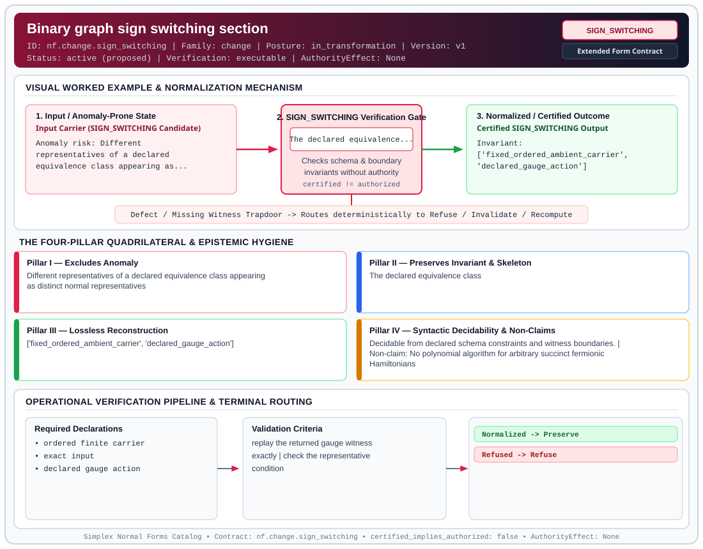

# Binary graph sign switching section (`SIGN_SWITCHING`)

> **Contract ID:** `nf.change.sign_switching` | **Family:** `change` | **Index Status:** `active` | **AuthorityEffect:** `None`

**[⬅ Back to Wiki Home](Home)** | **[View SVG Diagram](images/nf.change.sign_switching.svg)**

---

## 1. Executive Summary & Metadata

Binary graph sign switching section (SIGN_SWITCHING) enforces structural normalization and explicit defect routing in the change regime.

| Property | Value |
| :--- | :--- |
| **Canonical ID** | `nf.change.sign_switching` |
| **Short Name** | `SIGN_SWITCHING` |
| **Full Name** | Binary graph sign switching section |
| **Family** | `change` (Data in Motion & Boundary-Quotient Incremental Maintenance Contracts (BQNF & Cochain Repair)) |
| **Qualification** | Extended Form Contract (Normal Form Contract) |
| **Data / Math Posture** | in_transformation |
| **Index Status** | `active` |
| **Theory Status** | `proposed` |
| **Verification Status** | `executable` |
| **Contract Version** | `v1` |
| **Governance Fence** | `AuthorityEffect: None` (`certified_implies_authorized: false`) |

---

## 2. Visual Architecture & Normalization Diagram



---

## 3. Concrete Worked Example & Mechanism

### Visual Transition Summary

| Stage | Carrier / Operator | Concrete State / Invariant |
| :--- | :--- | :--- |
| **1. Before / Candidate Input** | `Input Carrier (SIGN_SWITCHING Candidate)` | Anomaly risk: Different ; representatives of a declared ; equivalence class appearing as... |
| **2. Normalization / Gate** | `SIGN_SWITCHING Verification Gate` | `The declared equivalence...` (`certified_implies_authorized: false`) |
| **3. After / Certified Output** | `Certified SIGN_SWITCHING Output` | Invariant: ; ['fixed_ordered_ambient_carrier', ; 'declared_gauge_action'] |

---

## 4. The Four-Pillar Quadrilateral & Non-Claims

Every contract in `simplex-normal-forms` is evaluated against the **Four-Pillar Quadrilateral** defined in `contracts/_golden_nfs/standard.yaml`:

| Pillar | Requirement | Contract Specification for `nf.change.sign_switching` |
| :--- | :--- | :--- |
| **Pillar I: Excludes Anomaly** | Name and eliminate a specific class of data or state defects. | Different representatives of a declared equivalence class appearing as distinct normal representatives |
| **Pillar II: Preserves Invariant** | State the structural invariant and protected skeleton preserved across transitions. | **Invariant:** The declared equivalence class<br>**Protected Skeleton:** ['fixed_ordered_ambient_carrier', 'declared_gauge_action'] |
| **Pillar III: Lossless Reconstruction** | State the non-loss reconstruction operator (join, direct sum, pullback, or replay). | Lossless reconstruction under declared projection, direct sum, or pullback operators. |
| **Pillar IV: Syntactic Decidability** | State how conformance is decided from declared constraints without unbudgeted scans. | Decidable from declared schema and witness metadata within bounded evaluation budgets. |

### Explicit Non-Claims (`certified_implies_authorized: false`)

- No polynomial algorithm for arbitrary succinct fermionic Hamiltonians
- No normalization across changes of labels, bases, carrier size, or equivalence relation

---

## 5. Operational Verification & Terminal Routing

### 5.1 Required Declarations

- ordered finite carrier
- exact input
- declared gauge action

### 5.2 Required Evidence

- **exact_gauge_witness**: binary_vector

### 5.3 Validation Criteria

| Criterion ID | Name | Condition |
| :--- | :--- | :--- |
| `criterion` | Check | replay the returned gauge witness exactly |
| `criterion` | Check | check the representative condition |

### 5.4 Terminal Route Map

Every evaluation terminates in a declared local route mapped to a canonical terminal in `standard.yaml`:

| Local Terminal Route | Canonical Terminal |
| :--- | :--- |
| `Normalized` | `Preserve` |
| `Refused` | `Refuse` |

### 5.5 Declared Failure Modes

_All defects route explicitly through the Terminal Route Map above._

---

## 6. Epistemic Claim Hygiene Quadrant

In accordance with the repository's epistemic claim discipline:

1. **What it supports:**
   - Supports syntactic and operational checking of `nf.change.sign_switching` (`SIGN_SWITCHING`) against its declared schema, boundary constraints, and witness obligations in this model.
   - Supports deterministic terminal routing (`Normalized, Refused`) when required declarations or invariants fail.
2. **What it does not support:**
   - Does not confer operational authority (`AuthorityEffect: None`, `certified_implies_authorized: false`).
   - Does not claim semantic truth of undeclared external processes or unverified upstream inputs beyond the declaredprotected skeleton.
3. **The narrowest defensible claim:**
   - Within the declared substrate `in_transformation`, this contract enforces that `Different representatives of a declared equivalence class appearing as distinct normal representatives` is either excluded under `The declared equivalence class` or routed to an explicit refusal/recovery terminal.
4. **The next test needed:**
   - Property-based falsification and mutation testing across boundary edge cases and composed multi-step pipelines for `nf.change.sign_switching`.

---

## 7. Canonical YAML Contract (`contracts/nf.change.sign_switching.yaml`)

<details>
<summary><strong>Click to expand full canonical YAML contract (contracts/nf.change.sign_switching.yaml)</strong></summary>

```yaml
schema_version: smplx.nf.contract.v1
contract_kind: normal_form_contract
identity:
  version: v1
  status: active
  theory_status: proposed
  contract_status: active
  verification_status: executable
  family: change
  id: nf.change.sign_switching
  name: Binary graph sign switching section
  short_name: SIGN_SWITCHING
classification:
  hierarchy_level: normal_form
  subject_kind:
  - finite_quotient
  data_posture: in_transformation
  mathematical_posture: formal_algebraic
purpose:
  excludes_anomaly: Different representatives of a declared equivalence class appearing
    as distinct normal representatives
  preserves_invariant: The declared equivalence class
  protected_skeleton:
  - fixed_ordered_ambient_carrier
  - declared_gauge_action
  erased_structure:
  - declared_gauge_redundancy
  non_claims:
  - No polynomial algorithm for arbitrary succinct fermionic Hamiltonians
  - No normalization across changes of labels, bases, carrier size, or equivalence
    relation
declarations_required:
- ordered finite carrier
- exact input
- declared gauge action
evidence_required:
- exact_gauge_witness: binary_vector
validation_criteria:
- replay the returned gauge witness exactly
- check the representative condition
terminal_routes:
- Normalized
- Refused
terminal_route_map:
  Normalized: Preserve
  Refused: Refuse
certification:
  certificate_required: true
  certificate_kind: explicit_gauge_witness
  obstruction_class_required: true
  loss_ledger_required: false
  loss_ledger_trigger_id: null
  verifier_required: true
authorization:
  authorized_by: null
  certified_implies_authorized: false
extensions:
  normalization:
    kind: canonicalizer
    claim_scope: A normal form for diagonal +/-1 basis gauges on an explicitly supplied
      sign graph; no claim for arbitrary unitary basis changes or succinct graph construction.
    domain: F2^E for a fixed ordered labelled finite undirected multigraph, including
      loops
    equivalence: s ~ s_prime iff s_prime(uv) = s(uv) + a(u) + a(v) mod 2
    normalizer: code/bqnf_sign_evaluator.py:normalize_sign_cochain
    representative_condition: All edges in the edge-order spanning forest have parity
      zero
    laws:
      soundness: N(s)(uv) = s(uv) xor returned_gauge(u) xor returned_gauge(v)
      idempotence: N(N(s)) = N(s)
      completeness: N(s) = N(s_prime) iff s and s_prime differ by vertex switching
      determinism: Edge order fixes the forest; least-vertex roots fix its gauge
    evidence:
    - ../docs/normal_form_audit.md
    - ../code/tests/test_normal_form_laws.py
quadrilateral:
  qualifies_as_true_normal_form: false
```

</details>
