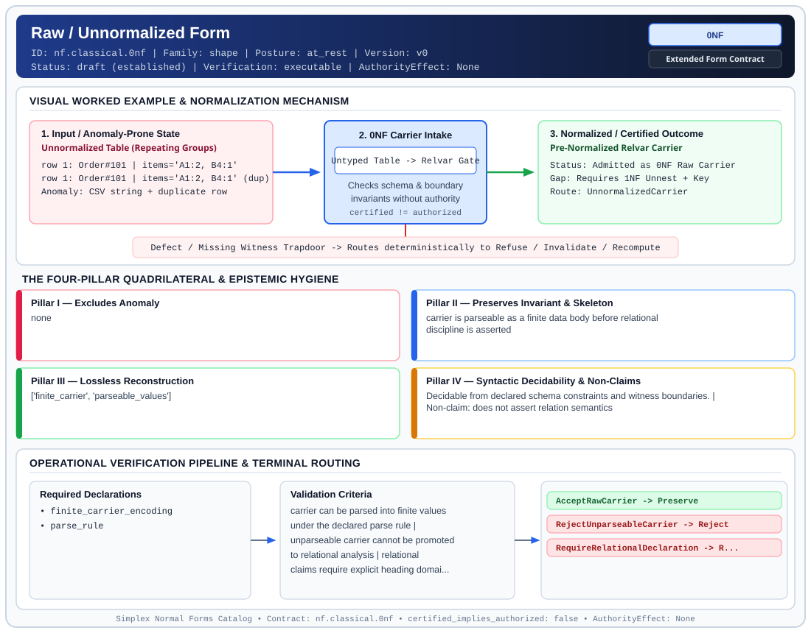

# Raw / Unnormalized Form (`0NF`)

> **Contract ID:** `nf.classical.0nf` | **Family:** `shape` | **Index Status:** `draft` | **AuthorityEffect:** `None`

**[⬅ Back to Wiki Home](Home)** | **[View SVG Diagram](images/nf.classical.0nf.svg)**

---

## 1. Executive Summary & Metadata

Raw / Unnormalized Form (0NF) enforces structural normalization and explicit defect routing in the shape regime.

| Property | Value |
| :--- | :--- |
| **Canonical ID** | `nf.classical.0nf` |
| **Short Name** | `0NF` |
| **Full Name** | Raw / Unnormalized Form |
| **Family** | `shape` (Relational, Algebraic & Cochain Shape Normal Forms (Data at Rest & Structural Decompositions)) |
| **Qualification** | Extended Form Contract (Normal Form Contract) |
| **Data / Math Posture** | at_rest |
| **Index Status** | `draft` |
| **Theory Status** | `established` |
| **Verification Status** | `executable` |
| **Contract Version** | `v0` |
| **Governance Fence** | `AuthorityEffect: None` (`certified_implies_authorized: false`) |

### Foundational Treatise Specification

- **Author**: Pedagogical pre-form
- **Structural Invariant**: Finite carrier before heading, domain, key, or predicate is declared.
- **Anomaly Excluded**: None.
- **Lossless Join Property**: Not applicable.
- **Qualifies As True Normal Form**: False
- **Qualification Gap**: Removes no anomalies; lacks schema constraints.

---

## 2. Visual Architecture & Normalization Diagram



---

## 3. Concrete Worked Example & Mechanism

### Visual Transition Summary

| Stage | Carrier / Operator | Concrete State / Invariant |
| :--- | :--- | :--- |
| **1. Before / Candidate Input** | `Unnormalized Table (Repeating Groups)` | row 1: Order#101 | items='A1:2, B4:1' ; row 1: Order#101 | items='A1:2, B4:1' (dup) ; Anomaly: CSV string + duplicate row |
| **2. Normalization / Gate** | `0NF Carrier Intake` | `Untyped Table -> Relvar Gate` (`certified_implies_authorized: false`) |
| **3. After / Certified Output** | `Pre-Normalized Relvar Carrier` | Status: Admitted as 0NF Raw Carrier ; Gap: Requires 1NF Unnest + Key ; Route: UnnormalizedCarrier |

### Contract-Declared Worked Cases

```yaml
- ref: coda_all_universe/1_the_tower/normal_forms/contracts/_book_09_full_normal_form_atlas.md
  section: 2.1 Classical Relational Normal Forms
```

---

## 4. The Four-Pillar Quadrilateral & Non-Claims

Every contract in `simplex-normal-forms` is evaluated against the **Four-Pillar Quadrilateral** defined in `contracts/_golden_nfs/standard.yaml`:

| Pillar | Requirement | Contract Specification for `nf.classical.0nf` |
| :--- | :--- | :--- |
| **Pillar I: Excludes Anomaly** | Name and eliminate a specific class of data or state defects. | none |
| **Pillar II: Preserves Invariant** | State the structural invariant and protected skeleton preserved across transitions. | **Invariant:** carrier is parseable as a finite data body before relational discipline is asserted<br>**Protected Skeleton:** ['finite_carrier', 'parseable_values'] |
| **Pillar III: Lossless Reconstruction** | State the non-loss reconstruction operator (join, direct sum, pullback, or replay). | Lossless reconstruction under declared projection, direct sum, or pullback operators. |
| **Pillar IV: Syntactic Decidability** | State how conformance is decided from declared constraints without unbudgeted scans. | Decidable from declared schema and witness metadata within bounded evaluation budgets. |

### Explicit Non-Claims (`certified_implies_authorized: false`)

- does not assert relation semantics
- does not assert tuple identity
- does not assert declared domains or keys
- does not certify runtime repair
- does not imply authorization
- does not meet the four-pillar test for a true normal form

---

## 5. Operational Verification & Terminal Routing

### 5.1 Required Declarations

- finite_carrier_encoding
- parse_rule

### 5.2 Required Evidence

_None declared._

### 5.3 Validation Criteria

| Criterion ID | Name | Condition |
| :--- | :--- | :--- |
| `criterion` | Check | carrier can be parsed into finite values under the declared parse rule |
| `criterion` | Check | unparseable carrier cannot be promoted to relational analysis |
| `criterion` | Check | relational claims require explicit heading domains keys and predicate |

### 5.4 Terminal Route Map

Every evaluation terminates in a declared local route mapped to a canonical terminal in `standard.yaml`:

| Local Terminal Route | Canonical Terminal |
| :--- | :--- |
| `AcceptRawCarrier` | `Preserve` |
| `RejectUnparseableCarrier` | `Reject` |
| `RequireRelationalDeclaration` | `Refuse` |

### 5.5 Declared Failure Modes

- **symptom**: byte stream is treated as a relation before parse rule and heading are declared, **diagnosis**: raw carrier promoted to relational claim, **terminal**: RequireRelationalDeclaration

---

## Deep-Dive Level Treatise

**AuthorityEffect:** None.  
**Level:** Level 00 (Unnormalized Raw Presentation / Base Ground)  
**Evidential Grade:** NATIVE IMPLEMENTED  
**Contract Reference:** [`nf.classical.0nf`](../../../../omega_engine_pfp/infrastructure/yaml/normal_forms/nf.classical.0nf.yaml)  
**Mathematical Posture:** Structural / Operational  
**Data Posture:** At Rest / Ingress  

---

## 1. Schematic & Conceptual Architecture

Zero Normal Form (0NF) models raw, unnormalized data representations prior to any relational atomicity or dependency discipline. In 0NF:
- Attributes may contain non-scalar collections (arrays, sub-tables, JSON bags, nested trees).
- Tuples lack positional or domain invariance.
- Duplication and repeated field groups are unrestricted.

```text
Raw Ingress Representation (0NF)
  ┌─────────────────────────────────────────────────────────────┐
  │ Record: [id: 101, tags: {"dev", "ops"}, payload: [1, 2, 3]] │
  └──────────────────────────────┬──────────────────────────────┘
                                 │
                   Flattening & Atomicity Filter
                                 ▼
                     Scalar Relvar (1NF)
```

In the MSS-N Tower, 0NF serves as the ground state for all data ingress pipelines, establishing the baseline against which structural projection loss is audited.

### The Ontological Triad: Table, Relvar, Boundary-Relvar

| Construct | Ontological Layer | Mathematical Object | Structural Discipline | Failure / Degeneracy Mode |
|---|---|---|---|---|
| **SQL Table** | Industrial Storage Engine | Multiset of physical rows, nullable columns, ordered fields | Ad-hoc SQL DDL (`CREATE TABLE`), duplicate rows permitted unless explicit unique constraint | Hidden duplicates, three-valued logic (`NULL = NULL` is UNKNOWN), silent ordering reliance |
| **Relational Relvar** | Classical Logical Model (Codd/Date) | Time-varying relation variable whose state is a mathematical relation $(H, B)$ | Unordered set of tuples, atomic scalar values, unique candidate keys | Static data-at-rest only; silent update/CDC cache inconsistency across views |
| **Boundary-Relvar** | Boundary-Oriented Programming (MSS-N) | Augmented relvar $(R, \partial R)$ equipped with discrete cochain boundary | Explicit delta-boundary tracking, signed repair certificates, typed terminal routing | Quarantined when boundary delta residual $\Xi > 0$ cannot be locally repaired |

---

## 2. Mathematical Invariants & Quadrilateral Properties

1. **Relation Heading & Non-Scalar Domains:**
   $$R_0 = (H, B), \quad H = \{A_1: D_1, \dots, A_k: D_k\}$$
   where domains $D_i$ may be arbitrary power sets $\mathcal{P}(U)$ or recursive relation types.

2. **The Quadrilateral Invariants:**
   - **Anomaly Excluded:** Uncontrolled structural embedding, invisible nested updates, and indeterminate key semantics.
   - **Protected Skeleton:** Raw tuple identifiers and declared nested attribute trees.
   - **Erased Structure:** None (0NF preserves all ingress bytes).
   - **Reconstruction:** Trivial identity mapping $R_0 \to R_0$.

3. **Non-Claims:**
   - 0NF does not claim relational closure under Codd relational algebra.
   - 0NF does not ensure under declared assumptions unique tuple addressing without an external row identifier.
   - 0NF does not prevent update, insertion, or deletion anomalies.

---

## 3. Terminal Routes & Verification Logic

```text
Ingress Payload
      │
      ├── Contains valid parse tree ──► Preserve (0NF Admitted)
      │
      ├── Missing root schema ────────► Refuse (IngressViolation)
      │
      └── Unparseable encoding ───────► Reject (MalformedPayload)
```

- `Preserve`: Payload admitted as a raw, unflattened ground representation.
- `Refuse`: Schema declaration missing or untyped.
- `Reject`: Syntax or framing violation.

---

## 4. Test Evidence & Local Execution

Verified in [`test_tranche3_advanced_relational_nfs.py`](../../../tests/normal_forms/test_tranche3_advanced_relational_nfs.py):
- `test_0nf_nested_collection_preservation`: Asserts that non-scalar attributes remain accessible without silent projection.
- `test_0nf_rejection_of_relational_joins`: Verifies that Codd joins on non-scalar domains fail closed to typed refusal.

---

## 5. Epistemic Claim Quadrant

1. **What it supports:**
   - Formal admission of nested and unnormalized data payloads without premature data loss.
   - Explicit auditing of ingress representations before relational normalization begins.
2. **What it does not support:**
   - Relational dependency preservation, lossless join decomposition, or SQL set algebra.
3. **The narrowest defensible claim:**
   - 0NF defines an unconstrained container whose members satisfy syntax parsing but not relational first normal form.
4. **The next test needed:**
   - Property tests asserting that any 0NF $\to$ 1NF flattening step emits an explicit loss ledger whenever nested ordering is discarded.

---

## 6. Epistemic Claim Hygiene Quadrant

In accordance with the repository's epistemic claim discipline:

1. **What it supports:**
   - Supports syntactic and operational checking of `nf.classical.0nf` (`0NF`) against its declared schema, boundary constraints, and witness obligations in this model.
   - Supports deterministic terminal routing (`AcceptRawCarrier, RejectUnparseableCarrier, RequireRelationalDeclaration`) when required declarations or invariants fail.
2. **What it does not support:**
   - Does not confer operational authority (`AuthorityEffect: None`, `certified_implies_authorized: false`).
   - Does not claim semantic truth of undeclared external processes or unverified upstream inputs beyond the declaredprotected skeleton.
3. **The narrowest defensible claim:**
   - Within the declared substrate `at_rest`, this contract enforces that `none` is either excluded under `carrier is parseable as a finite data body before relational discipline is asserted` or routed to an explicit refusal/recovery terminal.
4. **The next test needed:**
   - Property-based falsification and mutation testing across boundary edge cases and composed multi-step pipelines for `nf.classical.0nf`.

---

## 7. Canonical YAML Contract (`contracts/nf.classical.0nf.yaml`)

<details>
<summary><strong>Click to expand full canonical YAML contract (contracts/nf.classical.0nf.yaml)</strong></summary>

```yaml
schema_version: smplx.nf.contract.v0
schema_ref: ./normal_form_contract_schema.yaml
contract_kind: form_contract
identity:
  id: nf.classical.0nf
  name: Raw / Unnormalized Form
  short_name: 0NF
  version: v0
  theory_status: established
  contract_status: draft
  verification_status: executable
  family: shape
  status: draft
classification:
  hierarchy_level: form
  subject_kind:
  - relvar
  data_posture: at_rest
  mathematical_posture: operational
purpose:
  excludes_anomaly: none
  preserves_invariant: carrier is parseable as a finite data body before relational
    discipline is asserted
  protected_skeleton:
  - finite_carrier
  - parseable_values
  erased_structure: []
  non_claims:
  - does not assert relation semantics
  - does not assert tuple identity
  - does not assert declared domains or keys
  - does not certify runtime repair
  - does not imply authorization
  - does not meet the four-pillar test for a true normal form
definition:
  source: coda_all_universe/mssn_sn_tower/definitions.md
  citation:
    label: pedagogical name for an unnormalized carrier
  formal_statement: 'A carrier is called 0NF when a declared parse rule reads it as
    a finite collection of values. No heading, domain, key, or predicate is required.

    '
  quadrilateral:
    qualifies_as_true_normal_form: false
    anomaly_exclusion: no anomaly class is excluded
    lossless_join:
      status: not_applicable
      statement: no decomposition is defined
    dependency_preservation:
      status: not_applicable
      statement: no dependency set is declared
    syntactic_decision:
      status: parse_check
      statement: 'The check is that the declared parse rule accepts the carrier. That
        is not a decision about a relation schema.

        '
declarations_required:
- finite_carrier_encoding
- parse_rule
evidence_required: []
validation_criteria:
- carrier can be parsed into finite values under the declared parse rule
- unparseable carrier cannot be promoted to relational analysis
- relational claims require explicit heading domains keys and predicate
proof_obligations: []
terminal_routes:
- AcceptRawCarrier
- RejectUnparseableCarrier
- RequireRelationalDeclaration
terminal_route_map:
  AcceptRawCarrier: Preserve
  RejectUnparseableCarrier: Reject
  RequireRelationalDeclaration: Refuse
certification:
  certificate_required: false
  certificate_kind: null
  obstruction_class_required: false
  loss_ledger_required: false
  verifier_required: false
  loss_ledger_trigger_id: null
authorization:
  authorized_by: null
  certified_implies_authorized: false
failure_modes:
- symptom: byte stream is treated as a relation before parse rule and heading are
    declared
  diagnosis: raw carrier promoted to relational claim
  terminal: RequireRelationalDeclaration
examples:
- ref: coda_all_universe/1_the_tower/normal_forms/contracts/_book_09_full_normal_form_atlas.md
  section: 2.1 Classical Relational Normal Forms
references:
- coda_all_universe/1_the_tower/normal_forms/contracts/_book_09_full_normal_form_atlas.md
- coda_all_universe/1_the_tower/normal_forms/contracts/_paper_0_relvar_relation_table_and_boundary_relvar.md
```

</details>
