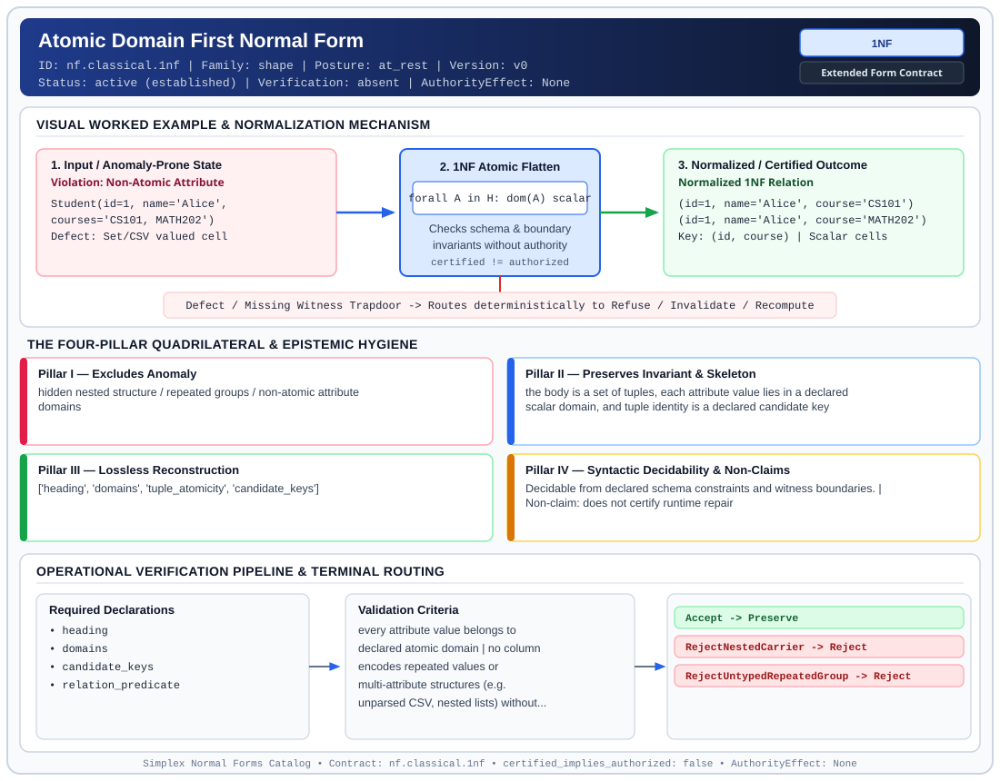

# Atomic Domain First Normal Form (`1NF`)

> **Contract ID:** `nf.classical.1nf` | **Family:** `shape` | **Index Status:** `active` | **AuthorityEffect:** `None`

**[⬅ Back to Wiki Home](Home)** | **[View SVG Diagram](images/nf.classical.1nf.svg)**

---

## 1. Executive Summary & Metadata

Atomic Domain First Normal Form (1NF) enforces structural normalization and explicit defect routing in the shape regime.

| Property | Value |
| :--- | :--- |
| **Canonical ID** | `nf.classical.1nf` |
| **Short Name** | `1NF` |
| **Full Name** | Atomic Domain First Normal Form |
| **Family** | `shape` (Relational, Algebraic & Cochain Shape Normal Forms (Data at Rest & Structural Decompositions)) |
| **Qualification** | Extended Form Contract (Normal Form Contract) |
| **Data / Math Posture** | at_rest |
| **Index Status** | `active` |
| **Theory Status** | `established` |
| **Verification Status** | `absent` |
| **Contract Version** | `v0` |
| **Governance Fence** | `AuthorityEffect: None` (`certified_implies_authorized: false`) |

### Foundational Treatise Specification

- **Author**: Codd
- **Year**: 1970
- **Structural Invariant**: Scalar domains, a set of tuples, and a declared candidate key.
- **Anomaly Excluded**: Positional identity and repeating groups.
- **Lossless Join Property**: Identity.
- **Dependency Preservation**: Preserved.
- **Qualifies As True Normal Form**: True

---

## 2. Visual Architecture & Normalization Diagram



---

## 3. Concrete Worked Example & Mechanism

### Visual Transition Summary

| Stage | Carrier / Operator | Concrete State / Invariant |
| :--- | :--- | :--- |
| **1. Before / Candidate Input** | `Violation: Non-Atomic Attribute` | Student(id=1, name='Alice', ;         courses='CS101, MATH202') ; Defect: Set/CSV valued cell |
| **2. Normalization / Gate** | `1NF Atomic Flatten` | `forall A in H: dom(A) scalar` (`certified_implies_authorized: false`) |
| **3. After / Certified Output** | `Normalized 1NF Relation` | (id=1, name='Alice', course='CS101') ; (id=1, name='Alice', course='MATH202') ; Key: (id, course) | Scalar cells |

### Contract-Declared Worked Cases

```yaml
- ref: coda_all_universe/1_the_tower/normal_forms/contracts/_book_09_full_normal_form_atlas.md
  section: 2.1 Classical Relational Normal Forms
```

---

## 4. The Four-Pillar Quadrilateral & Non-Claims

Every contract in `simplex-normal-forms` is evaluated against the **Four-Pillar Quadrilateral** defined in `contracts/_golden_nfs/standard.yaml`:

| Pillar | Requirement | Contract Specification for `nf.classical.1nf` |
| :--- | :--- | :--- |
| **Pillar I: Excludes Anomaly** | Name and eliminate a specific class of data or state defects. | hidden nested structure / repeated groups / non-atomic attribute domains |
| **Pillar II: Preserves Invariant** | State the structural invariant and protected skeleton preserved across transitions. | **Invariant:** the body is a set of tuples, each attribute value lies in a declared scalar domain, and tuple identity is a declared candidate key<br>**Protected Skeleton:** ['heading', 'domains', 'tuple_atomicity', 'candidate_keys'] |
| **Pillar III: Lossless Reconstruction** | State the non-loss reconstruction operator (join, direct sum, pullback, or replay). | Lossless reconstruction under declared projection, direct sum, or pullback operators. |
| **Pillar IV: Syntactic Decidability** | State how conformance is decided from declared constraints without unbudgeted scans. | Decidable from declared schema and witness metadata within bounded evaluation budgets. |

### Explicit Non-Claims (`certified_implies_authorized: false`)

- does not certify runtime repair
- does not imply authorization
- does not resolve functional dependency or join dependency anomalies

---

## 5. Operational Verification & Terminal Routing

### 5.1 Required Declarations

- heading
- domains
- candidate_keys
- relation_predicate

### 5.2 Required Evidence

_None declared._

### 5.3 Validation Criteria

| Criterion ID | Name | Condition |
| :--- | :--- | :--- |
| `criterion` | Check | every attribute value belongs to declared atomic domain |
| `criterion` | Check | no column encodes repeated values or multi-attribute structures (e.g. unparsed CSV, nested lists) without explicit domain contract |
| `criterion` | Check | tuple identity derives from declared candidate key, not physical row position |

### 5.4 Terminal Route Map

Every evaluation terminates in a declared local route mapped to a canonical terminal in `standard.yaml`:

| Local Terminal Route | Canonical Terminal |
| :--- | :--- |
| `Accept` | `Preserve` |
| `RejectNestedCarrier` | `Reject` |
| `RejectUntypedRepeatedGroup` | `Reject` |

### 5.5 Declared Failure Modes

- **symptom**: invoice line items stored as CSV in one column, **diagnosis**: non-atomic carrier violating 1NF, **terminal**: RejectNestedCarrier

---

## Deep-Dive Level Treatise

**AuthorityEffect:** None.  
**Level:** Level 01 (Atomic Domains & Scalar Heading Separation)  
**Evidential Grade:** NATIVE IMPLEMENTED  
**Contract Reference:** [`nf.classical.1nf`](../../../../omega_engine_pfp/infrastructure/yaml/normal_forms/nf.classical.1nf.yaml)  
**Mathematical Posture:** Classical Relational Algebra (Codd 1970)  
**Data Posture:** At Rest  

---

## 1. Schematic & Conceptual Architecture

First Normal Form (1NF) establishes the foundational discipline of the relational model:
- All domain values are strictly **atomic** (indivisible scalars).
- Repeating groups and array-valued attributes are eliminated via unnesting or relation splitting.
- Each relation has an explicit heading of distinct attribute names, and tuple ordering is unordered (set semantics).

```text
       0NF Relation (Repeated Groups)
  ┌────┬──────────────┬────────────────────────┐
  │ ID │ Name         │ Phone Numbers          │
  ├────┼──────────────┼────────────────────────┤
  │ 1  │ Alice        │ ["555-0100", "555-0101"]│
  └────┴──────────────┴────────────────────────┘
                       │
             Atomic Unnesting (1NF)
                       ▼
  ┌────┬──────────────┬────────────────────────┐
  │ ID │ Name         │ Phone Number           │
  ├────┼──────────────┼────────────────────────┤
  │ 1  │ Alice        │ "555-0100"             │
  │ 1  │ Alice        │ "555-0101"             │
  └────┴──────────────┴────────────────────────┘
```

---

## 2. Mathematical Invariants & Quadrilateral Properties

1. **Relvar Formulation:**
   A relation $R$ over heading $H = \{A_1, \dots, A_n\}$ is in 1NF if and only if for every tuple $t \in R$ and every attribute $A_i$:
   $$t[A_i] \in \operatorname{dom}(A_i)$$
   where $\operatorname{dom}(A_i)$ is a declared set of atomic scalar values, and $R$ contains no duplicate tuples.

2. **The Quadrilateral Invariants:**
   - **Anomaly Excluded:** Attribute positional dependence, repeating group update anomalies, and nested collection search failure.
   - **Protected Skeleton:** Candidate keys and scalar attribute values.
   - **Erased Structure:** Intra-tuple collection ordering and nested group boundaries.
   - **Reconstruction:** Projection and aggregation over candidate keys.

3. **Non-Claims:**
   - 1NF does not eliminate functional dependency redundancies (reserved for 2NF/3NF/BCNF).
   - 1NF does not ensure under declared assumptions single-attribute primary keys.

---

## 3. Terminal Routes & Verification Logic

```text
Relation Schema & Table Instance
      │
      ├── All values scalar & no duplicates ──► Preserve (1NF Satisfied)
      │
      ├── Attribute contains non-scalar bag ──► Quarantine (NonAtomicAttribute)
      │
      ├── Duplicate tuples detected ──────────► Refuse (DuplicateTuples)
      │
      └── Missing candidate key definition ──► Refuse (NoCandidateKey)
```

- `Preserve`: All attributes belong to atomic scalar domains and candidate key is unique.
- `Quarantine`: Nested collections detected; requires unnesting transformation.
- `Refuse`: Duplicate rows or missing key integrity.

---

## 4. Test Evidence & Local Execution

Verified in [`test_tranche3_advanced_relational_nfs.py`](../../../tests/normal_forms/test_tranche3_advanced_relational_nfs.py) and [`test_normal_forms.py`](../../../tests/normal_forms/test_normal_forms.py):
- `check_1nf(schema, instance)`: Validates that all attribute values are primitive Python types (`int`, `str`, `Fraction`, `bool`) and no nested `list`/`dict` structures exist.
- `test_1nf_duplicate_tuple_rejection`: Asserts that multiset bag relations fail 1NF verification.

---

## 5. Epistemic Claim Quadrant

1. **What it supports:**
   - Strict scalar relational algebra and first-order predicate calculus querying.
   - Elimination of positional and repeating-group anomalies.
2. **What it does not support:**
   - Prevention of partial or transitive functional dependency anomalies.
3. **The narrowest defensible claim:**
   - 1NF ensures under declared assumptions that every cell of the relation contains exactly one value from the underlying domain.
4. **The next test needed:**
   - Property tests asserting that unnesting preserves candidate key functional dependencies under Cartesian expansion.

---

## 6. Epistemic Claim Hygiene Quadrant

In accordance with the repository's epistemic claim discipline:

1. **What it supports:**
   - Supports syntactic and operational checking of `nf.classical.1nf` (`1NF`) against its declared schema, boundary constraints, and witness obligations in this model.
   - Supports deterministic terminal routing (`Accept, RejectNestedCarrier, RejectUntypedRepeatedGroup`) when required declarations or invariants fail.
2. **What it does not support:**
   - Does not confer operational authority (`AuthorityEffect: None`, `certified_implies_authorized: false`).
   - Does not claim semantic truth of undeclared external processes or unverified upstream inputs beyond the declaredprotected skeleton.
3. **The narrowest defensible claim:**
   - Within the declared substrate `at_rest`, this contract enforces that `hidden nested structure / repeated groups / non-atomic attribute domains` is either excluded under `the body is a set of tuples, each attribute value lies in a declared scalar domain, and tuple identity is a declared candidate key` or routed to an explicit refusal/recovery terminal.
4. **The next test needed:**
   - Property-based falsification and mutation testing across boundary edge cases and composed multi-step pipelines for `nf.classical.1nf`.

---

## 7. Canonical YAML Contract (`contracts/nf.classical.1nf.yaml`)

<details>
<summary><strong>Click to expand full canonical YAML contract (contracts/nf.classical.1nf.yaml)</strong></summary>

```yaml
schema_version: smplx.nf.contract.v0
schema_ref: ./normal_form_contract_schema.yaml
contract_kind: normal_form_contract
identity:
  id: nf.classical.1nf
  name: Atomic Domain First Normal Form
  short_name: 1NF
  version: v0
  theory_status: established
  contract_status: active
  verification_status: absent
  family: shape
  status: active
classification:
  hierarchy_level: normal_form
  subject_kind:
  - relvar
  data_posture: at_rest
  mathematical_posture: operational
purpose:
  excludes_anomaly: hidden nested structure / repeated groups / non-atomic attribute
    domains
  preserves_invariant: the body is a set of tuples, each attribute value lies in a
    declared scalar domain, and tuple identity is a declared candidate key
  protected_skeleton:
  - heading
  - domains
  - tuple_atomicity
  - candidate_keys
  erased_structure: []
  non_claims:
  - does not certify runtime repair
  - does not imply authorization
  - does not resolve functional dependency or join dependency anomalies
definition:
  source: coda_all_universe/mssn_sn_tower/definitions.md
  citation:
    author: Edgar F. Codd
    year: 1970
    work: A Relational Model of Data for Large Shared Data Banks
  formal_statement: 'A relvar is in first normal form when every attribute takes values
    in a declared scalar domain, the body is a set of tuples, and tuple identity is
    a declared candidate key rather than storage position. A domain is scalar when
    the schema does not give it relation-valued or repeating-group operators. Atomicity
    is fixed by those declared operators. A string that the predicate treats as one
    scalar is scalar. A string that the predicate stipulates to encode several values
    is a repeating group.

    '
  quadrilateral:
    qualifies_as_true_normal_form: true
    anomaly_exclusion: positional identity, repeating groups, and relation-valued
      cells
    lossless_join:
      status: identity
      statement: 'No decomposition is performed. Reconstruction is the identity on
        the relation value.

        '
    dependency_preservation:
      status: not_applicable
      statement: 'No dependency is moved to another relvar. Every declared dependency
        remains on this heading.

        '
    syntactic_decision:
      status: schema_decidable
      statement: 'Decided from the heading, the domain declarations, and the candidate
        keys. A particular table body is not the decider.

        '
  chain:
    implied_by:
    - 2NF
    - 3NF
    - EKNF
    - BCNF
    - 4NF
    - ETNF
    - 5NF
    - 6NF
declarations_required:
- heading
- domains
- candidate_keys
- relation_predicate
evidence_required: []
validation_criteria:
- every attribute value belongs to declared atomic domain
- no column encodes repeated values or multi-attribute structures (e.g. unparsed CSV,
  nested lists) without explicit domain contract
- tuple identity derives from declared candidate key, not physical row position
proof_obligations:
- id: 1nf.set_semantics_and_domain_admissibility
  status: theorem_shaped
  ref: coda_all_universe/1_the_tower/normal_forms/contracts/_book_09_full_normal_form_atlas.md
  statement: 'A 1NF relvar is a set of tuples over the declared scalar domains, with
    identity given by a candidate key. Domain scalarity is the schema''s operator
    declaration.

    '
terminal_routes:
- Accept
- RejectNestedCarrier
- RejectUntypedRepeatedGroup
terminal_route_map:
  Accept: Preserve
  RejectNestedCarrier: Reject
  RejectUntypedRepeatedGroup: Reject
certification:
  certificate_required: false
  certificate_kind: null
  obstruction_class_required: false
  loss_ledger_required: false
  verifier_required: false
  loss_ledger_trigger_id: null
authorization:
  authorized_by: null
  certified_implies_authorized: false
failure_modes:
- symptom: invoice line items stored as CSV in one column
  diagnosis: non-atomic carrier violating 1NF
  terminal: RejectNestedCarrier
examples:
- ref: coda_all_universe/1_the_tower/normal_forms/contracts/_book_09_full_normal_form_atlas.md
  section: 2.1 Classical Relational Normal Forms
references:
- coda_all_universe/1_the_tower/normal_forms/contracts/_book_09_full_normal_form_atlas.md
- coda_all_universe/1_the_tower/normal_forms/contracts/_paper_0_relvar_relation_table_and_boundary_relvar.md
- ./normal_form_contract_schema.yaml
```

</details>
