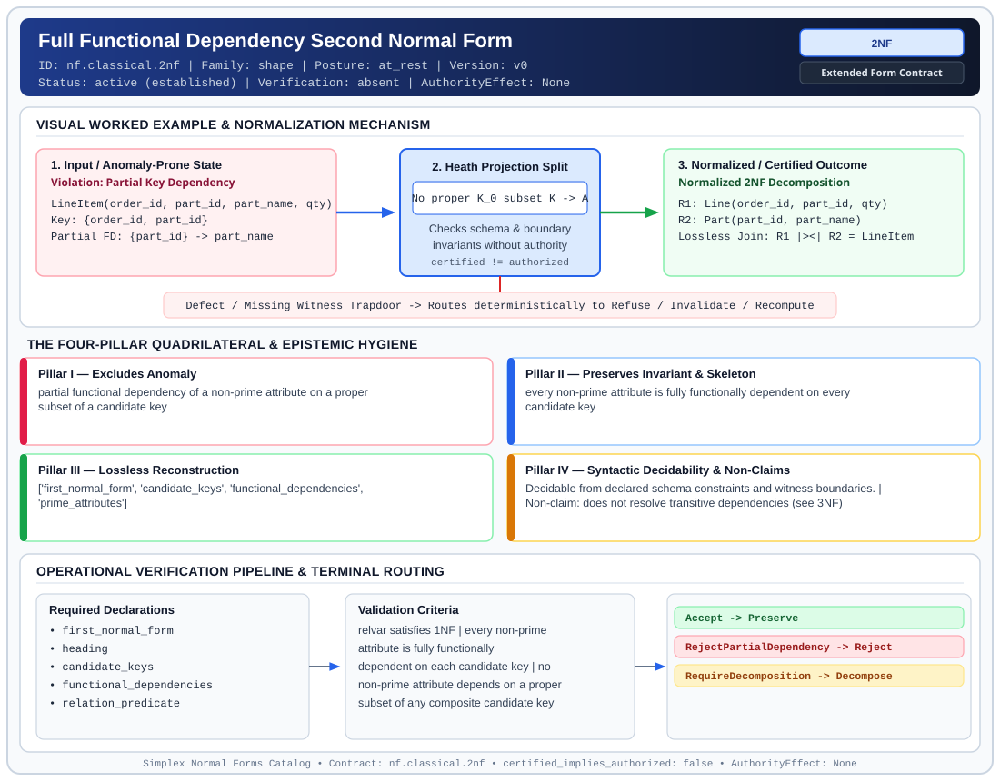

# Full Functional Dependency Second Normal Form (`2NF`)

> **Contract ID:** `nf.classical.2nf` | **Family:** `shape` | **Index Status:** `active` | **AuthorityEffect:** `None`

**[⬅ Back to Wiki Home](Home)** | **[View SVG Diagram](images/nf.classical.2nf.svg)**

---

## 1. Executive Summary & Metadata

Full Functional Dependency Second Normal Form (2NF) enforces structural normalization and explicit defect routing in the shape regime.

| Property | Value |
| :--- | :--- |
| **Canonical ID** | `nf.classical.2nf` |
| **Short Name** | `2NF` |
| **Full Name** | Full Functional Dependency Second Normal Form |
| **Family** | `shape` (Relational, Algebraic & Cochain Shape Normal Forms (Data at Rest & Structural Decompositions)) |
| **Qualification** | Extended Form Contract (Normal Form Contract) |
| **Data / Math Posture** | at_rest |
| **Index Status** | `active` |
| **Theory Status** | `established` |
| **Verification Status** | `absent` |
| **Contract Version** | `v0` |
| **Governance Fence** | `AuthorityEffect: None` (`certified_implies_authorized: false`) |

### Foundational Treatise Specification

- **Author**: Codd
- **Year**: 1971
- **Structural Invariant**: No non-prime attribute depends on a proper subset of a candidate key.
- **Anomaly Excluded**: Partial-key redundancy.
- **Lossless Join Property**: Heath's Theorem.
- **Dependency Preservation**: Preserved.
- **Qualifies As True Normal Form**: True

---

## 2. Visual Architecture & Normalization Diagram



---

## 3. Concrete Worked Example & Mechanism

### Visual Transition Summary

| Stage | Carrier / Operator | Concrete State / Invariant |
| :--- | :--- | :--- |
| **1. Before / Candidate Input** | `Violation: Partial Key Dependency` | LineItem(order_id, part_id, part_name, qty) ; Key: {order_id, part_id} ; Partial FD: {part_id} -> part_name |
| **2. Normalization / Gate** | `Heath Projection Split` | `No proper K_0 subset K -> A` (`certified_implies_authorized: false`) |
| **3. After / Certified Output** | `Normalized 2NF Decomposition` | R1: Line(order_id, part_id, qty) ; R2: Part(part_id, part_name) ; Lossless Join: R1 |><| R2 = LineItem |

### Contract-Declared Worked Cases

```yaml
- ref: coda_all_universe/1_the_tower/normal_forms/contracts/_book_09_full_normal_form_atlas.md
  section: 2.1 Classical Relational Normal Forms
```

---

## 4. The Four-Pillar Quadrilateral & Non-Claims

Every contract in `simplex-normal-forms` is evaluated against the **Four-Pillar Quadrilateral** defined in `contracts/_golden_nfs/standard.yaml`:

| Pillar | Requirement | Contract Specification for `nf.classical.2nf` |
| :--- | :--- | :--- |
| **Pillar I: Excludes Anomaly** | Name and eliminate a specific class of data or state defects. | partial functional dependency of a non-prime attribute on a proper subset of a candidate key |
| **Pillar II: Preserves Invariant** | State the structural invariant and protected skeleton preserved across transitions. | **Invariant:** every non-prime attribute is fully functionally dependent on every candidate key<br>**Protected Skeleton:** ['first_normal_form', 'candidate_keys', 'functional_dependencies', 'prime_attributes'] |
| **Pillar III: Lossless Reconstruction** | State the non-loss reconstruction operator (join, direct sum, pullback, or replay). | Lossless reconstruction under declared projection, direct sum, or pullback operators. |
| **Pillar IV: Syntactic Decidability** | State how conformance is decided from declared constraints without unbudgeted scans. | Decidable from declared schema and witness metadata within bounded evaluation budgets. |

### Explicit Non-Claims (`certified_implies_authorized: false`)

- does not resolve transitive dependencies (see 3NF)
- does not imply Boyce-Codd Normal Form
- does not certify runtime repair without cochain substrate
- does not imply authorization

---

## 5. Operational Verification & Terminal Routing

### 5.1 Required Declarations

- first_normal_form
- heading
- candidate_keys
- functional_dependencies
- relation_predicate

### 5.2 Required Evidence

_None declared._

### 5.3 Validation Criteria

| Criterion ID | Name | Condition |
| :--- | :--- | :--- |
| `criterion` | Check | relvar satisfies 1NF |
| `criterion` | Check | every non-prime attribute is fully functionally dependent on each candidate key |
| `criterion` | Check | no non-prime attribute depends on a proper subset of any composite candidate key |

### 5.4 Terminal Route Map

Every evaluation terminates in a declared local route mapped to a canonical terminal in `standard.yaml`:

| Local Terminal Route | Canonical Terminal |
| :--- | :--- |
| `Accept` | `Preserve` |
| `RejectPartialDependency` | `Reject` |
| `RequireDecomposition` | `Decompose` |

### 5.5 Declared Failure Modes

- **symptom**: order_line relvar keyed by (order_id, line_no) stores order_date depending only on order_id, **diagnosis**: non-prime attribute depends on a proper subset of a composite key, **terminal**: RejectPartialDependency

---

## Deep-Dive Level Treatise

**AuthorityEffect:** None.  
**Level:** Level 02 (Full Functional Dependency & Partial Key Exclusion)  
**Evidential Grade:** NATIVE IMPLEMENTED  
**Contract Reference:** [`nf.classical.2nf`](../../../../omega_engine_pfp/infrastructure/yaml/normal_forms/nf.classical.2nf.yaml)  
**Mathematical Posture:** Functional Dependency Closure (Armstrong 1974)  
**Data Posture:** At Rest  

---

## 1. Schematic & Conceptual Architecture

Second Normal Form (2NF) enforces that no non-prime attribute depends on a proper subset of any candidate key:
- The relation must already be in 1NF.
- Every non-prime attribute (an attribute not belonging to any minimal candidate key) must exhibit **full functional dependency** on every candidate key.

```text
       Partial Dependency (Fails 2NF)
   ┌───────────────────────┐
   │ (OrderID, ItemID) ───► Quantity   (Full dependency)
   │  OrderID ────────────► OrderDate  (PARTIAL DEPENDENCY on proper subset)
   └───────────────────────┘
               │
      Decomposition into 2NF Relvars
               ▼
   R1: (OrderID, ItemID, Quantity)  [Key: (OrderID, ItemID)]
   R2: (OrderID, OrderDate)         [Key: OrderID]
```

---

## 2. Mathematical Invariants & Quadrilateral Properties

1. **Formal Definition:**
   Let $R$ be a relation schema in 1NF with attribute set $U$, candidate key set $\mathcal{K}$, and functional dependency set $F$.
   An attribute $A \in U$ is **prime** if $A \in K$ for some $K \in \mathcal{K}$; otherwise, $A$ is **non-prime**.
   $R$ is in 2NF if and only if for every non-trivial functional dependency $X \to A \in F^+$ where $A$ is non-prime:
   $$X \not\subset K \quad \forall K \in \mathcal{K}$$
   That is, no non-prime attribute is functionally determined by a strict proper subset of any candidate key.

2. **The Quadrilateral Invariants:**
   - **Anomaly Excluded:** Redundant storage of partial-key facts, insertion anomalies for incomplete composite keys, and deletion anomalies where removing an item deletes order-level metadata.
   - **Protected Skeleton:** Full key-to-attribute dependency relationships.
   - **Erased Structure:** Direct co-location of partial-key attributes within the composite table.
   - **Reconstruction:** Natural join over the foreign key $R_1 \bowtie R_2 = R$.

---

## 3. Terminal Routes & Verification Logic

```text
1NF Relation & Functional Dependencies
      │
      ├── No partial dependencies detected ──► Preserve (2NF Verified)
      │
      ├── Partial key dependency exists ─────► Repair (DecomposeOnPartialKey)
      │
      └── Schema violates 1NF ───────────────► Refuse (1NFPreconditionFailed)
```

- `Preserve`: Schema satisfies 1NF and contains zero partial functional dependencies.
- `Repair`: Decomposes $R$ into $R[X \cup A]$ and $R[U \setminus A]$ where $X \subset K$.
- `Refuse`: Underlying 1NF preconditions are not satisfied.

---

## 4. Test Evidence & Local Execution

Verified in [`test_tranche3_advanced_relational_nfs.py`](../../../tests/normal_forms/test_tranche3_advanced_relational_nfs.py):
- `check_2nf(schema, fds)`: Computes candidate keys via attribute closure (`compute_attribute_closure`), extracts non-prime attributes, and asserts that no proper subset $X \subset K$ determines a non-prime attribute $A$.
- Tests verify that schemas with single-attribute primary keys are vacuously in 2NF.

---

## 5. Epistemic Claim Quadrant

1. **What it supports:**
   - Elimination of partial-key update and deletion anomalies.
   - Lossless decomposition across partial key projections.
2. **What it does not support:**
   - Elimination of transitive dependencies among non-prime attributes (governed by 3NF).
3. **The narrowest defensible claim:**
   - 2NF ensures under declared assumptions that non-prime attributes describe the *entire* candidate key, not solely a sub-component.
4. **The next test needed:**
   - Property tests asserting that composite foreign key constraints preserve referential integrity across 2NF decompositions.

---

## 6. Epistemic Claim Hygiene Quadrant

In accordance with the repository's epistemic claim discipline:

1. **What it supports:**
   - Supports syntactic and operational checking of `nf.classical.2nf` (`2NF`) against its declared schema, boundary constraints, and witness obligations in this model.
   - Supports deterministic terminal routing (`Accept, RejectPartialDependency, RequireDecomposition`) when required declarations or invariants fail.
2. **What it does not support:**
   - Does not confer operational authority (`AuthorityEffect: None`, `certified_implies_authorized: false`).
   - Does not claim semantic truth of undeclared external processes or unverified upstream inputs beyond the declaredprotected skeleton.
3. **The narrowest defensible claim:**
   - Within the declared substrate `at_rest`, this contract enforces that `partial functional dependency of a non-prime attribute on a proper subset of a candidate key` is either excluded under `every non-prime attribute is fully functionally dependent on every candidate key` or routed to an explicit refusal/recovery terminal.
4. **The next test needed:**
   - Property-based falsification and mutation testing across boundary edge cases and composed multi-step pipelines for `nf.classical.2nf`.

---

## 7. Canonical YAML Contract (`contracts/nf.classical.2nf.yaml`)

<details>
<summary><strong>Click to expand full canonical YAML contract (contracts/nf.classical.2nf.yaml)</strong></summary>

```yaml
schema_version: smplx.nf.contract.v0
schema_ref: ./normal_form_contract_schema.yaml
contract_kind: normal_form_contract
identity:
  id: nf.classical.2nf
  name: Full Functional Dependency Second Normal Form
  short_name: 2NF
  version: v0
  theory_status: established
  contract_status: active
  verification_status: absent
  family: shape
  status: active
classification:
  hierarchy_level: normal_form
  subject_kind:
  - relvar
  data_posture: at_rest
  mathematical_posture: operational
purpose:
  excludes_anomaly: partial functional dependency of a non-prime attribute on a proper
    subset of a candidate key
  preserves_invariant: every non-prime attribute is fully functionally dependent on
    every candidate key
  protected_skeleton:
  - first_normal_form
  - candidate_keys
  - functional_dependencies
  - prime_attributes
  erased_structure: []
  non_claims:
  - does not resolve transitive dependencies (see 3NF)
  - does not imply Boyce-Codd Normal Form
  - does not certify runtime repair without cochain substrate
  - does not imply authorization
definition:
  source: coda_all_universe/mssn_sn_tower/definitions.md
  citation:
    author: Edgar F. Codd
    year: 1971
    work: Further Normalization of the Data Base Relational Model
  formal_statement: 'A relvar is in second normal form when it is in first normal
    form and no non-prime attribute depends on a proper subset of a candidate key.
    An attribute is prime when it belongs to at least one candidate key. A candidate
    key is a superkey of which no proper subset is a superkey. A dependency of a prime
    attribute on part of a key is outside this prohibition.

    '
  quadrilateral:
    qualifies_as_true_normal_form: true
    anomaly_exclusion: 'Insertion, deletion, and update redundancy of a fact that
      depends on only part of a composite candidate key.

      '
    lossless_join:
      status: heath
      theorem: Heath 1971
      statement: 'If a non-prime attribute A depends on a proper subset K'' of a candidate
        key, Heath''s theorem makes the split (K''A, heading without A) join back
        to every legal instance, because K'' determines A.

        '
    dependency_preservation:
      status: preserved_for_the_split_dependency
      statement: 'The partial dependency sits entirely in the component headed by
        K''A. Transitive dependencies are not the target of this split.

        '
    syntactic_decision:
      status: schema_decidable
      statement: 'Decided from the candidate keys, the prime attributes, and a cover
        of the functional dependencies. The body of one instance is not the decider.

        '
  chain:
    requires:
    - 1NF
    implied_by:
    - 3NF
    - EKNF
    - BCNF
    - 4NF
    - ETNF
    - 5NF
    - 6NF
declarations_required:
- first_normal_form
- heading
- candidate_keys
- functional_dependencies
- relation_predicate
evidence_required: []
validation_criteria:
- relvar satisfies 1NF
- every non-prime attribute is fully functionally dependent on each candidate key
- no non-prime attribute depends on a proper subset of any composite candidate key
proof_obligations:
- id: 2nf.partial_dependency_elimination
  status: theorem_shaped
  ref: coda_all_universe/1_the_tower/normal_forms/contracts/_book_09_full_normal_form_atlas.md
  statement: 'Membership is first normal form plus the absence of a non-prime attribute
    that depends on a proper subset of a candidate key. The Heath split on that dependency
    is lossless.

    '
terminal_routes:
- Accept
- RejectPartialDependency
- RequireDecomposition
terminal_route_map:
  Accept: Preserve
  RejectPartialDependency: Reject
  RequireDecomposition: Decompose
certification:
  certificate_required: false
  certificate_kind: null
  obstruction_class_required: false
  loss_ledger_required: false
  verifier_required: false
  loss_ledger_trigger_id: null
authorization:
  authorized_by: null
  certified_implies_authorized: false
failure_modes:
- symptom: order_line relvar keyed by (order_id, line_no) stores order_date depending
    only on order_id
  diagnosis: non-prime attribute depends on a proper subset of a composite key
  terminal: RejectPartialDependency
examples:
- ref: coda_all_universe/1_the_tower/normal_forms/contracts/_book_09_full_normal_form_atlas.md
  section: 2.1 Classical Relational Normal Forms
references:
- coda_all_universe/1_the_tower/normal_forms/contracts/_book_09_full_normal_form_atlas.md
- coda_all_universe/1_the_tower/normal_forms/contracts/_paper_0_relvar_relation_table_and_boundary_relvar.md
- ./normal_form_contract_schema.yaml
```

</details>
