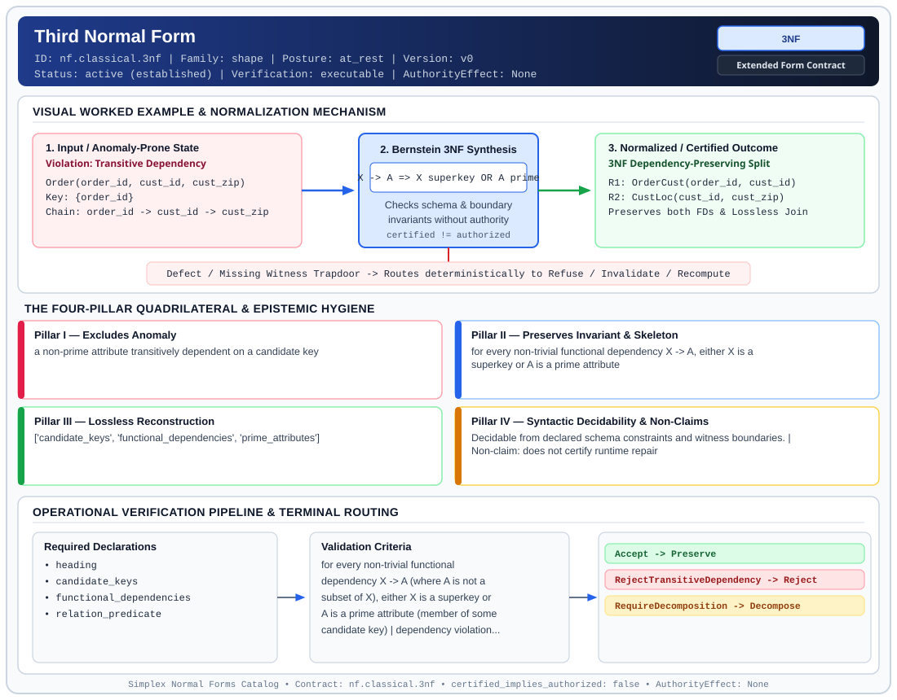

# Third Normal Form (`3NF`)

> **Contract ID:** `nf.classical.3nf` | **Family:** `shape` | **Index Status:** `active` | **AuthorityEffect:** `None`

**[⬅ Back to Wiki Home](Home)** | **[View SVG Diagram](images/nf.classical.3nf.svg)**

---

## 1. Executive Summary & Metadata

Third Normal Form (3NF) enforces structural normalization and explicit defect routing in the shape regime.

| Property | Value |
| :--- | :--- |
| **Canonical ID** | `nf.classical.3nf` |
| **Short Name** | `3NF` |
| **Full Name** | Third Normal Form |
| **Family** | `shape` (Relational, Algebraic & Cochain Shape Normal Forms (Data at Rest & Structural Decompositions)) |
| **Qualification** | Extended Form Contract (Normal Form Contract) |
| **Data / Math Posture** | at_rest |
| **Index Status** | `active` |
| **Theory Status** | `established` |
| **Verification Status** | `executable` |
| **Contract Version** | `v0` |
| **Governance Fence** | `AuthorityEffect: None` (`certified_implies_authorized: false`) |

### Foundational Treatise Specification

- **Author**: Codd
- **Year**: 1971
- **Structural Invariant**: For every non-trivial FD X -> A, X is a superkey or A is prime.
- **Anomaly Excluded**: Transitive dependence of a non-prime attribute.
- **Lossless Join Property**: Heath's Theorem.
- **Dependency Preservation**: Preserved by synthesis.
- **Qualifies As True Normal Form**: True

---

## 2. Visual Architecture & Normalization Diagram



---

## 3. Concrete Worked Example & Mechanism

### Visual Transition Summary

| Stage | Carrier / Operator | Concrete State / Invariant |
| :--- | :--- | :--- |
| **1. Before / Candidate Input** | `Violation: Transitive Dependency` | Order(order_id, cust_id, cust_zip) ; Key: {order_id} ; Chain: order_id -> cust_id -> cust_zip |
| **2. Normalization / Gate** | `Bernstein 3NF Synthesis` | `X -> A => X superkey OR A prime` (`certified_implies_authorized: false`) |
| **3. After / Certified Output** | `3NF Dependency-Preserving Split` | R1: OrderCust(order_id, cust_id) ; R2: CustLoc(cust_id, cust_zip) ; Preserves both FDs & Lossless Join |

### Contract-Declared Worked Cases

```yaml
- ref: coda_all_universe/1_the_tower/normal_forms/contracts/_book_09_full_normal_form_atlas.md
  section: 3.0 Running example
  note: Orders / Customers decomposition sketch
```

---

## 4. The Four-Pillar Quadrilateral & Non-Claims

Every contract in `simplex-normal-forms` is evaluated against the **Four-Pillar Quadrilateral** defined in `contracts/_golden_nfs/standard.yaml`:

| Pillar | Requirement | Contract Specification for `nf.classical.3nf` |
| :--- | :--- | :--- |
| **Pillar I: Excludes Anomaly** | Name and eliminate a specific class of data or state defects. | a non-prime attribute transitively dependent on a candidate key |
| **Pillar II: Preserves Invariant** | State the structural invariant and protected skeleton preserved across transitions. | **Invariant:** for every non-trivial functional dependency X -> A, either X is a superkey or A is a prime attribute<br>**Protected Skeleton:** ['candidate_keys', 'functional_dependencies', 'prime_attributes'] |
| **Pillar III: Lossless Reconstruction** | State the non-loss reconstruction operator (join, direct sum, pullback, or replay). | Lossless reconstruction under declared projection, direct sum, or pullback operators. |
| **Pillar IV: Syntactic Decidability** | State how conformance is decided from declared constraints without unbudgeted scans. | Decidable from declared schema and witness metadata within bounded evaluation budgets. |

### Explicit Non-Claims (`certified_implies_authorized: false`)

- does not certify runtime repair
- does not imply authorization
- does not eliminate all redundancy where a non-superkey determines a prime attribute (see BCNF)

---

## 5. Operational Verification & Terminal Routing

### 5.1 Required Declarations

- heading
- candidate_keys
- functional_dependencies
- relation_predicate

### 5.2 Required Evidence

_None declared._

### 5.3 Validation Criteria

| Criterion ID | Name | Condition |
| :--- | :--- | :--- |
| `criterion` | Check | for every non-trivial functional dependency X -> A (where A is not a subset of X), either X is a superkey or A is a prime attribute (member of some candidate key) |
| `criterion` | Check | dependency violations terminalize as decomposition requirements rather than being ignored |
| `criterion` | Check | minimal cover synthesis and extraneous attribute elimination use deterministic lexicographic attribute tie-breaking |

### 5.4 Terminal Route Map

Every evaluation terminates in a declared local route mapped to a canonical terminal in `standard.yaml`:

| Local Terminal Route | Canonical Terminal |
| :--- | :--- |
| `Accept` | `Preserve` |
| `RejectTransitiveDependency` | `Reject` |
| `RequireDecomposition` | `Decompose` |

### 5.5 Declared Failure Modes

- **symptom**: non-prime attribute depends on another non-key attribute set where determinant is not a superkey, **diagnosis**: transitive dependency violating 3NF condition, **terminal**: RequireDecomposition

---

## Deep-Dive Level Treatise

**AuthorityEffect:** None.  
**Level:** Level 03 (Transitive Dependency Elimination & Bernstein Synthesis)  
**Evidential Grade:** NATIVE IMPLEMENTED  
**Contract Reference:** [`nf.classical.3nf`](../../../../omega_engine_pfp/infrastructure/yaml/normal_forms/nf.classical.3nf.yaml)  
**Mathematical Posture:** Relational Synthesis & Dependency Preservation (Bernstein 1976)  
**Data Posture:** At Rest  

---

## 1. Schematic & Conceptual Architecture

Third Normal Form (3NF) eliminates **transitive dependencies** between non-prime attributes:
- The relation must already be in 2NF.
- Non-prime attributes must not depend on other non-prime attributes.
- Every attribute must depend directly on the key, the whole key, and nothing but the key (except for prime attribute targets).

```text
       Transitive Dependency (Fails 3NF)
   ┌───────────────────────────────────────────┐
   │ OrderID ────────► CustomerID (Candidate Key)
   │ CustomerID ─────► CustomerZip (TRANSITIVE) │
   └───────────────────────────────────────────┘
                       │
              3NF Bernstein Synthesis
                       ▼
   R1: (OrderID, CustomerID)   [Key: OrderID]
   R2: (CustomerID, CustomerZip) [Key: CustomerID]
```

---

## 2. Mathematical Invariants & Quadrilateral Properties

1. **Formal Definition (Codd 1972 / Zaniolo 1982):**
   A relation schema $R$ with functional dependencies $F$ is in 3NF if and only if for every non-trivial functional dependency $X \to A \in F^+$:
   $$\text{Either } X \text{ is a superkey of } R, \quad \text{or } A \text{ is a prime attribute of } R.$$

2. **Bernstein 3NF Synthesis Invariant:**
   For any schema $R$ and functional dependency set $F$, there exists a polynomial-time algorithm that computes a decomposition $D = \{R_1, \dots, R_m\}$ such that:
   - Each $R_i$ is in 3NF.
   - The decomposition is **lossless** ($\bowtie R_i = R$).
   - The decomposition is **dependency-preserving** ($(\bigcup F_i)^+ = F^+$).

3. **The Quadrilateral Invariants:**
   - **Anomaly Excluded:** Redundant transitive attribute storage, customer update anomalies across multiple orders.
   - **Protected Skeleton:** Minimal cover dependencies and candidate key coverings.
   - **Erased Structure:** Transitive co-location of attributes in the master relation.
   - **Reconstruction:** Lossless join decomposition via primary/foreign key connections.

---

## 3. Terminal Routes & Verification Logic

```text
2NF Relation & Functional Dependencies
      │
      ├── For all X -> A: X is superkey OR A is prime ──► Preserve (3NF Verified)
      │
      ├── Transitive non-prime dependency exists ───────► Repair (Synthesize3NF)
      │
      └── Schema violates 2NF ──────────────────────────► Refuse (2NFPreconditionFailed)
```

- `Preserve`: All dependencies satisfy the superkey or prime-attribute disjunction.
- `Repair`: Decomposes via Bernstein synthesis to restore 3NF while preserving dependencies.
- `Refuse`: Schema fails 1NF or 2NF preconditions.

---

## 4. Test Evidence & Local Execution

Verified in [`test_tranche3_advanced_relational_nfs.py`](../../../tests/normal_forms/test_tranche3_advanced_relational_nfs.py):
- `check_3nf(schema, fds)`: Validates that for every functional dependency, either the determinant is a superkey or the dependent attribute is prime.
- `test_bernstein_3nf_synthesis_algorithm`: Computes a canonical minimal cover, partitions into sub-relvars, ensures a candidate key relvar is included, and asserts both lossless join and dependency preservation.

---

## 5. Epistemic Claim Quadrant

1. **What it supports:**
   - canonical existence of lossless-join, dependency-preserving decompositions for all relational schemas.
   - Complete elimination of transitive dependencies among non-prime attributes.
2. **What it does not support:**
   - Elimination of redundancies caused by functional dependencies whose determinant is not a superkey when the dependent is prime (requires BCNF).
3. **The narrowest defensible claim:**
   - 3NF ensures under declared assumptions that no non-prime attribute is transitively dependent on any candidate key.
4. **The next test needed:**
   - Property tests comparing Bernstein synthesis against Armstrong closure bounds across 100 randomized relational schemata.

---

## 6. Epistemic Claim Hygiene Quadrant

In accordance with the repository's epistemic claim discipline:

1. **What it supports:**
   - Supports syntactic and operational checking of `nf.classical.3nf` (`3NF`) against its declared schema, boundary constraints, and witness obligations in this model.
   - Supports deterministic terminal routing (`Accept, RejectTransitiveDependency, RequireDecomposition`) when required declarations or invariants fail.
2. **What it does not support:**
   - Does not confer operational authority (`AuthorityEffect: None`, `certified_implies_authorized: false`).
   - Does not claim semantic truth of undeclared external processes or unverified upstream inputs beyond the declaredprotected skeleton.
3. **The narrowest defensible claim:**
   - Within the declared substrate `at_rest`, this contract enforces that `a non-prime attribute transitively dependent on a candidate key` is either excluded under `for every non-trivial functional dependency X -> A, either X is a superkey or A is a prime attribute` or routed to an explicit refusal/recovery terminal.
4. **The next test needed:**
   - Property-based falsification and mutation testing across boundary edge cases and composed multi-step pipelines for `nf.classical.3nf`.

---

## 7. Canonical YAML Contract (`contracts/nf.classical.3nf.yaml`)

<details>
<summary><strong>Click to expand full canonical YAML contract (contracts/nf.classical.3nf.yaml)</strong></summary>

```yaml
schema_version: smplx.nf.contract.v0
schema_ref: ./normal_form_contract_schema.yaml
contract_kind: normal_form_contract
identity:
  id: nf.classical.3nf
  name: Third Normal Form
  short_name: 3NF
  version: v0
  theory_status: established
  contract_status: active
  verification_status: executable
  family: shape
  status: active
classification:
  hierarchy_level: normal_form
  subject_kind:
  - relvar
  data_posture: at_rest
  mathematical_posture: operational
purpose:
  excludes_anomaly: a non-prime attribute transitively dependent on a candidate key
  preserves_invariant: for every non-trivial functional dependency X -> A, either
    X is a superkey or A is a prime attribute
  protected_skeleton:
  - candidate_keys
  - functional_dependencies
  - prime_attributes
  erased_structure: []
  non_claims:
  - does not certify runtime repair
  - does not imply authorization
  - does not eliminate all redundancy where a non-superkey determines a prime attribute
    (see BCNF)
definition:
  source: coda_all_universe/mssn_sn_tower/definitions.md
  citation:
    author: Edgar F. Codd
    year: 1971
    work: Further Normalization of the Data Base Relational Model
  formal_statement: 'Codd''s statement: the relvar is in second normal form, and no
    non-prime attribute A is transitively dependent on a candidate key K. Transitive
    dependence means K determines X, X determines A, X is not a superkey, and A lies
    outside both K and X. Zaniolo''s statement, which defines the same class of schemas
    under functional dependencies: for every functional dependency X -> A in which
    A is a single attribute outside X, either X is a superkey or A is prime. The decision
    procedure in this contract is Zaniolo''s statement.

    '
  same_class_as:
    statement: Codd's transitive-dependence statement
    scope: functional dependencies
    citation: Zaniolo 1982
    proved_in_this_tree: false
  quadrilateral:
    qualifies_as_true_normal_form: true
    anomaly_exclusion: 'Update and deletion anomalies from a non-prime attribute that
      depends on a candidate key only through another non-superkey set.

      '
    lossless_join:
      status: heath
      theorem: Heath 1971
      statement: 'A violating dependency X -> A yields the lossless split (XA, heading
        without A), because X determines A.

        '
    dependency_preservation:
      status: preserved_by_synthesis
      canonical_tie_breaking: lexicographic_attribute_ordering
      statement: 'Bernstein''s synthesis algorithm (1976) with deterministic lexicographic
        attribute tie-breaking produces a unique lossless decomposition into third
        normal form in which every functional dependency of the minimal cover is
        local to one component. Boyce-Codd normal form does not inherit this preservation
        ensure under declared assumptions.

        '
    syntactic_decision:
      status: schema_decidable
      statement: 'Decided from a cover of the functional dependencies, the superkeys,
        and the prime attributes. One stored body is not the decider.

        '
  chain:
    requires:
    - 1NF
    - 2NF
    implied_by:
    - EKNF
    - BCNF
    - 4NF
    - ETNF
    - 5NF
    - 6NF
declarations_required:
- heading
- candidate_keys
- functional_dependencies
- relation_predicate
evidence_required: []
validation_criteria:
- for every non-trivial functional dependency X -> A (where A is not a subset of X),
  either X is a superkey or A is a prime attribute (member of some candidate key)
- dependency violations terminalize as decomposition requirements rather than being
  ignored
- minimal cover synthesis and extraneous attribute elimination use deterministic lexicographic
  attribute tie-breaking
proof_obligations:
- id: 3nf.zaniolo_membership
  status: theorem_shaped
  ref: coda_all_universe/mssn_sn_tower/definitions.md
  statement: 'Under functional dependencies, Codd''s transitive-dependence condition
    and Zaniolo''s superkey-or-prime condition define the same schemas. The Lean checker
    is_3nf_compliant implements the second condition on a caller-supplied list of
    non-trivial dependencies.

    '
terminal_routes:
- Accept
- RejectTransitiveDependency
- RequireDecomposition
terminal_route_map:
  Accept: Preserve
  RejectTransitiveDependency: Reject
  RequireDecomposition: Decompose
certification:
  certificate_required: false
  certificate_kind: null
  obstruction_class_required: false
  loss_ledger_required: false
  verifier_required: false
  loss_ledger_trigger_id: null
authorization:
  authorized_by: null
  certified_implies_authorized: false
failure_modes:
- symptom: non-prime attribute depends on another non-key attribute set where determinant
    is not a superkey
  diagnosis: transitive dependency violating 3NF condition
  terminal: RequireDecomposition
examples:
- ref: coda_all_universe/1_the_tower/normal_forms/contracts/_book_09_full_normal_form_atlas.md
  section: 3.0 Running example
  note: Orders / Customers decomposition sketch
references:
- coda_all_universe/1_the_tower/normal_forms/contracts/_book_09_full_normal_form_atlas.md
- coda_all_universe/1_the_tower/normal_forms/contracts/_paper_0_relvar_relation_table_and_boundary_relvar.md
```

</details>
