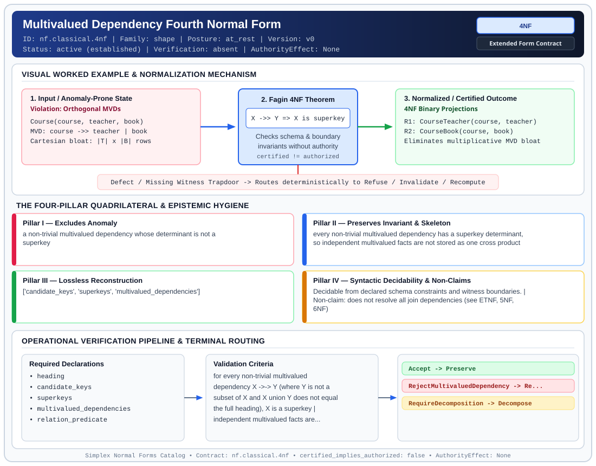

# Multivalued Dependency Fourth Normal Form (`4NF`)

> **Contract ID:** `nf.classical.4nf` | **Family:** `shape` | **Index Status:** `active` | **AuthorityEffect:** `None`

**[⬅ Back to Wiki Home](Home)** | **[View SVG Diagram](images/nf.classical.4nf.svg)**

---

## 1. Executive Summary & Metadata

Multivalued Dependency Fourth Normal Form (4NF) enforces structural normalization and explicit defect routing in the shape regime.

| Property | Value |
| :--- | :--- |
| **Canonical ID** | `nf.classical.4nf` |
| **Short Name** | `4NF` |
| **Full Name** | Multivalued Dependency Fourth Normal Form |
| **Family** | `shape` (Relational, Algebraic & Cochain Shape Normal Forms (Data at Rest & Structural Decompositions)) |
| **Qualification** | Extended Form Contract (Normal Form Contract) |
| **Data / Math Posture** | at_rest |
| **Index Status** | `active` |
| **Theory Status** | `established` |
| **Verification Status** | `absent` |
| **Contract Version** | `v0` |
| **Governance Fence** | `AuthorityEffect: None` (`certified_implies_authorized: false`) |

### Foundational Treatise Specification

- **Author**: Fagin
- **Year**: 1977
- **Structural Invariant**: Every non-trivial multivalued dependency X ->> Y has X as a superkey.
- **Anomaly Excluded**: Independent multivalued Cartesian bloat.
- **Lossless Join Property**: Fagin's Theorem.
- **Dependency Preservation**: Preserved.
- **Qualifies As True Normal Form**: True

---

## 2. Visual Architecture & Normalization Diagram



---

## 3. Concrete Worked Example & Mechanism

### Visual Transition Summary

| Stage | Carrier / Operator | Concrete State / Invariant |
| :--- | :--- | :--- |
| **1. Before / Candidate Input** | `Violation: Orthogonal MVDs` | Course(course, teacher, book) ; MVD: course ->> teacher | book ; Cartesian bloat: |T| x |B| rows |
| **2. Normalization / Gate** | `Fagin 4NF Theorem` | `X ->> Y => X is superkey` (`certified_implies_authorized: false`) |
| **3. After / Certified Output** | `4NF Binary Projections` | R1: CourseTeacher(course, teacher) ; R2: CourseBook(course, book) ; Eliminates multiplicative MVD bloat |

### Contract-Declared Worked Cases

```yaml
- ref: coda_all_universe/1_the_tower/normal_forms/contracts/_book_09_full_normal_form_atlas.md
  section: 2.1 Classical Relational Normal Forms
```

---

## 4. The Four-Pillar Quadrilateral & Non-Claims

Every contract in `simplex-normal-forms` is evaluated against the **Four-Pillar Quadrilateral** defined in `contracts/_golden_nfs/standard.yaml`:

| Pillar | Requirement | Contract Specification for `nf.classical.4nf` |
| :--- | :--- | :--- |
| **Pillar I: Excludes Anomaly** | Name and eliminate a specific class of data or state defects. | a non-trivial multivalued dependency whose determinant is not a superkey |
| **Pillar II: Preserves Invariant** | State the structural invariant and protected skeleton preserved across transitions. | **Invariant:** every non-trivial multivalued dependency has a superkey determinant, so independent multivalued facts are not stored as one cross product<br>**Protected Skeleton:** ['candidate_keys', 'superkeys', 'multivalued_dependencies'] |
| **Pillar III: Lossless Reconstruction** | State the non-loss reconstruction operator (join, direct sum, pullback, or replay). | Lossless reconstruction under declared projection, direct sum, or pullback operators. |
| **Pillar IV: Syntactic Decidability** | State how conformance is decided from declared constraints without unbudgeted scans. | Decidable from declared schema and witness metadata within bounded evaluation budgets. |

### Explicit Non-Claims (`certified_implies_authorized: false`)

- does not resolve all join dependencies (see ETNF, 5NF, 6NF)
- does not certify runtime repair without cochain substrate
- does not imply authorization

---

## 5. Operational Verification & Terminal Routing

### 5.1 Required Declarations

- heading
- candidate_keys
- superkeys
- multivalued_dependencies
- relation_predicate

### 5.2 Required Evidence

_None declared._

### 5.3 Validation Criteria

| Criterion ID | Name | Condition |
| :--- | :--- | :--- |
| `criterion` | Check | for every non-trivial multivalued dependency X ->-> Y (where Y is not a subset of X and X union Y does not equal the full heading), X is a superkey |
| `criterion` | Check | independent multivalued facts are decomposed into separate relvars with lossless reconstruction |

### 5.4 Terminal Route Map

Every evaluation terminates in a declared local route mapped to a canonical terminal in `standard.yaml`:

| Local Terminal Route | Canonical Terminal |
| :--- | :--- |
| `Accept` | `Preserve` |
| `RejectMultivaluedDependency` | `Reject` |
| `RequireDecomposition` | `Decompose` |

### 5.5 Declared Failure Modes

- **symptom**: employee skills and employee languages are stored in one relvar, creating all pairwise cross-product combinations, **diagnosis**: independent multivalued dependencies share a non-superkey determinant, **terminal**: RejectMultivaluedDependency

---

## Deep-Dive Level Treatise

**AuthorityEffect:** None.  
**Level:** Level 05 (Multivalued Dependencies & Orthogonal Factorization)  
**Evidential Grade:** NATIVE IMPLEMENTED  
**Contract Reference:** [`nf.classical.4nf`](../../../../omega_engine_pfp/infrastructure/yaml/normal_forms/nf.classical.4nf.yaml)  
**Mathematical Posture:** Multivalued Dependency Algebra (Fagin 1977)  
**Data Posture:** At Rest  

---

## 1. Schematic & Conceptual Architecture

Fourth Normal Form (4NF) addresses redundancies arising from **multivalued dependencies (MVDs)** that cannot be captured by functional dependencies alone:
- Occurs when two or more independent multi-valued facts about an entity are stored in the same relation.
- Forces a Cartesian product of independent attributes, leading to combinatorial tuple explosion.

```text
         MVD Redundancy (Fails 4NF)
  ┌──────────┬──────────────────┬──────────────┐
  │ Teacher  │ Course           │ Hobby        │
  ├──────────┼──────────────────┼──────────────┤
  │ Smith    │ Math             │ Tennis       │
  │ Smith    │ Math             │ Swimming     │
  │ Smith    │ Physics          │ Tennis       │
  │ Smith    │ Physics          │ Swimming     │
  └──────────┴──────────────────┴──────────────┘
  Teacher ↠ Course and Teacher ↠ Hobby are independent!
                       │
              4NF Decomposition
                       ▼
  R1: (Teacher, Course)     R2: (Teacher, Hobby)
```

---

## 2. Mathematical Invariants & Quadrilateral Properties

1. **Formal Definition (Fagin 1977):**
   Let $R$ be a relation schema over $U$. An MVD $X \twoheadrightarrow Y$ holds on $R$ if and only if for all tuples $t_1, t_2 \in R$ with $t_1[X] = t_2[X]$, there exist tuples $t_3, t_4 \in R$ such that:
   $$t_3[X] = t_1[X], \quad t_3[Y] = t_1[Y], \quad t_3[U \setminus (X \cup Y)] = t_2[U \setminus (X \cup Y)]$$
   $R$ is in 4NF if for every non-trivial MVD $X \twoheadrightarrow Y$ (where $Y \not\subseteq X$ and $X \cup Y \neq U$):
   $$X \text{ is a superkey of } R.$$

2. **Fagin's Binary Decomposition Theorem:**
   A relation $R(X, Y, Z)$ can be losslessly decomposed into $R_1(X, Y)$ and $R_2(X, Z)$ if and only if the MVD $X \twoheadrightarrow Y$ holds on $R$.

3. **The Quadrilateral Invariants:**
   - **Anomaly Excluded:** Cartesian redundancy, combinatorial update overhead on independent multi-valued facts.
   - **Protected Skeleton:** Independent multi-valued factorizations.
   - **Erased Structure:** Spurious cross-product pairings between independent attributes.
   - **Reconstruction:** Natural join $R_1(X, Y) \bowtie R_2(X, Z) = R$.

---

## 3. Terminal Routes & Verification Logic

```text
BCNF Relation & Multivalued Dependencies
      │
      ├── Every non-trivial MVD has a superkey determinant ──► Preserve (4NF Verified)
      │
      ├── Non-trivial non-superkey MVD exists ───────────────► Repair (FaginMVDDecomposition)
      │
      └── Schema fails BCNF preconditions ───────────────────► Refuse (BCNFPreconditionFailed)
```

- `Preserve`: Schema satisfies BCNF and all non-trivial MVDs emanate from superkeys.
- `Repair`: Decomposes $R$ into $R[X \cup Y]$ and $R[X \cup (U \setminus Y)]$.
- `Refuse`: Underlying functional dependency normal forms are violated.

---

## 4. Test Evidence & Local Execution

Verified in [`test_relational_confluence_and_4nf_mvd.py`](../../../tests/normal_forms/test_relational_confluence_and_4nf_mvd.py):
- `test_4nf_mvd_fagin_binary_decomposition`: Verifies that independent multivalued attributes factor into orthogonal relvars without tuple loss.
- `test_4nf_spurious_tuple_generation`: Asserts that updating an unnormalized table without inserting all cross-product tuples causes MVD violation and trips 4NF refusal.

---

## 5. Epistemic Claim Quadrant

1. **What it supports:**
   - Elimination of Cartesian product expansion among independent multi-valued facts.
   - Exact binary lossless join decomposition for multivalued dependencies.
2. **What it does not support:**
   - Decompositions that require ternary or $n$-ary joins (governed by 5NF / PJNF).
3. **The narrowest defensible claim:**
   - 4NF ensures under declared assumptions that every binary lossless decomposition is driven by a superkey.
4. **The next test needed:**
   - Property tests validating the confluence of MVD decompositions under randomized attribute ordering.

---

## 6. Epistemic Claim Hygiene Quadrant

In accordance with the repository's epistemic claim discipline:

1. **What it supports:**
   - Supports syntactic and operational checking of `nf.classical.4nf` (`4NF`) against its declared schema, boundary constraints, and witness obligations in this model.
   - Supports deterministic terminal routing (`Accept, RejectMultivaluedDependency, RequireDecomposition`) when required declarations or invariants fail.
2. **What it does not support:**
   - Does not confer operational authority (`AuthorityEffect: None`, `certified_implies_authorized: false`).
   - Does not claim semantic truth of undeclared external processes or unverified upstream inputs beyond the declaredprotected skeleton.
3. **The narrowest defensible claim:**
   - Within the declared substrate `at_rest`, this contract enforces that `a non-trivial multivalued dependency whose determinant is not a superkey` is either excluded under `every non-trivial multivalued dependency has a superkey determinant, so independent multivalued facts are not stored as one cross product` or routed to an explicit refusal/recovery terminal.
4. **The next test needed:**
   - Property-based falsification and mutation testing across boundary edge cases and composed multi-step pipelines for `nf.classical.4nf`.

---

## 7. Canonical YAML Contract (`contracts/nf.classical.4nf.yaml`)

<details>
<summary><strong>Click to expand full canonical YAML contract (contracts/nf.classical.4nf.yaml)</strong></summary>

```yaml
schema_version: smplx.nf.contract.v0
schema_ref: ./normal_form_contract_schema.yaml
contract_kind: normal_form_contract
identity:
  id: nf.classical.4nf
  name: Multivalued Dependency Fourth Normal Form
  short_name: 4NF
  version: v0
  theory_status: established
  contract_status: active
  verification_status: absent
  family: shape
  status: active
classification:
  hierarchy_level: normal_form
  subject_kind:
  - relvar
  data_posture: at_rest
  mathematical_posture: operational
purpose:
  excludes_anomaly: a non-trivial multivalued dependency whose determinant is not
    a superkey
  preserves_invariant: every non-trivial multivalued dependency has a superkey determinant,
    so independent multivalued facts are not stored as one cross product
  protected_skeleton:
  - candidate_keys
  - superkeys
  - multivalued_dependencies
  erased_structure: []
  non_claims:
  - does not resolve all join dependencies (see ETNF, 5NF, 6NF)
  - does not certify runtime repair without cochain substrate
  - does not imply authorization
definition:
  source: coda_all_universe/mssn_sn_tower/definitions.md
  citation:
    author: Ronald Fagin
    year: 1977
    work: Multivalued Dependencies and a New Normal Form for Relational Databases
  formal_statement: 'Let Z be the heading with X and Y removed. The multivalued dependency
    X ->-> Y holds when any two tuples that agree on X have a third tuple that keeps
    the first tuple''s Y values and the second tuple''s Z values. The dependency is
    trivial when Y is contained in X, or when X union Y is the whole heading. The
    relvar is in fourth normal form when every non-trivial multivalued dependency
    in the consequence closure has a superkey as its determinant. Read as multivalued
    dependencies, the functional dependencies then have superkey determinants as well,
    which is Boyce-Codd normal form.

    '
  quadrilateral:
    qualifies_as_true_normal_form: true
    anomaly_exclusion: 'Cartesian growth from two independent multivalued facts that
      share a determinant and are stored in one relvar.

      '
    lossless_join:
      status: fagin
      theorem: Fagin 1977
      statement: 'For a heading split into XY and XZ, the binary decomposition is
        lossless if and only if the multivalued dependency X ->-> Y holds (equivalently
        X ->-> Z).

        '
    dependency_preservation:
      status: split_mvd_preserved_embedded_mvds_not_guaranteed
      statement: 'The multivalued dependency used in the Fagin split is local to that
        decomposition. An embedded multivalued dependency, one that holds in a projection
        and is not the projection of a multivalued dependency of the original heading,
        is not ensured under declared assumptions to remain expressible after the split. Membership of the
        original schema is still decided from its own multivalued dependencies.

        '
    syntactic_decision:
      status: schema_decidable
      statement: 'Decided from a cover of the multivalued dependencies and the superkeys,
        by the dependency basis. One stored body is not the decider.

        '
  chain:
    requires:
    - BCNF
    implied_by:
    - ETNF
    - 5NF
    - 6NF
declarations_required:
- heading
- candidate_keys
- superkeys
- multivalued_dependencies
- relation_predicate
evidence_required: []
validation_criteria:
- for every non-trivial multivalued dependency X ->-> Y (where Y is not a subset of
  X and X union Y does not equal the full heading), X is a superkey
- independent multivalued facts are decomposed into separate relvars with lossless
  reconstruction
proof_obligations:
- id: 4nf.fagin_multivalued_dependency_theorem
  status: theorem_shaped
  ref: coda_all_universe/1_the_tower/normal_forms/contracts/_book_09_full_normal_form_atlas.md
  statement: 'Every non-trivial multivalued dependency has a superkey determinant.
    The Fagin split on a violating multivalued dependency is lossless.

    '
terminal_routes:
- Accept
- RejectMultivaluedDependency
- RequireDecomposition
terminal_route_map:
  Accept: Preserve
  RejectMultivaluedDependency: Reject
  RequireDecomposition: Decompose
certification:
  certificate_required: false
  certificate_kind: null
  obstruction_class_required: false
  loss_ledger_required: false
  verifier_required: false
  loss_ledger_trigger_id: null
authorization:
  authorized_by: null
  certified_implies_authorized: false
failure_modes:
- symptom: employee skills and employee languages are stored in one relvar, creating
    all pairwise cross-product combinations
  diagnosis: independent multivalued dependencies share a non-superkey determinant
  terminal: RejectMultivaluedDependency
examples:
- ref: coda_all_universe/1_the_tower/normal_forms/contracts/_book_09_full_normal_form_atlas.md
  section: 2.1 Classical Relational Normal Forms
references:
- coda_all_universe/1_the_tower/normal_forms/contracts/_book_09_full_normal_form_atlas.md
- coda_all_universe/1_the_tower/normal_forms/contracts/_paper_0_relvar_relation_table_and_boundary_relvar.md
- ./normal_form_contract_schema.yaml
```

</details>
