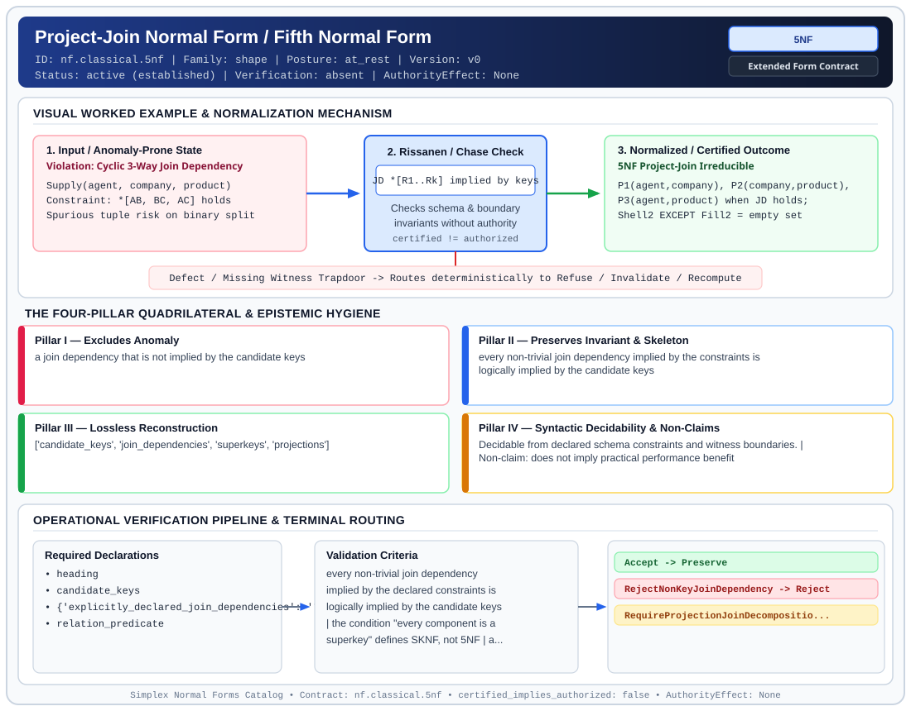

# Project-Join Normal Form / Fifth Normal Form (`5NF`)

> **Contract ID:** `nf.classical.5nf` | **Family:** `shape` | **Index Status:** `active` | **AuthorityEffect:** `None`

**[⬅ Back to Wiki Home](Home)** | **[View SVG Diagram](images/nf.classical.5nf.svg)**

---

## 1. Executive Summary & Metadata

Project-Join Normal Form / Fifth Normal Form (5NF) enforces structural normalization and explicit defect routing in the shape regime.

| Property | Value |
| :--- | :--- |
| **Canonical ID** | `nf.classical.5nf` |
| **Short Name** | `5NF` |
| **Full Name** | Project-Join Normal Form / Fifth Normal Form |
| **Family** | `shape` (Relational, Algebraic & Cochain Shape Normal Forms (Data at Rest & Structural Decompositions)) |
| **Qualification** | Extended Form Contract (Normal Form Contract) |
| **Data / Math Posture** | at_rest |
| **Index Status** | `active` |
| **Theory Status** | `established` |
| **Verification Status** | `absent` |
| **Contract Version** | `v0` |
| **Governance Fence** | `AuthorityEffect: None` (`certified_implies_authorized: false`) |

### Foundational Treatise Specification

- **Author**: Fagin
- **Year**: 1979
- **Structural Invariant**: Every non-trivial join dependency implied by constraints is logically implied by candidate keys.
- **Anomaly Excluded**: Join dependencies that candidate keys do not imply.
- **Lossless Join Property**: Rissanen's Theorem.
- **Dependency Preservation**: Analyzed.
- **Qualifies As True Normal Form**: True

---

## 2. Visual Architecture & Normalization Diagram



---

## 3. Concrete Worked Example & Mechanism

### Visual Transition Summary

| Stage | Carrier / Operator | Concrete State / Invariant |
| :--- | :--- | :--- |
| **1. Before / Candidate Input** | `Violation: Cyclic 3-Way Join Dependency` | Supply(agent, company, product) ; Constraint: *[AB, BC, AC] holds ; Spurious tuple risk on binary split |
| **2. Normalization / Gate** | `Rissanen / Chase Check` | `JD *[R1..Rk] implied by keys` (`certified_implies_authorized: false`) |
| **3. After / Certified Output** | `5NF Project-Join Irreducible` | P1(agent,company), P2(company,product), ; P3(agent,product) when JD holds; ; Shell2 EXCEPT Fill2 = empty set |

### Contract-Declared Worked Cases

```yaml
- ref: coda_all_universe/1_the_tower/normal_forms/contracts/_book_09_full_normal_form_atlas.md
  section: 2.1 Classical Relational Normal Forms
```

---

## 4. The Four-Pillar Quadrilateral & Non-Claims

Every contract in `simplex-normal-forms` is evaluated against the **Four-Pillar Quadrilateral** defined in `contracts/_golden_nfs/standard.yaml`:

| Pillar | Requirement | Contract Specification for `nf.classical.5nf` |
| :--- | :--- | :--- |
| **Pillar I: Excludes Anomaly** | Name and eliminate a specific class of data or state defects. | a join dependency that is not implied by the candidate keys |
| **Pillar II: Preserves Invariant** | State the structural invariant and protected skeleton preserved across transitions. | **Invariant:** every non-trivial join dependency implied by the constraints is logically implied by the candidate keys<br>**Protected Skeleton:** ['candidate_keys', 'join_dependencies', 'superkeys', 'projections'] |
| **Pillar III: Lossless Reconstruction** | State the non-loss reconstruction operator (join, direct sum, pullback, or replay). | Lossless reconstruction under declared projection, direct sum, or pullback operators. |
| **Pillar IV: Syntactic Decidability** | State how conformance is decided from declared constraints without unbudgeted scans. | Decidable from declared schema and witness metadata within bounded evaluation budgets. |

### Explicit Non-Claims (`certified_implies_authorized: false`)

- does not imply practical performance benefit
- does not certify runtime repair without cochain substrate
- does not imply authorization
- the shell-versus-fill query on one body is a witness that this body obeys or fails one ternary join dependency. It is not the membership test for the schema
- every component containing a candidate key (SKNF) does not establish that candidate keys logically imply the join dependency; pairwise keys permit a 4-tuple parity instance whose ternary join yields 4 spurious tuples (Darwen, Date, Fagin 2012 Theorem 6.1)

---

## 5. Operational Verification & Terminal Routing

### 5.1 Required Declarations

- heading
- candidate_keys
- **explicitly_declared_join_dependencies**: *(R_1, R_2, ..., R_n)
- relation_predicate

### 5.2 Required Evidence

_None declared._

### 5.3 Validation Criteria

| Criterion ID | Name | Condition |
| :--- | :--- | :--- |
| `criterion` | Check | every non-trivial join dependency implied by the declared constraints is logically implied by the candidate keys |
| `criterion` | Check | the condition "every component is a superkey" defines SKNF, not 5NF |
| `criterion` | Check | a four-tuple parity instance satisfying pairwise candidate keys can generate spurious tuples under ternary join, showing candidate keys alone do not imply the join dependency |
| `criterion` | Check | a body that is a proper subset of the join of its three binary projections is a witness against that join dependency on that body |
| `criterion` | Check | a decomposition used to reach this form must be lossless for the join dependency it removes |

### 5.4 Terminal Route Map

Every evaluation terminates in a declared local route mapped to a canonical terminal in `standard.yaml`:

| Local Terminal Route | Canonical Terminal |
| :--- | :--- |
| `Accept` | `Preserve` |
| `RejectNonKeyJoinDependency` | `Reject` |
| `RequireProjectionJoinDecomposition` | `Decompose` |

### 5.5 Declared Failure Modes

- **symptom**: supplier-part-project ternary facts are constrained by a cyclic 3-way join dependency where no component is a candidate key, **diagnosis**: non-key join dependency violating 5NF, **terminal**: RejectNonKeyJoinDependency

---

## Deep-Dive Level Treatise

**AuthorityEffect:** None.  
**Level:** Level 06 (Project-Join Normal Form & Cyclic Hypergraph Chase)  
**Evidential Grade:** NATIVE IMPLEMENTED  
**Contract Reference:** [`nf.classical.5nf`](../../../../omega_engine_pfp/infrastructure/yaml/normal_forms/nf.classical.5nf.yaml)  
**Mathematical Posture:** Join Dependency Hypergraphs & The Chase (Fagin 1979 / Beeri et al. 1983)  
**Data Posture:** At Rest  

---

## 1. Schematic & Conceptual Architecture

Fifth Normal Form (5NF), or Project-Join Normal Form (PJNF), governs relations that cannot be decomposed into two relations without loss, but **can** be decomposed into three or more relations:
- Deals with cyclic, symmetric constraints among attributes.
- Governed by **Join Dependencies (JDs)**: $\Join[R_1, \dots, R_k]$.
- A relation is in 5NF if every non-trivial join dependency is implied by its candidate keys.

```text
       Ternary Cyclic Constraint (Fails 5NF)
   Agents can sell Products, Companies supply Products,
   and Agents represent Companies, but an Agent only sells
   a Product IF the Company supplies it AND the Agent represents it!
                      │
   Cannot decompose into 2 relations without spurious tuples!
                      ▼
            Lossless 3-Way Join Dependency
         ⋈ [ (Agent, Company), (Company, Product), (Agent, Product) ]
```

---

## 2. Mathematical Invariants & Quadrilateral Properties

1. **Formal Definition (Fagin 1979):**
   A join dependency $\Join[R_1, \dots, R_k]$ holds on relation $R$ (where $\bigcup R_i = U$) if and only if:
   $$R = \pi_{R_1}(R) \bowtie \pi_{R_2}(R) \bowtie \dots \bowtie \pi_{R_k}(R)$$
   A relation schema $R$ is in 5NF if and only if for every join dependency $\Join[R_1, \dots, R_k]$ holding on $R$:
   $$\text{Every } R_i \text{ is a superkey of } R.$$

2. **The Relational Chase & GYO Reduction:**
   - The chase algorithm (`chase_join_dependency`) applies tableau transformations to decide whether a join dependency is logically implied by a set of functional and join dependencies.
   - Graham-Yu-Ozsoyoglu (GYO) reduction determines whether the join dependency hypergraph is $\alpha$-acyclic, in which case pairwise consistency ensures under declared assumptions global consistency.

3. **The Quadrilateral Invariants:**
   - **Anomaly Excluded:** Spurious tuple generation under multi-table reassembly, cyclic constraint update anomalies.
   - **Protected Skeleton:** Candidate key implications and minimal join dependency covers.
   - **Erased Structure:** Spurious cyclic combinations between partially independent projections.
   - **Reconstruction:** $k$-ary natural join $\pi_{R_1}(R) \bowtie \dots \bowtie \pi_{R_k}(R) = R$.

---

## 3. Terminal Routes & Verification Logic

```text
4NF Relation & Join Dependencies
      │
      ├── Every non-trivial JD implied by candidate keys ──► Preserve (5NF Satisfied)
      │
      ├── Non-key JD exists:
      │     ├── GYO reduction succeeds (Acyclic JD) ───────► Repair (AcyclicDecomposition)
      │     └── GYO reduction fails (Cyclic JD) ──────────► Quarantine (CyclicJoinConstraint)
      │
      └── Schema fails 4NF preconditions ──────────────────► Refuse (4NFPreconditionFailed)
```

- `Preserve`: All non-trivial join dependencies are consequences of the candidate keys.
- `Repair`: Decomposes relation into $k \ge 3$ projection relvars without loss.
- `Quarantine`: Cyclic join dependency detected; requires non-binary schema coordination.
- `Refuse`: 4NF preconditions failed.

---

## 4. Test Evidence & Local Execution

Verified in [`test_pjnf_5nf_join_dependency_chase.py`](../../../tests/normal_forms/test_pjnf_5nf_join_dependency_chase.py):
- `chase_join_dependency(schema, jd, fds)`: Validates that the tableau reduces to an all-distinguished variable row under candidate key constraints.
- `test_spurious_tuple_detection_under_non_5nf_join`: Demonstrates that joining projections of a non-5NF relation creates phantom records not present in the original relation.

---

## 5. Epistemic Claim Quadrant

1. **What it supports:**
   - Complete elimination of all join-reconstruction anomalies based on candidate keys.
   - Decision procedures for multi-table lossless decomposition via the relational chase.
2. **What it does not support:**
   - Elimination of temporal or interval anomalies (governed by 6NF).
   - General first-order constraint decidability (fenced by DKNF).
3. **The narrowest defensible claim:**
   - 5NF is the ultimate normal form with respect to project-join operations.
4. **The next test needed:**
   - Property tests asserting monotonicity of GYO hypergraph ear removals across randomized 6-vertex cyclic schemata.

---

## 6. Epistemic Claim Hygiene Quadrant

In accordance with the repository's epistemic claim discipline:

1. **What it supports:**
   - Supports syntactic and operational checking of `nf.classical.5nf` (`5NF`) against its declared schema, boundary constraints, and witness obligations in this model.
   - Supports deterministic terminal routing (`Accept, RejectNonKeyJoinDependency, RequireProjectionJoinDecomposition`) when required declarations or invariants fail.
2. **What it does not support:**
   - Does not confer operational authority (`AuthorityEffect: None`, `certified_implies_authorized: false`).
   - Does not claim semantic truth of undeclared external processes or unverified upstream inputs beyond the declaredprotected skeleton.
3. **The narrowest defensible claim:**
   - Within the declared substrate `at_rest`, this contract enforces that `a join dependency that is not implied by the candidate keys` is either excluded under `every non-trivial join dependency implied by the constraints is logically implied by the candidate keys` or routed to an explicit refusal/recovery terminal.
4. **The next test needed:**
   - Property-based falsification and mutation testing across boundary edge cases and composed multi-step pipelines for `nf.classical.5nf`.

---

## 7. Canonical YAML Contract (`contracts/nf.classical.5nf.yaml`)

<details>
<summary><strong>Click to expand full canonical YAML contract (contracts/nf.classical.5nf.yaml)</strong></summary>

```yaml
schema_version: smplx.nf.contract.v0
schema_ref: ./normal_form_contract_schema.yaml
contract_kind: normal_form_contract
identity:
  id: nf.classical.5nf
  name: Project-Join Normal Form / Fifth Normal Form
  short_name: 5NF
  version: v0
  theory_status: established
  contract_status: active
  verification_status: absent
  family: shape
  status: active
classification:
  hierarchy_level: normal_form
  subject_kind:
  - relvar
  data_posture: at_rest
  mathematical_posture: operational
purpose:
  excludes_anomaly: a join dependency that is not implied by the candidate keys
  preserves_invariant: every non-trivial join dependency implied by the constraints
    is logically implied by the candidate keys
  protected_skeleton:
  - candidate_keys
  - join_dependencies
  - superkeys
  - projections
  erased_structure: []
  non_claims:
  - does not imply practical performance benefit
  - does not certify runtime repair without cochain substrate
  - does not imply authorization
  - the shell-versus-fill query on one body is a witness that this body obeys or fails
    one ternary join dependency. It is not the membership test for the schema
  - every component containing a candidate key (SKNF) does not establish that candidate keys
    logically imply the join dependency; pairwise keys permit a 4-tuple parity instance
    whose ternary join yields 4 spurious tuples (Darwen, Date, Fagin 2012 Theorem 6.1)
definition:
  source: coda_all_universe/mssn_sn_tower/definitions.md
  citation:
    author: Ronald Fagin
    year: 1979
    work: Normal Forms and Relational Database Operators
  formal_statement: 'A relvar schema is in fifth normal form, also called projection-join
    normal form, when every non-trivial join dependency implied by its constraints
    is logically implied by its candidate keys. A join dependency is trivial when one of its
    components is the whole heading.

    '
  membership_test: implied by the candidate keys
  sufficient_key_component_test:
    statement: 'If every component of a join dependency contains a candidate key, then that
      join dependency is implied by the candidate keys.

      '
    strength: sufficient
    necessary: false
  quadrilateral:
    qualifies_as_true_normal_form: true
    anomaly_exclusion: 'Spurious tuples and cyclic join redundancy from a join dependency
      that the candidate keys do not imply.

      '
    lossless_join:
      status: join_dependency
      statement: 'The decomposition into the named projections is lossless exactly
        when the join dependency holds. Heath''s theorem and Fagin''s multivalued
        theorem are the binary cases. The join dependency itself is the n-ary losslessness
        condition. Rissanen (1977) studies the further demand that the components
        also be independent.

        '
    dependency_preservation:
      status: not_asserted
      statement: 'Membership does not promise a decomposition that preserves every
        functional dependency inside a single component. A schema can be taken to
        Boyce-Codd normal form, or to this form, by splits that drop a dependency
        as a local constraint.

        '
    syntactic_decision:
      status: schema_decidable
      statement: 'For a finite set of candidate keys and a finite join-dependency
        cover, implication is decidable by the chase. Comparing the cardinality of
        one body with the cardinality of the join of its projections decides that
        body only.

        '
  chain:
    requires:
    - SKNF
    - RFNF
    - ETNF
    - 4NF
    - BCNF
    implied_by:
    - 6NF
declarations_required:
- heading
- candidate_keys
- explicitly_declared_join_dependencies: '*(R_1, R_2, ..., R_n)'
- relation_predicate
evidence_required: []
validation_criteria:
- every non-trivial join dependency implied by the declared constraints is logically implied
  by the candidate keys
- the condition "every component is a superkey" defines SKNF, not 5NF
- a four-tuple parity instance satisfying pairwise candidate keys can generate spurious
  tuples under ternary join, showing candidate keys alone do not imply the join dependency
- a body that is a proper subset of the join of its three binary projections is a
  witness against that join dependency on that body
- a decomposition used to reach this form must be lossless for the join dependency
  it removes
proof_obligations:
- id: 5nf.fagin_project_join_theorem
  status: theorem_shaped
  ref: coda_all_universe/1_the_tower/normal_forms/contracts/_book_09_full_normal_form_atlas.md
  statement: 'Fifth normal form means every non-trivial join dependency implied by
    the constraints is logically implied by the candidate keys. The superkey component screen
    defines SKNF and is strictly weaker than 5NF. Constraints that are not join dependencies remain
    the subject of domain-key normal form.

    '
terminal_routes:
- Accept
- RejectNonKeyJoinDependency
- RequireProjectionJoinDecomposition
terminal_route_map:
  Accept: Preserve
  RejectNonKeyJoinDependency: Reject
  RequireProjectionJoinDecomposition: Decompose
certification:
  certificate_required: false
  certificate_kind: null
  obstruction_class_required: false
  loss_ledger_required: false
  verifier_required: false
  loss_ledger_trigger_id: null
authorization:
  authorized_by: null
  certified_implies_authorized: false
failure_modes:
- symptom: supplier-part-project ternary facts are constrained by a cyclic 3-way join
    dependency where no component is a candidate key
  diagnosis: non-key join dependency violating 5NF
  terminal: RejectNonKeyJoinDependency
examples:
- ref: coda_all_universe/1_the_tower/normal_forms/contracts/_book_09_full_normal_form_atlas.md
  section: 2.1 Classical Relational Normal Forms
references:
- coda_all_universe/1_the_tower/normal_forms/contracts/_book_09_full_normal_form_atlas.md
- coda_all_universe/1_the_tower/normal_forms/contracts/_paper_0_relvar_relation_table_and_boundary_relvar.md
- ./normal_form_contract_schema.yaml
```

</details>
