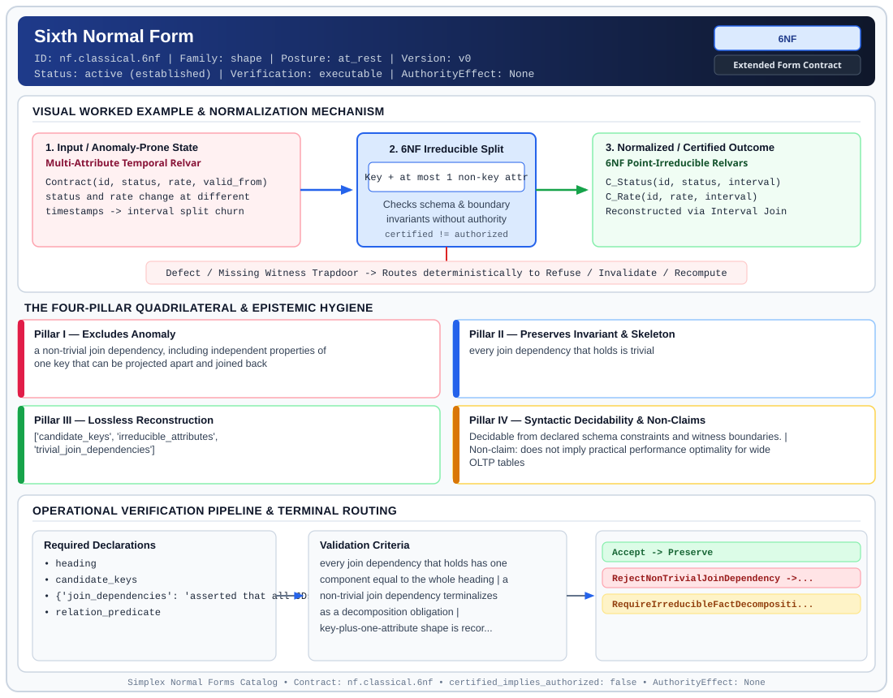

# Sixth Normal Form (`6NF`)

> **Contract ID:** `nf.classical.6nf` | **Family:** `shape` | **Index Status:** `active` | **AuthorityEffect:** `None`

**[⬅ Back to Wiki Home](Home)** | **[View SVG Diagram](images/nf.classical.6nf.svg)**

---

## 1. Executive Summary & Metadata

Sixth Normal Form (6NF) enforces structural normalization and explicit defect routing in the shape regime.

| Property | Value |
| :--- | :--- |
| **Canonical ID** | `nf.classical.6nf` |
| **Short Name** | `6NF` |
| **Full Name** | Sixth Normal Form |
| **Family** | `shape` (Relational, Algebraic & Cochain Shape Normal Forms (Data at Rest & Structural Decompositions)) |
| **Qualification** | Extended Form Contract (Normal Form Contract) |
| **Data / Math Posture** | at_rest |
| **Index Status** | `active` |
| **Theory Status** | `established` |
| **Verification Status** | `executable` |
| **Contract Version** | `v0` |
| **Governance Fence** | `AuthorityEffect: None` (`certified_implies_authorized: false`) |

### Foundational Treatise Specification

- **Author**: Date, Darwen, and Lorentzos
- **Year**: 2002
- **Structural Invariant**: Relvar satisfies no non-trivial join dependencies whatsoever (completely irreducible).
- **Anomaly Excluded**: Non-trivial join dependencies.
- **Lossless Join Property**: Trivial decompositions only.
- **Dependency Preservation**: Preserved on irreducible binary relvars.
- **Qualifies As True Normal Form**: True

---

## 2. Visual Architecture & Normalization Diagram



---

## 3. Concrete Worked Example & Mechanism

### Visual Transition Summary

| Stage | Carrier / Operator | Concrete State / Invariant |
| :--- | :--- | :--- |
| **1. Before / Candidate Input** | `Multi-Attribute Temporal Relvar` | Contract(id, status, rate, valid_from) ; status and rate change at different ; timestamps -> interval split churn |
| **2. Normalization / Gate** | `6NF Irreducible Split` | `Key + at most 1 non-key attr` (`certified_implies_authorized: false`) |
| **3. After / Certified Output** | `6NF Point-Irreducible Relvars` | C_Status(id, status, interval) ; C_Rate(id, rate, interval) ; Reconstructed via Interval Join |

### Contract-Declared Worked Cases

```yaml
- ref: coda_all_universe/1_the_tower/normal_forms/contracts/_book_09_full_normal_form_atlas.md
  section: 2.1 Classical Relational Normal Forms
```

---

## 4. The Four-Pillar Quadrilateral & Non-Claims

Every contract in `simplex-normal-forms` is evaluated against the **Four-Pillar Quadrilateral** defined in `contracts/_golden_nfs/standard.yaml`:

| Pillar | Requirement | Contract Specification for `nf.classical.6nf` |
| :--- | :--- | :--- |
| **Pillar I: Excludes Anomaly** | Name and eliminate a specific class of data or state defects. | a non-trivial join dependency, including independent properties of one key that can be projected apart and joined back |
| **Pillar II: Preserves Invariant** | State the structural invariant and protected skeleton preserved across transitions. | **Invariant:** every join dependency that holds is trivial<br>**Protected Skeleton:** ['candidate_keys', 'irreducible_attributes', 'trivial_join_dependencies'] |
| **Pillar III: Lossless Reconstruction** | State the non-loss reconstruction operator (join, direct sum, pullback, or replay). | Lossless reconstruction under declared projection, direct sum, or pullback operators. |
| **Pillar IV: Syntactic Decidability** | State how conformance is decided from declared constraints without unbudgeted scans. | Decidable from declared schema and witness metadata within bounded evaluation budgets. |

### Explicit Non-Claims (`certified_implies_authorized: false`)

- does not imply practical performance optimality for wide OLTP tables
- does not require every production schema to decompose to 6NF
- does not certify runtime repair without cochain substrate
- does not imply authorization

---

## 5. Operational Verification & Terminal Routing

### 5.1 Required Declarations

- heading
- candidate_keys
- **join_dependencies**: asserted that all JDs are trivial
- relation_predicate

### 5.2 Required Evidence

_None declared._

### 5.3 Validation Criteria

| Criterion ID | Name | Condition |
| :--- | :--- | :--- |
| `criterion` | Check | every join dependency that holds has one component equal to the whole heading |
| `criterion` | Check | a non-trivial join dependency terminalizes as a decomposition obligation |
| `criterion` | Check | key-plus-one-attribute shape is recorded only as a sufficient pattern under a pure key constraint, and it is not accepted as the membership test |

### 5.4 Terminal Route Map

Every evaluation terminates in a declared local route mapped to a canonical terminal in `standard.yaml`:

| Local Terminal Route | Canonical Terminal |
| :--- | :--- |
| `Accept` | `Preserve` |
| `RejectNonTrivialJoinDependency` | `Reject` |
| `RequireIrreducibleFactDecomposition` | `Decompose` |

### 5.5 Declared Failure Modes

- **symptom**: relvar contains candidate key and two non-key attributes that can be nonloss decomposed into two separate 6NF relvars, **diagnosis**: presence of non-trivial join dependency violating 6NF, **terminal**: RequireIrreducibleFactDecomposition

---

## Deep-Dive Level Treatise

**AuthorityEffect:** None.  
**Level:** Level 07 (Temporal Irreducibility & Lossless Interval Joins)  
**Evidential Grade:** NATIVE IMPLEMENTED  
**Contract Reference:** [`nf.classical.6nf`](../../../../omega_engine_pfp/infrastructure/yaml/normal_forms/nf.classical.6nf.yaml)  
**Mathematical Posture:** Temporal Relational Theory (Date, Darwen, & Lorentzos 2002)  
**Data Posture:** At Rest / Temporal History  

---

## 1. Schematic & Conceptual Architecture

Sixth Normal Form (6NF) decomposes relations to their **irreducible** components:
- A relation is in 6NF if and only if it satisfies no non-trivial join dependencies at all.
- Essential for **temporal databases**: multi-attribute temporal relvars with independent interval histories cannot be updated without creating gap and collision anomalies.
- In 6NF, each relvar consists of candidate keys, an interval, and at most **one** non-key attribute.

```text
       Temporal Multi-Attribute Relvar (Fails 6NF)
  ┌────┬─────────┬────────┬─────────────────────────────┐
  │ ID │ Status  │ Salary │ Interval [From, To)         │
  ├────┼─────────┼────────┼─────────────────────────────┤
  │ 1  │ Active  │ 80,000 │ [2026-01-01, 2026-06-01)   │
  └────┴─────────┴────────┴─────────────────────────────┘
  Updating Salary on March 1 forces artificial splitting of Status!
                        │
                6NF Decomposition
                        ▼
  R1: (ID, Status, Interval)  [Irreducible]
  R2: (ID, Salary, Interval)  [Irreducible]
```

---

## 2. Mathematical Invariants & Quadrilateral Properties

1. **Formal Definition (Date et al. 2002):**
   A relation schema $R$ is in 6NF if and only if $R$ satisfies no non-trivial join dependencies. That is, the only join dependencies satisfied by $R$ are of the form $\Join[R]$, meaning $R$ cannot be decomposed into proper projections without losing information.
   In practical temporal terms:
   $$R = K \cup \{\tau\} \cup \{A\}$$
   where $K$ is the entity key, $\tau$ is a valid-time interval, and $A$ is a single non-key attribute.

2. **Lossless Interval-Join Invariant:**
   Two temporal 6NF relations $R_1(K, \tau, A)$ and $R_2(K, \tau, B)$ reconstruct the joint history via the interval join operator:
   $$R_1 \bowtie_{\text{interval}} R_2 = \{(k, \tau_1 \cap \tau_2, a, b) : (k, \tau_1, a) \in R_1 \land (k, \tau_2, b) \in R_2 \land \tau_1 \cap \tau_2 \neq \emptyset\}$$
   This join is ensured under declared assumptions lossless and reconstructs the multi-attribute historical state without gap or collision artifacts.

3. **The Quadrilateral Invariants:**
   - **Anomaly Excluded:** Temporal update collisions, interval fragmentation, and artificial splitting of independent historical facts.
   - **Protected Skeleton:** Independent attribute-interval histories.
   - **Erased Structure:** Accidental coupling of distinct attribute update cadences.
   - **Reconstruction:** Interval-intersection natural join $\bowtie_{\text{interval}}$.

---

## 3. Terminal Routes & Verification Logic

```text
5NF Relation & Temporal Intervals
      │
      ├── Satisfies only trivial JDs (at most 1 non-key attr) ──► Preserve (6NF Verified)
      │
      ├── Multiple independent temporal attributes exist ──────► Repair (6NFDecomposeToUnary)
      │
      └── Schema fails 5NF preconditions ──────────────────────► Refuse (5NFPreconditionFailed)
```

- `Preserve`: Relation is irreducible under all project-join operations.
- `Repair`: Decomposes multi-attribute relation into single-attribute historical relvars.
- `Refuse`: 5NF preconditions failed.

---

## 4. Test Evidence & Local Execution

Verified in [`test_tranche3_advanced_relational_nfs.py`](../../../tests/normal_forms/test_tranche3_advanced_relational_nfs.py):
- `test_6nf_irreducible_temporal_decomposition`: Confirms that decomposing temporal relvars eliminates update coupling.
- `test_6nf_join_reconstruction_temporal_losslessness`: supports that interval-join reconstruction restores the full historical timeline without temporal gaps.

---

## 5. Epistemic Claim Quadrant

1. **What it supports:**
   - Elimination of all temporal update, insertion, and deletion collisions.
   - Independent versioning and compaction of separate attributes.
2. **What it does not support:**
   - Storage efficiency for non-temporal, statically updated relations (where 6NF causes excessive table proliferation).
3. **The narrowest defensible claim:**
   - 6NF is the ultimate decomposition: every 6NF relation is irreducible.
4. **The next test needed:**
   - Performance benchmark comparing 6NF interval joins against 3NF temporal coalescing under high-frequency writes.

---

## 6. Epistemic Claim Hygiene Quadrant

In accordance with the repository's epistemic claim discipline:

1. **What it supports:**
   - Supports syntactic and operational checking of `nf.classical.6nf` (`6NF`) against its declared schema, boundary constraints, and witness obligations in this model.
   - Supports deterministic terminal routing (`Accept, RejectNonTrivialJoinDependency, RequireIrreducibleFactDecomposition`) when required declarations or invariants fail.
2. **What it does not support:**
   - Does not confer operational authority (`AuthorityEffect: None`, `certified_implies_authorized: false`).
   - Does not claim semantic truth of undeclared external processes or unverified upstream inputs beyond the declaredprotected skeleton.
3. **The narrowest defensible claim:**
   - Within the declared substrate `at_rest`, this contract enforces that `a non-trivial join dependency, including independent properties of one key that can be projected apart and joined back` is either excluded under `every join dependency that holds is trivial` or routed to an explicit refusal/recovery terminal.
4. **The next test needed:**
   - Property-based falsification and mutation testing across boundary edge cases and composed multi-step pipelines for `nf.classical.6nf`.

---

## 7. Canonical YAML Contract (`contracts/nf.classical.6nf.yaml`)

<details>
<summary><strong>Click to expand full canonical YAML contract (contracts/nf.classical.6nf.yaml)</strong></summary>

```yaml
schema_version: smplx.nf.contract.v0
schema_ref: ./normal_form_contract_schema.yaml
contract_kind: normal_form_contract
identity:
  id: nf.classical.6nf
  name: Sixth Normal Form
  short_name: 6NF
  version: v0
  theory_status: established
  contract_status: active
  verification_status: executable
  family: shape
  status: active
classification:
  hierarchy_level: normal_form
  subject_kind:
  - relvar
  data_posture: at_rest
  mathematical_posture: operational
purpose:
  excludes_anomaly: a non-trivial join dependency, including independent properties
    of one key that can be projected apart and joined back
  preserves_invariant: every join dependency that holds is trivial
  protected_skeleton:
  - candidate_keys
  - irreducible_attributes
  - trivial_join_dependencies
  erased_structure: []
  non_claims:
  - does not imply practical performance optimality for wide OLTP tables
  - does not require every production schema to decompose to 6NF
  - does not certify runtime repair without cochain substrate
  - does not imply authorization
definition:
  source: coda_all_universe/mssn_sn_tower/definitions.md
  citation:
    authors: C. J. Date, Hugh Darwen, and Nikos A. Lorentzos
    year: 2002
    work: Temporal Data and the Relational Model
  formal_statement: 'A relvar is in sixth normal form when it satisfies no non-trivial
    join dependency. Equivalently, every lossless decomposition has a component whose
    heading is the whole heading. The form is aimed at independent properties of one
    key, including properties that vary over distinct temporal intervals.

    '
  binary_fact_shape:
    statement: 'A heading that is one candidate key plus a single attribute outside
      that key satisfies the form when the key constraint is the only constraint,
      because there is no second attribute with which to build a non-trivial join
      dependency.

      '
    defines_membership: false
    note: 'A wider heading can still satisfy the form when a further constraint blocks
      every non-trivial join dependency. An all-key heading can still fail the form
      when a non-trivial join dependency holds among the key attributes.

      '
  quadrilateral:
    qualifies_as_true_normal_form: true
    anomaly_exclusion: 'Independent facts, including distinct interval properties
      of one key, that a non-trivial join dependency can separate.

      '
    lossless_join:
      status: trivial_decompositions_only
      statement: 'The only lossless decompositions are the trivial ones. There is
        no non-trivial project-join reconstruction because no non-trivial join dependency
        holds.

        '
    dependency_preservation:
      status: not_applicable
      statement: 'There is no non-trivial decomposition across which a dependency
        would have to be preserved. Constraints that are not join dependencies are
        outside this form. Domain-key normal form is the separate test for those constraints.

        '
    syntactic_decision:
      status: schema_decidable_for_a_finite_jd_cover
      statement: 'Decided by showing that every join dependency implied by the declared
        cover is trivial. One stored body is not the decider. The shape "key plus
        one other attribute" is not a substitute for that check.

        '
  chain:
    requires:
    - 5NF
    implied_by: []
declarations_required:
- heading
- candidate_keys
- join_dependencies: asserted that all JDs are trivial
- relation_predicate
evidence_required: []
validation_criteria:
- every join dependency that holds has one component equal to the whole heading
- a non-trivial join dependency terminalizes as a decomposition obligation
- key-plus-one-attribute shape is recorded only as a sufficient pattern under a pure
  key constraint, and it is not accepted as the membership test
proof_obligations:
- id: 6nf.trivial_jd_characterization
  status: theorem_shaped
  ref: coda_all_universe/mssn_sn_tower/definitions.md
  statement: 'A relvar is in sixth normal form when every join dependency it satisfies
    is trivial.

    '
terminal_routes:
- Accept
- RejectNonTrivialJoinDependency
- RequireIrreducibleFactDecomposition
terminal_route_map:
  Accept: Preserve
  RejectNonTrivialJoinDependency: Reject
  RequireIrreducibleFactDecomposition: Decompose
certification:
  certificate_required: false
  certificate_kind: null
  obstruction_class_required: false
  loss_ledger_required: false
  verifier_required: false
  loss_ledger_trigger_id: null
authorization:
  authorized_by: null
  certified_implies_authorized: false
failure_modes:
- symptom: relvar contains candidate key and two non-key attributes that can be nonloss
    decomposed into two separate 6NF relvars
  diagnosis: presence of non-trivial join dependency violating 6NF
  terminal: RequireIrreducibleFactDecomposition
examples:
- ref: coda_all_universe/1_the_tower/normal_forms/contracts/_book_09_full_normal_form_atlas.md
  section: 2.1 Classical Relational Normal Forms
references:
- coda_all_universe/1_the_tower/normal_forms/contracts/_book_09_full_normal_form_atlas.md
- coda_all_universe/1_the_tower/normal_forms/contracts/_paper_0_relvar_relation_table_and_boundary_relvar.md
```

</details>
