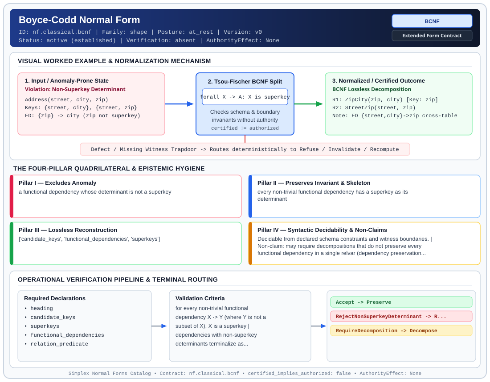

# Boyce-Codd Normal Form (`BCNF`)

> **Contract ID:** `nf.classical.bcnf` | **Family:** `shape` | **Index Status:** `active` | **AuthorityEffect:** `None`

**[⬅ Back to Wiki Home](Home)** | **[View SVG Diagram](images/nf.classical.bcnf.svg)**

---

## 1. Executive Summary & Metadata

Boyce-Codd Normal Form (BCNF) enforces structural normalization and explicit defect routing in the shape regime.

| Property | Value |
| :--- | :--- |
| **Canonical ID** | `nf.classical.bcnf` |
| **Short Name** | `BCNF` |
| **Full Name** | Boyce-Codd Normal Form |
| **Family** | `shape` (Relational, Algebraic & Cochain Shape Normal Forms (Data at Rest & Structural Decompositions)) |
| **Qualification** | Extended Form Contract (Normal Form Contract) |
| **Data / Math Posture** | at_rest |
| **Index Status** | `active` |
| **Theory Status** | `established` |
| **Verification Status** | `absent` |
| **Contract Version** | `v0` |
| **Governance Fence** | `AuthorityEffect: None` (`certified_implies_authorized: false`) |

### Foundational Treatise Specification

- **Author**: Boyce and Codd
- **Year**: 1974
- **Structural Invariant**: Every non-trivial functional dependency has a superkey determinant.
- **Anomaly Excluded**: Functional dependencies whose determinants are not superkeys.
- **Lossless Join Property**: Heath's Theorem.
- **Dependency Preservation**: Not always preserved.
- **Qualifies As True Normal Form**: True

---

## 2. Visual Architecture & Normalization Diagram



---

## 3. Concrete Worked Example & Mechanism

### Visual Transition Summary

| Stage | Carrier / Operator | Concrete State / Invariant |
| :--- | :--- | :--- |
| **1. Before / Candidate Input** | `Violation: Non-Superkey Determinant` | Address(street, city, zip) ; Keys: {street, city}, {street, zip} ; FD: {zip} -> city (zip not superkey) |
| **2. Normalization / Gate** | `Tsou-Fischer BCNF Split` | `forall X -> A: X is superkey` (`certified_implies_authorized: false`) |
| **3. After / Certified Output** | `BCNF Lossless Decomposition` | R1: ZipCity(zip, city) [Key: zip] ; R2: StreetZip(street, zip) ; Note: FD {street,city}->zip cross-table |

### Contract-Declared Worked Cases

```yaml
- ref: coda_all_universe/1_the_tower/normal_forms/contracts/_book_09_full_normal_form_atlas.md
  section: 2.1 Classical Relational Normal Forms
```

---

## 4. The Four-Pillar Quadrilateral & Non-Claims

Every contract in `simplex-normal-forms` is evaluated against the **Four-Pillar Quadrilateral** defined in `contracts/_golden_nfs/standard.yaml`:

| Pillar | Requirement | Contract Specification for `nf.classical.bcnf` |
| :--- | :--- | :--- |
| **Pillar I: Excludes Anomaly** | Name and eliminate a specific class of data or state defects. | a functional dependency whose determinant is not a superkey |
| **Pillar II: Preserves Invariant** | State the structural invariant and protected skeleton preserved across transitions. | **Invariant:** every non-trivial functional dependency has a superkey as its determinant<br>**Protected Skeleton:** ['candidate_keys', 'functional_dependencies', 'superkeys'] |
| **Pillar III: Lossless Reconstruction** | State the non-loss reconstruction operator (join, direct sum, pullback, or replay). | Lossless reconstruction under declared projection, direct sum, or pullback operators. |
| **Pillar IV: Syntactic Decidability** | State how conformance is decided from declared constraints without unbudgeted scans. | Decidable from declared schema and witness metadata within bounded evaluation budgets. |

### Explicit Non-Claims (`certified_implies_authorized: false`)

- may require decompositions that do not preserve every functional dependency in a single relvar (dependency preservation is not ensured under declared assumptions by BCNF alone)
- does not certify runtime repair without cochain substrate
- does not imply authorization
- unrelated to quarantined BellCNF observer contracts

---

## 5. Operational Verification & Terminal Routing

### 5.1 Required Declarations

- heading
- candidate_keys
- superkeys
- functional_dependencies
- relation_predicate

### 5.2 Required Evidence

_None declared._

### 5.3 Validation Criteria

| Criterion ID | Name | Condition |
| :--- | :--- | :--- |
| `criterion` | Check | for every non-trivial functional dependency X -> Y (where Y is not a subset of X), X is a superkey |
| `criterion` | Check | dependencies with non-superkey determinants terminalize as decomposition obligations |
| `criterion` | Check | decomposition elimination order is deterministically tie-broken by lexicographic ordering of attribute tuples (X, Y) |

### 5.4 Terminal Route Map

Every evaluation terminates in a declared local route mapped to a canonical terminal in `standard.yaml`:

| Local Terminal Route | Canonical Terminal |
| :--- | :--- |
| `Accept` | `Preserve` |
| `RejectNonSuperkeyDeterminant` | `Reject` |
| `RequireDecomposition` | `Decompose` |

### 5.5 Declared Failure Modes

- **symptom**: instructor determines room while instructor is not a candidate key or superkey of the relvar, **diagnosis**: non-superkey determinant functional dependency violating BCNF, **terminal**: RejectNonSuperkeyDeterminant

---

## Deep-Dive Level Treatise

**AuthorityEffect:** None.  
**Level:** Level 04 (Determinant Superkeys & Lossless Join Decompositions)  
**Evidential Grade:** NATIVE IMPLEMENTED  
**Contract Reference:** [`nf.classical.bcnf`](../../../../omega_engine_pfp/infrastructure/yaml/normal_forms/nf.classical.bcnf.yaml)  
**Mathematical Posture:** Heath's Lossless Join Theorem & BCNF Trees (Tsou & Fischer 1982)  
**Data Posture:** At Rest  

---

## 1. Schematic & Conceptual Architecture

Boyce-Codd Normal Form (BCNF) strengthens 3NF by removing the "or $A$ is prime" escape clause:
- Every non-trivial functional dependency must have a **superkey** as its determinant.
- Eliminates all redundancy that can be modeled by functional dependencies.
- **Trade-off:** BCNF always permits a lossless decomposition, but does **not** always preserve dependencies.

```text
       3NF Schema but Fails BCNF
   ┌──────────────────────────────────────────────┐
   │ (Student, Course) ──► Advisor (Composite Key)│
   │ Advisor ────────────► Course  (NON-SUPERKEY) │
   └──────────────────────────────────────────────┘
                       │
             Tsou-Fischer BCNF Tree
                       ▼
   R1: (Advisor, Course)    [Key: Advisor]
   R2: (Student, Advisor)   [Key: (Student, Advisor)]
   [Loss: Dependency (Student, Course) -> Advisor is lost!]
```

---

## 2. Mathematical Invariants & Quadrilateral Properties

1. **Formal Definition (Codd 1974):**
   A relation schema $R$ with functional dependencies $F$ is in BCNF if and only if for every non-trivial functional dependency $X \to Y \in F^+$:
   $$X \text{ is a superkey of } R.$$

2. **Heath's Lossless Decomposition Theorem:**
   A binary decomposition of $R$ into $R_1(X \cup Y)$ and $R_2(X \cup Z)$ (where $U = X \cup Y \cup Z$ and $Y \cap Z = \emptyset$) is lossless ($R_1 \bowtie R_2 = R$) if and only if:
   $$X \to Y \in F^+ \quad \text{or} \quad X \to Z \in F^+.$$

3. **The Quadrilateral Invariants:**
   - **Anomaly Excluded:** All functional dependency redundancies, update anomalies on overlapping candidate keys.
   - **Protected Skeleton:** Superkeys and lossless join projection trees.
   - **Erased Structure:** Compound multi-relation dependencies not expressible on single projections.
   - **Reconstruction:** Lossless join tree synthesis via Heath projections.

---

## 3. Terminal Routes & Verification Logic

```text
3NF Relation & Functional Dependencies
      │
      ├── Every determinant is a superkey ──────────► Preserve (BCNF Satisfied)
      │
      ├── Determinant is not a superkey:
      │     ├── Decomposes losslessly with deps ────► Repair (BCNFDecomposition)
      │     └── Decomposition loses dependencies ──► Quarantine (LossyDependencyBCNF)
      │
      └── Schema fails 3NF preconditions ───────────► Refuse (3NFPreconditionFailed)
```

- `Preserve`: All determinants are superkeys.
- `Repair`: Decomposed into BCNF relations with dependencies intact.
- `Quarantine`: Decomposed into BCNF, but requires an external cross-table assertion or loss ledger because dependencies cannot be preserved.
- `Refuse`: Underlying 1NF/2NF/3NF constraints violated.

---

## 4. Test Evidence & Local Execution

Verified in [`test_tranche3_advanced_relational_nfs.py`](../../../tests/normal_forms/test_tranche3_advanced_relational_nfs.py):
- `check_bcnf(schema, fds)`: Checks that for every non-trivial dependency $X \to Y$, attribute closure $X^+$ equals the relation heading $U$.
- `test_bcnf_decomposition_lossless_tree`: Executes the Tsou & Fischer (1982) BCNF decomposition tree algorithm, verifying lossless join property at each tree branch.

---

## 5. Epistemic Claim Quadrant

1. **What it supports:**
   - Complete elimination of all functional dependency redundancies.
   - ensured under declared assumptions lossless join reconstruction across all decomposition trees.
2. **What it does not support:**
   - canonical dependency preservation (some schemas cannot achieve both BCNF and dependency preservation).
   - Elimination of multivalued dependencies (requires 4NF).
3. **The narrowest defensible claim:**
   - BCNF ensures under declared assumptions that every functional dependency corresponds to a search on a unique key.
4. **The next test needed:**
   - Property tests generating schemas that fail dependency preservation in BCNF and asserting that the lost dependencies are recorded in a typed loss ledger.

---

## 6. Epistemic Claim Hygiene Quadrant

In accordance with the repository's epistemic claim discipline:

1. **What it supports:**
   - Supports syntactic and operational checking of `nf.classical.bcnf` (`BCNF`) against its declared schema, boundary constraints, and witness obligations in this model.
   - Supports deterministic terminal routing (`Accept, RejectNonSuperkeyDeterminant, RequireDecomposition`) when required declarations or invariants fail.
2. **What it does not support:**
   - Does not confer operational authority (`AuthorityEffect: None`, `certified_implies_authorized: false`).
   - Does not claim semantic truth of undeclared external processes or unverified upstream inputs beyond the declaredprotected skeleton.
3. **The narrowest defensible claim:**
   - Within the declared substrate `at_rest`, this contract enforces that `a functional dependency whose determinant is not a superkey` is either excluded under `every non-trivial functional dependency has a superkey as its determinant` or routed to an explicit refusal/recovery terminal.
4. **The next test needed:**
   - Property-based falsification and mutation testing across boundary edge cases and composed multi-step pipelines for `nf.classical.bcnf`.

---

## 7. Canonical YAML Contract (`contracts/nf.classical.bcnf.yaml`)

<details>
<summary><strong>Click to expand full canonical YAML contract (contracts/nf.classical.bcnf.yaml)</strong></summary>

```yaml
schema_version: smplx.nf.contract.v0
schema_ref: ./normal_form_contract_schema.yaml
contract_kind: normal_form_contract
identity:
  id: nf.classical.bcnf
  name: Boyce-Codd Normal Form
  short_name: BCNF
  version: v0
  theory_status: established
  contract_status: active
  verification_status: absent
  family: shape
  status: active
classification:
  hierarchy_level: normal_form
  subject_kind:
  - relvar
  data_posture: at_rest
  mathematical_posture: operational
purpose:
  excludes_anomaly: a functional dependency whose determinant is not a superkey
  preserves_invariant: every non-trivial functional dependency has a superkey as its
    determinant
  protected_skeleton:
  - candidate_keys
  - functional_dependencies
  - superkeys
  erased_structure: []
  non_claims:
  - may require decompositions that do not preserve every functional dependency in
    a single relvar (dependency preservation is not ensured under declared assumptions by BCNF alone)
  - does not certify runtime repair without cochain substrate
  - does not imply authorization
  - unrelated to quarantined BellCNF observer contracts
definition:
  source: coda_all_universe/mssn_sn_tower/definitions.md
  citation:
    authors: Raymond F. Boyce and Edgar F. Codd
    year: 1974
    work: Recent Investigations in Relational Data Base Systems
  formal_statement: 'A relvar is in Boyce-Codd normal form when every non-trivial
    functional dependency X -> Y has X as a superkey. The determinant must be a superkey.
    It may be a candidate key or a proper superset of one. A trivial dependency, one
    whose right side is contained in its left side, is not a violation.

    '
  preservation_counterexample:
    heading:
    - S
    - J
    - T
    functional_dependencies:
    - SJ -> T
    - T -> J
    note: 'T -> J and T is not a superkey, so the schema is outside Boyce-Codd normal
      form. The Heath split into (T, J) and (S, T) is lossless and drops SJ -> T as
      a constraint local to either component.

      '
  quadrilateral:
    qualifies_as_true_normal_form: true
    anomaly_exclusion: 'Every redundancy expressed by a functional dependency whose
      determinant is not a superkey. Multivalued dependencies, join dependencies,
      and constraints outside functional dependencies remain in scope for later forms.

      '
    lossless_join:
      status: heath
      theorem: Heath 1971
      canonical_tie_breaking: lexicographic_attribute_ordering
      statement: 'Each violating dependency X -> Y produces a lossless binary split.
        Deterministic lexicographic attribute ordering over (X, Y) selects a unique
        canonical decomposition sequence across equivalent dependency closures.

        '
    dependency_preservation:
      status: not_always
      statement: 'A lossless decomposition into Boyce-Codd normal form need not keep
        every functional dependency enforceable inside a single component. The schema
        (S, J, T) with SJ -> T and T -> J is the standard witness. Third normal form
        and elementary key normal form retain a dependency-preserving route that this
        form does not.

        '
    syntactic_decision:
      status: schema_decidable
      statement: 'Decided from a cover of the non-trivial functional dependencies
        and the superkeys. The Lean checker is_bcnf_compliant applies that test to
        a caller-supplied list of non-trivial dependencies.

        '
  chain:
    requires:
    - 1NF
    - 2NF
    - 3NF
    - EKNF
    implied_by:
    - 4NF
    - ETNF
    - 5NF
    - 6NF
declarations_required:
- heading
- candidate_keys
- superkeys
- functional_dependencies
- relation_predicate
evidence_required: []
validation_criteria:
- for every non-trivial functional dependency X -> Y (where Y is not a subset of X),
  X is a superkey
- dependencies with non-superkey determinants terminalize as decomposition obligations
- decomposition elimination order is deterministically tie-broken by lexicographic
  ordering of attribute tuples (X, Y)
proof_obligations:
- id: bcnf.functional_dependency_superkey_condition
  status: theorem_shaped
  ref: coda_all_universe/1_the_tower/normal_forms/contracts/_book_09_full_normal_form_atlas.md
  statement: 'Every non-trivial functional dependency has a superkey determinant.
    The Lean theorem bcnf_implies_3nf shows that a list passing the Boyce-Codd checker
    also passes the third-normal-form checker. Dependency preservation across a decomposition
    is a separate obligation and can fail.

    '
terminal_routes:
- Accept
- RejectNonSuperkeyDeterminant
- RequireDecomposition
terminal_route_map:
  Accept: Preserve
  RejectNonSuperkeyDeterminant: Reject
  RequireDecomposition: Decompose
certification:
  certificate_required: false
  certificate_kind: null
  obstruction_class_required: false
  loss_ledger_required: false
  verifier_required: false
  loss_ledger_trigger_id: null
authorization:
  authorized_by: null
  certified_implies_authorized: false
failure_modes:
- symptom: instructor determines room while instructor is not a candidate key or superkey
    of the relvar
  diagnosis: non-superkey determinant functional dependency violating BCNF
  terminal: RejectNonSuperkeyDeterminant
examples:
- ref: coda_all_universe/1_the_tower/normal_forms/contracts/_book_09_full_normal_form_atlas.md
  section: 2.1 Classical Relational Normal Forms
references:
- coda_all_universe/1_the_tower/normal_forms/contracts/_book_09_full_normal_form_atlas.md
- coda_all_universe/1_the_tower/normal_forms/contracts/_paper_0_relvar_relation_table_and_boundary_relvar.md
- ./normal_form_contract_schema.yaml
```

</details>
