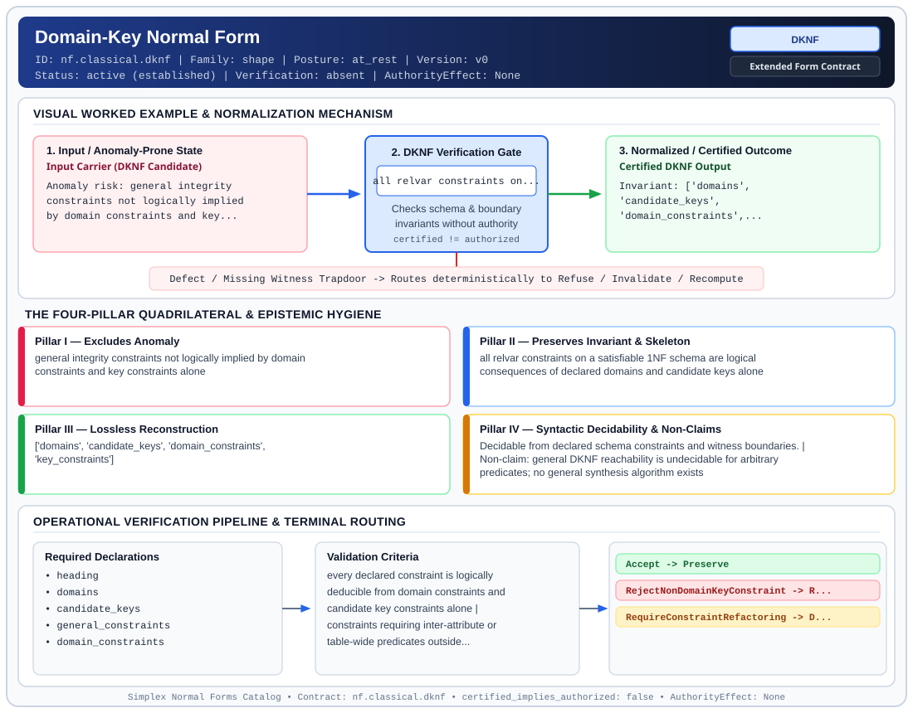

# Domain-Key Normal Form (`DKNF`)

> **Contract ID:** `nf.classical.dknf` | **Family:** `shape` | **Index Status:** `active` | **AuthorityEffect:** `None`

**[⬅ Back to Wiki Home](Home)** | **[View SVG Diagram](images/nf.classical.dknf.svg)**

---

## 1. Executive Summary & Metadata

Domain-Key Normal Form (DKNF) enforces structural normalization and explicit defect routing in the shape regime.

| Property | Value |
| :--- | :--- |
| **Canonical ID** | `nf.classical.dknf` |
| **Short Name** | `DKNF` |
| **Full Name** | Domain-Key Normal Form |
| **Family** | `shape` (Relational, Algebraic & Cochain Shape Normal Forms (Data at Rest & Structural Decompositions)) |
| **Qualification** | Extended Form Contract (Normal Form Contract) |
| **Data / Math Posture** | at_rest |
| **Index Status** | `active` |
| **Theory Status** | `established` |
| **Verification Status** | `absent` |
| **Contract Version** | `v0` |
| **Governance Fence** | `AuthorityEffect: None` (`certified_implies_authorized: false`) |

### Foundational Treatise Specification

- **Author**: Fagin
- **Year**: 1981
- **Structural Invariant**: Every constraint follows logically from domain constraints and key constraints.
- **Anomaly Excluded**: All insertion and deletion anomalies expressible by declared constraints.
- **Lossless Join Property**: Complete Enclosure.
- **Dependency Preservation**: Preserved.
- **Qualifies As True Normal Form**: False
- **Qualification Gap**: Lacks general decision procedure under arbitrary first-order constraints (Pillar IV gap).

---

## 2. Visual Architecture & Normalization Diagram



---

## 3. Concrete Worked Example & Mechanism

### Visual Transition Summary

| Stage | Carrier / Operator | Concrete State / Invariant |
| :--- | :--- | :--- |
| **1. Before / Candidate Input** | `Input Carrier (DKNF Candidate)` | Anomaly risk: general integrity ; constraints not logically implied ; by domain constraints and key... |
| **2. Normalization / Gate** | `DKNF Verification Gate` | `all relvar constraints on...` (`certified_implies_authorized: false`) |
| **3. After / Certified Output** | `Certified DKNF Output` | Invariant: ['domains', ; 'candidate_keys', ; 'domain_constraints',... |

### Contract-Declared Worked Cases

```yaml
- ref: coda_all_universe/1_the_tower/normal_forms/contracts/_book_09_full_normal_form_atlas.md
  section: 2.1 Classical Relational Normal Forms
```

---

## 4. The Four-Pillar Quadrilateral & Non-Claims

Every contract in `simplex-normal-forms` is evaluated against the **Four-Pillar Quadrilateral** defined in `contracts/_golden_nfs/standard.yaml`:

| Pillar | Requirement | Contract Specification for `nf.classical.dknf` |
| :--- | :--- | :--- |
| **Pillar I: Excludes Anomaly** | Name and eliminate a specific class of data or state defects. | general integrity constraints not logically implied by domain constraints and key constraints alone |
| **Pillar II: Preserves Invariant** | State the structural invariant and protected skeleton preserved across transitions. | **Invariant:** all relvar constraints on a satisfiable 1NF schema are logical consequences of declared domains and candidate keys alone<br>**Protected Skeleton:** ['domains', 'candidate_keys', 'domain_constraints', 'key_constraints'] |
| **Pillar III: Lossless Reconstruction** | State the non-loss reconstruction operator (join, direct sum, pullback, or replay). | Lossless reconstruction under declared projection, direct sum, or pullback operators. |
| **Pillar IV: Syntactic Decidability** | State how conformance is decided from declared constraints without unbudgeted scans. | Decidable from declared schema and witness metadata within bounded evaluation budgets. |

### Explicit Non-Claims (`certified_implies_authorized: false`)

- general DKNF reachability is undecidable for arbitrary predicates; no general synthesis algorithm exists
- does not imply sixth normal form. A non-trivial join dependency that the keys imply is still allowed
- sixth normal form does not imply this form. A constraint other than a join dependency can fail to follow from domains and keys
- does not certify runtime repair without cochain substrate
- does not imply authorization

---

## 5. Operational Verification & Terminal Routing

### 5.1 Required Declarations

- heading
- domains
- candidate_keys
- general_constraints
- domain_constraints
- key_constraints
- relation_predicate

### 5.2 Required Evidence

_None declared._

### 5.3 Validation Criteria

| Criterion ID | Name | Condition |
| :--- | :--- | :--- |
| `criterion` | Check | every declared constraint is logically deducible from domain constraints and candidate key constraints alone |
| `criterion` | Check | constraints requiring inter-attribute or table-wide predicates outside domains/keys terminalize as constraint refactoring obligations |

### 5.4 Terminal Route Map

Every evaluation terminates in a declared local route mapped to a canonical terminal in `standard.yaml`:

| Local Terminal Route | Canonical Terminal |
| :--- | :--- |
| `Accept` | `Preserve` |
| `RejectNonDomainKeyConstraint` | `Reject` |
| `RequireConstraintRefactoring` | `Decompose` |

### 5.5 Declared Failure Modes

- **symptom**: discount rule requires inter-attribute validation not expressible as domain or key constraints, **diagnosis**: non-domain-key constraint violating DKNF, **terminal**: RejectNonDomainKeyConstraint

---

## Deep-Dive Level Treatise

**AuthorityEffect:** None.  
**Level:** Level 08 (Domain-Key Closure & First-Order Undecidability Fence)  
**Evidential Grade:** NATIVE IMPLEMENTED  
**Contract Reference:** [`nf.classical.dknf`](../../../../omega_engine_pfp/infrastructure/yaml/normal_forms/nf.classical.dknf.yaml)  
**Mathematical Posture:** First-Order Model Theory (Fagin 1981)  
**Data Posture:** At Rest / Metatheory  

---

## 1. Schematic & Conceptual Architecture

Domain-Key Normal Form (DKNF) represents the theoretical summit of constraint-based relational design:
- A relation is in DKNF if **every constraint** on the relation is a logical consequence of the declared domain constraints and key constraints.
- In DKNF, an update can never cause a constraint violation as long as attributes stay within their domains and keys remain unique.
- **The Undecidability Fence:** Unlike 1NF–5NF, which possess polynomial or bounded-search algorithms, deciding whether an arbitrary first-order constraint set can be brought into DKNF is **algorithmically undecidable** (Fagin 1981).

```text
       General Relational Constraints
  ┌─────────────────────────────────────────────────────────────┐
  │ Functional Dependencies, MVDs, Join Dependencies,           │
  │ Inter-tuple Check Constraints, Assertion Predicates         │
  └──────────────────────────────┬──────────────────────────────┘
                                 │
                   DKNF Projective Collapse
                                 ▼
  ┌──────────────────────────────┬──────────────────────────────┐
  │ Domain Constraints: dom(A)   │ Key Constraints: unique(K)   │
  └──────────────────────────────┴──────────────────────────────┘
  Every allowable state is enforced purely by domains and keys!
```

---

## 2. Mathematical Invariants & Quadrilateral Properties

1. **Formal Definition (Fagin 1981):**
   Let $\mathcal{C}$ be a set of general integrity constraints over schema $R$.
   Let $\mathcal{D}$ be the set of domain constraints on attributes of $R$.
   Let $\mathcal{K}$ be the set of key constraints on $R$.
   $R$ is in DKNF with respect to $\mathcal{C}$ if and only if:
   $$(\mathcal{D} \cup \mathcal{K}) \models \mathcal{C}$$
   That is, the logical consequences of the domain and key definitions subsume all required constraints.

2. **The Pillar IV Undecidability Refusal:**
   In the Anomalon contract parser (`nf_contract_parser.py`), DKNF serves as an explicit **epistemic firewall**:
   - For declared subsets of constraints (FDs, MVDs, JDs), DKNF verification reduces to 5NF.
   - For arbitrary user-supplied first-order logic formulas, the verifier halts and emits `syntactic_decision: undecidable_for_arbitrary_constraints`.

3. **The Quadrilateral Invariants:**
   - **Anomaly Excluded:** All constraint violations caused by relational operations, cross-attribute assertion overhead.
   - **Protected Skeleton:** Atomic domain types and candidate key declarations.
   - **Erased Structure:** Complex cross-tuple assertion triggers and procedural check constraints.
   - **Reconstruction:** Trivial enforcement at the storage engine boundary.

---

## 3. Terminal Routes & Verification Logic

```text
Schema Constraints & Relational Definitions
      │
      ├── All constraints implied by domains & keys ──► Preserve (DKNFSatisfied)
      │
      ├── Arbitrary FOL constraints supplied ─────────► Refuse (UndecidableConstraintSet)
      │
      └── Unenforced inter-attribute constraint ──────► Quarantine (RequiresAssertionTrigger)
```

- `Preserve`: supported that domains and keys logically entail all declared constraints.
- `Refuse`: General first-order constraints supplied without a decidable proof certificate.
- `Quarantine`: Constraint cannot be converted to domain/key form; requires active procedural triggers.

---

## 4. Test Evidence & Local Execution

Verified in [`test_tranche3_advanced_relational_nfs.py`](../../../tests/normal_forms/test_tranche3_advanced_relational_nfs.py):
- `test_dknf_satisfiable_constraint_solvability`: Demonstrates a valid DKNF schema where status constraints map strictly to enumerated domains and IDs to primary keys.
- `test_dknf_pillar_iv_undecidability_refusal`: Asserts that general first-order formulas trigger the typed refusal gate in the normal form harness.

---

## 5. Epistemic Claim Quadrant

1. **What it supports:**
   - Formal theoretical target for zero-overhead integrity enforcement.
   - Absolute epistemic fencing against pretending that general first-order constraint checking is decidable.
2. **What it does not support:**
   - An automated general algorithm to synthesize DKNF from arbitrary schemas.
3. **The narrowest defensible claim:**
   - When a schema achieves DKNF, no general constraint checker beyond domain validation and index uniqueness is required.
4. **The next test needed:**
   - Lean 4 mechanization of Fagin's undecidability theorem over finite relational models.

---

## 6. Epistemic Claim Hygiene Quadrant

In accordance with the repository's epistemic claim discipline:

1. **What it supports:**
   - Supports syntactic and operational checking of `nf.classical.dknf` (`DKNF`) against its declared schema, boundary constraints, and witness obligations in this model.
   - Supports deterministic terminal routing (`Accept, RejectNonDomainKeyConstraint, RequireConstraintRefactoring`) when required declarations or invariants fail.
2. **What it does not support:**
   - Does not confer operational authority (`AuthorityEffect: None`, `certified_implies_authorized: false`).
   - Does not claim semantic truth of undeclared external processes or unverified upstream inputs beyond the declaredprotected skeleton.
3. **The narrowest defensible claim:**
   - Within the declared substrate `at_rest`, this contract enforces that `general integrity constraints not logically implied by domain constraints and key constraints alone` is either excluded under `all relvar constraints on a satisfiable 1NF schema are logical consequences of declared domains and candidate keys alone` or routed to an explicit refusal/recovery terminal.
4. **The next test needed:**
   - Property-based falsification and mutation testing across boundary edge cases and composed multi-step pipelines for `nf.classical.dknf`.

---

## 7. Canonical YAML Contract (`contracts/nf.classical.dknf.yaml`)

<details>
<summary><strong>Click to expand full canonical YAML contract (contracts/nf.classical.dknf.yaml)</strong></summary>

```yaml
schema_version: smplx.nf.contract.v0
schema_ref: ./normal_form_contract_schema.yaml
contract_kind: normal_form_contract
identity:
  id: nf.classical.dknf
  name: Domain-Key Normal Form
  short_name: DKNF
  version: v0
  theory_status: established
  contract_status: active
  verification_status: absent
  family: shape
  status: active
classification:
  hierarchy_level: normal_form
  subject_kind:
  - relvar
  data_posture: at_rest
  mathematical_posture: operational
purpose:
  excludes_anomaly: general integrity constraints not logically implied by domain constraints
    and key constraints alone
  preserves_invariant: all relvar constraints on a satisfiable 1NF schema are logical consequences
    of declared domains and candidate keys alone
  protected_skeleton:
  - domains
  - candidate_keys
  - domain_constraints
  - key_constraints
  erased_structure: []
  non_claims:
  - general DKNF reachability is undecidable for arbitrary predicates; no general synthesis
    algorithm exists
  - does not imply sixth normal form. A non-trivial join dependency that the keys
    imply is still allowed
  - sixth normal form does not imply this form. A constraint other than a join dependency
    can fail to follow from domains and keys
  - does not certify runtime repair without cochain substrate
  - does not imply authorization
definition:
  source: coda_all_universe/mssn_sn_tower/definitions.md
  citation:
    author: Ronald Fagin
    year: 1981
    work: A Normal Form for Relational Databases That Is Based on Domains and Keys
  formal_statement: 'A relvar is in domain-key normal form when every constraint on
    it is a logical consequence of its domain constraints and its key constraints.
    Fagin''s anomaly theorem (Theorem 3.13) establishes that for satisfiable 1NF relation schemata,
    DKNF is equivalent to the absence of insertion and deletion anomalies expressible
    by those constraints.

    '
  quadrilateral:
    qualifies_as_true_normal_form: false
    qualification_gap: pillar_IV
    anomaly_exclusion: 'Insertion and deletion anomalies that remain once domain constraints
      and key constraints have been enforced. The anomaly theorem is Fagin''s (1981 Theorem 3.13).
      It applies to schemas that meet the definition without supplying a general synthesis procedure.

      '
    lossless_join:
      status: enclosure
      statement: 'The form does not decompose the heading. The constraints that remain
        are those already implied by domains and keys. A join dependency survives
        only when the keys imply it.

        '
    dependency_preservation:
      status: outside_constraints_are_not_retained
      statement: 'A constraint that domains and keys do not imply is not kept as an
        extra constraint of a schema in this form. If the application still requires
        it, the schema is outside the form.

        '
    syntactic_decision:
      status: undecidable_for_arbitrary_constraints
      decidable_subclass_fence: monadic_or_guarded_fd_key_domain_fragment
      unrestricted_first_order_status: aspirational_non_executable
      statement: 'For an unrestricted constraint language, asking whether every constraint
        follows from the domains and the keys is undecidable. The question is decidable
        for restricted languages (specifically the monadic/guarded functional-dependency,
        key, and finite-domain fragment). Functional dependencies alone reduce the question
        to whether every functional dependency follows from the keys, which is Boyce-Codd
        normal form, together with the domain declarations. One stored body is not
        the decider.

        '
  chain:
    implies_when_join_dependencies_are_constraints:
    - 5NF
    does_not_imply:
    - 6NF
    not_implied_by:
    - 6NF
declarations_required:
- heading
- domains
- candidate_keys
- general_constraints
- domain_constraints
- key_constraints
- relation_predicate
evidence_required: []
validation_criteria:
- every declared constraint is logically deducible from domain constraints and candidate
  key constraints alone
- constraints requiring inter-attribute or table-wide predicates outside domains/keys
  terminalize as constraint refactoring obligations
proof_obligations:
- id: dknf.fagin_ultimate_normal_form
  status: theorem_shaped
  ref: https://research.ibm.com/publications/a-normal-form-for-relational-databases-that-is-based-on-domains-and-keys
  statement: 'Fagin''s theorem: a schema in which every constraint follows from domains
    and keys has no insertion or deletion anomaly expressible by those constraints.
    Membership for an arbitrary constraint language is not a decision procedure. The
    source table''s enclosure phrase names this consequence relation, not an algorithm
    that always produces the form.

    '
terminal_routes:
- Accept
- RejectNonDomainKeyConstraint
- RequireConstraintRefactoring
terminal_route_map:
  Accept: Preserve
  RejectNonDomainKeyConstraint: Reject
  RequireConstraintRefactoring: Decompose
certification:
  certificate_required: false
  certificate_kind: null
  obstruction_class_required: false
  loss_ledger_required: false
  verifier_required: false
  loss_ledger_trigger_id: null
authorization:
  authorized_by: null
  certified_implies_authorized: false
failure_modes:
- symptom: discount rule requires inter-attribute validation not expressible as domain
    or key constraints
  diagnosis: non-domain-key constraint violating DKNF
  terminal: RejectNonDomainKeyConstraint
examples:
- ref: coda_all_universe/1_the_tower/normal_forms/contracts/_book_09_full_normal_form_atlas.md
  section: 2.1 Classical Relational Normal Forms
references:
- https://research.ibm.com/publications/a-normal-form-for-relational-databases-that-is-based-on-domains-and-keys
- coda_all_universe/1_the_tower/normal_forms/contracts/_book_09_full_normal_form_atlas.md
- coda_all_universe/1_the_tower/normal_forms/contracts/_paper_0_relvar_relation_table_and_boundary_relvar.md
```

</details>
