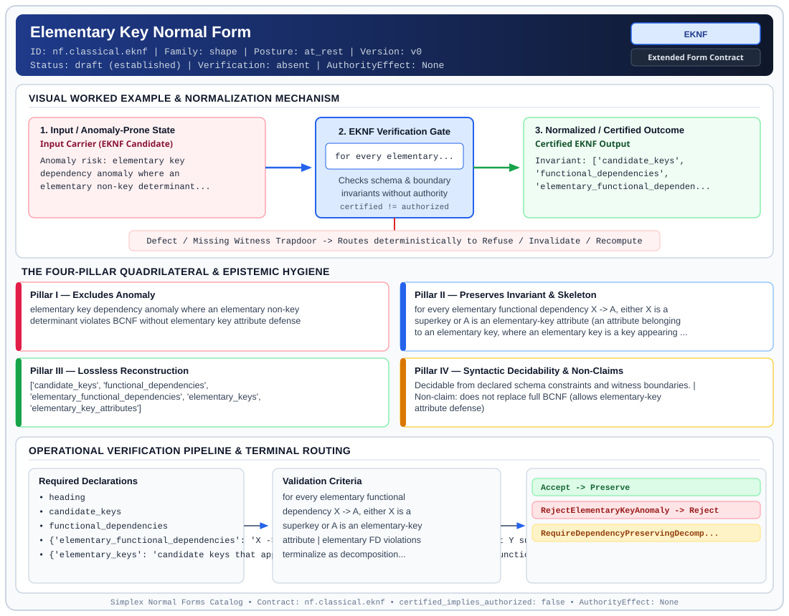

# Elementary Key Normal Form (`EKNF`)

> **Contract ID:** `nf.classical.eknf` | **Family:** `shape` | **Index Status:** `active` | **AuthorityEffect:** `None`

**[⬅ Back to Wiki Home](Home)** | **[View SVG Diagram](images/nf.classical.eknf.svg)**

---

## 1. Executive Summary & Metadata

Elementary Key Normal Form (EKNF) enforces structural normalization and explicit defect routing in the shape regime.

| Property | Value |
| :--- | :--- |
| **Canonical ID** | `nf.classical.eknf` |
| **Short Name** | `EKNF` |
| **Full Name** | Elementary Key Normal Form |
| **Family** | `shape` (Relational, Algebraic & Cochain Shape Normal Forms (Data at Rest & Structural Decompositions)) |
| **Qualification** | Extended Form Contract (Normal Form Contract) |
| **Data / Math Posture** | at_rest |
| **Index Status** | `active` |
| **Theory Status** | `established` |
| **Verification Status** | `absent` |
| **Contract Version** | `v0` |
| **Governance Fence** | `AuthorityEffect: None` (`certified_implies_authorized: false`) |

### Foundational Treatise Specification

- **Author**: Zaniolo
- **Year**: 1982
- **Structural Invariant**: For every elementary FD X -> A, X is a superkey or A lies on an elementary key.
- **Anomaly Excluded**: Elementary-dependency redundancy in overlapping composite keys.
- **Lossless Join Property**: Heath's Theorem.
- **Dependency Preservation**: Preserved by synthesis.
- **Qualifies As True Normal Form**: True

---

## 2. Visual Architecture & Normalization Diagram



---

## 3. Concrete Worked Example & Mechanism

### Visual Transition Summary

| Stage | Carrier / Operator | Concrete State / Invariant |
| :--- | :--- | :--- |
| **1. Before / Candidate Input** | `Input Carrier (EKNF Candidate)` | Anomaly risk: elementary key ; dependency anomaly where an ; elementary non-key determinant... |
| **2. Normalization / Gate** | `EKNF Verification Gate` | `for every elementary...` (`certified_implies_authorized: false`) |
| **3. After / Certified Output** | `Certified EKNF Output` | Invariant: ['candidate_keys', ; 'functional_dependencies', ; 'elementary_functional_dependen... |

### Contract-Declared Worked Cases

```yaml
- ref: coda_all_universe/1_the_tower/normal_forms/contracts/_book_09_full_normal_form_atlas.md
  section: 2.1 Classical Relational Normal Forms
```

---

## 4. The Four-Pillar Quadrilateral & Non-Claims

Every contract in `simplex-normal-forms` is evaluated against the **Four-Pillar Quadrilateral** defined in `contracts/_golden_nfs/standard.yaml`:

| Pillar | Requirement | Contract Specification for `nf.classical.eknf` |
| :--- | :--- | :--- |
| **Pillar I: Excludes Anomaly** | Name and eliminate a specific class of data or state defects. | elementary key dependency anomaly where an elementary non-key determinant violates BCNF without elementary key attribute defense |
| **Pillar II: Preserves Invariant** | State the structural invariant and protected skeleton preserved across transitions. | **Invariant:** for every elementary functional dependency X -> A, either X is a superkey or A is an elementary-key attribute (an attribute belonging to an elementary key, where an elementary key is a key appearing as the determinant of an elementary FD)<br>**Protected Skeleton:** ['candidate_keys', 'functional_dependencies', 'elementary_functional_dependencies', 'elementary_keys', 'elementary_key_attributes'] |
| **Pillar III: Lossless Reconstruction** | State the non-loss reconstruction operator (join, direct sum, pullback, or replay). | Lossless reconstruction under declared projection, direct sum, or pullback operators. |
| **Pillar IV: Syntactic Decidability** | State how conformance is decided from declared constraints without unbudgeted scans. | Decidable from declared schema and witness metadata within bounded evaluation budgets. |

### Explicit Non-Claims (`certified_implies_authorized: false`)

- does not replace full BCNF (allows elementary-key attribute defense)
- elementary key attributes are strictly narrower than general prime attributes (a prime attribute belonging only to non-elementary keys does not qualify)
- does not ensure under declared assumptions runtime repair without explicit cochain substrate
- does not imply authorization
- the source table's phrase "every non-trivial determinant is a superkey or an elementary prime" drops the restriction to elementary functional dependencies. Membership uses the elementary-dependency statement below

---

## 5. Operational Verification & Terminal Routing

### 5.1 Required Declarations

- heading
- candidate_keys
- functional_dependencies
- **elementary_functional_dependencies**: X -> A where A not in X and for no proper subset Y subset X does Y -> A hold
- **elementary_keys**: candidate keys that appear as the determinant of some elementary functional dependency
- **elementary_key_attributes**: attributes belonging to at least one elementary key
- relation_predicate

### 5.2 Required Evidence

_None declared._

### 5.3 Validation Criteria

| Criterion ID | Name | Condition |
| :--- | :--- | :--- |
| `criterion` | Check | for every elementary functional dependency X -> A, either X is a superkey or A is an elementary-key attribute |
| `criterion` | Check | elementary FD violations terminalize as decomposition requirements |

### 5.4 Terminal Route Map

Every evaluation terminates in a declared local route mapped to a canonical terminal in `standard.yaml`:

| Local Terminal Route | Canonical Terminal |
| :--- | :--- |
| `Accept` | `Preserve` |
| `RejectElementaryKeyAnomaly` | `Reject` |
| `RequireDependencyPreservingDecomposition` | `Decompose` |

### 5.5 Declared Failure Modes

- **symptom**: elementary functional dependency X -> A has non-superkey determinant X and non-elementary key attribute A, **diagnosis**: elementary key anomaly violating EKNF condition, **terminal**: RejectElementaryKeyAnomaly

---

## Deep-Dive Level Treatise

**AuthorityEffect:** None.  
**Level:** Level 09 (Intermediate Structural Refinements Between 3NF, BCNF, and 5NF)  
**Evidential Grade:** NATIVE IMPLEMENTED  
**Contract References:** [`nf.classical.eknf`](../../../../omega_engine_pfp/infrastructure/yaml/normal_forms/nf.classical.eknf.yaml), [`nf.classical.etnf`](../../../../omega_engine_pfp/infrastructure/yaml/normal_forms/nf.classical.etnf.yaml), [`nf.classical.rfnf`](../../../../omega_engine_pfp/infrastructure/yaml/normal_forms/nf.classical.rfnf.yaml)  
**Mathematical Posture:** Classical Relational Refinement (Zaniolo 1982 / Darwen, Date & Fagin 2012 / Vincent 1999)  
**Data Posture:** At Rest  

---

## 1. Schematic & Conceptual Architecture

Between 3NF, BCNF, and 5NF lie critical structural intermediate normal forms that resolve specific relational anomalies without forfeiting dependency preservation:

```text
3NF ──► EKNF (Elementary Key) ──► BCNF ──► ETNF (Essential Tuple) ──► 5NF
                             ▲
                             └── RFNF (Redundancy-Free)
```

1. **Elementary Key Normal Form (EKNF):** Strict intermediate between 3NF and BCNF. Replaces 3NF's broad prime-attribute condition with an **elementary key** condition, excluding compound non-elementary dependencies while guaranteeing dependency preservation.
2. **Essential Tuple Normal Form (ETNF):** Strict intermediate between BCNF and 5NF. Checks that every implied non-trivial join dependency contains at least one superkey component, preventing tuple redundancy without requiring full 5NF project-join decomposition.
3. **Redundancy-Free Normal Form (RFNF):** Asserts that no tuple component can be predicted from other components under declared FDs and MVDs.

---

## 2. Mathematical Invariants & Quadrilateral Properties

1. **EKNF Formal Invariant (Zaniolo 1982):**
   A relation schema $R$ is in EKNF if for every non-trivial FD $X \to Y \in F^+$, either $X$ is a superkey of $R$, or each $A \in Y \setminus X$ is part of an elementary key (an attribute in an irreducible minimal key).

2. **ETNF Formal Invariant (Darwen, Date, & Fagin 2012):**
   A relation schema $R$ is in ETNF if and only if $R$ is in BCNF, and for every non-trivial join dependency $\Join[R_1, \dots, R_k]$ holding on $R$, at least one component $R_i$ is a superkey of $R$.

3. **Separating Counterexamples:**
   - **3NF vs EKNF:** Schema $(A, B, C, D)$ with FDs $AB \to CD, C \to B$. Satisfies 3NF (since $B$ is prime), but fails EKNF because $C \to B$ involves compound dependencies across distinct keys.
   - **BCNF vs ETNF:** A schema can satisfy BCNF yet possess an implied join dependency whose components contain no superkeys, failing ETNF.

---

## 3. Terminal Routes & Verification Logic

```text
Relation Schema & Advanced Invariants
      │
      ├── Satisfies EKNF, ETNF, and RFNF ──► Preserve (AdvancedRelationalOk)
      │
      ├── Fails elementary key condition ──► Repair (EKNFDecompose)
      │
      └── Fails essential tuple superkey ──► Quarantine (RequiresETNFDecomp)
```

- `Preserve`: Schema satisfies the precise intermediate criteria without unnecessary fragmentation.
- `Repair`: Decomposes to preserve elementary keys.
- `Quarantine`: Schema contains join-redundancies that BCNF cannot see.

---

## 4. Test Evidence & Local Execution

Verified in [`test_tranche3_advanced_relational_nfs.py`](../../../tests/normal_forms/test_tranche3_advanced_relational_nfs.py):
- `test_eknf_strict_separation_from_3nf_and_bcnf`: Executes the separating counterexample separating 3NF from EKNF and EKNF from BCNF.
- `test_etnf_separation_between_bcnf_and_5nf`: Verifies that ETNF correctly identifies join dependencies with superkey components.
- `test_rfnf_redundancy_free_normal_form_evaluation`: Asserts that no attribute value is predictable from independent tuple projections.

---

## 5. Epistemic Claim Quadrant

1. **What it supports:**
   - Fine-grained architectural control over the exact trade-off between dependency preservation and redundancy elimination.
   - Formal verification of elementary key and essential tuple bounds.
2. **What it does not support:**
   - Dynamic repair of change-data-capture streams (requires BQNF).
3. **The narrowest defensible claim:**
   - EKNF and ETNF provide strictly tighter bounds on redundancy than 3NF and BCNF respectively, without sacrificing polynomial-time checkability.
4. **The next test needed:**
   - Property tests generating 100 randomized schemas with multiple overlapping composite keys to benchmark EKNF check runtimes.

---

## 6. Epistemic Claim Hygiene Quadrant

In accordance with the repository's epistemic claim discipline:

1. **What it supports:**
   - Supports syntactic and operational checking of `nf.classical.eknf` (`EKNF`) against its declared schema, boundary constraints, and witness obligations in this model.
   - Supports deterministic terminal routing (`Accept, RejectElementaryKeyAnomaly, RequireDependencyPreservingDecomposition`) when required declarations or invariants fail.
2. **What it does not support:**
   - Does not confer operational authority (`AuthorityEffect: None`, `certified_implies_authorized: false`).
   - Does not claim semantic truth of undeclared external processes or unverified upstream inputs beyond the declaredprotected skeleton.
3. **The narrowest defensible claim:**
   - Within the declared substrate `at_rest`, this contract enforces that `elementary key dependency anomaly where an elementary non-key determinant violates BCNF without elementary key attribute defense` is either excluded under `for every elementary functional dependency X -> A, either X is a superkey or A is an elementary-key attribute (an attribute belonging to an elementary key, where an elementary key is a key appearing as the determinant of an elementary FD)` or routed to an explicit refusal/recovery terminal.
4. **The next test needed:**
   - Property-based falsification and mutation testing across boundary edge cases and composed multi-step pipelines for `nf.classical.eknf`.

---

## 7. Canonical YAML Contract (`contracts/nf.classical.eknf.yaml`)

<details>
<summary><strong>Click to expand full canonical YAML contract (contracts/nf.classical.eknf.yaml)</strong></summary>

```yaml
schema_version: smplx.nf.contract.v0
schema_ref: ./normal_form_contract_schema.yaml
contract_kind: normal_form_contract
identity:
  id: nf.classical.eknf
  name: Elementary Key Normal Form
  short_name: EKNF
  version: v0
  theory_status: established
  contract_status: draft
  verification_status: absent
  family: shape
  status: draft
classification:
  hierarchy_level: normal_form
  subject_kind:
  - relvar
  data_posture: at_rest
  mathematical_posture: operational
purpose:
  excludes_anomaly: elementary key dependency anomaly where an elementary non-key
    determinant violates BCNF without elementary key attribute defense
  preserves_invariant: for every elementary functional dependency X -> A, either X
    is a superkey or A is an elementary-key attribute (an attribute belonging to an
    elementary key, where an elementary key is a key appearing as the determinant
    of an elementary FD)
  protected_skeleton:
  - candidate_keys
  - functional_dependencies
  - elementary_functional_dependencies
  - elementary_keys
  - elementary_key_attributes
  erased_structure: []
  non_claims:
  - does not replace full BCNF (allows elementary-key attribute defense)
  - elementary key attributes are strictly narrower than general prime attributes
    (a prime attribute belonging only to non-elementary keys does not qualify)
  - does not ensure under declared assumptions runtime repair without explicit cochain substrate
  - does not imply authorization
  - the source table's phrase "every non-trivial determinant is a superkey or an elementary
    prime" drops the restriction to elementary functional dependencies. Membership
    uses the elementary-dependency statement below
definition:
  source: coda_all_universe/mssn_sn_tower/definitions.md
  citation:
    author: Carlo Zaniolo
    year: 1982
    work: A New Normal Form for the Design of Relational Database Schemata
  formal_statement: 'A functional dependency X -> A is elementary when A is a single
    attribute outside X and no proper subset of X determines A. A candidate key is
    elementary when it is the determinant of some elementary functional dependency.
    An attribute is an elementary-key attribute when it belongs to at least one elementary
    key. The relvar is in elementary key normal form when, for every elementary functional
    dependency X -> A, either X is a superkey or A is an elementary-key attribute.

    '
  quadrilateral:
    qualifies_as_true_normal_form: true
    anomaly_exclusion: 'Redundancy carried by an elementary functional dependency
      whose determinant is not a superkey and whose dependent attribute lies on no
      elementary key.

      '
    lossless_join:
      status: heath
      theorem: Heath 1971
      statement: 'A violating elementary dependency X -> A still satisfies Heath''s
        hypothesis, so the binary split on X is lossless.

        '
    dependency_preservation:
      status: preserved_by_synthesis
      statement: 'Zaniolo showed a dependency-preserving decomposition into this form.
        Replacing this form by Boyce-Codd normal form drops that ensure under declared assumptions. This tree
        does not implement the synthesis.

        '
    syntactic_decision:
      status: schema_decidable
      statement: 'Decided from the elementary functional dependencies, the elementary
        keys, and the superkeys. One stored body is not the decider.

        '
  chain:
    requires:
    - 3NF
    implied_by:
    - BCNF
    - 4NF
    - ETNF
    - 5NF
    - 6NF
    strict_gap_below: BCNF
    strict_gap_above: 3NF
declarations_required:
- heading
- candidate_keys
- functional_dependencies
- elementary_functional_dependencies: X -> A where A not in X and for no proper subset
    Y subset X does Y -> A hold
- elementary_keys: candidate keys that appear as the determinant of some elementary
    functional dependency
- elementary_key_attributes: attributes belonging to at least one elementary key
- relation_predicate
evidence_required: []
validation_criteria:
- for every elementary functional dependency X -> A, either X is a superkey or A is
  an elementary-key attribute
- elementary FD violations terminalize as decomposition requirements
proof_obligations:
- id: eknf.subsumption_of_3nf
  status: theorem_shaped
  ref: https://dl.acm.org/doi/pdf/10.1145/319732.319749
  statement: Every relvar in EKNF is in 3NF, and every relvar in BCNF is in EKNF
terminal_routes:
- Accept
- RejectElementaryKeyAnomaly
- RequireDependencyPreservingDecomposition
terminal_route_map:
  Accept: Preserve
  RejectElementaryKeyAnomaly: Reject
  RequireDependencyPreservingDecomposition: Decompose
certification:
  certificate_required: false
  certificate_kind: null
  obstruction_class_required: false
  loss_ledger_required: false
  verifier_required: false
  loss_ledger_trigger_id: null
authorization:
  authorized_by: null
  certified_implies_authorized: false
failure_modes:
- symptom: elementary functional dependency X -> A has non-superkey determinant X
    and non-elementary key attribute A
  diagnosis: elementary key anomaly violating EKNF condition
  terminal: RejectElementaryKeyAnomaly
examples:
- ref: coda_all_universe/1_the_tower/normal_forms/contracts/_book_09_full_normal_form_atlas.md
  section: 2.1 Classical Relational Normal Forms
references:
- https://dl.acm.org/doi/pdf/10.1145/319732.319749
- coda_all_universe/1_the_tower/normal_forms/contracts/_book_09_full_normal_form_atlas.md
- coda_all_universe/1_the_tower/normal_forms/contracts/_paper_0_relvar_relation_table_and_boundary_relvar.md
```

</details>
