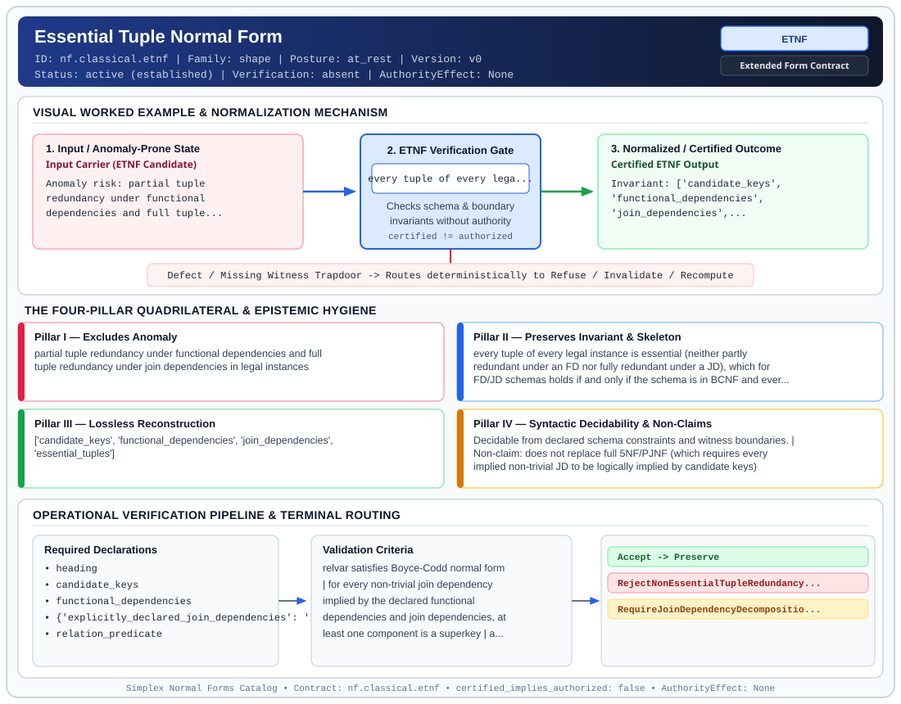

# Essential Tuple Normal Form (`ETNF`)

> **Contract ID:** `nf.classical.etnf` | **Family:** `shape` | **Index Status:** `active` | **AuthorityEffect:** `None`

**[⬅ Back to Wiki Home](Home)** | **[View SVG Diagram](images/nf.classical.etnf.svg)**

---

## 1. Executive Summary & Metadata

Essential Tuple Normal Form (ETNF) enforces structural normalization and explicit defect routing in the shape regime.

| Property | Value |
| :--- | :--- |
| **Canonical ID** | `nf.classical.etnf` |
| **Short Name** | `ETNF` |
| **Full Name** | Essential Tuple Normal Form |
| **Family** | `shape` (Relational, Algebraic & Cochain Shape Normal Forms (Data at Rest & Structural Decompositions)) |
| **Qualification** | Extended Form Contract (Normal Form Contract) |
| **Data / Math Posture** | at_rest |
| **Index Status** | `active` |
| **Theory Status** | `established` |
| **Verification Status** | `absent` |
| **Contract Version** | `v0` |
| **Governance Fence** | `AuthorityEffect: None` (`certified_implies_authorized: false`) |

### Foundational Treatise Specification

- **Author**: Darwen, Date, and Fagin
- **Year**: 2012
- **Structural Invariant**: Schema in BCNF, and every implied non-trivial JD has at least one superkey component.
- **Anomaly Excluded**: Partial tuple redundancy under FDs and full tuple redundancy under JDs.
- **Lossless Join Property**: Project-Join.
- **Dependency Preservation**: Analyzed.
- **Qualifies As True Normal Form**: True

---

## 2. Visual Architecture & Normalization Diagram



---

## 3. Concrete Worked Example & Mechanism

### Visual Transition Summary

| Stage | Carrier / Operator | Concrete State / Invariant |
| :--- | :--- | :--- |
| **1. Before / Candidate Input** | `Input Carrier (ETNF Candidate)` | Anomaly risk: partial tuple ; redundancy under functional ; dependencies and full tuple... |
| **2. Normalization / Gate** | `ETNF Verification Gate` | `every tuple of every lega...` (`certified_implies_authorized: false`) |
| **3. After / Certified Output** | `Certified ETNF Output` | Invariant: ['candidate_keys', ; 'functional_dependencies', ; 'join_dependencies',... |

### Contract-Declared Worked Cases

```yaml
- ref: coda_all_universe/1_the_tower/normal_forms/contracts/_book_09_full_normal_form_atlas.md
  section: 2.1 Classical Relational Normal Forms
```

---

## 4. The Four-Pillar Quadrilateral & Non-Claims

Every contract in `simplex-normal-forms` is evaluated against the **Four-Pillar Quadrilateral** defined in `contracts/_golden_nfs/standard.yaml`:

| Pillar | Requirement | Contract Specification for `nf.classical.etnf` |
| :--- | :--- | :--- |
| **Pillar I: Excludes Anomaly** | Name and eliminate a specific class of data or state defects. | partial tuple redundancy under functional dependencies and full tuple redundancy under join dependencies in legal instances |
| **Pillar II: Preserves Invariant** | State the structural invariant and protected skeleton preserved across transitions. | **Invariant:** every tuple of every legal instance is essential (neither partly redundant under an FD nor fully redundant under a JD), which for FD/JD schemas holds if and only if the schema is in BCNF and every explicitly declared non-trivial join dependency has at least one superkey component<br>**Protected Skeleton:** ['candidate_keys', 'functional_dependencies', 'join_dependencies', 'essential_tuples'] |
| **Pillar III: Lossless Reconstruction** | State the non-loss reconstruction operator (join, direct sum, pullback, or replay). | Lossless reconstruction under declared projection, direct sum, or pullback operators. |
| **Pillar IV: Syntactic Decidability** | State how conformance is decided from declared constraints without unbudgeted scans. | Decidable from declared schema and witness metadata within bounded evaluation budgets. |

### Explicit Non-Claims (`certified_implies_authorized: false`)

- does not replace full 5NF/PJNF (which requires every implied non-trivial JD to be logically implied by candidate keys)
- ETNF requires at least one superkey component of each implied non-trivial join dependency. Requiring every component to be a superkey is the condition for SKNF (5NFR), which is strictly stronger than ETNF and RFNF
- a check of only the join dependencies written down by hand is incomplete unless that list is closed under implication or the schema is known to be in BCNF
- the source table's phrase "join dependencies with components at most two" is not the Darwen-Date-Fagin membership test
- does not certify runtime repair without cochain substrate
- does not imply authorization

---

## 5. Operational Verification & Terminal Routing

### 5.1 Required Declarations

- heading
- candidate_keys
- functional_dependencies
- **explicitly_declared_join_dependencies**: *(R_1, R_2, ..., R_n)
- relation_predicate

### 5.2 Required Evidence

_None declared._

### 5.3 Validation Criteria

| Criterion ID | Name | Condition |
| :--- | :--- | :--- |
| `criterion` | Check | relvar satisfies Boyce-Codd normal form |
| `criterion` | Check | for every non-trivial join dependency implied by the declared functional dependencies and join dependencies, at least one component is a superkey |
| `criterion` | Check | a listed join dependency that was not closed under implication is not yet the membership test |
| `criterion` | Check | redundant-tuple witnesses terminalize as a join-dependency decomposition obligation |

### 5.4 Terminal Route Map

Every evaluation terminates in a declared local route mapped to a canonical terminal in `standard.yaml`:

| Local Terminal Route | Canonical Terminal |
| :--- | :--- |
| `Accept` | `Preserve` |
| `RejectNonEssentialTupleRedundancy` | `Reject` |
| `RequireJoinDependencyDecomposition` | `Decompose` |

### 5.5 Declared Failure Modes

- **symptom**: relvar in BCNF contains redundant tuples constructible from sub-projections because an explicitly declared non-trivial JD lacks any superkey component, **diagnosis**: essential tuple redundancy violating ETNF, **terminal**: RejectNonEssentialTupleRedundancy

---

## 6. Epistemic Claim Hygiene Quadrant

In accordance with the repository's epistemic claim discipline:

1. **What it supports:**
   - Supports syntactic and operational checking of `nf.classical.etnf` (`ETNF`) against its declared schema, boundary constraints, and witness obligations in this model.
   - Supports deterministic terminal routing (`Accept, RejectNonEssentialTupleRedundancy, RequireJoinDependencyDecomposition`) when required declarations or invariants fail.
2. **What it does not support:**
   - Does not confer operational authority (`AuthorityEffect: None`, `certified_implies_authorized: false`).
   - Does not claim semantic truth of undeclared external processes or unverified upstream inputs beyond the declaredprotected skeleton.
3. **The narrowest defensible claim:**
   - Within the declared substrate `at_rest`, this contract enforces that `partial tuple redundancy under functional dependencies and full tuple redundancy under join dependencies in legal instances` is either excluded under `every tuple of every legal instance is essential (neither partly redundant under an FD nor fully redundant under a JD), which for FD/JD schemas holds if and only if the schema is in BCNF and every explicitly declared non-trivial join dependency has at least one superkey component` or routed to an explicit refusal/recovery terminal.
4. **The next test needed:**
   - Property-based falsification and mutation testing across boundary edge cases and composed multi-step pipelines for `nf.classical.etnf`.

---

## 7. Canonical YAML Contract (`contracts/nf.classical.etnf.yaml`)

<details>
<summary><strong>Click to expand full canonical YAML contract (contracts/nf.classical.etnf.yaml)</strong></summary>

```yaml
schema_version: smplx.nf.contract.v0
schema_ref: ./normal_form_contract_schema.yaml
contract_kind: normal_form_contract
identity:
  id: nf.classical.etnf
  name: Essential Tuple Normal Form
  short_name: ETNF
  version: v0
  theory_status: established
  contract_status: active
  verification_status: absent
  family: shape
  status: active
classification:
  hierarchy_level: normal_form
  subject_kind:
  - relvar
  data_posture: at_rest
  mathematical_posture: operational
purpose:
  excludes_anomaly: partial tuple redundancy under functional dependencies and full
    tuple redundancy under join dependencies in legal instances
  preserves_invariant: every tuple of every legal instance is essential (neither partly
    redundant under an FD nor fully redundant under a JD), which for FD/JD schemas
    holds if and only if the schema is in BCNF and every explicitly declared non-trivial
    join dependency has at least one superkey component
  protected_skeleton:
  - candidate_keys
  - functional_dependencies
  - join_dependencies
  - essential_tuples
  erased_structure: []
  non_claims:
  - does not replace full 5NF/PJNF (which requires every implied non-trivial JD
    to be logically implied by candidate keys)
  - ETNF requires at least one superkey component of each implied non-trivial join
    dependency. Requiring every component to be a superkey is the condition for SKNF (5NFR),
    which is strictly stronger than ETNF and RFNF
  - a check of only the join dependencies written down by hand is incomplete unless
    that list is closed under implication or the schema is known to be in BCNF
  - the source table's phrase "join dependencies with components at most two" is not
    the Darwen-Date-Fagin membership test
  - does not certify runtime repair without cochain substrate
  - does not imply authorization
definition:
  source: coda_all_universe/mssn_sn_tower/definitions.md
  citation:
    authors: Hugh Darwen, C. J. Date, and Ronald Fagin
    year: 2012
    work: A Normal Form for Relational Databases, Essential Tuple Normal Form
  formal_statement: 'A tuple t in a legal instance r is redundant for the constraint
    set when every relation that contains r without t and obeys the constraints also
    contains t. An essential tuple is one that is neither partly redundant under a
    functional dependency nor fully redundant under a join dependency. The schema is
    in essential tuple normal form when every tuple of every legal instance is essential.
    When the constraints are functional dependencies and join dependencies, this holds
    if and only if the schema is in Boyce-Codd normal form (BCNF) and every non-trivial join
    dependency implied by the constraints has at least one component that is a superkey
    (Darwen, Date, Fagin 2012 Definitions 1.4, 1.6, 1.12 and Theorem 1.13).

    '
  source_table_reading:
    phrase: join dependencies with components at most two, each a key component
    status: not_the_membership_test
    published_test: 'The schema is in BCNF and at least one component of every
      explicitly declared non-trivial join dependency is a superkey. Theorem 1.13
      ensures under declared assumptions the condition holds for all implied join dependencies as well.

      '
  quadrilateral:
    qualifies_as_true_normal_form: true
    anomaly_exclusion: 'A stored tuple that is partly redundant under a functional
      dependency or fully redundant under a join dependency, so deleting or modifying
      it does not change the legal information.

      '
    lossless_join:
      status: join_dependency
      statement: 'A join dependency holds exactly when the natural join of those projections
        returns the original instance. That is the definition of lossless join for
        the decomposition. Rissanen (1977) adds independence of the components, losslessness
        together with local dependency checking. This contract uses the join-dependency
        definition for losslessness.

        '
    dependency_preservation:
      status: not_asserted
      statement: 'This form is a membership condition on one schema. It does not promise
        a synthesis algorithm that preserves every dependency.

        '
    syntactic_decision:
      status: schema_decidable
      statement: 'For a finite cover of functional and join dependencies, consequence
        closure is decidable by the chase. Membership is read from that closure and
        the superkeys. One stored body is not the decider.

        '
  chain:
    requires:
    - 4NF
    - BCNF
    implied_by:
    - RFNF
    - SKNF
    - 5NF
    - 6NF
    strict_gap_below: 5NF
    strict_gap_above: 4NF
declarations_required:
- heading
- candidate_keys
- functional_dependencies
- explicitly_declared_join_dependencies: '*(R_1, R_2, ..., R_n)'
- relation_predicate
evidence_required: []
validation_criteria:
- relvar satisfies Boyce-Codd normal form
- for every non-trivial join dependency implied by the declared functional dependencies
  and join dependencies, at least one component is a superkey
- a listed join dependency that was not closed under implication is not yet the membership
  test
- redundant-tuple witnesses terminalize as a join-dependency decomposition obligation
proof_obligations:
- id: etnf.between_4nf_and_5nf
  status: theorem_shaped
  ref: https://research.ibm.com/publications/a-normal-form-for-preventing-redundant-tuples-in-relational-databases
  statement: 'For functional and join dependencies, essential tuple normal form holds
    exactly when every implied non-trivial join dependency has at least one superkey
    component. Fifth normal form implies this form, and this form implies fourth normal
    form. Both inclusions are strict in the literature. This tree does not support those
    inclusions.

    '
terminal_routes:
- Accept
- RejectNonEssentialTupleRedundancy
- RequireJoinDependencyDecomposition
terminal_route_map:
  Accept: Preserve
  RejectNonEssentialTupleRedundancy: Reject
  RequireJoinDependencyDecomposition: Decompose
certification:
  certificate_required: false
  certificate_kind: null
  obstruction_class_required: false
  loss_ledger_required: false
  verifier_required: false
  loss_ledger_trigger_id: null
authorization:
  authorized_by: null
  certified_implies_authorized: false
failure_modes:
- symptom: relvar in BCNF contains redundant tuples constructible from sub-projections
    because an explicitly declared non-trivial JD lacks any superkey component
  diagnosis: essential tuple redundancy violating ETNF
  terminal: RejectNonEssentialTupleRedundancy
examples:
- ref: coda_all_universe/1_the_tower/normal_forms/contracts/_book_09_full_normal_form_atlas.md
  section: 2.1 Classical Relational Normal Forms
references:
- https://research.ibm.com/publications/a-normal-form-for-preventing-redundant-tuples-in-relational-databases
- coda_all_universe/1_the_tower/normal_forms/contracts/_book_09_full_normal_form_atlas.md
- coda_all_universe/1_the_tower/normal_forms/contracts/_paper_0_relvar_relation_table_and_boundary_relvar.md
```

</details>
