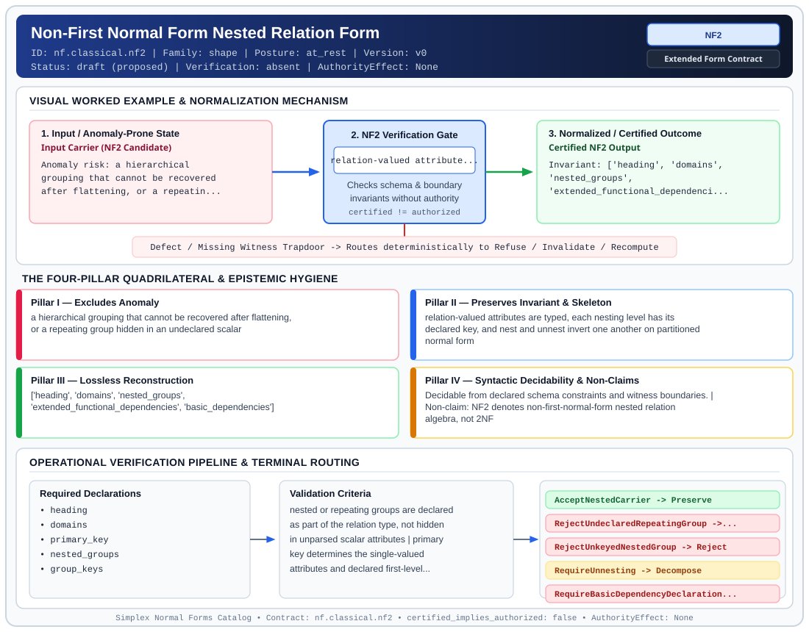

# Non-First Normal Form Nested Relation Form (`NF2`)

> **Contract ID:** `nf.classical.nf2` | **Family:** `shape` | **Index Status:** `draft` | **AuthorityEffect:** `None`

**[⬅ Back to Wiki Home](Home)** | **[View SVG Diagram](images/nf.classical.nf2.svg)**

---

## 1. Executive Summary & Metadata

Non-First Normal Form Nested Relation Form (NF2) enforces structural normalization and explicit defect routing in the shape regime.

| Property | Value |
| :--- | :--- |
| **Canonical ID** | `nf.classical.nf2` |
| **Short Name** | `NF2` |
| **Full Name** | Non-First Normal Form Nested Relation Form |
| **Family** | `shape` (Relational, Algebraic & Cochain Shape Normal Forms (Data at Rest & Structural Decompositions)) |
| **Qualification** | Extended Form Contract (Normal Form Contract) |
| **Data / Math Posture** | at_rest |
| **Index Status** | `draft` |
| **Theory Status** | `proposed` |
| **Verification Status** | `absent` |
| **Contract Version** | `v0` |
| **Governance Fence** | `AuthorityEffect: None` (`certified_implies_authorized: false`) |

### Foundational Treatise Specification

- **Author**: Schek and Scholl
- **Year**: 1986
- **Structural Invariant**: Nest and unnest invert one another on partitioned normal form.
- **Anomaly Excluded**: Hierarchies that cannot be recovered after flattening.
- **Lossless Join Property**: Invertible Nest/Unnest.
- **Dependency Preservation**: Preserved under partitioned NF.
- **Qualifies As True Normal Form**: False
- **Qualification Gap**: Orthogonal to the flat relational decomposition chain.

---

## 2. Visual Architecture & Normalization Diagram



---

## 3. Concrete Worked Example & Mechanism

### Visual Transition Summary

| Stage | Carrier / Operator | Concrete State / Invariant |
| :--- | :--- | :--- |
| **1. Before / Candidate Input** | `Input Carrier (NF2 Candidate)` | Anomaly risk: a hierarchical ; grouping that cannot be recovered ; after flattening, or a repeatin... |
| **2. Normalization / Gate** | `NF2 Verification Gate` | `relation-valued attribute...` (`certified_implies_authorized: false`) |
| **3. After / Certified Output** | `Certified NF2 Output` | Invariant: ['heading', 'domains', ; 'nested_groups', ; 'extended_functional_dependenci... |

### Contract-Declared Worked Cases

```yaml
- ref: coda_all_universe/1_the_tower/normal_forms/contracts/_book_09_full_normal_form_atlas.md
  section: 2.1 Classical Relational Normal Forms
```

---

## 4. The Four-Pillar Quadrilateral & Non-Claims

Every contract in `simplex-normal-forms` is evaluated against the **Four-Pillar Quadrilateral** defined in `contracts/_golden_nfs/standard.yaml`:

| Pillar | Requirement | Contract Specification for `nf.classical.nf2` |
| :--- | :--- | :--- |
| **Pillar I: Excludes Anomaly** | Name and eliminate a specific class of data or state defects. | a hierarchical grouping that cannot be recovered after flattening, or a repeating group hidden in an undeclared scalar |
| **Pillar II: Preserves Invariant** | State the structural invariant and protected skeleton preserved across transitions. | **Invariant:** relation-valued attributes are typed, each nesting level has its declared key, and nest and unnest invert one another on partitioned normal form<br>**Protected Skeleton:** ['heading', 'domains', 'nested_groups', 'extended_functional_dependencies', 'basic_dependencies'] |
| **Pillar III: Lossless Reconstruction** | State the non-loss reconstruction operator (join, direct sum, pullback, or replay). | Lossless reconstruction under declared projection, direct sum, or pullback operators. |
| **Pillar IV: Syntactic Decidability** | State how conformance is decided from declared constraints without unbudgeted scans. | Decidable from declared schema and witness metadata within bounded evaluation budgets. |

### Explicit Non-Claims (`certified_implies_authorized: false`)

- NF2 denotes non-first-normal-form nested relation algebra, not 2NF
- does not claim nested relation bodies are classical flat 1NF relations
- does not replace flat normalization when 1NF relational decomposition is required
- does not certify runtime repair without cochain substrate
- does not imply authorization
- this form is orthogonal to the chain from first normal form through sixth. It admits relation-valued attributes, which first normal form excludes

---

## 5. Operational Verification & Terminal Routing

### 5.1 Required Declarations

- heading
- domains
- primary_key
- nested_groups
- group_keys
- extended_functional_dependencies
- basic_dependencies
- relation_predicate

### 5.2 Required Evidence

_None declared._

### 5.3 Validation Criteria

| Criterion ID | Name | Condition |
| :--- | :--- | :--- |
| `criterion` | Check | nested or repeating groups are declared as part of the relation type, not hidden in unparsed scalar attributes |
| `criterion` | Check | primary key determines the single-valued attributes and declared first-level repeating groups |
| `criterion` | Check | each repeating group declares its key relative to the enclosing relation key |
| `criterion` | Check | extended functional dependencies are derivable from declared basic dependencies |
| `criterion` | Check | single-valued attributes of the nested relation satisfy declared classical 3NF baselines |

### 5.4 Terminal Route Map

Every evaluation terminates in a declared local route mapped to a canonical terminal in `standard.yaml`:

| Local Terminal Route | Canonical Terminal |
| :--- | :--- |
| `AcceptNestedCarrier` | `Preserve` |
| `RejectUndeclaredRepeatingGroup` | `Reject` |
| `RejectUnkeyedNestedGroup` | `Reject` |
| `RequireUnnesting` | `Decompose` |
| `RequireBasicDependencyDeclaration` | `Refuse` |

### 5.5 Declared Failure Modes

- **symptom**: invoice lines are stored as an untyped blob while the schema claims a single-valued attribute, **diagnosis**: undeclared repeating group violating NF2 structural declaration, **terminal**: RejectUndeclaredRepeatingGroup
- **symptom**: salary history is nested but date or equivalent group key is not declared, **diagnosis**: unkeyed nested group violating nested relation key integrity, **terminal**: RejectUnkeyedNestedGroup

---

## 6. Epistemic Claim Hygiene Quadrant

In accordance with the repository's epistemic claim discipline:

1. **What it supports:**
   - Supports syntactic and operational checking of `nf.classical.nf2` (`NF2`) against its declared schema, boundary constraints, and witness obligations in this model.
   - Supports deterministic terminal routing (`AcceptNestedCarrier, RejectUndeclaredRepeatingGroup, RejectUnkeyedNestedGroup, RequireUnnesting`) when required declarations or invariants fail.
2. **What it does not support:**
   - Does not confer operational authority (`AuthorityEffect: None`, `certified_implies_authorized: false`).
   - Does not claim semantic truth of undeclared external processes or unverified upstream inputs beyond the declaredprotected skeleton.
3. **The narrowest defensible claim:**
   - Within the declared substrate `at_rest`, this contract enforces that `a hierarchical grouping that cannot be recovered after flattening, or a repeating group hidden in an undeclared scalar` is either excluded under `relation-valued attributes are typed, each nesting level has its declared key, and nest and unnest invert one another on partitioned normal form` or routed to an explicit refusal/recovery terminal.
4. **The next test needed:**
   - Property-based falsification and mutation testing across boundary edge cases and composed multi-step pipelines for `nf.classical.nf2`.

---

## 7. Canonical YAML Contract (`contracts/nf.classical.nf2.yaml`)

<details>
<summary><strong>Click to expand full canonical YAML contract (contracts/nf.classical.nf2.yaml)</strong></summary>

```yaml
schema_version: smplx.nf.contract.v0
schema_ref: ./normal_form_contract_schema.yaml
contract_kind: normal_form_contract
identity:
  id: nf.classical.nf2
  name: Non-First Normal Form Nested Relation Form
  short_name: NF2
  version: v0
  theory_status: proposed
  contract_status: draft
  verification_status: absent
  family: shape
  status: draft
classification:
  hierarchy_level: normal_form
  subject_kind:
  - relvar
  data_posture: at_rest
  mathematical_posture: operational
purpose:
  excludes_anomaly: a hierarchical grouping that cannot be recovered after flattening,
    or a repeating group hidden in an undeclared scalar
  preserves_invariant: relation-valued attributes are typed, each nesting level has
    its declared key, and nest and unnest invert one another on partitioned normal
    form
  protected_skeleton:
  - heading
  - domains
  - nested_groups
  - extended_functional_dependencies
  - basic_dependencies
  erased_structure: []
  non_claims:
  - NF2 denotes non-first-normal-form nested relation algebra, not 2NF
  - does not claim nested relation bodies are classical flat 1NF relations
  - does not replace flat normalization when 1NF relational decomposition is required
  - does not certify runtime repair without cochain substrate
  - does not imply authorization
  - this form is orthogonal to the chain from first normal form through sixth. It
    admits relation-valued attributes, which first normal form excludes
definition:
  source: coda_all_universe/mssn_sn_tower/definitions.md
  citation:
    authors: Hans-Jörg Schek and Marc H. Scholl
    year: 1986
    work: The relational model with relation-valued attributes
  formal_statement: 'A nested relation carries relation-valued attributes under an
    explicit algebra of nest and unnest. It is in partitioned normal form when, at
    each level, the atomic attributes are a key for the relation-valued attributes
    at that level. On that class, nest and unnest are inverses: unnesting then nesting
    returns the nested value, and nesting then unnesting returns the flat value. Outside
    that class, unnest is still defined, and nesting the unnested value need not return
    the original nested value.

    '
  quadrilateral:
    qualifies_as_true_normal_form: false
    qualification_gap: orthogonal_to_the_flat_chain
    anomaly_exclusion: 'Loss of a declared hierarchy under flattening, and a repeating
      group stored in a scalar that the schema did not declare as relation-valued.
      The source table''s remark about flattening cost is a performance remark, not
      the anomaly class.

      '
    lossless_join:
      status: nest_unnest_on_partitioned_normal_form
      statement: 'Reconstruction is nest and unnest, not a flat project-join. Invertibility
        is the partitioned-normal-form theorem. It is not claimed for arbitrary nested
        values.

        '
    dependency_preservation:
      status: extended_dependencies_declared_at_each_level
      statement: 'Extended dependencies are checked at the nesting level where they
        are declared. Flattening into first normal form is a different design choice
        and is not performed silently by this form.

        '
    syntactic_decision:
      status: schema_decidable
      statement: 'Decided from the nested heading, the level keys, and the declared
        basic dependencies. One stored document is not the decider.

        '
  chain:
    orthogonal_to:
    - 1NF
    - 2NF
    - 3NF
    - EKNF
    - BCNF
    - 4NF
    - ETNF
    - 5NF
    - 6NF
declarations_required:
- heading
- domains
- primary_key
- nested_groups
- group_keys
- extended_functional_dependencies
- basic_dependencies
- relation_predicate
evidence_required: []
validation_criteria:
- nested or repeating groups are declared as part of the relation type, not hidden
  in unparsed scalar attributes
- primary key determines the single-valued attributes and declared first-level repeating
  groups
- each repeating group declares its key relative to the enclosing relation key
- extended functional dependencies are derivable from declared basic dependencies
- single-valued attributes of the nested relation satisfy declared classical 3NF baselines
proof_obligations:
- id: nf2.nest_unnest_algebraic_isomorphism
  status: theorem_shaped
  ref: https://www.comp.nus.edu.sg/~lingtw/cs4221/nested.relation.pdf
  statement: 'On partitioned normal form, nest and unnest are inverse. Outside that
    class, unnest need not be inverted by nest.

    '
terminal_routes:
- AcceptNestedCarrier
- RejectUndeclaredRepeatingGroup
- RejectUnkeyedNestedGroup
- RequireUnnesting
- RequireBasicDependencyDeclaration
terminal_route_map:
  AcceptNestedCarrier: Preserve
  RejectUndeclaredRepeatingGroup: Reject
  RejectUnkeyedNestedGroup: Reject
  RequireUnnesting: Decompose
  RequireBasicDependencyDeclaration: Refuse
certification:
  certificate_required: false
  certificate_kind: null
  obstruction_class_required: false
  loss_ledger_required: false
  verifier_required: false
  loss_ledger_trigger_id: null
authorization:
  authorized_by: null
  certified_implies_authorized: false
failure_modes:
- symptom: invoice lines are stored as an untyped blob while the schema claims a single-valued
    attribute
  diagnosis: undeclared repeating group violating NF2 structural declaration
  terminal: RejectUndeclaredRepeatingGroup
- symptom: salary history is nested but date or equivalent group key is not declared
  diagnosis: unkeyed nested group violating nested relation key integrity
  terminal: RejectUnkeyedNestedGroup
examples:
- ref: coda_all_universe/1_the_tower/normal_forms/contracts/_book_09_full_normal_form_atlas.md
  section: 2.1 Classical Relational Normal Forms
references:
- coda_all_universe/1_the_tower/normal_forms/contracts/_book_09_full_normal_form_atlas.md
- coda_all_universe/1_the_tower/normal_forms/contracts/_paper_0_relvar_relation_table_and_boundary_relvar.md
- ./normal_form_contract_schema.yaml
- https://www.comp.nus.edu.sg/~lingtw/cs4221/nested.relation.pdf
```

</details>
