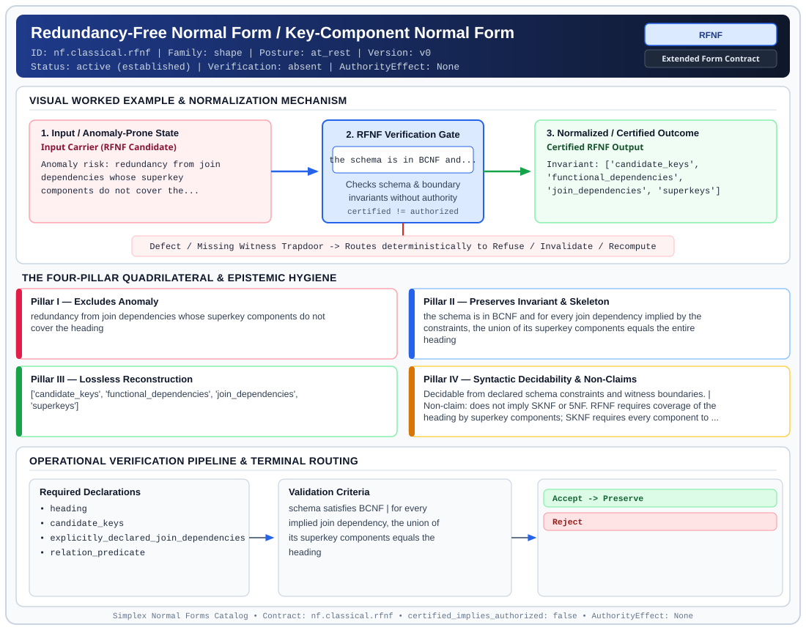

# Redundancy-Free Normal Form / Key-Component Normal Form (`RFNF`)

> **Contract ID:** `nf.classical.rfnf` | **Family:** `shape` | **Index Status:** `active` | **AuthorityEffect:** `None`

**[⬅ Back to Wiki Home](Home)** | **[View SVG Diagram](images/nf.classical.rfnf.svg)**

---

## 1. Executive Summary & Metadata

Redundancy-Free Normal Form / Key-Component Normal Form (RFNF) enforces structural normalization and explicit defect routing in the shape regime.

| Property | Value |
| :--- | :--- |
| **Canonical ID** | `nf.classical.rfnf` |
| **Short Name** | `RFNF` |
| **Full Name** | Redundancy-Free Normal Form / Key-Component Normal Form |
| **Family** | `shape` (Relational, Algebraic & Cochain Shape Normal Forms (Data at Rest & Structural Decompositions)) |
| **Qualification** | Extended Form Contract (Normal Form Contract) |
| **Data / Math Posture** | at_rest |
| **Index Status** | `active` |
| **Theory Status** | `established` |
| **Verification Status** | `absent` |
| **Contract Version** | `v0` |
| **Governance Fence** | `AuthorityEffect: None` (`certified_implies_authorized: false`) |

### Foundational Treatise Specification

- **Author**: Vincent (origin); Darwen, Date, and Fagin (characterization)
- **Year**: 2012
- **Structural Invariant**: Schema in BCNF where the union of superkey components equals the entire heading for every JD.
- **Anomaly Excluded**: Redundancy from join dependencies whose superkey components do not cover heading.
- **Lossless Join Property**: Project-Join.
- **Dependency Preservation**: Analyzed.
- **Qualifies As True Normal Form**: True

---

## 2. Visual Architecture & Normalization Diagram



---

## 3. Concrete Worked Example & Mechanism

### Visual Transition Summary

| Stage | Carrier / Operator | Concrete State / Invariant |
| :--- | :--- | :--- |
| **1. Before / Candidate Input** | `Input Carrier (RFNF Candidate)` | Anomaly risk: redundancy from join ; dependencies whose superkey ; components do not cover the... |
| **2. Normalization / Gate** | `RFNF Verification Gate` | `the schema is in BCNF and...` (`certified_implies_authorized: false`) |
| **3. After / Certified Output** | `Certified RFNF Output` | Invariant: ['candidate_keys', ; 'functional_dependencies', ; 'join_dependencies', 'superkeys'] |

---

## 4. The Four-Pillar Quadrilateral & Non-Claims

Every contract in `simplex-normal-forms` is evaluated against the **Four-Pillar Quadrilateral** defined in `contracts/_golden_nfs/standard.yaml`:

| Pillar | Requirement | Contract Specification for `nf.classical.rfnf` |
| :--- | :--- | :--- |
| **Pillar I: Excludes Anomaly** | Name and eliminate a specific class of data or state defects. | redundancy from join dependencies whose superkey components do not cover the heading |
| **Pillar II: Preserves Invariant** | State the structural invariant and protected skeleton preserved across transitions. | **Invariant:** the schema is in BCNF and for every join dependency implied by the constraints, the union of its superkey components equals the entire heading<br>**Protected Skeleton:** ['candidate_keys', 'functional_dependencies', 'join_dependencies', 'superkeys'] |
| **Pillar III: Lossless Reconstruction** | State the non-loss reconstruction operator (join, direct sum, pullback, or replay). | Lossless reconstruction under declared projection, direct sum, or pullback operators. |
| **Pillar IV: Syntactic Decidability** | State how conformance is decided from declared constraints without unbudgeted scans. | Decidable from declared schema and witness metadata within bounded evaluation budgets. |

### Explicit Non-Claims (`certified_implies_authorized: false`)

- does not imply SKNF or 5NF. RFNF requires coverage of the heading by superkey components; SKNF requires every component to be a superkey
- KCNF is an equivalent syntactic characterization, not an additional strict level
- does not certify runtime repair without cochain substrate
- does not imply authorization

---

## 5. Operational Verification & Terminal Routing

### 5.1 Required Declarations

- heading
- candidate_keys
- explicitly_declared_join_dependencies
- relation_predicate

### 5.2 Required Evidence

_None declared._

### 5.3 Validation Criteria

| Criterion ID | Name | Condition |
| :--- | :--- | :--- |
| `criterion` | Check | schema satisfies BCNF |
| `criterion` | Check | for every implied join dependency, the union of its superkey components equals the heading |

### 5.4 Terminal Route Map

Every evaluation terminates in a declared local route mapped to a canonical terminal in `standard.yaml`:

| Local Terminal Route | Canonical Terminal |
| :--- | :--- |
| `Accept` | `Preserve` |
| `Reject` | `Reject` |

### 5.5 Declared Failure Modes

- **symptom**: join dependency superkey components do not cover entire heading, **diagnosis**: superkey components fail heading coverage in BCNF schema, **terminal**: Reject

---

## 6. Epistemic Claim Hygiene Quadrant

In accordance with the repository's epistemic claim discipline:

1. **What it supports:**
   - Supports syntactic and operational checking of `nf.classical.rfnf` (`RFNF`) against its declared schema, boundary constraints, and witness obligations in this model.
   - Supports deterministic terminal routing (`Accept, Reject`) when required declarations or invariants fail.
2. **What it does not support:**
   - Does not confer operational authority (`AuthorityEffect: None`, `certified_implies_authorized: false`).
   - Does not claim semantic truth of undeclared external processes or unverified upstream inputs beyond the declaredprotected skeleton.
3. **The narrowest defensible claim:**
   - Within the declared substrate `at_rest`, this contract enforces that `redundancy from join dependencies whose superkey components do not cover the heading` is either excluded under `the schema is in BCNF and for every join dependency implied by the constraints, the union of its superkey components equals the entire heading` or routed to an explicit refusal/recovery terminal.
4. **The next test needed:**
   - Property-based falsification and mutation testing across boundary edge cases and composed multi-step pipelines for `nf.classical.rfnf`.

---

## 7. Canonical YAML Contract (`contracts/nf.classical.rfnf.yaml`)

<details>
<summary><strong>Click to expand full canonical YAML contract (contracts/nf.classical.rfnf.yaml)</strong></summary>

```yaml
schema_version: smplx.nf.contract.v0
schema_ref: ./normal_form_contract_schema.yaml
contract_kind: normal_form_contract
identity:
  id: nf.classical.rfnf
  name: Redundancy-Free Normal Form / Key-Component Normal Form
  short_name: RFNF
  version: v0
  theory_status: established
  contract_status: active
  verification_status: absent
  family: shape
  status: active
classification:
  hierarchy_level: normal_form
  subject_kind:
  - relvar
  data_posture: at_rest
  mathematical_posture: operational
purpose:
  excludes_anomaly: redundancy from join dependencies whose superkey components do not cover the heading
  preserves_invariant: the schema is in BCNF and for every join dependency implied by the constraints,
    the union of its superkey components equals the entire heading
  protected_skeleton:
  - candidate_keys
  - functional_dependencies
  - join_dependencies
  - superkeys
  erased_structure: []
  non_claims:
  - does not imply SKNF or 5NF. RFNF requires coverage of the heading by superkey components;
    SKNF requires every component to be a superkey
  - KCNF is an equivalent syntactic characterization, not an additional strict level
  - does not certify runtime repair without cochain substrate
  - does not imply authorization
definition:
  source: coda_all_universe/mssn_sn_tower/definitions.md
  citation:
    authors: Hugh Darwen, C. J. Date, and Ronald Fagin
    year: 2012
    work: A Normal Form for Relational Databases, Essential Tuple Normal Form
  formal_statement: 'A relvar schema is in redundancy-free normal form (RFNF) when
    it is in Boyce-Codd normal form and, for every join dependency implied by its
    constraints, the union of the components that are superkeys covers the entire heading
    (Darwen, Date, Fagin 2012 Theorem 1.19).

    '
  membership_test: in BCNF and union of superkey components covers heading for all implied JDs
  quadrilateral:
    qualifies_as_true_normal_form: true
    anomaly_exclusion: 'Partial tuple redundancies that occur in BCNF/ETNF schemas when
      superkey components do not span the entire attribute heading.

      '
    lossless_join:
      status: join_dependency
      statement: 'Decomposition follows the join dependencies implied by schema constraints.

        '
    dependency_preservation:
      status: not_asserted
      statement: 'Dependency preservation of all constraints within single components is
        not ensured under declared assumptions.

        '
    syntactic_decision:
      status: schema_decidable
      statement: 'Decidable by computing BCNF compliance and verifying heading coverage
        across superkey components of implied join dependencies.

        '
  chain:
    requires:
    - ETNF
    - 4NF
    - BCNF
    implied_by:
    - SKNF
    - 5NF
    - 6NF
declarations_required:
- heading
- candidate_keys
- explicitly_declared_join_dependencies
- relation_predicate
evidence_required: []
validation_criteria:
- schema satisfies BCNF
- for every implied join dependency, the union of its superkey components equals the heading
terminal_routes:
- Accept
- Reject
terminal_route_map:
  Accept: Preserve
  Reject: Reject
certification:
  certificate_required: false
  certificate_kind: null
  obstruction_class_required: false
  loss_ledger_required: false
  verifier_required: false
  loss_ledger_trigger_id: null
authorization:
  authorized_by: null
  certified_implies_authorized: false
failure_modes:
- symptom: join dependency superkey components do not cover entire heading
  diagnosis: superkey components fail heading coverage in BCNF schema
  terminal: Reject
```

</details>
