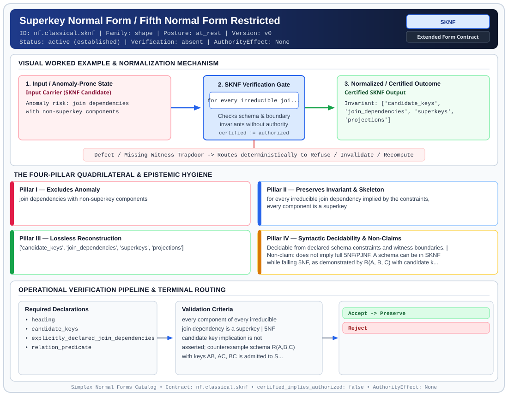

# Superkey Normal Form / Fifth Normal Form Restricted (`SKNF`)

> **Contract ID:** `nf.classical.sknf` | **Family:** `shape` | **Index Status:** `active` | **AuthorityEffect:** `None`

**[⬅ Back to Wiki Home](Home)** | **[View SVG Diagram](images/nf.classical.sknf.svg)**

---

## 1. Executive Summary & Metadata

Superkey Normal Form / Fifth Normal Form Restricted (SKNF) enforces structural normalization and explicit defect routing in the shape regime.

| Property | Value |
| :--- | :--- |
| **Canonical ID** | `nf.classical.sknf` |
| **Short Name** | `SKNF` |
| **Full Name** | Superkey Normal Form / Fifth Normal Form Restricted |
| **Family** | `shape` (Relational, Algebraic & Cochain Shape Normal Forms (Data at Rest & Structural Decompositions)) |
| **Qualification** | Extended Form Contract (Normal Form Contract) |
| **Data / Math Posture** | at_rest |
| **Index Status** | `active` |
| **Theory Status** | `established` |
| **Verification Status** | `absent` |
| **Contract Version** | `v0` |
| **Governance Fence** | `AuthorityEffect: None` (`certified_implies_authorized: false`) |

### Foundational Treatise Specification

- **Author**: Normann (origin); Darwen, Date, and Fagin (characterization)
- **Year**: 2012
- **Structural Invariant**: Every component of every irreducible join dependency implied by constraints is a superkey.
- **Anomaly Excluded**: Join dependencies with non-superkey components; strictly weaker than 5NF.
- **Lossless Join Property**: Project-Join.
- **Dependency Preservation**: Analyzed.
- **Qualifies As True Normal Form**: True
- **Key Component Screen**: Refutes key shortcut via 4-tuple parity counterexample.

---

## 2. Visual Architecture & Normalization Diagram



---

## 3. Concrete Worked Example & Mechanism

### Visual Transition Summary

| Stage | Carrier / Operator | Concrete State / Invariant |
| :--- | :--- | :--- |
| **1. Before / Candidate Input** | `Input Carrier (SKNF Candidate)` | Anomaly risk: join dependencies ; with non-superkey components |
| **2. Normalization / Gate** | `SKNF Verification Gate` | `for every irreducible joi...` (`certified_implies_authorized: false`) |
| **3. After / Certified Output** | `Certified SKNF Output` | Invariant: ['candidate_keys', ; 'join_dependencies', 'superkeys', ; 'projections'] |

---

## 4. The Four-Pillar Quadrilateral & Non-Claims

Every contract in `simplex-normal-forms` is evaluated against the **Four-Pillar Quadrilateral** defined in `contracts/_golden_nfs/standard.yaml`:

| Pillar | Requirement | Contract Specification for `nf.classical.sknf` |
| :--- | :--- | :--- |
| **Pillar I: Excludes Anomaly** | Name and eliminate a specific class of data or state defects. | join dependencies with non-superkey components |
| **Pillar II: Preserves Invariant** | State the structural invariant and protected skeleton preserved across transitions. | **Invariant:** for every irreducible join dependency implied by the constraints, every component is a superkey<br>**Protected Skeleton:** ['candidate_keys', 'join_dependencies', 'superkeys', 'projections'] |
| **Pillar III: Lossless Reconstruction** | State the non-loss reconstruction operator (join, direct sum, pullback, or replay). | Lossless reconstruction under declared projection, direct sum, or pullback operators. |
| **Pillar IV: Syntactic Decidability** | State how conformance is decided from declared constraints without unbudgeted scans. | Decidable from declared schema and witness metadata within bounded evaluation budgets. |

### Explicit Non-Claims (`certified_implies_authorized: false`)

- does not imply full 5NF/PJNF. A schema can be in SKNF while failing 5NF, as demonstrated by R(A, B, C) with candidate keys AB, AC, BC and join dependency *[AB, AC, BC] (Darwen, Date, Fagin 2012 Theorem 6.1)
- a four-tuple parity instance satisfying pairwise candidate keys can generate four spurious tuples under ternary join, showing that candidate keys alone do not imply the join dependency
- does not certify runtime repair without cochain substrate
- does not imply authorization

---

## 5. Operational Verification & Terminal Routing

### 5.1 Required Declarations

- heading
- candidate_keys
- explicitly_declared_join_dependencies
- relation_predicate

### 5.2 Required Evidence

_None declared._

### 5.3 Validation Criteria

| Criterion ID | Name | Condition |
| :--- | :--- | :--- |
| `criterion` | Check | every component of every irreducible join dependency is a superkey |
| `criterion` | Check | 5NF candidate key implication is not asserted; counterexample schema R(A,B,C) with keys AB, AC, BC is admitted to SKNF but rejected from 5NF |

### 5.4 Terminal Route Map

Every evaluation terminates in a declared local route mapped to a canonical terminal in `standard.yaml`:

| Local Terminal Route | Canonical Terminal |
| :--- | :--- |
| `Accept` | `Preserve` |
| `Reject` | `Reject` |

### 5.5 Declared Failure Modes

- **symptom**: an irreducible join dependency has a component that is not a superkey, **diagnosis**: irreducible join dependency component missing candidate key, **terminal**: Reject

---

## 6. Epistemic Claim Hygiene Quadrant

In accordance with the repository's epistemic claim discipline:

1. **What it supports:**
   - Supports syntactic and operational checking of `nf.classical.sknf` (`SKNF`) against its declared schema, boundary constraints, and witness obligations in this model.
   - Supports deterministic terminal routing (`Accept, Reject`) when required declarations or invariants fail.
2. **What it does not support:**
   - Does not confer operational authority (`AuthorityEffect: None`, `certified_implies_authorized: false`).
   - Does not claim semantic truth of undeclared external processes or unverified upstream inputs beyond the declaredprotected skeleton.
3. **The narrowest defensible claim:**
   - Within the declared substrate `at_rest`, this contract enforces that `join dependencies with non-superkey components` is either excluded under `for every irreducible join dependency implied by the constraints, every component is a superkey` or routed to an explicit refusal/recovery terminal.
4. **The next test needed:**
   - Property-based falsification and mutation testing across boundary edge cases and composed multi-step pipelines for `nf.classical.sknf`.

---

## 7. Canonical YAML Contract (`contracts/nf.classical.sknf.yaml`)

<details>
<summary><strong>Click to expand full canonical YAML contract (contracts/nf.classical.sknf.yaml)</strong></summary>

```yaml
schema_version: smplx.nf.contract.v0
schema_ref: ./normal_form_contract_schema.yaml
contract_kind: normal_form_contract
identity:
  id: nf.classical.sknf
  name: Superkey Normal Form / Fifth Normal Form Restricted
  short_name: SKNF
  version: v0
  theory_status: established
  contract_status: active
  verification_status: absent
  family: shape
  status: active
classification:
  hierarchy_level: normal_form
  subject_kind:
  - relvar
  data_posture: at_rest
  mathematical_posture: operational
purpose:
  excludes_anomaly: join dependencies with non-superkey components
  preserves_invariant: for every irreducible join dependency implied by the constraints,
    every component is a superkey
  protected_skeleton:
  - candidate_keys
  - join_dependencies
  - superkeys
  - projections
  erased_structure: []
  non_claims:
  - does not imply full 5NF/PJNF. A schema can be in SKNF while failing 5NF, as demonstrated
    by R(A, B, C) with candidate keys AB, AC, BC and join dependency *[AB, AC, BC] (Darwen, Date, Fagin 2012 Theorem 6.1)
  - a four-tuple parity instance satisfying pairwise candidate keys can generate four spurious
    tuples under ternary join, showing that candidate keys alone do not imply the join dependency
  - does not certify runtime repair without cochain substrate
  - does not imply authorization
definition:
  source: coda_all_universe/mssn_sn_tower/definitions.md
  citation:
    authors: Hugh Darwen, C. J. Date, and Ronald Fagin
    year: 2012
    work: A Normal Form for Relational Databases, Essential Tuple Normal Form
  formal_statement: 'A relvar schema is in superkey normal form (SKNF), also called
    5NF-restricted (5NFR), when for every irreducible join dependency implied by its
    constraints, every component is a superkey (Darwen, Date, Fagin 2012 Section 1.2
    and Theorem 6.1).

    '
  membership_test: every component of every irreducible join dependency is a superkey
  quadrilateral:
    qualifies_as_true_normal_form: true
    anomaly_exclusion: 'Redundancies arising from join dependencies where some component
      is not a superkey. It does not eliminate all join-dependency redundancies,
      as 5NF is strictly stronger.

      '
    lossless_join:
      status: join_dependency
      statement: 'Decomposition into the superkey components is lossless for the
        irreducible join dependency.

        '
    dependency_preservation:
      status: not_asserted
      statement: 'Membership does not promise dependency preservation of all constraints
        within individual components.

        '
    syntactic_decision:
      status: schema_decidable
      statement: 'Decidable by testing whether every component of each irreducible
        join dependency in the consequence closure contains a candidate key.

        '
  chain:
    requires:
    - RFNF
    - ETNF
    - 4NF
    - BCNF
    implied_by:
    - 5NF
    - 6NF
    strict_gap_below: 5NF
declarations_required:
- heading
- candidate_keys
- explicitly_declared_join_dependencies
- relation_predicate
evidence_required: []
validation_criteria:
- every component of every irreducible join dependency is a superkey
- 5NF candidate key implication is not asserted; counterexample schema R(A,B,C) with
  keys AB, AC, BC is admitted to SKNF but rejected from 5NF
terminal_routes:
- Accept
- Reject
terminal_route_map:
  Accept: Preserve
  Reject: Reject
certification:
  certificate_required: false
  certificate_kind: null
  obstruction_class_required: false
  loss_ledger_required: false
  verifier_required: false
  loss_ledger_trigger_id: null
authorization:
  authorized_by: null
  certified_implies_authorized: false
failure_modes:
- symptom: an irreducible join dependency has a component that is not a superkey
  diagnosis: irreducible join dependency component missing candidate key
  terminal: Reject
```

</details>
