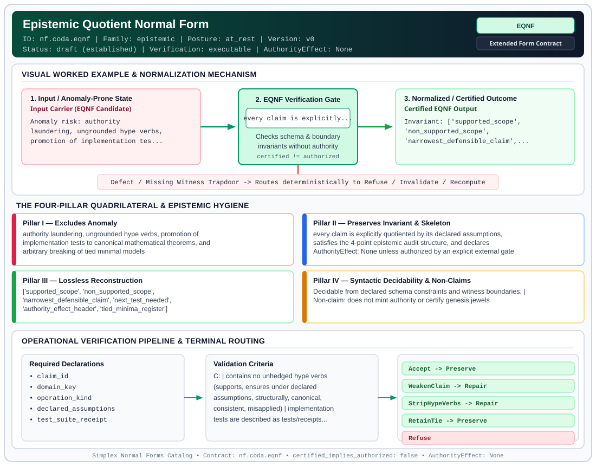

# Epistemic Quotient Normal Form (`EQNF`)

> **Contract ID:** `nf.coda.eqnf` | **Family:** `epistemic` | **Index Status:** `draft` | **AuthorityEffect:** `None`

**[⬅ Back to Wiki Home](Home)** | **[View SVG Diagram](images/nf.coda.eqnf.svg)**

---

## 1. Executive Summary & Metadata

Epistemic Quotient Normal Form (EQNF) enforces structural normalization and explicit defect routing in the epistemic regime.

| Property | Value |
| :--- | :--- |
| **Canonical ID** | `nf.coda.eqnf` |
| **Short Name** | `EQNF` |
| **Full Name** | Epistemic Quotient Normal Form |
| **Family** | `epistemic` (Observer-Relative Epistemic, Freshness, Context, Provenance & Distinguishability Contracts) |
| **Qualification** | Extended Form Contract (Normal Form Contract) |
| **Data / Math Posture** | at_rest |
| **Index Status** | `draft` |
| **Theory Status** | `established` |
| **Verification Status** | `executable` |
| **Contract Version** | `v0` |
| **Governance Fence** | `AuthorityEffect: None` (`certified_implies_authorized: false`) |

---

## 2. Visual Architecture & Normalization Diagram



---

## 3. Concrete Worked Example & Mechanism

### Visual Transition Summary

| Stage | Carrier / Operator | Concrete State / Invariant |
| :--- | :--- | :--- |
| **1. Before / Candidate Input** | `Input Carrier (EQNF Candidate)` | Anomaly risk: authority ; laundering, ungrounded hype verbs, ; promotion of implementation tes... |
| **2. Normalization / Gate** | `EQNF Verification Gate` | `every claim is explicitly...` (`certified_implies_authorized: false`) |
| **3. After / Certified Output** | `Certified EQNF Output` | Invariant: ['supported_scope', ; 'non_supported_scope', ; 'narrowest_defensible_claim',... |

### Contract-Declared Worked Cases

```yaml
- ref: coda_all_universe/1_the_tower/9_ansi_sql/bisimulation_receipt.md
  section: 3. Epistemic Audit (Claim Hygiene)
```

---

## 4. The Four-Pillar Quadrilateral & Non-Claims

Every contract in `simplex-normal-forms` is evaluated against the **Four-Pillar Quadrilateral** defined in `contracts/_golden_nfs/standard.yaml`:

| Pillar | Requirement | Contract Specification for `nf.coda.eqnf` |
| :--- | :--- | :--- |
| **Pillar I: Excludes Anomaly** | Name and eliminate a specific class of data or state defects. | authority laundering, ungrounded hype verbs, promotion of implementation tests to canonical mathematical theorems, and arbitrary breaking of tied minimal models |
| **Pillar II: Preserves Invariant** | State the structural invariant and protected skeleton preserved across transitions. | **Invariant:** every claim is explicitly quotiented by its declared assumptions, satisfies the 4-point epistemic audit structure, and declares AuthorityEffect: None unless authorized by an explicit external gate<br>**Protected Skeleton:** ['supported_scope', 'non_supported_scope', 'narrowest_defensible_claim', 'next_test_needed', 'authority_effect_header', 'tied_minima_register'] |
| **Pillar III: Lossless Reconstruction** | State the non-loss reconstruction operator (join, direct sum, pullback, or replay). | Lossless reconstruction under declared projection, direct sum, or pullback operators. |
| **Pillar IV: Syntactic Decidability** | State how conformance is decided from declared constraints without unbudgeted scans. | Decidable from declared schema and witness metadata within bounded evaluation budgets. |

### Explicit Non-Claims (`certified_implies_authorized: false`)

- does not mint authority or certify genesis jewels
- does not eliminate the need for interactive theorem supporting in Lean 4
- does not treat a green test suite as a mathematical proof of unbounded theorems
- AuthorityEffect: None

---

## 5. Operational Verification & Terminal Routing

### 5.1 Required Declarations

- claim_id
- domain_key
- operation_kind
- declared_assumptions
- test_suite_receipt

### 5.2 Required Evidence

- test_execution_log
- lean_elaboration_receipt
- what_it_supports
- what_it_does_not_support
- narrowest_defensible_claim
- next_test_needed

### 5.3 Validation Criteria

| Criterion ID | Name | Condition |
| :--- | :--- | :--- |
| `` | **** |  |
| `criterion` | Check | contains no unhedged hype verbs (supports, ensures under declared assumptions, structurally, canonical, consistent, misapplied) |
| `criterion` | Check | implementation tests are described as tests/receipts, not mathematical proofs |
| `criterion` | Check | mathematical toy models are scoped to the declared finite setting |
| `criterion` | Check | every receipt includes all 4 points of the epistemic audit |
| `criterion` | Check | tied minimal candidates are retained as sets rather than broken by arbitrary position |

### 5.4 Terminal Route Map

Every evaluation terminates in a declared local route mapped to a canonical terminal in `standard.yaml`:

| Local Terminal Route | Canonical Terminal |
| :--- | :--- |
| `Accept` | `Preserve` |
| `WeakenClaim` | `Repair` |
| `StripHypeVerbs` | `Repair` |
| `RetainTie` | `Preserve` |
| `Refuse` | `Refuse` |

### 5.5 Declared Failure Modes

- **symptom**: test receipt uses forbidden verb "supports" or "ensures under declared assumptions", **diagnosis**: ungrounded hype verb violating claim discipline, **terminal**: StripHypeVerbs
- **symptom**: toy setting described as canonical theorem, **diagnosis**: overclaim failure mode, **terminal**: WeakenClaim
- **symptom**: tie broken without declared selection rule, **diagnosis**: arbitrary symmetry breaking violating SCNF, **terminal**: RetainTie

---

## Deep-Dive Level Treatise

**AuthorityEffect:** None.  
**Level:** Level 16 (Data under Observation / Quotient Factors & Kernel Equality)  
**Evidential Grade:** NATIVE IMPLEMENTED  
**Contract Reference:** [`nf.coda.eqnf`](../../../../omega_engine_pfp/infrastructure/yaml/normal_forms/nf.coda.eqnf.yaml)  
**Mathematical Posture:** canonical Quotient Factorization & Canonical Kernels  
**Data Posture:** Under Observation  

---

## 1. Schematic & Conceptual Architecture

Epistemic Quotient Normal Form (EQNF) disciplines how relations and representations are **quotiented** by equivalence relations:
- When two objects or rows cannot be distinguished by any admitted observer, they belong to the same equivalence class.
- EQNF asserts that any valid quotient map factors uniquely through the declared kernel:
  $$\pi: A \to A / \sim$$
- Any factor through the quotient is **unique on the declared kernel**, and quotient distance is strictly the $L_1$ distance between quotient classes.
- A non-trivial equivalence class does *not* assert point equality on carrier elements; it records that the declared observers cannot separate them.

```text
               Carrier Set A
            ┌───────────────────┐
            │   a1 ~ a2         │ (Kernel Equivalence)
            └─────────┬─────────┘
                      │ Quotient Map \pi
                      ▼
               Quotient Space A / ~
            ┌───────────────────┐
            │      [a]          │
            └─────────┬─────────┘
                      │ Unique Factor \bar{f}
                      ▼
               Target Space B
```

---

## 2. Mathematical Invariants & Quadrilateral Properties

1. **canonical Factorization Law:**
   Let $\sim$ be an equivalence relation with kernel $\ker(\sim)$. A map $f: A \to B$ factors through $\pi: A \to A/\sim$ if and only if $\ker(\sim) \subseteq \ker(f)$.
   When this holds, there exists a unique map $\bar{f}: A/\sim \to B$ such that:
   $$f = \bar{f} \circ \pi$$

2. **The Quadrilateral Invariants:**
   - **Anomaly Excluded:** Ambiguous quotient factorizations, illegal identification of non-equivalent states, conflating quotient representatives with carrier point identity.
   - **Protected Skeleton:** Equivalence classes, declared kernel pairs, and certified quotient metrics.
   - **Erased Structure:** Internal differences between kernel-equivalent representatives.
   - **Reconstruction:** Factorial lift $\bar{f}$ over canonical class representatives.

---

## 3. Terminal Routes & Verification Logic

```text
Candidate Quotient Map f & Declared Kernel ~
      │
      ├── ker(~) ⊆ ker(f) & verification status machine_checked ──► Preserve (EQNFFactorValid)
      │
      ├── f separates elements in ker(~) ────────────────────────► Refuse (KernelSeparated)
      │
      └── Verification status absent or unverified ──────────────► Refuse (UnverifiedQuotient)
```

- `Preserve`: Map factors uniquely through the quotient with machine-checked verification.
- `Refuse`: Candidate factor violates kernel equivalence, or quotient lacks verification proof.

---

## 4. Test Evidence & Local Execution

Verified in [`test_tranche8_epistemic_and_authority.py`](../../../tests/normal_forms/test_tranche8_epistemic_and_authority.py) and [`test_tranche30_pseudometric_and_quotient_factors.py`](../../../tests/normal_forms/test_tranche30_pseudometric_and_quotient_factors.py):
- `test_universal_factor_unique_on_classes`: supports that any two factors agreeing on all quotient classes are identical.
- `test_eqnf_unverified_quotient_refuses_preserve`: Asserts that an EQNF quotient with verification status `absent` fails closed to typed refusal.

---

## 5. Epistemic Claim Quadrant

1. **What it supports:**
   - Rigorous mathematical quotienting across database tables, states, and prompt representations.
   - canonical factor uniqueness on declared kernels.
2. **What it does not support:**
   - Point equality on carrier objects prior to an explicit metric separation axiom (governed by ODNF).
3. **The narrowest defensible claim:**
   - EQNF ensures under declared assumptions that equivalence classes are closed under all declared observer operations.
4. **The next test needed:**
   - Property tests asserting that composite quotients $(A / \sim_1) / \sim_2$ are naturally isomorphic to $A / (\sim_1 \lor \sim_2)$.

---

## 6. Epistemic Claim Hygiene Quadrant

In accordance with the repository's epistemic claim discipline:

1. **What it supports:**
   - Supports syntactic and operational checking of `nf.coda.eqnf` (`EQNF`) against its declared schema, boundary constraints, and witness obligations in this model.
   - Supports deterministic terminal routing (`Accept, WeakenClaim, StripHypeVerbs, RetainTie`) when required declarations or invariants fail.
2. **What it does not support:**
   - Does not confer operational authority (`AuthorityEffect: None`, `certified_implies_authorized: false`).
   - Does not claim semantic truth of undeclared external processes or unverified upstream inputs beyond the declaredprotected skeleton.
3. **The narrowest defensible claim:**
   - Within the declared substrate `at_rest`, this contract enforces that `authority laundering, ungrounded hype verbs, promotion of implementation tests to canonical mathematical theorems, and arbitrary breaking of tied minimal models` is either excluded under `every claim is explicitly quotiented by its declared assumptions, satisfies the 4-point epistemic audit structure, and declares AuthorityEffect: None unless authorized by an explicit external gate` or routed to an explicit refusal/recovery terminal.
4. **The next test needed:**
   - Property-based falsification and mutation testing across boundary edge cases and composed multi-step pipelines for `nf.coda.eqnf`.

---

## 7. Canonical YAML Contract (`contracts/nf.coda.eqnf.yaml`)

<details>
<summary><strong>Click to expand full canonical YAML contract (contracts/nf.coda.eqnf.yaml)</strong></summary>

```yaml
schema_version: smplx.nf.contract.v0
schema_ref: ./normal_form_contract_schema.yaml
contract_kind: normal_form_contract
identity:
  id: nf.coda.eqnf
  name: Epistemic Quotient Normal Form
  short_name: EQNF
  version: v0
  status: draft
  family: epistemic
  theory_status: established
  contract_status: draft
  verification_status: executable
classification:
  hierarchy_level: normal_form
  subject_kind:
  - claim_ledger
  - epistemic_receipt
  - verification_boundary
  - audit_envelope
  data_posture: at_rest
  mathematical_posture: operational
purpose:
  excludes_anomaly: authority laundering, ungrounded hype verbs, promotion of implementation
    tests to canonical mathematical theorems, and arbitrary breaking of tied minimal models
  preserves_invariant: 'every claim is explicitly quotiented by its declared assumptions,
    satisfies the 4-point epistemic audit structure, and declares AuthorityEffect: None unless
    authorized by an explicit external gate'
  protected_skeleton:
  - supported_scope
  - non_supported_scope
  - narrowest_defensible_claim
  - next_test_needed
  - authority_effect_header
  - tied_minima_register
  erased_structure:
  - hype_verbs
  - unverified_universal_quantifiers
  non_claims:
  - does not mint authority or certify genesis jewels
  - does not eliminate the need for interactive theorem supporting in Lean 4
  - does not treat a green test suite as a mathematical proof of unbounded theorems
  - 'AuthorityEffect: None'
quadrilateral:
  qualifies_as_true_normal_form: false
  qualification_gap: claim_record_not_a_relvar_decomposition
  anomaly_exclusion: a claim whose scope, failure, or authority header is missing or overstated
  lossless_join:
    status: not_a_relational_decomposition
    statement: the four-part audit is retained with the claim; nothing is reconstructed by
      a join
  dependency_preservation:
    status: assumptions_stay_attached
    statement: a claim keeps the assumptions it was quotiented by
  syntactic_decision:
    status: declaration_decidable
    statement: the check reads the claim record and its audit fields
declarations_required:
- claim_id
- domain_key
- operation_kind
- declared_assumptions
- test_suite_receipt
evidence_required:
- test_execution_log
- lean_elaboration_receipt
- what_it_supports
- what_it_does_not_support
- narrowest_defensible_claim
- next_test_needed
validation_criteria:
- contains explicit "AuthorityEffect: None" header
- contains no unhedged hype verbs (supports, ensures under declared assumptions, structurally, canonical, consistent,
  misapplied)
- implementation tests are described as tests/receipts, not mathematical proofs
- mathematical toy models are scoped to the declared finite setting
- every receipt includes all 4 points of the epistemic audit
- tied minimal candidates are retained as sets rather than broken by arbitrary position
proof_obligations:
- id: eqnf.claim_hygiene_invariant
  status: declared_upstream
  ref: AGENTS.md
  section: Claim Hygiene Rule
terminal_routes:
- Accept
- WeakenClaim
- StripHypeVerbs
- RetainTie
- Refuse
terminal_route_map:
  Accept: Preserve
  WeakenClaim: Repair
  StripHypeVerbs: Repair
  RetainTie: Preserve
  Refuse: Refuse
certification:
  certificate_required: true
  certificate_kind: epistemic_audit_certificate
  obstruction_class_required: false
  loss_ledger_required: true
  verifier_required: true
  loss_ledger_trigger_id: null
authorization:
  authorized_by: null
  certified_implies_authorized: false
failure_modes:
- symptom: test receipt uses forbidden verb "supports" or "ensures under declared assumptions"
  diagnosis: ungrounded hype verb violating claim discipline
  terminal: StripHypeVerbs
- symptom: toy setting described as canonical theorem
  diagnosis: overclaim failure mode
  terminal: WeakenClaim
- symptom: tie broken without declared selection rule
  diagnosis: arbitrary symmetry breaking violating SCNF
  terminal: RetainTie
examples:
- ref: coda_all_universe/1_the_tower/9_ansi_sql/bisimulation_receipt.md
  section: 3. Epistemic Audit (Claim Hygiene)
references:
- ./nf.derivation.scnf.yaml
- ./nf.derivation.aonf.yaml
- AGENTS.md
```

</details>
