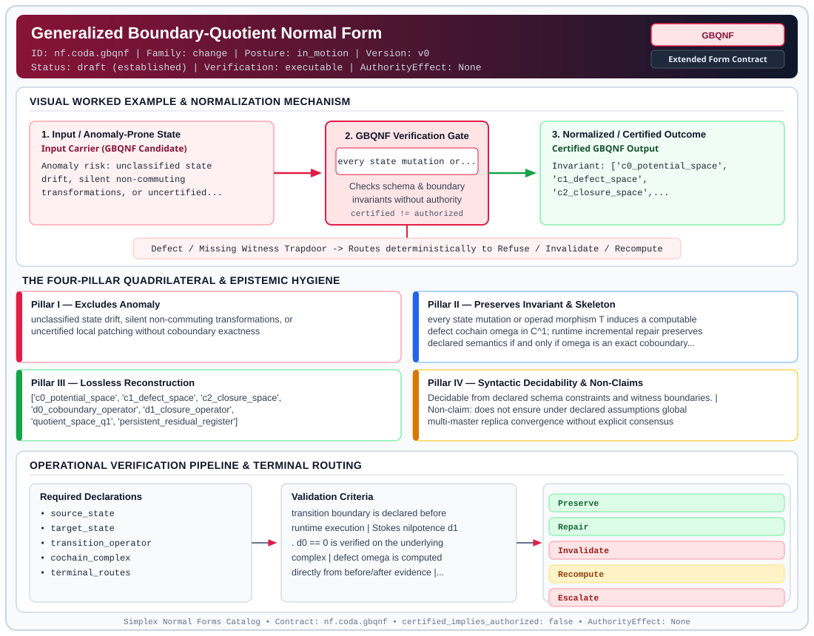

# Generalized Boundary-Quotient Normal Form (`GBQNF`)

> **Contract ID:** `nf.coda.gbqnf` | **Family:** `change` | **Index Status:** `draft` | **AuthorityEffect:** `None`

**[⬅ Back to Wiki Home](Home)** | **[View SVG Diagram](images/nf.coda.gbqnf.svg)**

---

## 1. Executive Summary & Metadata

Generalized Boundary-Quotient Normal Form (GBQNF) enforces structural normalization and explicit defect routing in the change regime.

| Property | Value |
| :--- | :--- |
| **Canonical ID** | `nf.coda.gbqnf` |
| **Short Name** | `GBQNF` |
| **Full Name** | Generalized Boundary-Quotient Normal Form |
| **Family** | `change` (Data in Motion & Boundary-Quotient Incremental Maintenance Contracts (BQNF & Cochain Repair)) |
| **Qualification** | Extended Form Contract (Normal Form Contract) |
| **Data / Math Posture** | in_motion |
| **Index Status** | `draft` |
| **Theory Status** | `established` |
| **Verification Status** | `executable` |
| **Contract Version** | `v0` |
| **Governance Fence** | `AuthorityEffect: None` (`certified_implies_authorized: false`) |

---

## 2. Visual Architecture & Normalization Diagram



---

## 3. Concrete Worked Example & Mechanism

### Visual Transition Summary

| Stage | Carrier / Operator | Concrete State / Invariant |
| :--- | :--- | :--- |
| **1. Before / Candidate Input** | `Input Carrier (GBQNF Candidate)` | Anomaly risk: unclassified state ; drift, silent non-commuting ; transformations, or uncertified... |
| **2. Normalization / Gate** | `GBQNF Verification Gate` | `every state mutation or...` (`certified_implies_authorized: false`) |
| **3. After / Certified Output** | `Certified GBQNF Output` | Invariant: ['c0_potential_space', ; 'c1_defect_space', ; 'c2_closure_space',... |

### Contract-Declared Worked Cases

```yaml
- ref: coda_all_universe/mssn_sn_tower/docs/catalog.md
  section: '3. Data in Motion: Boundary-Quotient Normal Form (BQNF)'
```

---

## 4. The Four-Pillar Quadrilateral & Non-Claims

Every contract in `simplex-normal-forms` is evaluated against the **Four-Pillar Quadrilateral** defined in `contracts/_golden_nfs/standard.yaml`:

| Pillar | Requirement | Contract Specification for `nf.coda.gbqnf` |
| :--- | :--- | :--- |
| **Pillar I: Excludes Anomaly** | Name and eliminate a specific class of data or state defects. | unclassified state drift, silent non-commuting transformations, or uncertified local patching without coboundary exactness |
| **Pillar II: Preserves Invariant** | State the structural invariant and protected skeleton preserved across transitions. | **Invariant:** every state mutation or operad morphism T induces a computable defect cochain omega in C^1; runtime incremental repair preserves declared semantics if and only if omega is an exact coboundary (omega = d^0 alpha)<br>**Protected Skeleton:** ['c0_potential_space', 'c1_defect_space', 'c2_closure_space', 'd0_coboundary_operator', 'd1_closure_operator', 'quotient_space_q1', 'persistent_residual_register'] |
| **Pillar III: Lossless Reconstruction** | State the non-loss reconstruction operator (join, direct sum, pullback, or replay). | Lossless reconstruction under declared projection, direct sum, or pullback operators. |
| **Pillar IV: Syntactic Decidability** | State how conformance is decided from declared constraints without unbudgeted scans. | Decidable from declared schema and witness metadata within bounded evaluation budgets. |

### Explicit Non-Claims (`certified_implies_authorized: false`)

- does not ensure under declared assumptions global multi-master replica convergence without explicit consensus
- does not claim that every defect is repairable; non-exact defects terminalize loudly
- exactness applies strictly to declared invertible or linear monoidal actions; non-invertible reductions (e.g. destructive lossy projections) require full recomputation
- does not imply authorization or authority minting (AuthorityEffect: None)

---

## 5. Operational Verification & Terminal Routing

### 5.1 Required Declarations

- source_state
- target_state
- transition_operator
- cochain_complex
- terminal_routes

### 5.2 Required Evidence

- mutation_event_kind
- before_image
- after_image
- defect_cochain_omega
- coboundary_image_membership

### 5.3 Validation Criteria

| Criterion ID | Name | Condition |
| :--- | :--- | :--- |
| `criterion` | Check | transition boundary is declared before runtime execution |
| `criterion` | Check | Stokes nilpotence d1 . d0 == 0 is verified on the underlying complex |
| `criterion` | Check | defect omega is computed directly from before/after evidence |
| `criterion` | Check | exact repair is authorized if and only if [omega] == [0] in Q1 = C1 / im(d0), equivalently omega = d0(alpha) for a certified potential alpha in C0 |
| `criterion` | Check | closed non-exact defects (d1 omega == 0, [omega] != 0 in H1) are recorded as persistent residuals in Cat_Res and escalated or recomputed |
| `criterion` | Check | closure failure (d1 omega != 0) aborts and terminalizes loudly as Refuse or ClosureFailure |

### 5.4 Terminal Route Map

Every evaluation terminates in a declared local route mapped to a canonical terminal in `standard.yaml`:

| Local Terminal Route | Canonical Terminal |
| :--- | :--- |
| `Preserve` | `Preserve` |
| `Repair` | `Repair` |
| `Invalidate` | `Invalidate` |
| `Recompute` | `Recompute` |
| `Escalate` | `Escalate` |
| `Refuse` | `Refuse` |
| `ClosureFailure` | `Refuse` |

### 5.5 Declared Failure Modes

- **symptom**: state patched after mutation without solving omega = d0 alpha, **diagnosis**: uncertified local repair violating coboundary exactness, **terminal**: Invalidate
- **symptom**: closed non-exact defect treated as repaired, **diagnosis**: ignoring non-trivial cohomology cycle in H1, **terminal**: Escalate
- **symptom**: non-commuting composition yields d1 omega != 0, **diagnosis**: Stokes closure failure, **terminal**: Refuse

---

## 6. Epistemic Claim Hygiene Quadrant

In accordance with the repository's epistemic claim discipline:

1. **What it supports:**
   - Supports syntactic and operational checking of `nf.coda.gbqnf` (`GBQNF`) against its declared schema, boundary constraints, and witness obligations in this model.
   - Supports deterministic terminal routing (`Preserve, Repair, Invalidate, Recompute`) when required declarations or invariants fail.
2. **What it does not support:**
   - Does not confer operational authority (`AuthorityEffect: None`, `certified_implies_authorized: false`).
   - Does not claim semantic truth of undeclared external processes or unverified upstream inputs beyond the declaredprotected skeleton.
3. **The narrowest defensible claim:**
   - Within the declared substrate `in_motion`, this contract enforces that `unclassified state drift, silent non-commuting transformations, or uncertified local patching without coboundary exactness` is either excluded under `every state mutation or operad morphism T induces a computable defect cochain omega in C^1; runtime incremental repair preserves declared semantics if and only if omega is an exact coboundary (omega = d^0 alpha)` or routed to an explicit refusal/recovery terminal.
4. **The next test needed:**
   - Property-based falsification and mutation testing across boundary edge cases and composed multi-step pipelines for `nf.coda.gbqnf`.

---

## 7. Canonical YAML Contract (`contracts/nf.coda.gbqnf.yaml`)

<details>
<summary><strong>Click to expand full canonical YAML contract (contracts/nf.coda.gbqnf.yaml)</strong></summary>

```yaml
schema_version: smplx.nf.contract.v0
schema_ref: ./normal_form_contract_schema.yaml
contract_kind: normal_form_contract
identity:
  id: nf.coda.gbqnf
  name: Generalized Boundary-Quotient Normal Form
  short_name: GBQNF
  version: v0
  status: draft
  family: change
  theory_status: established
  contract_status: draft
  verification_status: executable
classification:
  hierarchy_level: normal_form
  subject_kind:
  - operad_morphism
  - pipeline_state
  - transformation_envelope
  - boundary_relvar
  data_posture: in_motion
  mathematical_posture: operational
purpose:
  excludes_anomaly: unclassified state drift, silent non-commuting transformations, or uncertified
    local patching without coboundary exactness
  preserves_invariant: every state mutation or operad morphism T induces a computable defect
    cochain omega in C^1; runtime incremental repair preserves declared semantics if and only
    if omega is an exact coboundary (omega = d^0 alpha)
  protected_skeleton:
  - c0_potential_space
  - c1_defect_space
  - c2_closure_space
  - d0_coboundary_operator
  - d1_closure_operator
  - quotient_space_q1
  - persistent_residual_register
  erased_structure: []
  non_claims:
  - does not ensure under declared assumptions global multi-master replica convergence without explicit consensus
  - does not claim that every defect is repairable; non-exact defects terminalize loudly
  - exactness applies strictly to declared invertible or linear monoidal actions; non-invertible
    reductions (e.g. destructive lossy projections) require full recomputation
  - 'does not imply authorization or authority minting (AuthorityEffect: None)'
quadrilateral:
  qualifies_as_true_normal_form: false
  qualification_gap: reconstruction_is_state_agreement_not_a_relational_join
  anomaly_exclusion: a state patch whose defect is not an exact coboundary
  lossless_join:
    status: exact_repair_agrees_with_recomputation
    statement: an exact defect omega = d0 alpha repairs the declared state; a non-exact defect
      does not
  dependency_preservation:
    status: nilpotence_retained
    statement: d1 composed with d0 remains zero on the declared complex
  syntactic_decision:
    status: declaration_plus_event_decidable
    statement: the route is computed from the declared operators and the before and after
      images
declarations_required:
- source_state
- target_state
- transition_operator
- cochain_complex
- terminal_routes
evidence_required:
- mutation_event_kind
- before_image
- after_image
- defect_cochain_omega
- coboundary_image_membership
validation_criteria:
- transition boundary is declared before runtime execution
- Stokes nilpotence d1 . d0 == 0 is verified on the underlying complex
- defect omega is computed directly from before/after evidence
- exact repair is authorized if and only if [omega] == [0] in Q1 = C1 / im(d0), equivalently
  omega = d0(alpha) for a certified potential alpha in C0
- closed non-exact defects (d1 omega == 0, [omega] != 0 in H1) are recorded as persistent
  residuals in Cat_Res and escalated or recomputed
- closure failure (d1 omega != 0) aborts and terminalizes loudly as Refuse or ClosureFailure
proof_obligations:
- id: gbqnf.stokes_nilpotence_identity
  status: upstream_theorem
  ref: 19L57G1
  section: lean4/Derivation/BoundaryCancellation.lean
- id: gbqnf.coboundary_repair_soundness
  status: upstream_theorem
  ref: coda_all_universe/mssn_sn_tower/lean/normal_forms_core.lean
  statement: An exact defect (omega = d0 alpha) preserves target state invariants under incremental
    repair
terminal_routes:
- Preserve
- Repair
- Invalidate
- Recompute
- Escalate
- Refuse
- ClosureFailure
terminal_route_map:
  Preserve: Preserve
  Repair: Repair
  Invalidate: Invalidate
  Recompute: Recompute
  Escalate: Escalate
  Refuse: Refuse
  ClosureFailure: Refuse
certification:
  certificate_required: true
  certificate_kind: gbqnf_repair_certificate
  obstruction_class_required: true
  loss_ledger_required: true
  verifier_required: true
  loss_ledger_trigger_id: null
authorization:
  authorized_by: null
  certified_implies_authorized: false
failure_modes:
- symptom: state patched after mutation without solving omega = d0 alpha
  diagnosis: uncertified local repair violating coboundary exactness
  terminal: Invalidate
- symptom: closed non-exact defect treated as repaired
  diagnosis: ignoring non-trivial cohomology cycle in H1
  terminal: Escalate
- symptom: non-commuting composition yields d1 omega != 0
  diagnosis: Stokes closure failure
  terminal: Refuse
examples:
- ref: coda_all_universe/mssn_sn_tower/docs/catalog.md
  section: '3. Data in Motion: Boundary-Quotient Normal Form (BQNF)'
references:
- ./nf.change.bqnf.yaml
- ./normal_forms_core.lean
- ./normal_forms_evaluator.py
```

</details>
