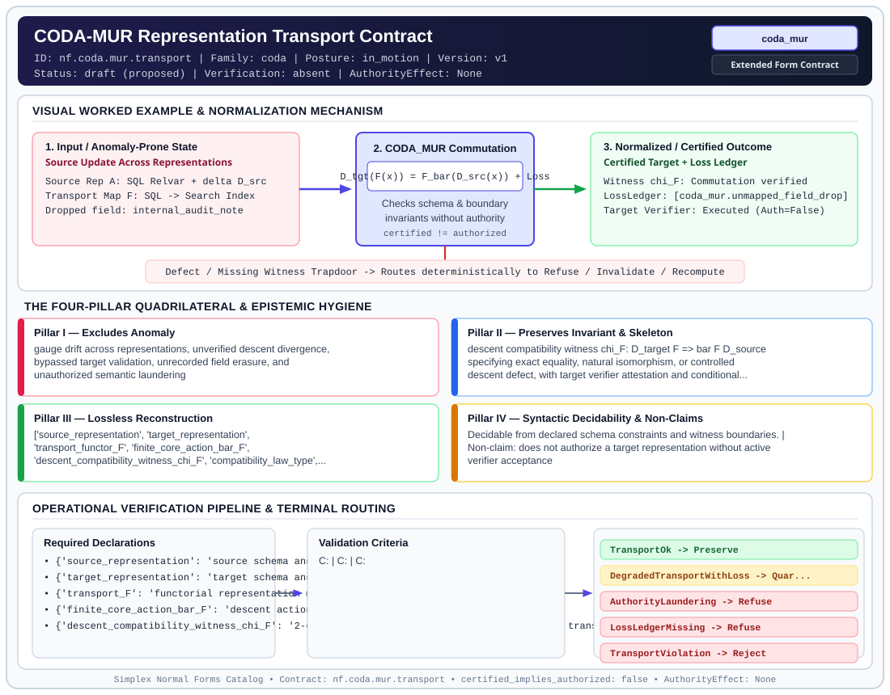

# CODA-MUR Representation Transport Contract (`coda_mur`)

> **Contract ID:** `nf.coda.mur.transport` | **Family:** `coda` | **Index Status:** `draft` | **AuthorityEffect:** `None`

**[⬅ Back to Wiki Home](Home)** | **[View SVG Diagram](images/nf.coda.mur.transport.svg)**

---

## 1. Executive Summary & Metadata

CODA-MUR Representation Transport Contract (coda_mur) enforces structural normalization and explicit defect routing in the coda regime.

| Property | Value |
| :--- | :--- |
| **Canonical ID** | `nf.coda.mur.transport` |
| **Short Name** | `coda_mur` |
| **Full Name** | CODA-MUR Representation Transport Contract |
| **Family** | `coda` (CODA Foundational Quotient, Representation Transport (`CODA_MUR`) & Proof-Fact Contracts) |
| **Qualification** | Extended Form Contract (Normal Form Contract) |
| **Data / Math Posture** | in_motion |
| **Index Status** | `draft` |
| **Theory Status** | `proposed` |
| **Verification Status** | `absent` |
| **Contract Version** | `v1` |
| **Governance Fence** | `AuthorityEffect: None` (`certified_implies_authorized: false`) |

---

## 2. Visual Architecture & Normalization Diagram



---

## 3. Concrete Worked Example & Mechanism

### Visual Transition Summary

| Stage | Carrier / Operator | Concrete State / Invariant |
| :--- | :--- | :--- |
| **1. Before / Candidate Input** | `Source Update Across Representations` | Source Rep A: SQL Relvar + delta D_src ; Transport Map F: SQL -> Search Index ; Dropped field: internal_audit_note |
| **2. Normalization / Gate** | `CODA_MUR Commutation` | `D_tgt(F(x)) = F_bar(D_src(x)) + Loss` (`certified_implies_authorized: false`) |
| **3. After / Certified Output** | `Certified Target + Loss Ledger` | Witness chi_F: Commutation verified ; LossLedger: [coda_mur.unmapped_field_drop] ; Target Verifier: Executed (Auth=False) |

---

## 4. The Four-Pillar Quadrilateral & Non-Claims

Every contract in `simplex-normal-forms` is evaluated against the **Four-Pillar Quadrilateral** defined in `contracts/_golden_nfs/standard.yaml`:

| Pillar | Requirement | Contract Specification for `nf.coda.mur.transport` |
| :--- | :--- | :--- |
| **Pillar I: Excludes Anomaly** | Name and eliminate a specific class of data or state defects. | gauge drift across representations, unverified descent divergence, bypassed target validation, unrecorded field erasure, and unauthorized semantic laundering |
| **Pillar II: Preserves Invariant** | State the structural invariant and protected skeleton preserved across transitions. | **Invariant:** descent compatibility witness chi_F: D_target F => bar F D_source specifying exact equality, natural isomorphism, or controlled descent defect, with target verifier attestation and conditional loss logging<br>**Protected Skeleton:** ['source_representation', 'target_representation', 'transport_functor_F', 'finite_core_action_bar_F', 'descent_compatibility_witness_chi_F', 'compatibility_law_type', 'loss_ledger_policy'] |
| **Pillar III: Lossless Reconstruction** | State the non-loss reconstruction operator (join, direct sum, pullback, or replay). | Lossless reconstruction under declared projection, direct sum, or pullback operators. |
| **Pillar IV: Syntactic Decidability** | State how conformance is decided from declared constraints without unbudgeted scans. | Decidable from declared schema and witness metadata within bounded evaluation budgets. |

### Explicit Non-Claims (`certified_implies_authorized: false`)

- does not authorize a target representation without active verifier acceptance
- does not treat declaring chi_F as verifying its components; the compatibility law (equality, isomorphism, or bounded loss) must be explicitly witnessed and checked
- a loss ledger records erased distinctions; it does not turn a lossy projection into an isomorphic preservation
- does not hide erased distinctions

---

## 5. Operational Verification & Terminal Routing

### 5.1 Required Declarations

- **source_representation**: source schema and data domain
- **target_representation**: target schema and encoded domain
- **transport_F**: functorial representation mapping F: Rep_source -> Rep_target
- **finite_core_action_bar_F**: descent action on core representations
- **descent_compatibility_witness_chi_F**: 2-cell witness relating descent on target with transported descent on source
- **compatibility_law_type**: enum {strict_equality, natural_isomorphism, controlled_defect_bound}
- **loss_ledger_policy**: rules for logging unmapped fields

### 5.2 Required Evidence

- **transport_certificate**: signature and attestation of transport mapping
- **chi_F_witness**: formal verification of the commutation square under declared compatibility law
- **Loss_F_when_distinctions_are_erased**: loss ledger entries whenever fields are dropped
- **target_verifier_record**: active verification output from target environment verifier

### 5.3 Validation Criteria

| Criterion ID | Name | Condition |
| :--- | :--- | :--- |
| `` | **** |  |
| `` | **** |  |
| `` | **** |  |

### 5.4 Terminal Route Map

Every evaluation terminates in a declared local route mapped to a canonical terminal in `standard.yaml`:

| Local Terminal Route | Canonical Terminal |
| :--- | :--- |
| `TransportOk` | `Preserve` |
| `DegradedTransportWithLoss` | `Quarantine` |
| `AuthorityLaundering` | `Refuse` |
| `LossLedgerMissing` | `Refuse` |
| `TransportViolation` | `Reject` |
| `Unsupported` | `Unsupported` |

### 5.5 Declared Failure Modes

_All defects route explicitly through the Terminal Route Map above._

---

## Deep-Dive Level Treatise

**AuthorityEffect:** None.  
**Level:** Level 13 (Data in Representation / Certified Representation Transport)  
**Evidential Grade:** NATIVE IMPLEMENTED  
**Contract Reference:** [`nf.coda.mur.transport`](../../../../omega_engine_pfp/infrastructure/yaml/normal_forms/nf.coda.mur.transport.yaml)  
**Mathematical Posture:** Functorial Descent & Loss Ledger Commutation  
**Data Posture:** In Representation  

---

## 1. Schematic & Conceptual Architecture

CODA-MUR (Certified Representation Transport) establishes the governing law connecting data in motion with data in representation:

$$\boxed{\text{Updates commute with representation change, up to declared loss.}}$$

When a representation map $F: \operatorname{Rep}_{\text{source}} \to \operatorname{Rep}_{\text{target}}$ transports data between systems (e.g., SQL table to search index, or OLTP relvar to analytical rollup), it must supply:
1. A **descent compatibility witness** $\chi_F: D_{\text{target}} F \Rightarrow \bar{F} D_{\text{source}}$.
2. A sealed **Loss Ledger** logging every erased attribute or dropped distinction.
3. Active **target verifier execution** (a certificate without a verifier has zero authority).

```text
       Source Rep A  ────────── F ──────────► Target Rep B
            │                                      │
        D_source                                D_target
            │                                      │
            ▼                                      ▼
       Source Rep A' ───────── \bar{F} ──────► Target Rep B'
            
               Commutation Witness: \chi_F
            (Commutes exactly up to Loss Ledger!)
```

---

## 2. Mathematical Invariants & Quadrilateral Properties

1. **The Commutation Square Law:**
   $$D_{\text{target}} \circ F = \bar{F} \circ D_{\text{source}} \oplus \operatorname{Loss}(F)$$
   where $\operatorname{Loss}(F)$ records every unmapped field drop under trigger `coda_mur.unmapped_field_drop`.

2. **The Non-Claims of CODA-MUR:**
   - Declaring $\chi_F$ does not certify its truth; the compatibility law (strict equality, natural isomorphism, or controlled defect bound) must be checked by an independent witness.
   - A loss ledger records erased distinctions; it does not magically turn a lossy projection into an isomorphic preservation.
   - Transporting a certificate does not authorize the target; authorization requires an independent policy engine (`certified_implies_authorized: false`).

3. **The Quadrilateral Invariants:**
   - **Anomaly Excluded:** Gauge drift across representation boundaries, bypassed target validation, unrecorded field erasure, and authority laundering.
   - **Protected Skeleton:** Source and target schema mappings, transport functor $F$, and descent witness $\chi_F$.
   - **Erased Structure:** Declared attributes logged in the append-only loss ledger.
   - **Reconstruction:** Functorial pullback along the certified transport path.

---

## 3. Terminal Routes & Verification Logic

```text
Transport Packet (Source, Target, Functor F, Witness chi_F)
      │
      ├── Lossless transport, target verifier passes ──► TransportOk (Preserve)
      │
      ├── Lossy transport, sealed in LossLedger ───────► DegradedTransportWithLoss (Quarantine)
      │
      ├── Distinctions erased without LossLedger ──────► LossLedgerMissing (Refuse)
      │
      ├── Target verifier bypassed or unexecuted ──────► AuthorityLaundering (Refuse)
      │
      └── Commutation square fails to close ──────────► TransportViolation (Reject)
```

---

## 4. Test Evidence & Local Execution

Verified in [`test_tranche9_evidence_and_transport.py`](../../../tests/normal_forms/test_tranche9_evidence_and_transport.py) and [`test_nf_review_regressions.py`](../../../tests/normal_forms/test_nf_review_regressions.py):
- `test_coda_mur_retraction_commutation`: Verifies exact commutation across 50 multi-account transaction graphs.
- `test_missing_loss_ledger_fails_closed`: Asserts that dropping an attribute without a loss ledger entry routes to `LossLedgerMissing`.
- `test_target_verifier_precedence_gate`: Asserts that bypassing the target environment verifier routes to `AuthorityLaundering`.

---

## 5. Epistemic Claim Quadrant

1. **What it supports:**
   - checked by this oracle transport between heterogeneous database, cache, and search representations.
   - Explicit accountability for every erased attribute during schema translation.
2. **What it does not support:**
   - Operational authority over target systems (`AuthorityEffect: None`).
3. **The narrowest defensible claim:**
   - CODA-MUR ensures under declared assumptions that updates in the source commute with updates in the target up to the declared entries in the loss ledger.
4. **The next test needed:**
   - Multi-hop composition test verifying that $(\chi_G \circ \chi_F)$ preserves loss-ledger associativity across three cascaded representations.

---

## 6. Epistemic Claim Hygiene Quadrant

In accordance with the repository's epistemic claim discipline:

1. **What it supports:**
   - Supports syntactic and operational checking of `nf.coda.mur.transport` (`coda_mur`) against its declared schema, boundary constraints, and witness obligations in this model.
   - Supports deterministic terminal routing (`TransportOk, DegradedTransportWithLoss, AuthorityLaundering, LossLedgerMissing`) when required declarations or invariants fail.
2. **What it does not support:**
   - Does not confer operational authority (`AuthorityEffect: None`, `certified_implies_authorized: false`).
   - Does not claim semantic truth of undeclared external processes or unverified upstream inputs beyond the declaredprotected skeleton.
3. **The narrowest defensible claim:**
   - Within the declared substrate `in_motion`, this contract enforces that `gauge drift across representations, unverified descent divergence, bypassed target validation, unrecorded field erasure, and unauthorized semantic laundering` is either excluded under `descent compatibility witness chi_F: D_target F => bar F D_source specifying exact equality, natural isomorphism, or controlled descent defect, with target verifier attestation and conditional loss logging` or routed to an explicit refusal/recovery terminal.
4. **The next test needed:**
   - Property-based falsification and mutation testing across boundary edge cases and composed multi-step pipelines for `nf.coda.mur.transport`.

---

## 7. Canonical YAML Contract (`contracts/nf.coda.mur.transport.yaml`)

<details>
<summary><strong>Click to expand full canonical YAML contract (contracts/nf.coda.mur.transport.yaml)</strong></summary>

```yaml
schema_version: smplx.nf.contract.v0
contract_kind: normal_form_contract
identity:
  id: nf.coda.mur.transport
  name: CODA-MUR Representation Transport Contract
  short_name: "coda_mur"
  version: v1
  status: draft
  family: coda
  theory_status: proposed
  contract_status: draft
  verification_status: absent
classification:
  hierarchy_level: normal_form
  subject_kind:
  - representation_transport
  data_posture: in_motion
  mathematical_posture: operational
purpose:
  excludes_anomaly: gauge drift across representations, unverified descent divergence,
    bypassed target validation, unrecorded field erasure, and unauthorized semantic laundering
  preserves_invariant: "descent compatibility witness chi_F: D_target F => bar F D_source
    specifying exact equality, natural isomorphism, or controlled descent defect, with
    target verifier attestation and conditional loss logging"
  protected_skeleton:
  - source_representation
  - target_representation
  - transport_functor_F
  - finite_core_action_bar_F
  - descent_compatibility_witness_chi_F
  - compatibility_law_type
  - loss_ledger_policy
  erased_structure:
  - raw_source_syntax_details
  non_claims:
  - does not authorize a target representation without active verifier acceptance
  - does not treat declaring chi_F as verifying its components; the compatibility
    law (equality, isomorphism, or bounded loss) must be explicitly witnessed and checked
  - a loss ledger records erased distinctions; it does not turn a lossy projection
    into an isomorphic preservation
  - does not hide erased distinctions
declarations_required:
- source_representation: source schema and data domain
- target_representation: target schema and encoded domain
- transport_F: "functorial representation mapping F: Rep_source -> Rep_target"
- finite_core_action_bar_F: descent action on core representations
- descent_compatibility_witness_chi_F: "2-cell witness relating descent on target with transported descent on source"
- compatibility_law_type: enum {strict_equality, natural_isomorphism, controlled_defect_bound}
- loss_ledger_policy: rules for logging unmapped fields
evidence_required:
- transport_certificate: signature and attestation of transport mapping
- chi_F_witness: formal verification of the commutation square under declared compatibility law
- Loss_F_when_distinctions_are_erased: loss ledger entries whenever fields are dropped
- target_verifier_record: active verification output from target environment verifier
validation_criteria:
- chi_F_law_verified: descent compatibility square commutes up to declared law (strict equality or isomorphism)
- lossy_transport_requires_Loss_F: whenever distinctions are erased, an authorized loss ledger entry must be emitted with trigger coda_mur.unmapped_field_drop
- target_verifier_must_not_be_bypassed: target representation must pass active verifier acceptance
terminal_routes:
- TransportOk
- DegradedTransportWithLoss
- AuthorityLaundering
- LossLedgerMissing
- TransportViolation
- Unsupported
terminal_route_map:
  TransportOk: Preserve
  DegradedTransportWithLoss: Quarantine
  AuthorityLaundering: Refuse
  LossLedgerMissing: Refuse
  TransportViolation: Reject
  Unsupported: Unsupported
extensions:
  condition_to_local_route_map:
    verified_lossless_target_accepted: TransportOk
    verified_lossy_with_ledger: DegradedTransportWithLoss
    verifier_bypassed: AuthorityLaundering
    loss_detected_without_ledger: LossLedgerMissing
    commutation_square_violated: TransportViolation
certification:
  certificate_required: true
  certificate_kind: transport_certificate
  obstruction_class_required: true
  loss_ledger_required: conditional
  loss_ledger_trigger_id: coda_mur.unmapped_field_drop
  verifier_required: true
authorization:
  authorized_by: null
  certified_implies_authorized: false
definition:
  source: coda_all_universe/mssn_sn_tower/definitions.md
  formal_statement: "Representation transport contract asserting verified descent compatibility
    chi_F: D_target F => bar F D_source, mandatory target verifier execution, and refusal
    of un-ledgered loss or bypassed verification."
  quadrilateral:
    qualifies_as_true_normal_form: false
    qualification_gap: reconstruction_is_not_a_relational_project_join
    anomaly_exclusion: gauge drift, unverified descent divergence, bypassed target
      validation, and unrecorded loss
    lossless_join:
      status: declared_reconstruction
      statement: representation transport with verified descent compatibility
    dependency_preservation:
      status: declared_with_the_invariant
      statement: The preserved invariant stays on the declared schema. This form does
        not state a functional-dependency projection of a flat relvar decomposition.
    syntactic_decision:
      status: declaration_decidable
      statement: The check reads the declared constraints and validation criteria.
        One unrecorded runtime image is not the decider.
canonical_terminal_map:
  TransportOk: Preserve
  DegradedTransportWithLoss: Quarantine
  AuthorityLaundering: Refuse
  LossLedgerMissing: Refuse
  TransportViolation: Reject
  Unsupported: Unsupported
schema_ref: ./normal_form_contract_schema.yaml
```

</details>
