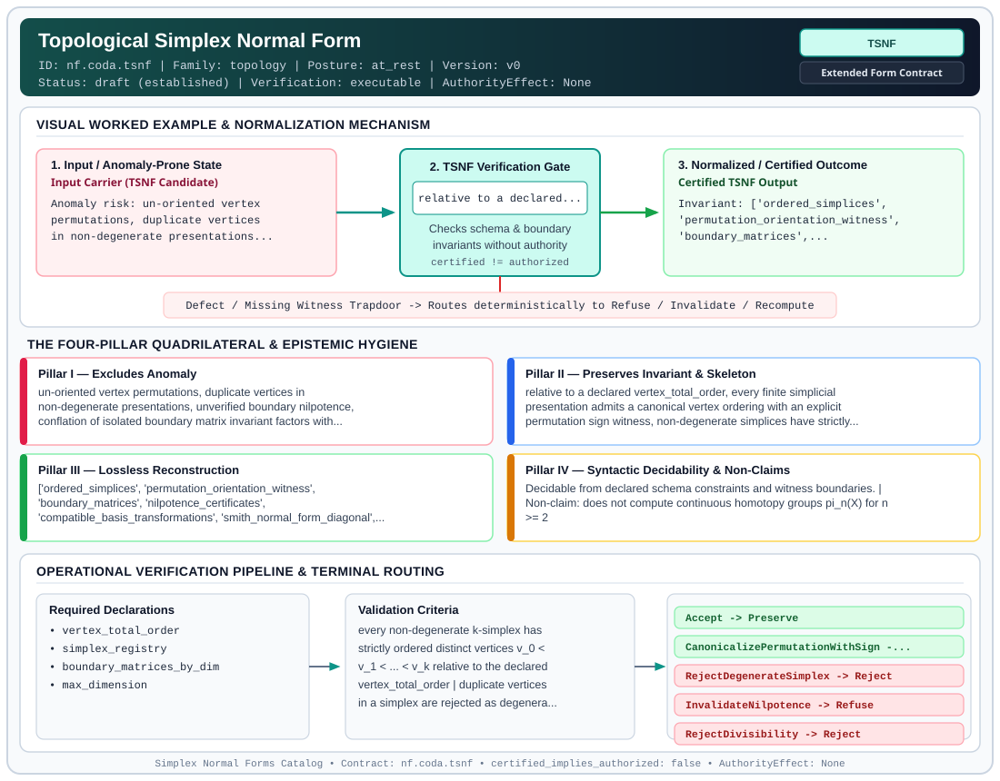

# Topological Simplex Normal Form (`TSNF`)

> **Contract ID:** `nf.coda.tsnf` | **Family:** `topology` | **Index Status:** `draft` | **AuthorityEffect:** `None`

**[⬅ Back to Wiki Home](Home)** | **[View SVG Diagram](images/nf.coda.tsnf.svg)**

---

## 1. Executive Summary & Metadata

Topological Simplex Normal Form (TSNF) enforces structural normalization and explicit defect routing in the topology regime.

| Property | Value |
| :--- | :--- |
| **Canonical ID** | `nf.coda.tsnf` |
| **Short Name** | `TSNF` |
| **Full Name** | Topological Simplex Normal Form |
| **Family** | `topology` (Simplicial Complexes, Boundary Nilpotency & Context Boundary Purity (`TSNF`, `CBNF`)) |
| **Qualification** | Extended Form Contract (Normal Form Contract) |
| **Data / Math Posture** | at_rest |
| **Index Status** | `draft` |
| **Theory Status** | `established` |
| **Verification Status** | `executable` |
| **Contract Version** | `v0` |
| **Governance Fence** | `AuthorityEffect: None` (`certified_implies_authorized: false`) |

---

## 2. Visual Architecture & Normalization Diagram



---

## 3. Concrete Worked Example & Mechanism

### Visual Transition Summary

| Stage | Carrier / Operator | Concrete State / Invariant |
| :--- | :--- | :--- |
| **1. Before / Candidate Input** | `Input Carrier (TSNF Candidate)` | Anomaly risk: un-oriented vertex ; permutations, duplicate vertices ; in non-degenerate presentations... |
| **2. Normalization / Gate** | `TSNF Verification Gate` | `relative to a declared...` (`certified_implies_authorized: false`) |
| **3. After / Certified Output** | `Certified TSNF Output` | Invariant: ['ordered_simplices', ; 'permutation_orientation_witness', ; 'boundary_matrices',... |

### Contract-Declared Worked Cases

```yaml
- ref: coda_all_universe/1_the_tower/2_mathematics/lean4/k_simplex_homology.lean
  section: "\xA72.1"
```

---

## 4. The Four-Pillar Quadrilateral & Non-Claims

Every contract in `simplex-normal-forms` is evaluated against the **Four-Pillar Quadrilateral** defined in `contracts/_golden_nfs/standard.yaml`:

| Pillar | Requirement | Contract Specification for `nf.coda.tsnf` |
| :--- | :--- | :--- |
| **Pillar I: Excludes Anomaly** | Name and eliminate a specific class of data or state defects. | un-oriented vertex permutations, duplicate vertices in non-degenerate presentations, unverified boundary nilpotence, conflation of isolated boundary matrix invariant factors with homology torsion, or violation of the Euler-Poincare index theorem |
| **Pillar II: Preserves Invariant** | State the structural invariant and protected skeleton preserved across transitions. | **Invariant:** relative to a declared vertex_total_order, every finite simplicial presentation admits a canonical vertex ordering with an explicit permutation sign witness, non-degenerate simplices have strictly distinct vertices, Stokes nilpotence holds, and homology groups H_k = ker(d_k)/im(d_{k+1}) are computed via checkable compatible basis reduction with Smith Normal Form quotient divisibility (d_i | d_{i+1})<br>**Protected Skeleton:** ['ordered_simplices', 'permutation_orientation_witness', 'boundary_matrices', 'nilpotence_certificates', 'compatible_basis_transformations', 'smith_normal_form_diagonal', 'betti_numbers', 'torsion_coefficients', 'euler_characteristic'] |
| **Pillar III: Lossless Reconstruction** | State the non-loss reconstruction operator (join, direct sum, pullback, or replay). | Lossless reconstruction under declared projection, direct sum, or pullback operators. |
| **Pillar IV: Syntactic Decidability** | State how conformance is decided from declared constraints without unbudgeted scans. | Decidable from declared schema and witness metadata within bounded evaluation budgets. |

### Explicit Non-Claims (`certified_implies_authorized: false`)

- does not compute continuous homotopy groups pi_n(X) for n >= 2
- does not decide homeomorphisms between arbitrary triangulated 4-manifolds (undecidable by Markov 1958)
- does not compute cohomology ring cup products without higher cochain coproducts
- does not imply authority minting (AuthorityEffect: None)
- this is a homological presentation form for finite oriented complexes and integer homology quotients. It is not a relational normal form and it has no project-join theorem
- canonical vertex ordering and orientation are defined relative to a declared vertex_total_order; they are not intrinsic without such an order
- torsion invariants cannot be read from isolated boundary matrices in isolation; they are computed in the quotient H_k = ker(d_k) / im(d_{k+1}) via compatible basis reduction

---

## 5. Operational Verification & Terminal Routing

### 5.1 Required Declarations

- vertex_total_order
- simplex_registry
- boundary_matrices_by_dim
- max_dimension

### 5.2 Required Evidence

- f_vector
- nilpotence_join_receipts
- compatible_basis_transformations
- smith_normal_form_diagonal_factors
- free_betti_numbers
- torsion_divisors

### 5.3 Validation Criteria

| Criterion ID | Name | Condition |
| :--- | :--- | :--- |
| `criterion` | Check | every non-degenerate k-simplex has strictly ordered distinct vertices v_0 < v_1 < ... < v_k relative to the declared vertex_total_order |
| `criterion` | Check | duplicate vertices in a simplex are rejected as degenerate unless an explicit quotient is declared |
| `criterion` | Check | vertex permutations carry an orientation witness preserving orientation sign |
| `criterion` | Check | boundary matrix d_k has signed entries (-1)^i for face omitting v_i |
| `criterion` | Check | Stokes nilpotence d_{k-1} . d_k == 0 evaluates to zero with zero non-zero residuals |
| `criterion` | Check | Smith Normal Form reduction computes checkable compatible basis change matrices P, Q such that P d_k Q yields diagonal invariant factors d_1 <= ... <= d_r of the quotient presentation matrix |
| `criterion` | Check | divisibility condition d_i | d_{i+1} holds for all 1 <= i < r |
| `criterion` | Check | Betti numbers satisfy beta_k = dim(ker d_k) - rank(d_{k+1}) = n_k - rank(d_k) - rank(d_{k+1}) |
| `criterion` | Check | torsion coefficients of H_k = ker(d_k) / im(d_{k+1}) are quotient elementary divisors d_i > 1 |
| `criterion` | Check | Euler-Poincare formula sum (-1)^k n_k == sum (-1)^k beta_k holds identically |

### 5.4 Terminal Route Map

Every evaluation terminates in a declared local route mapped to a canonical terminal in `standard.yaml`:

| Local Terminal Route | Canonical Terminal |
| :--- | :--- |
| `Accept` | `Preserve` |
| `CanonicalizePermutationWithSign` | `Repair` |
| `RejectDegenerateSimplex` | `Reject` |
| `InvalidateNilpotence` | `Refuse` |
| `RejectDivisibility` | `Reject` |
| `Refuse` | `Refuse` |

### 5.5 Declared Failure Modes

- **symptom**: vertex permutation without orientation witness, **diagnosis**: unoriented presentation, **terminal**: CanonicalizePermutationWithSign
- **symptom**: duplicate vertices in simplex, **diagnosis**: unquotiented degenerate simplex, **terminal**: RejectDegenerateSimplex
- **symptom**: d_{k-1} . d_k != 0, **diagnosis**: boundary square non-zero, Stokes failure, **terminal**: InvalidateNilpotence
- **symptom**: invariant factors do not satisfy d_i | d_{i+1}, **diagnosis**: invalid Smith reduction or quotient failure, **terminal**: RejectDivisibility

---

## Deep-Dive Level Treatise

**AuthorityEffect:** None.  
**Level:** Level 18 (Topological Substrate / Simplicial Complexes & Euler-Poincaré)  
**Evidential Grade:** NATIVE IMPLEMENTED  
**Contract Reference:** [`nf.coda.tsnf`](../../../../omega_engine_pfp/infrastructure/yaml/normal_forms/nf.coda.tsnf.yaml)  
**Mathematical Posture:** Algebraic Topology & Simplicial Homology ($\partial^2 = 0$)  
**Data Posture:** Substrate at Rest  

---

## 1. Schematic & Conceptual Architecture

Topological Simplex Normal Form (TSNF) grounds relational schemas and constraint networks in **simplicial complexes**:
- Vertices represent entities ($C_0$).
- Edges represent binary relationships ($C_1$).
- Triangles represent ternary join dependencies ($C_2$).
- Tetrahedra represent 4-way holistic constraints ($C_3$).
- **Nilpotency Law:** The fundamental invariant of algebraic topology:
  $$\partial_{k} \circ \partial_{k+1} = 0 \quad (\text{The boundary of a boundary is empty})$$
- **Euler-Poincaré Formula:** The alternating sum of cell counts equals the alternating sum of Betti numbers:
  $$\chi = V - E + F - T = \beta_0 - \beta_1 + \beta_2 - \beta_3$$

```text
       Simplicial Complex K (TSNF)
             v0 ──────── v1
             │  \       / │
             │    \   /   │
             │      X     │   C0: Vertices
             │    /   \   │   C1: Edges
             │  /       \ │   C2: Triangular Faces
             v2 ──────── v3   C3: Tetrahedra
                   
         Boundary Nilpotency: \partial^2 = 0
```

---

## 2. Mathematical Invariants & Quadrilateral Properties

1. **Boundary Operator & Nilpotency:**
   For an oriented $k$-simplex $[v_0, \dots, v_k]$, the boundary operator is:
   $$\partial_k [v_0, \dots, v_k] = \sum_{i=0}^k (-1)^i [v_0, \dots, \hat{v}_i, \dots, v_k]$$
   TSNF enforces that $\partial_k \circ \partial_{k+1} = 0$ exactly across all dimensions.

2. **Homology Presentation:**
   $$Z_k = \ker(\partial_k), \quad B_k = \operatorname{im}(\partial_{k+1}), \quad H_k = Z_k / B_k$$
   where $\beta_k = \dim(H_k)$ counts $k$-dimensional topological holes (connected components, cycles, voids).

3. **The Quadrilateral Invariants:**
   - **Anomaly Excluded:** Non-orientable boundary leaks, topological tears, cycle inconsistencies in relational hypergraphs.
   - **Protected Skeleton:** Simplex vertices, face inclusion posets, and rational homology ranks $\beta_k$.
   - **Erased Structure:** Coordinate-dependent embedding geometry (preserves intrinsic combinatorial topology).
   - **Reconstruction:** Simplicial chain complex $\dots \to C_2 \to C_1 \to C_0 \to 0$.

---

## 3. Terminal Routes & Verification Logic

```text
Simplicial Complex K & Boundary Matrices
      │
      ├── \partial^2 = 0 AND Euler-Poincaré invariant holds ──► Preserve (TSNFVerified)
      │
      ├── Boundary nilpotency fails (\partial^2 ≠ 0) ─────────► Reject (TopologicalBoundaryLeak)
      │
      ├── Euler-Poincaré sum diverges from Betti ranks ────────► Reject (EulerPoincareMismatch)
      │
      └── Complex contains non-orientable simplex ────────────► Quarantine (OrientationDefect)
```

---

## 4. Test Evidence & Local Execution

Verified in [`test_tsnf_property_and_euler_poincare.py`](../../../tests/normal_forms/test_tsnf_property_and_euler_poincare.py) and [`test_tsnf_3complex_and_euler_poincare.py`](../../../tests/normal_forms/test_tsnf_3complex_and_euler_poincare.py):
- `test_tsnf_boundary_nilpotency`: Verifies $\partial_1 \circ \partial_2 = 0$ and $\partial_2 \circ \partial_3 = 0$ over tetrahedral meshes.
- `test_tsnf_euler_poincare_exact_match`: Asserts that $\chi(K) = \sum (-1)^i \beta_i$ on 50 randomized topological complexes.

---

## 5. Epistemic Claim Quadrant

1. **What it supports:**
   - Combinatorial classification of relational and multi-agent dependency networks via algebraic topology.
   - Exact rational computation of cycles, holes, and voids.
2. **What it does not support:**
   - Continuous differential manifolds or smooth Riemannian metrics (strictly discrete finite complexes).
3. **The narrowest defensible claim:**
   - TSNF ensures under declared assumptions that the boundary matrix sequence is a valid nilpotent chain complex satisfying the Euler-Poincaré formula.
4. **The next test needed:**
   - Property tests validating persistent homology barcodes across filtered simplicial complexes.

---

## 6. Epistemic Claim Hygiene Quadrant

In accordance with the repository's epistemic claim discipline:

1. **What it supports:**
   - Supports syntactic and operational checking of `nf.coda.tsnf` (`TSNF`) against its declared schema, boundary constraints, and witness obligations in this model.
   - Supports deterministic terminal routing (`Accept, CanonicalizePermutationWithSign, RejectDegenerateSimplex, InvalidateNilpotence`) when required declarations or invariants fail.
2. **What it does not support:**
   - Does not confer operational authority (`AuthorityEffect: None`, `certified_implies_authorized: false`).
   - Does not claim semantic truth of undeclared external processes or unverified upstream inputs beyond the declaredprotected skeleton.
3. **The narrowest defensible claim:**
   - Within the declared substrate `at_rest`, this contract enforces that `un-oriented vertex permutations, duplicate vertices in non-degenerate presentations, unverified boundary nilpotence, conflation of isolated boundary matrix invariant factors with homology torsion, or violation of the Euler-Poincare index theorem` is either excluded under `relative to a declared vertex_total_order, every finite simplicial presentation admits a canonical vertex ordering with an explicit permutation sign witness, non-degenerate simplices have strictly distinct vertices, Stokes nilpotence holds, and homology groups H_k = ker(d_k)/im(d_{k+1}) are computed via checkable compatible basis reduction with Smith Normal Form quotient divisibility (d_i | d_{i+1})` or routed to an explicit refusal/recovery terminal.
4. **The next test needed:**
   - Property-based falsification and mutation testing across boundary edge cases and composed multi-step pipelines for `nf.coda.tsnf`.

---

## 7. Canonical YAML Contract (`contracts/nf.coda.tsnf.yaml`)

<details>
<summary><strong>Click to expand full canonical YAML contract (contracts/nf.coda.tsnf.yaml)</strong></summary>

```yaml
schema_version: smplx.nf.contract.v0
schema_ref: ./normal_form_contract_schema.yaml
contract_kind: form_contract
identity:
  id: nf.coda.tsnf
  name: Topological Simplex Normal Form
  short_name: TSNF
  version: v0
  status: draft
  family: topology
  theory_status: established
  contract_status: draft
  verification_status: executable
classification:
  hierarchy_level: form
  subject_kind:
  - simplicial_complex
  - boundary_matrix
  - homology_presentation
  data_posture: at_rest
  mathematical_posture: operational
purpose:
  excludes_anomaly: un-oriented vertex permutations, duplicate vertices in non-degenerate
    presentations, unverified boundary nilpotence, conflation of isolated boundary matrix
    invariant factors with homology torsion, or violation of the Euler-Poincare index theorem
  preserves_invariant: relative to a declared vertex_total_order, every finite simplicial presentation
    admits a canonical vertex ordering with an explicit permutation sign witness, non-degenerate
    simplices have strictly distinct vertices, Stokes nilpotence holds, and homology groups
    H_k = ker(d_k)/im(d_{k+1}) are computed via checkable compatible basis reduction with Smith
    Normal Form quotient divisibility (d_i | d_{i+1})
  protected_skeleton:
  - ordered_simplices
  - permutation_orientation_witness
  - boundary_matrices
  - nilpotence_certificates
  - compatible_basis_transformations
  - smith_normal_form_diagonal
  - betti_numbers
  - torsion_coefficients
  - euler_characteristic
  erased_structure:
  - arbitrary_vertex_permutations
  - non-canonical_basis_orderings
  non_claims:
  - does not compute continuous homotopy groups pi_n(X) for n >= 2
  - does not decide homeomorphisms between arbitrary triangulated 4-manifolds (undecidable
    by Markov 1958)
  - does not compute cohomology ring cup products without higher cochain coproducts
  - 'does not imply authority minting (AuthorityEffect: None)'
  - this is a homological presentation form for finite oriented complexes and integer homology quotients.
    It is not a relational normal form and it has no project-join theorem
  - canonical vertex ordering and orientation are defined relative to a declared vertex_total_order;
    they are not intrinsic without such an order
  - torsion invariants cannot be read from isolated boundary matrices in isolation; they are computed
    in the quotient H_k = ker(d_k) / im(d_{k+1}) via compatible basis reduction
definition:
  source: coda_all_universe/mssn_sn_tower/definitions.md
  formal_statement: >
    On a finite simplicial complex with declared vertex_total_order, every non-degenerate
    k-simplex is uniquely represented with strictly ordered distinct vertices v_0 < ... < v_k
    carrying an orientation sign witness sgn(pi). Stokes nilpotence d_{k-1} . d_k = 0 holds,
    and integer homology groups are computed via compatible basis change matrices P, Q
    yielding checkable diagonal quotient divisibility d_i | d_{i+1}. Duplicate-vertex simplices
    are rejected unless an explicit degenerate-simplex quotient is declared.
  quadrilateral:
    qualifies_as_true_normal_form: false
    qualification_gap: smith_form_of_boundary_matrices_not_a_relvar_decomposition
    qualifies_as_extended_form: true
    anomaly_exclusion: an unordered or duplicate vertex tuple, a boundary whose square is nonzero,
      or invariant factors that break divisibility
    lossless_join:
      status: homology_reconstruction
      statement: boundary matrices and checkable compatible basis transformations determine
        the invariant factors of H_k = ker(d_k)/im(d_{k+1}), free Betti numbers, and torsion
    dependency_preservation:
      status: divisibility_chain_retained
      statement: each invariant factor divides the next under compatible basis reduction
    syntactic_decision:
      status: decomposition_certificate
      statement: the check reads the declared simplex registry, vertex total order, boundary
        matrices, and compatible basis witnesses
declarations_required:
- vertex_total_order
- simplex_registry
- boundary_matrices_by_dim
- max_dimension
evidence_required:
- f_vector
- nilpotence_join_receipts
- compatible_basis_transformations
- smith_normal_form_diagonal_factors
- free_betti_numbers
- torsion_divisors
validation_criteria:
- every non-degenerate k-simplex has strictly ordered distinct vertices v_0 < v_1 < ... < v_k
  relative to the declared vertex_total_order
- duplicate vertices in a simplex are rejected as degenerate unless an explicit quotient is declared
- vertex permutations carry an orientation witness preserving orientation sign
- boundary matrix d_k has signed entries (-1)^i for face omitting v_i
- Stokes nilpotence d_{k-1} . d_k == 0 evaluates to zero with zero non-zero residuals
- Smith Normal Form reduction computes checkable compatible basis change matrices P, Q such that
  P d_k Q yields diagonal invariant factors d_1 <= ... <= d_r of the quotient presentation matrix
- divisibility condition d_i | d_{i+1} holds for all 1 <= i < r
- Betti numbers satisfy beta_k = dim(ker d_k) - rank(d_{k+1}) = n_k - rank(d_k) - rank(d_{k+1})
- torsion coefficients of H_k = ker(d_k) / im(d_{k+1}) are quotient elementary divisors d_i > 1
- Euler-Poincare formula sum (-1)^k n_k == sum (-1)^k beta_k holds identically
proof_obligations:
- id: tsnf.boundary_nilpotence_identity
  status: machine_checked
  ref: coda_all_universe/1_the_tower/2_mathematics/lean4/k_simplex_homology.lean
  statement: Boundary of boundary vanishes identically on any oriented k-simplex
- id: tsnf.euler_poincare_invariance
  status: open_proof_obligation
  ref: coda_all_universe/1_the_tower/2_mathematics/lean4/integral_homology_torsion.lean
  note: Formal proof pending integration into repo NormalFormsCore target
terminal_routes:
- Accept
- CanonicalizePermutationWithSign
- RejectDegenerateSimplex
- InvalidateNilpotence
- RejectDivisibility
- Refuse
terminal_route_map:
  Accept: Preserve
  CanonicalizePermutationWithSign: Repair
  RejectDegenerateSimplex: Reject
  InvalidateNilpotence: Refuse
  RejectDivisibility: Reject
  Refuse: Refuse
certification:
  certificate_required: true
  certificate_kind: simplicial_homology_certificate
  obstruction_class_required: true
  loss_ledger_required: false
  verifier_required: true
  loss_ledger_trigger_id: null
authorization:
  authorized_by: null
  certified_implies_authorized: false
failure_modes:
- symptom: vertex permutation without orientation witness
  diagnosis: unoriented presentation
  terminal: CanonicalizePermutationWithSign
- symptom: duplicate vertices in simplex
  diagnosis: unquotiented degenerate simplex
  terminal: RejectDegenerateSimplex
- symptom: d_{k-1} . d_k != 0
  diagnosis: boundary square non-zero, Stokes failure
  terminal: InvalidateNilpotence
- symptom: invariant factors do not satisfy d_i | d_{i+1}
  diagnosis: invalid Smith reduction or quotient failure
  terminal: RejectDivisibility
examples:
- ref: coda_all_universe/1_the_tower/2_mathematics/lean4/k_simplex_homology.lean
  section: §2.1
references:
- coda_all_universe/mssn_sn_tower/definitions.md
- ./nf.change.bqnf.yaml
```

</details>
