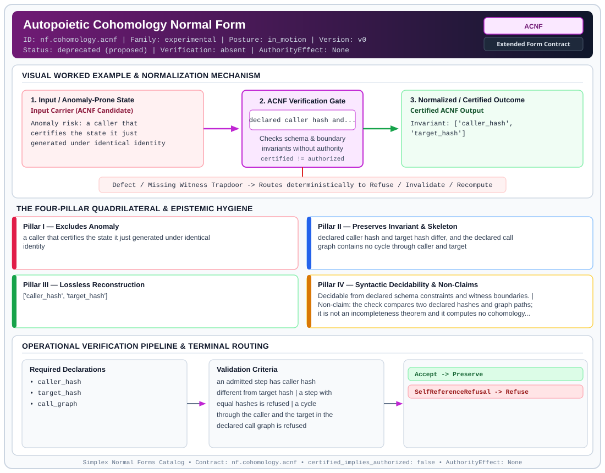

# Autopoietic Cohomology Normal Form (`ACNF`)

> **Contract ID:** `nf.cohomology.acnf` | **Family:** `experimental` | **Index Status:** `deprecated` | **AuthorityEffect:** `None`

**[⬅ Back to Wiki Home](Home)** | **[View SVG Diagram](images/nf.cohomology.acnf.svg)**

---

## 1. Executive Summary & Metadata

Autopoietic Cohomology Normal Form (ACNF) enforces structural normalization and explicit defect routing in the experimental regime.

| Property | Value |
| :--- | :--- |
| **Canonical ID** | `nf.cohomology.acnf` |
| **Short Name** | `ACNF` |
| **Full Name** | Autopoietic Cohomology Normal Form |
| **Family** | `experimental` (Bounded Quantum-Classical, Contextuality, Quantifier Alternation & Agent-State Contracts) |
| **Qualification** | Extended Form Contract (Normal Form Contract) |
| **Data / Math Posture** | in_motion |
| **Index Status** | `deprecated` |
| **Theory Status** | `proposed` |
| **Verification Status** | `absent` |
| **Contract Version** | `v0` |
| **Governance Fence** | `AuthorityEffect: None` (`certified_implies_authorized: false`) |

---

## 2. Visual Architecture & Normalization Diagram



---

## 3. Concrete Worked Example & Mechanism

### Visual Transition Summary

| Stage | Carrier / Operator | Concrete State / Invariant |
| :--- | :--- | :--- |
| **1. Before / Candidate Input** | `Input Carrier (ACNF Candidate)` | Anomaly risk: a caller that ; certifies the state it just ; generated under identical identity |
| **2. Normalization / Gate** | `ACNF Verification Gate` | `declared caller hash and...` (`certified_implies_authorized: false`) |
| **3. After / Certified Output** | `Certified ACNF Output` | Invariant: ['caller_hash', ; 'target_hash'] |

### Contract-Declared Worked Cases

```yaml
- ref: coda_all_universe/mssn_sn_tower/definitions.md
  section: '3.7'
```

---

## 4. The Four-Pillar Quadrilateral & Non-Claims

Every contract in `simplex-normal-forms` is evaluated against the **Four-Pillar Quadrilateral** defined in `contracts/_golden_nfs/standard.yaml`:

| Pillar | Requirement | Contract Specification for `nf.cohomology.acnf` |
| :--- | :--- | :--- |
| **Pillar I: Excludes Anomaly** | Name and eliminate a specific class of data or state defects. | a caller that certifies the state it just generated under identical identity |
| **Pillar II: Preserves Invariant** | State the structural invariant and protected skeleton preserved across transitions. | **Invariant:** declared caller hash and target hash differ, and the declared call graph contains no cycle through caller and target<br>**Protected Skeleton:** ['caller_hash', 'target_hash'] |
| **Pillar III: Lossless Reconstruction** | State the non-loss reconstruction operator (join, direct sum, pullback, or replay). | Lossless reconstruction under declared projection, direct sum, or pullback operators. |
| **Pillar IV: Syntactic Decidability** | State how conformance is decided from declared constraints without unbudgeted scans. | Decidable from declared schema and witness metadata within bounded evaluation budgets. |

### Explicit Non-Claims (`certified_implies_authorized: false`)

- the check compares two declared hashes and graph paths; it is not an incompleteness theorem and it computes no cohomology groups
- hash inequality H(actor) != H(artifact) does not support causal independence or absence of self-certification without authenticated producer/verifier bindings
- the source name for the refusal is a metaphor. The route in this contract is SelfReferenceRefusal
- does not imply authorization

---

## 5. Operational Verification & Terminal Routing

### 5.1 Required Declarations

- caller_hash
- target_hash
- call_graph

### 5.2 Required Evidence

_None declared._

### 5.3 Validation Criteria

| Criterion ID | Name | Condition |
| :--- | :--- | :--- |
| `criterion` | Check | an admitted step has caller hash different from target hash |
| `criterion` | Check | a step with equal hashes is refused |
| `criterion` | Check | a cycle through the caller and the target in the declared call graph is refused |

### 5.4 Terminal Route Map

Every evaluation terminates in a declared local route mapped to a canonical terminal in `standard.yaml`:

| Local Terminal Route | Canonical Terminal |
| :--- | :--- |
| `Accept` | `Preserve` |
| `SelfReferenceRefusal` | `Refuse` |

### 5.5 Declared Failure Modes

- **symptom**: caller hash equals target hash, **diagnosis**: the caller is the verification target, **terminal**: SelfReferenceRefusal

---

## 6. Epistemic Claim Hygiene Quadrant

In accordance with the repository's epistemic claim discipline:

1. **What it supports:**
   - Supports syntactic and operational checking of `nf.cohomology.acnf` (`ACNF`) against its declared schema, boundary constraints, and witness obligations in this model.
   - Supports deterministic terminal routing (`Accept, SelfReferenceRefusal`) when required declarations or invariants fail.
2. **What it does not support:**
   - Does not confer operational authority (`AuthorityEffect: None`, `certified_implies_authorized: false`).
   - Does not claim semantic truth of undeclared external processes or unverified upstream inputs beyond the declaredprotected skeleton.
3. **The narrowest defensible claim:**
   - Within the declared substrate `in_motion`, this contract enforces that `a caller that certifies the state it just generated under identical identity` is either excluded under `declared caller hash and target hash differ, and the declared call graph contains no cycle through caller and target` or routed to an explicit refusal/recovery terminal.
4. **The next test needed:**
   - Property-based falsification and mutation testing across boundary edge cases and composed multi-step pipelines for `nf.cohomology.acnf`.

---

## 7. Canonical YAML Contract (`contracts/nf.cohomology.acnf.yaml`)

<details>
<summary><strong>Click to expand full canonical YAML contract (contracts/nf.cohomology.acnf.yaml)</strong></summary>

```yaml
schema_version: smplx.nf.contract.v0
schema_ref: ./normal_form_contract_schema.yaml
contract_kind: normal_form_contract
identity:
  id: nf.cohomology.acnf
  name: Autopoietic Cohomology Normal Form
  short_name: ACNF
  version: v0
  theory_status: proposed
  contract_status: deprecated
  verification_status: absent
  family: experimental
  status: deprecated
  alias_of: nf.recursion.asrf
  deprecation_note: >
    Deprecated historical alias for Autopoietic Self-Reference Refusal Form (ASRF / nf.recursion.asrf).
    Retained for contract inventory compatibility; enforces acyclic caller-target identity checks
    and computes no cohomology groups.
classification:
  hierarchy_level: normal_form
  subject_kind:
  - caller_identity
  - verification_target
  data_posture: in_motion
  mathematical_posture: operational
purpose:
  excludes_anomaly: a caller that certifies the state it just generated under identical identity
  preserves_invariant: declared caller hash and target hash differ, and the declared call graph
    contains no cycle through caller and target
  protected_skeleton:
  - caller_hash
  - target_hash
  erased_structure: []
  non_claims:
  - the check compares two declared hashes and graph paths; it is not an incompleteness theorem
    and it computes no cohomology groups
  - hash inequality H(actor) != H(artifact) does not support causal independence or absence of
    self-certification without authenticated producer/verifier bindings
  - the source name for the refusal is a metaphor. The route in this contract is SelfReferenceRefusal
  - does not imply authorization
definition:
  source: coda_all_universe/mssn_sn_tower/definitions.md
  section: '3.7'
  formal_statement: >
    A verification step records a declared caller hash and a target hash. The step is
    admitted when the two hashes differ and no cycle exists through caller and target in
    the declared call graph. When they are equal or cyclic, the step is refused with
    SelfReferenceRefusal. The refusal record is kept apart from admitted evaluations.
  quadrilateral:
    qualifies_as_true_normal_form: false
    qualification_gap: no_cohomology_or_join_theorem_is_stated
    qualifies_as_extended_form: true
    anomaly_exclusion: self-certification of a generated state under identical identity
    lossless_join:
      status: refusal_separated
      statement: refused self-cycles are stored as refusals and are not folded into
        admitted evaluations
    dependency_preservation:
      status: hash_inequality_retained
      statement: an admitted step keeps caller hash different from target hash
    syntactic_decision:
      status: declaration_decidable
      statement: the check compares the declared hashes and the declared call graph
declarations_required:
- caller_hash
- target_hash
- call_graph
evidence_required: []
validation_criteria:
- an admitted step has caller hash different from target hash
- a step with equal hashes is refused
- a cycle through the caller and the target in the declared call graph is refused
terminal_routes:
- Accept
- SelfReferenceRefusal
terminal_route_map:
  Accept: Preserve
  SelfReferenceRefusal: Refuse
certification:
  certificate_required: false
  certificate_kind: null
  obstruction_class_required: false
  loss_ledger_required: false
  verifier_required: false
  loss_ledger_trigger_id: null
authorization:
  authorized_by: null
  certified_implies_authorized: false
failure_modes:
- symptom: caller hash equals target hash
  diagnosis: the caller is the verification target
  terminal: SelfReferenceRefusal
examples:
- ref: coda_all_universe/mssn_sn_tower/definitions.md
  section: '3.7'
references:
- coda_all_universe/mssn_sn_tower/definitions.md
- ./nf.recursion.asrf.yaml
```

</details>
