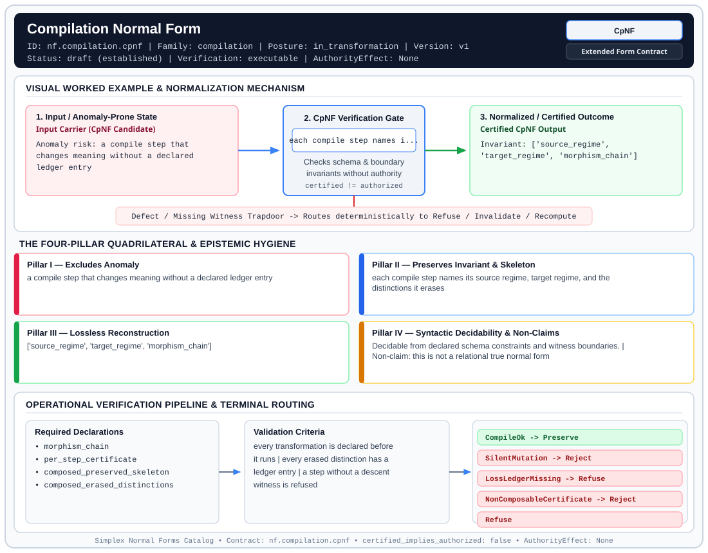

# Compilation Normal Form (`CpNF`)

> **Contract ID:** `nf.compilation.cpnf` | **Family:** `compilation` | **Index Status:** `draft` | **AuthorityEffect:** `None`

**[⬅ Back to Wiki Home](Home)** | **[View SVG Diagram](images/nf.compilation.cpnf.svg)**

---

## 1. Executive Summary & Metadata

Compilation Normal Form (CpNF) enforces structural normalization and explicit defect routing in the compilation regime.

| Property | Value |
| :--- | :--- |
| **Canonical ID** | `nf.compilation.cpnf` |
| **Short Name** | `CpNF` |
| **Full Name** | Compilation Normal Form |
| **Family** | `compilation` (Compilation & Query Lowering Preservation Contracts (`CpNF`)) |
| **Qualification** | Extended Form Contract (Normal Form Contract) |
| **Data / Math Posture** | in_transformation |
| **Index Status** | `draft` |
| **Theory Status** | `established` |
| **Verification Status** | `executable` |
| **Contract Version** | `v1` |
| **Governance Fence** | `AuthorityEffect: None` (`certified_implies_authorized: false`) |

---

## 2. Visual Architecture & Normalization Diagram



---

## 3. Concrete Worked Example & Mechanism

### Visual Transition Summary

| Stage | Carrier / Operator | Concrete State / Invariant |
| :--- | :--- | :--- |
| **1. Before / Candidate Input** | `Input Carrier (CpNF Candidate)` | Anomaly risk: a compile step that ; changes meaning without a declared ; ledger entry |
| **2. Normalization / Gate** | `CpNF Verification Gate` | `each compile step names i...` (`certified_implies_authorized: false`) |
| **3. After / Certified Output** | `Certified CpNF Output` | Invariant: ['source_regime', ; 'target_regime', 'morphism_chain'] |

---

## 4. The Four-Pillar Quadrilateral & Non-Claims

Every contract in `simplex-normal-forms` is evaluated against the **Four-Pillar Quadrilateral** defined in `contracts/_golden_nfs/standard.yaml`:

| Pillar | Requirement | Contract Specification for `nf.compilation.cpnf` |
| :--- | :--- | :--- |
| **Pillar I: Excludes Anomaly** | Name and eliminate a specific class of data or state defects. | a compile step that changes meaning without a declared ledger entry |
| **Pillar II: Preserves Invariant** | State the structural invariant and protected skeleton preserved across transitions. | **Invariant:** each compile step names its source regime, target regime, and the distinctions it erases<br>**Protected Skeleton:** ['source_regime', 'target_regime', 'morphism_chain'] |
| **Pillar III: Lossless Reconstruction** | State the non-loss reconstruction operator (join, direct sum, pullback, or replay). | Lossless reconstruction under declared projection, direct sum, or pullback operators. |
| **Pillar IV: Syntactic Decidability** | State how conformance is decided from declared constraints without unbudgeted scans. | Decidable from declared schema and witness metadata within bounded evaluation budgets. |

### Explicit Non-Claims (`certified_implies_authorized: false`)

- this is not a relational true normal form
- this is not a runtime cache repair
- a compile certificate does not authorize the compiled artifact
- the archive file contract.compilation.cpnf.yaml set authorized_by to a policy engine; this proposal leaves authorized_by null

---

## 5. Operational Verification & Terminal Routing

### 5.1 Required Declarations

- morphism_chain
- per_step_certificate
- composed_preserved_skeleton
- composed_erased_distinctions

### 5.2 Required Evidence

- transport_certificate_per_step
- loss_ledger_when_a_distinction_is_erased

### 5.3 Validation Criteria

| Criterion ID | Name | Condition |
| :--- | :--- | :--- |
| `criterion` | Check | every transformation is declared before it runs |
| `criterion` | Check | every erased distinction has a ledger entry |
| `criterion` | Check | a step without a descent witness is refused |

### 5.4 Terminal Route Map

Every evaluation terminates in a declared local route mapped to a canonical terminal in `standard.yaml`:

| Local Terminal Route | Canonical Terminal |
| :--- | :--- |
| `CompileOk` | `Preserve` |
| `SilentMutation` | `Reject` |
| `LossLedgerMissing` | `Refuse` |
| `NonComposableCertificate` | `Reject` |
| `Refuse` | `Refuse` |

### 5.5 Declared Failure Modes

_All defects route explicitly through the Terminal Route Map above._

---

## Deep-Dive Level Treatise

**AuthorityEffect:** None.  
**Level:** Level 14 (Data in Representation / Query Rewrite & Compiler Lowering)  
**Evidential Grade:** NATIVE IMPLEMENTED  
**Contract Reference:** [`nf.compilation.cpnf`](../../../../omega_engine_pfp/infrastructure/yaml/normal_forms/nf.compilation.cpnf.yaml)  
**Mathematical Posture:** Translation Validation & Semantic Preservation  
**Data Posture:** In Representation  

---

## 1. Schematic & Conceptual Architecture

Compilation Normal Form (CpNF) governs the translation pipeline that turns high-level relational expressions into executable physical query plans:
- Disciplines **query optimization rewrites** (predicate pushdown, join reordering, view merging).
- Verifies **compiler lowering**: transforming declarative relational calculus into low-level execution bytecode or SQL execution plans.
- Ensures that every rewrite step preserves observable query semantics and records any lossy lowering (e.g. integer width truncation, float precision loss).

```text
       Declarative SQL Expression
                   │
                   ▼
       Relational Algebra Tree (SPJA)
                   │
                   ▼
       Cost-Based Optimizer Rewrite
                   │
             CpNF Validation Gate
          (Checks Semantic Equivalence)
                   ▼
       Physical Execution Bytecode
```

---

## 2. Mathematical Invariants & Quadrilateral Properties

1. **Semantic Preservation Law:**
   Let $Q$ be a source query expression, and $Q_{\text{opt}} = \operatorname{compile}(Q)$ the compiled execution plan.
   $Q_{\text{opt}}$ is in CpNF if and only if for all admitted database states $S$:
   $$\operatorname{eval}(Q_{\text{opt}}, S) = \operatorname{eval}(Q, S) \oplus \operatorname{Loss}_{\text{comp}}(Q \to Q_{\text{opt}})$$

2. **Trigger Registry Alignment:**
   Any lossy compilation step (e.g. converting BigRational to double precision, or truncating string lengths) must emit a loss ledger entry bound to `cpnf.lossy_compilation_lowering`.

3. **The Quadrilateral Invariants:**
   - **Anomaly Excluded:** Query optimizer semantic bugs, silent result set drift, incorrect aggregate pushdowns, unrecorded floating-point precision drops.
   - **Protected Skeleton:** Output schema, projected attributes, grouping keys, and sort orders.
   - **Erased Structure:** Declarative syntactic structure, comments, and unselected subquery branches.
   - **Reconstruction:** Evaluation equivalence over all valid database states.

---

## 3. Terminal Routes & Verification Logic

```text
Compiled Query Plan & Lowering Trace
      │
      ├── Exact semantic equivalence supported ────────► Preserve (CompilationValid)
      │
      ├── Precision loss sealed in LossLedger ──────► Quarantine (LossyLoweringAccepted)
      │
      ├── Semantic mismatch between source & target ─► Reject (OptimizerDefect)
      │
      └── Unrecorded precision drop ────────────────► Refuse (UnledgeredLoweringLoss)
```

- `Preserve`: Optimizer transformation supported semantically isomorphic.
- `Quarantine`: Lossy lowering accepted under a declared loss ledger policy.
- `Reject`: Query results differ on valid test states.
- `Refuse`: Dropped precision without an explicit ledger.

---

## 4. Test Evidence & Local Execution

Verified in [`test_tranche9_evidence_and_transport.py`](../../../tests/normal_forms/test_tranche9_evidence_and_transport.py):
- `test_cpnf_predicate_pushdown_preservation`: Verifies that pushing predicates through joins does not alter tuple membership.
- `test_cpnf_lossy_lowering_loss_ledger`: Asserts that lowering exact rationals to double-precision floats requires an active loss ledger with trigger `cpnf.lossy_compilation_lowering`.

---

## 5. Epistemic Claim Quadrant

1. **What it supports:**
   - Formal validation of query optimization and execution plan lowering.
   - Audit trail for precision degradation during analytical compilation.
2. **What it does not support:**
   - Optimization of non-deterministic queries (e.g. queries calling `RANDOM()` or system clocks).
3. **The narrowest defensible claim:**
   - CpNF ensures under declared assumptions that a compiled query plan produces the identical result set as the declarative source on all deterministic inputs.
4. **The next test needed:**
   - Property tests synthesizing randomized complex SQL subqueries to verify that cost-based join reorderings commute under ANSI SQL-92 semantics.

---

## 6. Epistemic Claim Hygiene Quadrant

In accordance with the repository's epistemic claim discipline:

1. **What it supports:**
   - Supports syntactic and operational checking of `nf.compilation.cpnf` (`CpNF`) against its declared schema, boundary constraints, and witness obligations in this model.
   - Supports deterministic terminal routing (`CompileOk, SilentMutation, LossLedgerMissing, NonComposableCertificate`) when required declarations or invariants fail.
2. **What it does not support:**
   - Does not confer operational authority (`AuthorityEffect: None`, `certified_implies_authorized: false`).
   - Does not claim semantic truth of undeclared external processes or unverified upstream inputs beyond the declaredprotected skeleton.
3. **The narrowest defensible claim:**
   - Within the declared substrate `in_transformation`, this contract enforces that `a compile step that changes meaning without a declared ledger entry` is either excluded under `each compile step names its source regime, target regime, and the distinctions it erases` or routed to an explicit refusal/recovery terminal.
4. **The next test needed:**
   - Property-based falsification and mutation testing across boundary edge cases and composed multi-step pipelines for `nf.compilation.cpnf`.

---

## 7. Canonical YAML Contract (`contracts/nf.compilation.cpnf.yaml`)

<details>
<summary><strong>Click to expand full canonical YAML contract (contracts/nf.compilation.cpnf.yaml)</strong></summary>

```yaml
schema_version: smplx.nf.contract.v0
contract_kind: normal_form_contract
identity:
  id: nf.compilation.cpnf
  name: Compilation Normal Form
  short_name: CpNF
  version: v1
  status: draft
  family: compilation
  contract_status: draft
classification:
  hierarchy_level: transformation_contract
  subject_kind:
  - representation_transport
  - query_shape
  data_posture: in_transformation
  mathematical_posture: operational
purpose:
  excludes_anomaly: a compile step that changes meaning without a declared ledger
    entry
  preserves_invariant: each compile step names its source regime, target regime, and
    the distinctions it erases
  protected_skeleton:
  - source_regime
  - target_regime
  - morphism_chain
  erased_structure: []
  non_claims:
  - this is not a relational true normal form
  - this is not a runtime cache repair
  - a compile certificate does not authorize the compiled artifact
  - the archive file contract.compilation.cpnf.yaml set authorized_by to a policy
    engine; this proposal leaves authorized_by null
declarations_required:
- morphism_chain
- per_step_certificate
- composed_preserved_skeleton
- composed_erased_distinctions
evidence_required:
- transport_certificate_per_step
- loss_ledger_when_a_distinction_is_erased
validation_criteria:
- every transformation is declared before it runs
- every erased distinction has a ledger entry
- a step without a descent witness is refused
terminal_routes:
- CompileOk
- SilentMutation
- LossLedgerMissing
- NonComposableCertificate
- Refuse
terminal_route_map:
  CompileOk: Preserve
  SilentMutation: Reject
  LossLedgerMissing: Refuse
  NonComposableCertificate: Reject
  Refuse: Refuse
definition:
  source: coda_all_universe/mssn_sn_tower/definitions.md
  formal_statement: 'A compilation is in this form when every step is a declared map
    between two regimes and every distinction the step erases is written to a loss
    ledger. Reconstruction is replay of that chain, not a relational join.

    '
  quadrilateral:
    qualifies_as_true_normal_form: false
    qualification_gap: reconstruction_is_replay_of_a_compile_chain
    anomaly_exclusion: an unledgered change of meaning across compile steps
    lossless_join:
      status: declared_reconstruction
      statement: replaying the declared chain reproduces the compiled artifact and
        the loss ledger
    dependency_preservation:
      status: declared_with_the_invariant
      statement: erased distinctions stay on the ledger instead of being dropped silently
    syntactic_decision:
      status: declaration_decidable
      statement: the check reads the morphism chain and the ledger, not one runtime
        row
certification:
  certificate_required: true
  certificate_kind: transport_certificate
  obstruction_class_required: true
  loss_ledger_required: true
  verifier_required: true
authorization:
  authorized_by: null
  certified_implies_authorized: false
references:
- coda_all_universe/mssn_sn_tower/contracts/nf.compilation.cpnf.yaml
- coda_all_universe/mssn_sn_tower/docs/papers/nf.coda.mur.transport.yaml
schema_ref: ./normal_form_contract_schema.yaml
```

</details>
