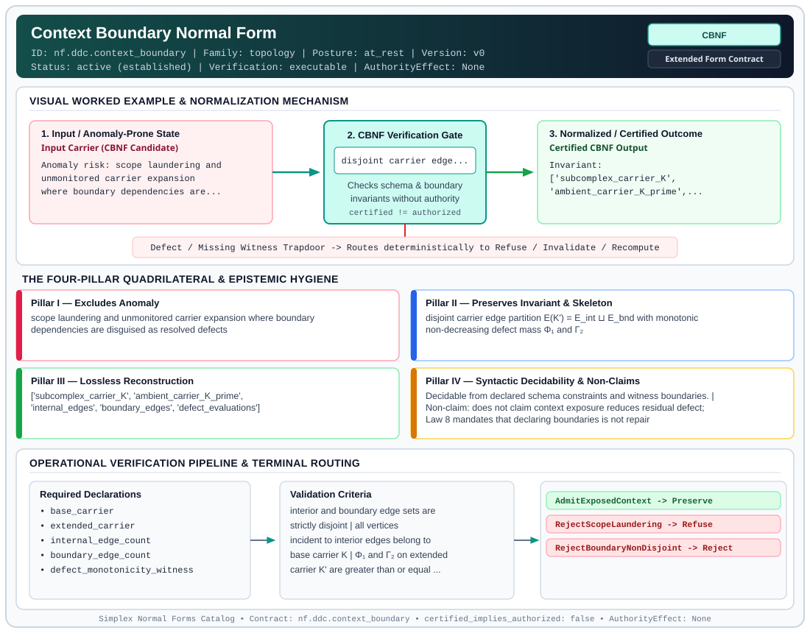

# Context Boundary Normal Form (`CBNF`)

> **Contract ID:** `nf.ddc.context_boundary` | **Family:** `topology` | **Index Status:** `active` | **AuthorityEffect:** `None`

**[⬅ Back to Wiki Home](Home)** | **[View SVG Diagram](images/nf.ddc.context_boundary.svg)**

---

## 1. Executive Summary & Metadata

Context Boundary Normal Form (CBNF) enforces structural normalization and explicit defect routing in the topology regime.

| Property | Value |
| :--- | :--- |
| **Canonical ID** | `nf.ddc.context_boundary` |
| **Short Name** | `CBNF` |
| **Full Name** | Context Boundary Normal Form |
| **Family** | `topology` (Simplicial Complexes, Boundary Nilpotency & Context Boundary Purity (`TSNF`, `CBNF`)) |
| **Qualification** | Extended Form Contract (Normal Form Contract) |
| **Data / Math Posture** | at_rest |
| **Index Status** | `active` |
| **Theory Status** | `established` |
| **Verification Status** | `executable` |
| **Contract Version** | `v0` |
| **Governance Fence** | `AuthorityEffect: None` (`certified_implies_authorized: false`) |

### Foundational Treatise Specification

- **Family**: topology
- **Runes**: ['C']
- **Target Runtime Law**: Law 8 (Context Boundary Purity)
- **Domain**: Dynamic carrier subcomplexes K \subset K' and observation windows.
- **Anomaly Excluded**: Scope laundering, discarding inconvenient defects by re-scoping without lease contracts.
- **Preserved Invariant**: Disjoint partition E(K') = E_int \sqcup E_bnd with non-decreasing defect mass.
- **Reconstruction Theorem**: Re-embedding internal and boundary subcomplexes recovers global carrier losslessly.

---

## 2. Visual Architecture & Normalization Diagram



---

## 3. Concrete Worked Example & Mechanism

### Visual Transition Summary

| Stage | Carrier / Operator | Concrete State / Invariant |
| :--- | :--- | :--- |
| **1. Before / Candidate Input** | `Input Carrier (CBNF Candidate)` | Anomaly risk: scope laundering and ; unmonitored carrier expansion ; where boundary dependencies are... |
| **2. Normalization / Gate** | `CBNF Verification Gate` | `disjoint carrier edge...` (`certified_implies_authorized: false`) |
| **3. After / Certified Output** | `Certified CBNF Output` | Invariant: ; ['subcomplex_carrier_K', ; 'ambient_carrier_K_prime',... |

### Contract-Declared Worked Cases

```yaml
- ref: omega_engine_education/documentation/14_discrete_deformation_calculus_ddc/00_discrete_deformation_calculus_foundations.md
  section: '2.1'
```

---

## 4. The Four-Pillar Quadrilateral & Non-Claims

Every contract in `simplex-normal-forms` is evaluated against the **Four-Pillar Quadrilateral** defined in `contracts/_golden_nfs/standard.yaml`:

| Pillar | Requirement | Contract Specification for `nf.ddc.context_boundary` |
| :--- | :--- | :--- |
| **Pillar I: Excludes Anomaly** | Name and eliminate a specific class of data or state defects. | scope laundering and unmonitored carrier expansion where boundary dependencies are disguised as resolved defects |
| **Pillar II: Preserves Invariant** | State the structural invariant and protected skeleton preserved across transitions. | **Invariant:** disjoint carrier edge partition E(K') = E_int ⊔ E_bnd with monotonic non-decreasing defect mass Φ₁ and Γ₂<br>**Protected Skeleton:** ['subcomplex_carrier_K', 'ambient_carrier_K_prime', 'internal_edges', 'boundary_edges', 'defect_evaluations'] |
| **Pillar III: Lossless Reconstruction** | State the non-loss reconstruction operator (join, direct sum, pullback, or replay). | Lossless reconstruction under declared projection, direct sum, or pullback operators. |
| **Pillar IV: Syntactic Decidability** | State how conformance is decided from declared constraints without unbudgeted scans. | Decidable from declared schema and witness metadata within bounded evaluation budgets. |

### Explicit Non-Claims (`certified_implies_authorized: false`)

- does not claim context exposure reduces residual defect; Law 8 mandates that declaring boundaries is not repair
- does not claim exposed boundary edges are gauge-repairable without further licensed carrier inclusion
- does not confer operational authority; authority_effect is unconditionally None

---

## 5. Operational Verification & Terminal Routing

### 5.1 Required Declarations

- base_carrier
- extended_carrier
- internal_edge_count
- boundary_edge_count
- defect_monotonicity_witness

### 5.2 Required Evidence

_None declared._

### 5.3 Validation Criteria

| Criterion ID | Name | Condition |
| :--- | :--- | :--- |
| `criterion` | Check | interior and boundary edge sets are strictly disjoint |
| `criterion` | Check | all vertices incident to interior edges belong to base carrier K |
| `criterion` | Check | Φ₁ and Γ₂ on extended carrier K' are greater than or equal to their values on K |

### 5.4 Terminal Route Map

Every evaluation terminates in a declared local route mapped to a canonical terminal in `standard.yaml`:

| Local Terminal Route | Canonical Terminal |
| :--- | :--- |
| `AdmitExposedContext` | `Preserve` |
| `RejectScopeLaundering` | `Refuse` |
| `RejectBoundaryNonDisjoint` | `Reject` |

### 5.5 Declared Failure Modes

- **symptom**: defect mass decreases across context exposure without explicit repair rune, **diagnosis**: scope laundering attempted; violates Law 8, **terminal**: RejectScopeLaundering
- **symptom**: intersection of interior and boundary edges is non-empty, **diagnosis**: carrier partition is not disjoint, **terminal**: RejectBoundaryNonDisjoint

---

## 6. Epistemic Claim Hygiene Quadrant

In accordance with the repository's epistemic claim discipline:

1. **What it supports:**
   - Supports syntactic and operational checking of `nf.ddc.context_boundary` (`CBNF`) against its declared schema, boundary constraints, and witness obligations in this model.
   - Supports deterministic terminal routing (`AdmitExposedContext, RejectScopeLaundering, RejectBoundaryNonDisjoint`) when required declarations or invariants fail.
2. **What it does not support:**
   - Does not confer operational authority (`AuthorityEffect: None`, `certified_implies_authorized: false`).
   - Does not claim semantic truth of undeclared external processes or unverified upstream inputs beyond the declaredprotected skeleton.
3. **The narrowest defensible claim:**
   - Within the declared substrate `at_rest`, this contract enforces that `scope laundering and unmonitored carrier expansion where boundary dependencies are disguised as resolved defects` is either excluded under `disjoint carrier edge partition E(K') = E_int ⊔ E_bnd with monotonic non-decreasing defect mass Φ₁ and Γ₂` or routed to an explicit refusal/recovery terminal.
4. **The next test needed:**
   - Property-based falsification and mutation testing across boundary edge cases and composed multi-step pipelines for `nf.ddc.context_boundary`.

---

## 7. Canonical YAML Contract (`contracts/nf.ddc.context_boundary.yaml`)

<details>
<summary><strong>Click to expand full canonical YAML contract (contracts/nf.ddc.context_boundary.yaml)</strong></summary>

```yaml
schema_version: smplx.nf.contract.v0
schema_ref: ./normal_form_contract_schema.yaml
contract_kind: normal_form_contract
identity:
  id: nf.ddc.context_boundary
  name: Context Boundary Normal Form
  short_name: CBNF
  version: v0
  theory_status: established
  contract_status: active
  status: active
  verification_status: executable
  family: topology
classification:
  hierarchy_level: normal_form
  subject_kind:
    - carrier_complex
    - observation_window
    - boundary_subcomplex
  data_posture: at_rest
  mathematical_posture: operational
purpose:
  excludes_anomaly: scope laundering and unmonitored carrier expansion where boundary dependencies are disguised as resolved defects
  preserves_invariant: disjoint carrier edge partition E(K') = E_int ⊔ E_bnd with monotonic non-decreasing defect mass Φ₁ and Γ₂
  protected_skeleton:
    - subcomplex_carrier_K
    - ambient_carrier_K_prime
    - internal_edges
    - boundary_edges
    - defect_evaluations
  erased_structure:
    - external_complex_topology_beyond_boundary
  non_claims:
    - does not claim context exposure reduces residual defect; Law 8 mandates that declaring boundaries is not repair
    - does not claim exposed boundary edges are gauge-repairable without further licensed carrier inclusion
    - does not confer operational authority; authority_effect is unconditionally None
definition:
  source: omega_engine_education/documentation/14_discrete_deformation_calculus_ddc/normal_forms/README.md
  section: '2.0'
  formal_statement: >
    On a discrete simplicial or cell complex carrier K exposed to an ambient window K',
    Context Boundary Normal Form (CBNF) losslessly partitions edges into disjoint interior
    and boundary sets E(K') = E_int ⊔ E_bnd. Context exposure rune C declares this partition
    and verifies that residual mass Φ₁ and curvature defect Γ₂ are monotonic non-decreasing,
    forbidding false defect relief through unmonitored carrier expansion.
  quadrilateral:
    qualifies_as_true_normal_form: false
    qualification_gap: topological_sheaf_partition_not_relational_project_join
    anomaly_exclusion: scope laundering (attempting to decrease Φ₁ or Γ₂ by expanding the carrier boundary)
    lossless_join:
      status: disjoint_sum_reconstruction
      statement: E(K') is losslessly partitioned into E_int ⊔ E_bnd with explicit indicator functions
    dependency_preservation:
      status: subcomplex_embedding_preserved
      statement: internal cochain relations are preserved identically on E_int
    syntactic_decision:
      status: combinatorial_subgraph_decidable
      statement: membership is decidable by checking vertex incident inclusion and edge partition counts
declarations_required:
  - base_carrier
  - extended_carrier
  - internal_edge_count
  - boundary_edge_count
  - defect_monotonicity_witness
evidence_required: []
validation_criteria:
  - interior and boundary edge sets are strictly disjoint
  - all vertices incident to interior edges belong to base carrier K
  - Φ₁ and Γ₂ on extended carrier K' are greater than or equal to their values on K
terminal_routes:
  - AdmitExposedContext
  - RejectScopeLaundering
  - RejectBoundaryNonDisjoint
terminal_route_map:
  AdmitExposedContext: Preserve
  RejectScopeLaundering: Refuse
  RejectBoundaryNonDisjoint: Reject
certification:
  certificate_required: false
  certificate_kind: null
  obstruction_class_required: false
  loss_ledger_required: false
  verifier_required: true
  loss_ledger_trigger_id: null
authorization:
  authorized_by: null
  certified_implies_authorized: false
failure_modes:
  - symptom: defect mass decreases across context exposure without explicit repair rune
    diagnosis: scope laundering attempted; violates Law 8
    terminal: RejectScopeLaundering
  - symptom: intersection of interior and boundary edges is non-empty
    diagnosis: carrier partition is not disjoint
    terminal: RejectBoundaryNonDisjoint
examples:
  - ref: omega_engine_education/documentation/14_discrete_deformation_calculus_ddc/00_discrete_deformation_calculus_foundations.md
    section: '2.1'
references:
  - omega_engine_education/documentation/14_discrete_deformation_calculus_ddc/00_discrete_deformation_calculus_foundations.md
  - omega_engine_governance/contracts/contracts_omega_engine_crates/mathematics/discrete_deformation_algebra/context_embedding_operator.contract.yaml
```

</details>
