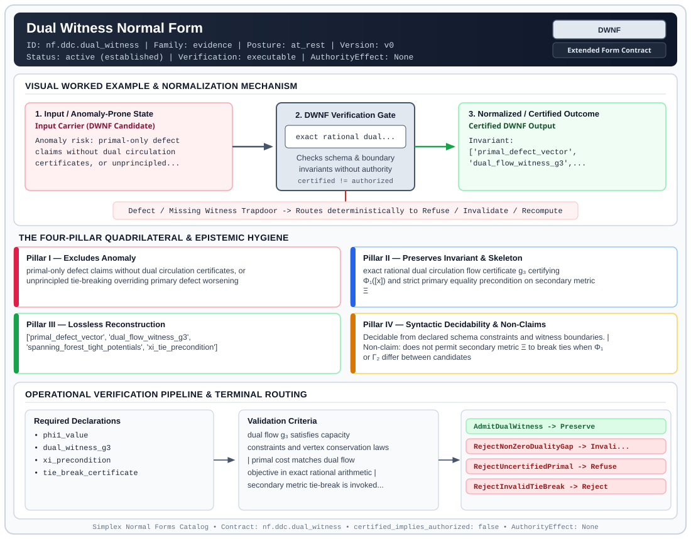

# Dual Witness Normal Form (`DWNF`)

> **Contract ID:** `nf.ddc.dual_witness` | **Family:** `evidence` | **Index Status:** `active` | **AuthorityEffect:** `None`

**[⬅ Back to Wiki Home](Home)** | **[View SVG Diagram](images/nf.ddc.dual_witness.svg)**

---

## 1. Executive Summary & Metadata

Dual Witness Normal Form (DWNF) enforces structural normalization and explicit defect routing in the evidence regime.

| Property | Value |
| :--- | :--- |
| **Canonical ID** | `nf.ddc.dual_witness` |
| **Short Name** | `DWNF` |
| **Full Name** | Dual Witness Normal Form |
| **Family** | `evidence` (Cryptographic Receipts, Dual Witnesses, Loss Ledgers, CDC Logs & Schema Totality) |
| **Qualification** | Extended Form Contract (Normal Form Contract) |
| **Data / Math Posture** | at_rest |
| **Index Status** | `active` |
| **Theory Status** | `established` |
| **Verification Status** | `executable` |
| **Contract Version** | `v0` |
| **Governance Fence** | `AuthorityEffect: None` (`certified_implies_authorized: false`) |

### Foundational Treatise Specification

- **Family**: evidence
- **Runes**: ['R', 'E']
- **Target Runtime Law**: Dual Certification Law
- **Domain**: Optimization problems and defect minimization on 1-complexes.
- **Anomaly Excluded**: Unilateral primal optimality assertions and heuristic defect claims lacking certificates.
- **Preserved Invariant**: Simultaneous emission of primal flow and dual circulation witness with zero duality gap and Xi tie-break.
- **Reconstruction Theorem**: Dual certificate independently verifies primal minimizer without re-running search.

---

## 2. Visual Architecture & Normalization Diagram



---

## 3. Concrete Worked Example & Mechanism

### Visual Transition Summary

| Stage | Carrier / Operator | Concrete State / Invariant |
| :--- | :--- | :--- |
| **1. Before / Candidate Input** | `Input Carrier (DWNF Candidate)` | Anomaly risk: primal-only defect ; claims without dual circulation ; certificates, or unprincipled... |
| **2. Normalization / Gate** | `DWNF Verification Gate` | `exact rational dual...` (`certified_implies_authorized: false`) |
| **3. After / Certified Output** | `Certified DWNF Output` | Invariant: ; ['primal_defect_vector', ; 'dual_flow_witness_g3',... |

### Contract-Declared Worked Cases

```yaml
- ref: omega_engine_education/documentation/14_discrete_deformation_calculus_ddc/00_discrete_deformation_calculus_foundations.md
  section: '2.8'
```

---

## 4. The Four-Pillar Quadrilateral & Non-Claims

Every contract in `simplex-normal-forms` is evaluated against the **Four-Pillar Quadrilateral** defined in `contracts/_golden_nfs/standard.yaml`:

| Pillar | Requirement | Contract Specification for `nf.ddc.dual_witness` |
| :--- | :--- | :--- |
| **Pillar I: Excludes Anomaly** | Name and eliminate a specific class of data or state defects. | primal-only defect claims without dual circulation certificates, or unprincipled tie-breaking overriding primary defect worsening |
| **Pillar II: Preserves Invariant** | State the structural invariant and protected skeleton preserved across transitions. | **Invariant:** exact rational dual circulation flow certificate g₃ certifying Φ₁([x]) and strict primary equality precondition on secondary metric Ξ<br>**Protected Skeleton:** ['primal_defect_vector', 'dual_flow_witness_g3', 'spanning_forest_tight_potentials', 'xi_tie_precondition'] |
| **Pillar III: Lossless Reconstruction** | State the non-loss reconstruction operator (join, direct sum, pullback, or replay). | Lossless reconstruction under declared projection, direct sum, or pullback operators. |
| **Pillar IV: Syntactic Decidability** | State how conformance is decided from declared constraints without unbudgeted scans. | Decidable from declared schema and witness metadata within bounded evaluation budgets. |

### Explicit Non-Claims (`certified_implies_authorized: false`)

- does not permit secondary metric Ξ to break ties when Φ₁ or Γ₂ differ between candidates
- does not assert quotient norm without certifying both primal bound and dual witness
- does not confer operational authority; authority_effect is unconditionally None

---

## 5. Operational Verification & Terminal Routing

### 5.1 Required Declarations

- phi1_value
- dual_witness_g3
- xi_precondition
- tie_break_certificate

### 5.2 Required Evidence

_None declared._

### 5.3 Validation Criteria

| Criterion ID | Name | Condition |
| :--- | :--- | :--- |
| `criterion` | Check | dual flow g₃ satisfies capacity constraints and vertex conservation laws |
| `criterion` | Check | primal cost matches dual flow objective in exact rational arithmetic |
| `criterion` | Check | secondary metric tie-break is invoked only when candidate Φ₁ and Γ₂ are identical |

### 5.4 Terminal Route Map

Every evaluation terminates in a declared local route mapped to a canonical terminal in `standard.yaml`:

| Local Terminal Route | Canonical Terminal |
| :--- | :--- |
| `AdmitDualWitness` | `Preserve` |
| `RejectNonZeroDualityGap` | `Invalidate` |
| `RejectUncertifiedPrimal` | `Refuse` |
| `RejectInvalidTieBreak` | `Reject` |

### 5.5 Declared Failure Modes

- **symptom**: primal objective exceeds dual circulation flow value, **diagnosis**: duality gap non-zero; certificate invalid, **terminal**: RejectNonZeroDualityGap
- **symptom**: candidate selected by Ξ metric when Φ₁ or Γ₂ are unequal, **diagnosis**: secondary metric overrode primary defect worsening; violates tie-break invariant, **terminal**: RejectInvalidTieBreak

---

## 6. Epistemic Claim Hygiene Quadrant

In accordance with the repository's epistemic claim discipline:

1. **What it supports:**
   - Supports syntactic and operational checking of `nf.ddc.dual_witness` (`DWNF`) against its declared schema, boundary constraints, and witness obligations in this model.
   - Supports deterministic terminal routing (`AdmitDualWitness, RejectNonZeroDualityGap, RejectUncertifiedPrimal, RejectInvalidTieBreak`) when required declarations or invariants fail.
2. **What it does not support:**
   - Does not confer operational authority (`AuthorityEffect: None`, `certified_implies_authorized: false`).
   - Does not claim semantic truth of undeclared external processes or unverified upstream inputs beyond the declaredprotected skeleton.
3. **The narrowest defensible claim:**
   - Within the declared substrate `at_rest`, this contract enforces that `primal-only defect claims without dual circulation certificates, or unprincipled tie-breaking overriding primary defect worsening` is either excluded under `exact rational dual circulation flow certificate g₃ certifying Φ₁([x]) and strict primary equality precondition on secondary metric Ξ` or routed to an explicit refusal/recovery terminal.
4. **The next test needed:**
   - Property-based falsification and mutation testing across boundary edge cases and composed multi-step pipelines for `nf.ddc.dual_witness`.

---

## 7. Canonical YAML Contract (`contracts/nf.ddc.dual_witness.yaml`)

<details>
<summary><strong>Click to expand full canonical YAML contract (contracts/nf.ddc.dual_witness.yaml)</strong></summary>

```yaml
schema_version: smplx.nf.contract.v0
schema_ref: ./normal_form_contract_schema.yaml
contract_kind: normal_form_contract
identity:
  id: nf.ddc.dual_witness
  name: Dual Witness Normal Form
  short_name: DWNF
  version: v0
  theory_status: established
  contract_status: active
  status: active
  verification_status: executable
  family: evidence
classification:
  hierarchy_level: normal_form
  subject_kind:
    - dual_circulation_flow
    - phi1_certificate
    - xi_tie_break
  data_posture: at_rest
  mathematical_posture: operational
purpose:
  excludes_anomaly: primal-only defect claims without dual circulation certificates, or unprincipled tie-breaking overriding primary defect worsening
  preserves_invariant: exact rational dual circulation flow certificate g₃ certifying Φ₁([x]) and strict primary equality precondition on secondary metric Ξ
  protected_skeleton:
    - primal_defect_vector
    - dual_flow_witness_g3
    - spanning_forest_tight_potentials
    - xi_tie_precondition
  erased_structure:
    - dual_solver_pivot_sequence
  non_claims:
    - does not permit secondary metric Ξ to break ties when Φ₁ or Γ₂ differ between candidates
    - does not assert quotient norm without certifying both primal bound and dual witness
    - does not confer operational authority; authority_effect is unconditionally None
definition:
  source: omega_engine_education/documentation/14_discrete_deformation_calculus_ddc/normal_forms/README.md
  section: '2.0'
  formal_statement: >
    On a 1-cochain complex with boundary coboundaries over ℚ, Dual Witness Normal Form (DWNF)
    certifies the quotient residual norm Φ₁([x]) by producing an exact rational dual circulation
    flow g₃ such that the duality gap is certified zero. When multiple repair moves compete,
    secondary harmonic metric Ξ is admissible if and only if primary metrics Φ₁ and Γ₂ are
    strictly equal across competing candidates.
  quadrilateral:
    qualifies_as_true_normal_form: false
    qualification_gap: dual_witness_certification_not_relational_project_join
    anomaly_exclusion: uncertified quotient claims, inadequate detector masking, or secondary metric overriding primary defect worsening
    lossless_join:
      status: primal_dual_duality_gap_zero
      statement: the exact rational duality gap between primal circulation cost and dual flow witness is certified identically zero
    dependency_preservation:
      status: circulation_cycle_preserved
      statement: cycle flow g₃ is verified locally against edge capacities and flow conservation at internal vertices
    syntactic_decision:
      status: rational_duality_decidable
      statement: membership is decidable by checking primal-dual gap and evaluating XiTiePrecondition.is_satisfied()
declarations_required:
  - phi1_value
  - dual_witness_g3
  - xi_precondition
  - tie_break_certificate
evidence_required: []
validation_criteria:
  - dual flow g₃ satisfies capacity constraints and vertex conservation laws
  - primal cost matches dual flow objective in exact rational arithmetic
  - secondary metric tie-break is invoked only when candidate Φ₁ and Γ₂ are identical
terminal_routes:
  - AdmitDualWitness
  - RejectNonZeroDualityGap
  - RejectUncertifiedPrimal
  - RejectInvalidTieBreak
terminal_route_map:
  AdmitDualWitness: Preserve
  RejectNonZeroDualityGap: Invalidate
  RejectUncertifiedPrimal: Refuse
  RejectInvalidTieBreak: Reject
certification:
  certificate_required: true
  certificate_kind: dual_circulation_receipt
  obstruction_class_required: false
  loss_ledger_required: false
  verifier_required: true
  loss_ledger_trigger_id: null
authorization:
  authorized_by: null
  certified_implies_authorized: false
failure_modes:
  - symptom: primal objective exceeds dual circulation flow value
    diagnosis: duality gap non-zero; certificate invalid
    terminal: RejectNonZeroDualityGap
  - symptom: candidate selected by Ξ metric when Φ₁ or Γ₂ are unequal
    diagnosis: secondary metric overrode primary defect worsening; violates tie-break invariant
    terminal: RejectInvalidTieBreak
examples:
  - ref: omega_engine_education/documentation/14_discrete_deformation_calculus_ddc/00_discrete_deformation_calculus_foundations.md
    section: '2.8'
references:
  - omega_engine_governance/contracts/contracts_omega_engine_crates/mathematics/discrete_deformation_algebra/quotient_mass.contract.yaml
  - omega_engine_governance/contracts/contracts_omega_engine_crates/mathematics/discrete_deformation_algebra/tie_r.contract.yaml
```

</details>
