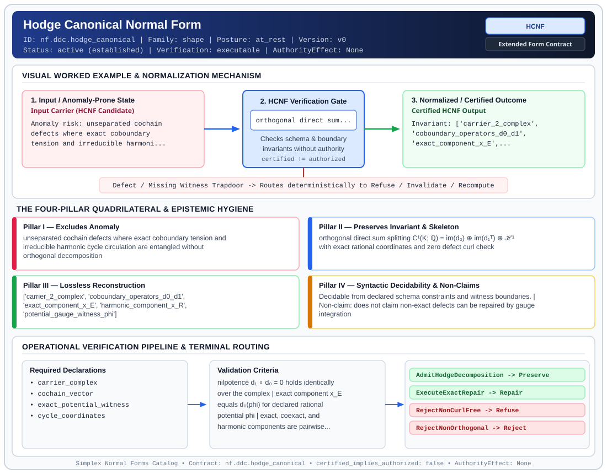

# Hodge Canonical Normal Form (`HCNF`)

> **Contract ID:** `nf.ddc.hodge_canonical` | **Family:** `shape` | **Index Status:** `active` | **AuthorityEffect:** `None`

**[⬅ Back to Wiki Home](Home)** | **[View SVG Diagram](images/nf.ddc.hodge_canonical.svg)**

---

## 1. Executive Summary & Metadata

Hodge Canonical Normal Form (HCNF) enforces structural normalization and explicit defect routing in the shape regime.

| Property | Value |
| :--- | :--- |
| **Canonical ID** | `nf.ddc.hodge_canonical` |
| **Short Name** | `HCNF` |
| **Full Name** | Hodge Canonical Normal Form |
| **Family** | `shape` (Relational, Algebraic & Cochain Shape Normal Forms (Data at Rest & Structural Decompositions)) |
| **Qualification** | Extended Form Contract (Normal Form Contract) |
| **Data / Math Posture** | at_rest |
| **Index Status** | `active` |
| **Theory Status** | `established` |
| **Verification Status** | `executable` |
| **Contract Version** | `v0` |
| **Governance Fence** | `AuthorityEffect: None` (`certified_implies_authorized: false`) |

### Foundational Treatise Specification

- **Family**: shape
- **Runes**: ['E', 'R']
- **Target Runtime Law**: Law 7 (Orthogonal Repair)
- **Domain**: Discrete 1-cochains c in C^1(K, Q) over cell complexes.
- **Anomaly Excluded**: Conflating exact gradient adjustments with non-trivial harmonic loops or boundary curls.
- **Preserved Invariant**: Orthogonal direct sum decomposition C^1 = im d_0 \oplus im d_1^* \oplus H^1.
- **Reconstruction Theorem**: c = d_0 p + h + d_1^* q without rational error.

---

## 2. Visual Architecture & Normalization Diagram



---

## 3. Concrete Worked Example & Mechanism

### Visual Transition Summary

| Stage | Carrier / Operator | Concrete State / Invariant |
| :--- | :--- | :--- |
| **1. Before / Candidate Input** | `Input Carrier (HCNF Candidate)` | Anomaly risk: unseparated cochain ; defects where exact coboundary ; tension and irreducible harmoni... |
| **2. Normalization / Gate** | `HCNF Verification Gate` | `orthogonal direct sum...` (`certified_implies_authorized: false`) |
| **3. After / Certified Output** | `Certified HCNF Output` | Invariant: ['carrier_2_complex', ; 'coboundary_operators_d0_d1', ; 'exact_component_x_E',... |

### Contract-Declared Worked Cases

```yaml
- ref: omega_engine_education/documentation/14_discrete_deformation_calculus_ddc/00_discrete_deformation_calculus_foundations.md
  section: '2.2'
```

---

## 4. The Four-Pillar Quadrilateral & Non-Claims

Every contract in `simplex-normal-forms` is evaluated against the **Four-Pillar Quadrilateral** defined in `contracts/_golden_nfs/standard.yaml`:

| Pillar | Requirement | Contract Specification for `nf.ddc.hodge_canonical` |
| :--- | :--- | :--- |
| **Pillar I: Excludes Anomaly** | Name and eliminate a specific class of data or state defects. | unseparated cochain defects where exact coboundary tension and irreducible harmonic cycle circulation are entangled without orthogonal decomposition |
| **Pillar II: Preserves Invariant** | State the structural invariant and protected skeleton preserved across transitions. | **Invariant:** orthogonal direct sum splitting C¹(K; ℚ) = im(d₀) ⊕ im(d₁ᵀ) ⊕ ℋ¹ with exact rational coordinates and zero defect curl check<br>**Protected Skeleton:** ['carrier_2_complex', 'coboundary_operators_d0_d1', 'exact_component_x_E', 'harmonic_component_x_R', 'potential_gauge_witness_phi'] |
| **Pillar III: Lossless Reconstruction** | State the non-loss reconstruction operator (join, direct sum, pullback, or replay). | Lossless reconstruction under declared projection, direct sum, or pullback operators. |
| **Pillar IV: Syntactic Decidability** | State how conformance is decided from declared constraints without unbudgeted scans. | Decidable from declared schema and witness metadata within bounded evaluation budgets. |

### Explicit Non-Claims (`certified_implies_authorized: false`)

- does not claim non-exact defects can be repaired by gauge integration
- does not claim exact potential is unique without designating a gauge root per connected component
- does not imply operational authority; authority_effect is unconditionally None

---

## 5. Operational Verification & Terminal Routing

### 5.1 Required Declarations

- carrier_complex
- cochain_vector
- exact_potential_witness
- cycle_coordinates

### 5.2 Required Evidence

_None declared._

### 5.3 Validation Criteria

| Criterion ID | Name | Condition |
| :--- | :--- | :--- |
| `criterion` | Check | nilpotence d₁ ∘ d₀ = 0 holds identically over the complex |
| `criterion` | Check | exact component x_E equals d₀(phi) for declared rational potential phi |
| `criterion` | Check | exact, coexact, and harmonic components are pairwise orthogonal |

### 5.4 Terminal Route Map

Every evaluation terminates in a declared local route mapped to a canonical terminal in `standard.yaml`:

| Local Terminal Route | Canonical Terminal |
| :--- | :--- |
| `AdmitHodgeDecomposition` | `Preserve` |
| `ExecuteExactRepair` | `Repair` |
| `RejectNonCurlFree` | `Refuse` |
| `RejectNonOrthogonal` | `Reject` |

### 5.5 Declared Failure Modes

- **symptom**: d₁ x != 0 during attempted exact repair, **diagnosis**: cochain is not curl-free; exact repair inadmissible in this model, violates Law 7, **terminal**: RejectNonCurlFree
- **symptom**: sum of components does not equal input cochain x, **diagnosis**: projection error or non-orthogonal basis, **terminal**: RejectNonOrthogonal

---

## 6. Epistemic Claim Hygiene Quadrant

In accordance with the repository's epistemic claim discipline:

1. **What it supports:**
   - Supports syntactic and operational checking of `nf.ddc.hodge_canonical` (`HCNF`) against its declared schema, boundary constraints, and witness obligations in this model.
   - Supports deterministic terminal routing (`AdmitHodgeDecomposition, ExecuteExactRepair, RejectNonCurlFree, RejectNonOrthogonal`) when required declarations or invariants fail.
2. **What it does not support:**
   - Does not confer operational authority (`AuthorityEffect: None`, `certified_implies_authorized: false`).
   - Does not claim semantic truth of undeclared external processes or unverified upstream inputs beyond the declaredprotected skeleton.
3. **The narrowest defensible claim:**
   - Within the declared substrate `at_rest`, this contract enforces that `unseparated cochain defects where exact coboundary tension and irreducible harmonic cycle circulation are entangled without orthogonal decomposition` is either excluded under `orthogonal direct sum splitting C¹(K; ℚ) = im(d₀) ⊕ im(d₁ᵀ) ⊕ ℋ¹ with exact rational coordinates and zero defect curl check` or routed to an explicit refusal/recovery terminal.
4. **The next test needed:**
   - Property-based falsification and mutation testing across boundary edge cases and composed multi-step pipelines for `nf.ddc.hodge_canonical`.

---

## 7. Canonical YAML Contract (`contracts/nf.ddc.hodge_canonical.yaml`)

<details>
<summary><strong>Click to expand full canonical YAML contract (contracts/nf.ddc.hodge_canonical.yaml)</strong></summary>

```yaml
schema_version: smplx.nf.contract.v0
schema_ref: ./normal_form_contract_schema.yaml
contract_kind: normal_form_contract
identity:
  id: nf.ddc.hodge_canonical
  name: Hodge Canonical Normal Form
  short_name: HCNF
  version: v0
  theory_status: established
  contract_status: active
  status: active
  verification_status: executable
  family: shape
classification:
  hierarchy_level: normal_form
  subject_kind:
    - 1_cochain_defect
    - discrete_hodge_decomposition
    - coboundary_potential
  data_posture: at_rest
  mathematical_posture: operational
purpose:
  excludes_anomaly: unseparated cochain defects where exact coboundary tension and irreducible harmonic cycle circulation are entangled without orthogonal decomposition
  preserves_invariant: orthogonal direct sum splitting C¹(K; ℚ) = im(d₀) ⊕ im(d₁ᵀ) ⊕ ℋ¹ with exact rational coordinates and zero defect curl check
  protected_skeleton:
    - carrier_2_complex
    - coboundary_operators_d0_d1
    - exact_component_x_E
    - harmonic_component_x_R
    - potential_gauge_witness_phi
  erased_structure:
    - gauge_choice_offset
    - intermediate_tree_search_order
  non_claims:
    - does not claim non-exact defects can be repaired by gauge integration
    - does not claim exact potential is unique without designating a gauge root per connected component
    - does not imply operational authority; authority_effect is unconditionally None
definition:
  source: omega_engine_education/documentation/14_discrete_deformation_calculus_ddc/normal_forms/README.md
  section: '2.0'
  formal_statement: >
    On a finite 2-complex with rational coboundaries d₀ and d₁, Hodge Canonical Normal Form (HCNF)
    decomposes any 1-cochain defect x into unique orthogonal components x = x_E + x_C + x_R.
    Exact repair rune E is lawful if and only if curl d₁ x == 0 and x_E lies strictly in im(d₀).
    Harmonic residuals x_R cannot be eliminated by local node potentials.
  quadrilateral:
    qualifies_as_true_normal_form: false
    qualification_gap: direct_sum_decomposition_not_relational_project_join
    anomaly_exclusion: non-curl-free cochains submitted to exact repair, or harmonic residuals treated as exact coboundaries
    lossless_join:
      status: direct_sum_reconstruction
      statement: x = x_E + x_C + x_R is uniquely and losslessly reconstructed from orthogonal Hodge projectors over ℚ
    dependency_preservation:
      status: coboundary_chain_preserved
      statement: boundary condition d₁ ∘ d₀ = 0 is verified locally on 2-cells and edges without global joins
    syntactic_decision:
      status: exact_rational_decidable
      statement: membership in im(d₀) is decidable by BFS potential integration and checking d₁x == 0
declarations_required:
  - carrier_complex
  - cochain_vector
  - exact_potential_witness
  - cycle_coordinates
evidence_required: []
validation_criteria:
  - nilpotence d₁ ∘ d₀ = 0 holds identically over the complex
  - exact component x_E equals d₀(phi) for declared rational potential phi
  - exact, coexact, and harmonic components are pairwise orthogonal
terminal_routes:
  - AdmitHodgeDecomposition
  - ExecuteExactRepair
  - RejectNonCurlFree
  - RejectNonOrthogonal
terminal_route_map:
  AdmitHodgeDecomposition: Preserve
  ExecuteExactRepair: Repair
  RejectNonCurlFree: Refuse
  RejectNonOrthogonal: Reject
certification:
  certificate_required: false
  certificate_kind: null
  obstruction_class_required: true
  loss_ledger_required: false
  verifier_required: true
  loss_ledger_trigger_id: null
authorization:
  authorized_by: null
  certified_implies_authorized: false
failure_modes:
  - symptom: d₁ x != 0 during attempted exact repair
    diagnosis: cochain is not curl-free; exact repair inadmissible in this model, violates Law 7
    terminal: RejectNonCurlFree
  - symptom: sum of components does not equal input cochain x
    diagnosis: projection error or non-orthogonal basis
    terminal: RejectNonOrthogonal
examples:
  - ref: omega_engine_education/documentation/14_discrete_deformation_calculus_ddc/00_discrete_deformation_calculus_foundations.md
    section: '2.2'
references:
  - omega_engine_governance/contracts/contracts_omega_engine_crates/mathematics/discrete_deformation_algebra/exact_repair_operator.contract.yaml
  - omega_engine_governance/contracts/contracts_omega_engine_crates/mathematics/discrete_deformation_algebra/quotient_space.contract.yaml
```

</details>
