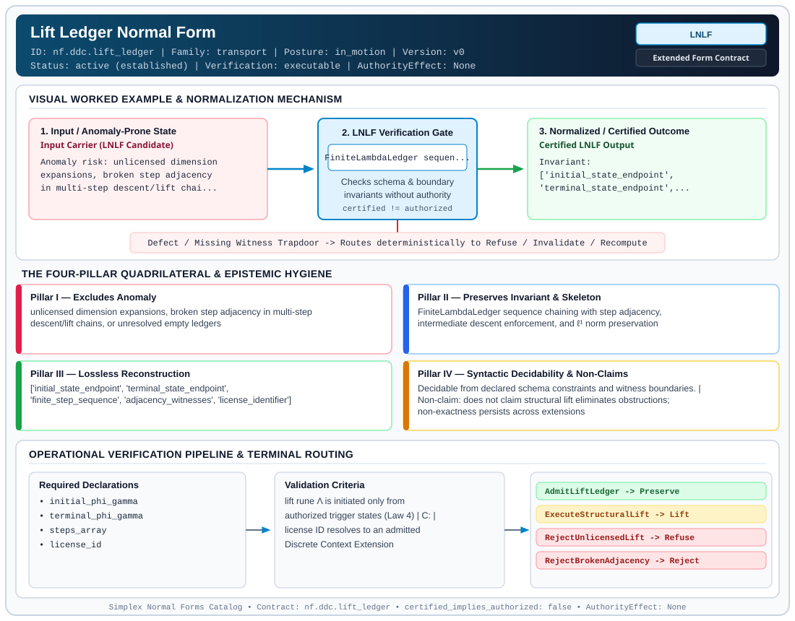

# Lift Ledger Normal Form (`LNLF`)

> **Contract ID:** `nf.ddc.lift_ledger` | **Family:** `transport` | **Index Status:** `active` | **AuthorityEffect:** `None`

**[⬅ Back to Wiki Home](Home)** | **[View SVG Diagram](images/nf.ddc.lift_ledger.svg)**

---

## 1. Executive Summary & Metadata

Lift Ledger Normal Form (LNLF) enforces structural normalization and explicit defect routing in the transport regime.

| Property | Value |
| :--- | :--- |
| **Canonical ID** | `nf.ddc.lift_ledger` |
| **Short Name** | `LNLF` |
| **Full Name** | Lift Ledger Normal Form |
| **Family** | `transport` (Scale Ascent/Descent & Representation Transport Ledgers (`LNLF`, `LLNF`, `GNF`)) |
| **Qualification** | Extended Form Contract (Normal Form Contract) |
| **Data / Math Posture** | in_motion |
| **Index Status** | `active` |
| **Theory Status** | `established` |
| **Verification Status** | `executable` |
| **Contract Version** | `v0` |
| **Governance Fence** | `AuthorityEffect: None` (`certified_implies_authorized: false`) |

### Foundational Treatise Specification

- **Family**: transport
- **Runes**: ['LAMBDA', 'D']
- **Target Runtime Law**: Law 4 (Step Adjacency & Lift Coherence)
- **Domain**: Coarse-to-fine scale ascent transformations LAMBDA: H_{k-1} -> H_k.
- **Anomaly Excluded**: Broken scale step adjacency (|k - k'| > 1) and unlicensed energy inflation.
- **Preserved Invariant**: Step adjacency verification (k' = k + 1) and exact rational norm tracking.
- **Reconstruction Theorem**: Projection \pi \circ LAMBDA recovers coarse state identically on supported subspace.

---

## 2. Visual Architecture & Normalization Diagram



---

## 3. Concrete Worked Example & Mechanism

### Visual Transition Summary

| Stage | Carrier / Operator | Concrete State / Invariant |
| :--- | :--- | :--- |
| **1. Before / Candidate Input** | `Input Carrier (LNLF Candidate)` | Anomaly risk: unlicensed dimension ; expansions, broken step adjacency ; in multi-step descent/lift chai... |
| **2. Normalization / Gate** | `LNLF Verification Gate` | `FiniteLambdaLedger sequen...` (`certified_implies_authorized: false`) |
| **3. After / Certified Output** | `Certified LNLF Output` | Invariant: ; ['initial_state_endpoint', ; 'terminal_state_endpoint',... |

### Contract-Declared Worked Cases

```yaml
- ref: omega_engine_education/documentation/14_discrete_deformation_calculus_ddc/00_discrete_deformation_calculus_foundations.md
  section: '2.5'
```

---

## 4. The Four-Pillar Quadrilateral & Non-Claims

Every contract in `simplex-normal-forms` is evaluated against the **Four-Pillar Quadrilateral** defined in `contracts/_golden_nfs/standard.yaml`:

| Pillar | Requirement | Contract Specification for `nf.ddc.lift_ledger` |
| :--- | :--- | :--- |
| **Pillar I: Excludes Anomaly** | Name and eliminate a specific class of data or state defects. | unlicensed dimension expansions, broken step adjacency in multi-step descent/lift chains, or unresolved empty ledgers |
| **Pillar II: Preserves Invariant** | State the structural invariant and protected skeleton preserved across transitions. | **Invariant:** FiniteLambdaLedger sequence chaining with step adjacency, intermediate descent enforcement, and ℓ¹ norm preservation<br>**Protected Skeleton:** ['initial_state_endpoint', 'terminal_state_endpoint', 'finite_step_sequence', 'adjacency_witnesses', 'license_identifier'] |
| **Pillar III: Lossless Reconstruction** | State the non-loss reconstruction operator (join, direct sum, pullback, or replay). | Lossless reconstruction under declared projection, direct sum, or pullback operators. |
| **Pillar IV: Syntactic Decidability** | State how conformance is decided from declared constraints without unbudgeted scans. | Decidable from declared schema and witness metadata within bounded evaluation budgets. |

### Explicit Non-Claims (`certified_implies_authorized: false`)

- does not claim structural lift eliminates obstructions; non-exactness persists across extensions
- does not permit lift without an explicit discrete license LCE
- does not confer operational authority; authority_effect is unconditionally None

---

## 5. Operational Verification & Terminal Routing

### 5.1 Required Declarations

- initial_phi_gamma
- terminal_phi_gamma
- steps_array
- license_id

### 5.2 Required Evidence

_None declared._

### 5.3 Validation Criteria

| Criterion ID | Name | Condition |
| :--- | :--- | :--- |
| `criterion` | Check | lift rune Λ is initiated only from authorized trigger states (Law 4) |
| `` | **** |  |
| `criterion` | Check | license ID resolves to an admitted Discrete Context Extension |

### 5.4 Terminal Route Map

Every evaluation terminates in a declared local route mapped to a canonical terminal in `standard.yaml`:

| Local Terminal Route | Canonical Terminal |
| :--- | :--- |
| `AdmitLiftLedger` | `Preserve` |
| `ExecuteStructuralLift` | `Lift` |
| `RejectUnlicensedLift` | `Refuse` |
| `RejectBrokenAdjacency` | `Reject` |

### 5.5 Declared Failure Modes

- **symptom**: step[i].after does not match step[i+1].before, **diagnosis**: broken step adjacency; unchained deformation sequence, **terminal**: RejectBrokenAdjacency
- **symptom**: lift proposed without ClosedResidual or DetectorInadequate, **diagnosis**: lift attempted from uncertified pre-state; violates Law 4, **terminal**: RejectUnlicensedLift

---

## 6. Epistemic Claim Hygiene Quadrant

In accordance with the repository's epistemic claim discipline:

1. **What it supports:**
   - Supports syntactic and operational checking of `nf.ddc.lift_ledger` (`LNLF`) against its declared schema, boundary constraints, and witness obligations in this model.
   - Supports deterministic terminal routing (`AdmitLiftLedger, ExecuteStructuralLift, RejectUnlicensedLift, RejectBrokenAdjacency`) when required declarations or invariants fail.
2. **What it does not support:**
   - Does not confer operational authority (`AuthorityEffect: None`, `certified_implies_authorized: false`).
   - Does not claim semantic truth of undeclared external processes or unverified upstream inputs beyond the declaredprotected skeleton.
3. **The narrowest defensible claim:**
   - Within the declared substrate `in_motion`, this contract enforces that `unlicensed dimension expansions, broken step adjacency in multi-step descent/lift chains, or unresolved empty ledgers` is either excluded under `FiniteLambdaLedger sequence chaining with step adjacency, intermediate descent enforcement, and ℓ¹ norm preservation` or routed to an explicit refusal/recovery terminal.
4. **The next test needed:**
   - Property-based falsification and mutation testing across boundary edge cases and composed multi-step pipelines for `nf.ddc.lift_ledger`.

---

## 7. Canonical YAML Contract (`contracts/nf.ddc.lift_ledger.yaml`)

<details>
<summary><strong>Click to expand full canonical YAML contract (contracts/nf.ddc.lift_ledger.yaml)</strong></summary>

```yaml
schema_version: smplx.nf.contract.v0
schema_ref: ./normal_form_contract_schema.yaml
contract_kind: normal_form_contract
identity:
  id: nf.ddc.lift_ledger
  name: Lift Ledger Normal Form
  short_name: LNLF
  version: v0
  theory_status: established
  contract_status: active
  status: active
  verification_status: executable
  family: transport
classification:
  hierarchy_level: normal_form
  subject_kind:
    - structural_lift
    - dimension_extension
    - finite_lambda_ledger
  data_posture: in_motion
  mathematical_posture: operational
purpose:
  excludes_anomaly: unlicensed dimension expansions, broken step adjacency in multi-step descent/lift chains, or unresolved empty ledgers
  preserves_invariant: FiniteLambdaLedger sequence chaining with step adjacency, intermediate descent enforcement, and ℓ¹ norm preservation
  protected_skeleton:
    - initial_state_endpoint
    - terminal_state_endpoint
    - finite_step_sequence
    - adjacency_witnesses
    - license_identifier
  erased_structure:
    - unreferenced_external_gauge_coordinates
  non_claims:
    - does not claim structural lift eliminates obstructions; non-exactness persists across extensions
    - does not permit lift without an explicit discrete license LCE
    - does not confer operational authority; authority_effect is unconditionally None
definition:
  source: omega_engine_education/documentation/14_discrete_deformation_calculus_ddc/normal_forms/README.md
  section: '2.0'
  formal_statement: >
    On a discrete deformation trajectory involving dimension expansions, Lift Ledger Normal Form (LNLF)
    organizes multi-step moves into an explicit FiniteLambdaLedger. Structural lift rune Λ is triggered
    strictly from ClosedResidual (Φ₁ > 0, Γ₂ = 0) or DetectorInadequate states under Licensed Context
    Extension (LCE), enforcing adjacent step continuity step[i].after == step[i+1].before.
  quadrilateral:
    qualifies_as_true_normal_form: false
    qualification_gap: step_adjacency_chaining_not_relational_project_join
    anomaly_exclusion: jumping coordinates without step continuity, unchained descent rows, or lifting without valid discrete license
    lossless_join:
      status: chained_sequence_reconstruction
      statement: the sequence of intermediate states is reconstructed losslessly from step[0].before to step[-1].after
    dependency_preservation:
      status: pairwise_adjacency_preserved
      statement: step[i].after == step[i+1].before is checked locally on adjacent step pairs
    syntactic_decision:
      status: finite_ledger_decidable
      statement: membership is decidable by FiniteLambdaLedger.require_chained()
declarations_required:
  - initial_phi_gamma
  - terminal_phi_gamma
  - steps_array
  - license_id
evidence_required: []
validation_criteria:
  - lift rune Λ is initiated only from authorized trigger states (Law 4)
  - consecutive step endpoints match exactly: step[i].after == step[i+1].before
  - license ID resolves to an admitted Discrete Context Extension
terminal_routes:
  - AdmitLiftLedger
  - ExecuteStructuralLift
  - RejectUnlicensedLift
  - RejectBrokenAdjacency
terminal_route_map:
  AdmitLiftLedger: Preserve
  ExecuteStructuralLift: Lift
  RejectUnlicensedLift: Refuse
  RejectBrokenAdjacency: Reject
certification:
  certificate_required: true
  certificate_kind: lambda_ledger_receipt
  obstruction_class_required: true
  loss_ledger_required: true
  verifier_required: true
  loss_ledger_trigger_id: descent_with_loss
authorization:
  authorized_by: null
  certified_implies_authorized: false
failure_modes:
  - symptom: step[i].after does not match step[i+1].before
    diagnosis: broken step adjacency; unchained deformation sequence
    terminal: RejectBrokenAdjacency
  - symptom: lift proposed without ClosedResidual or DetectorInadequate
    diagnosis: lift attempted from uncertified pre-state; violates Law 4
    terminal: RejectUnlicensedLift
examples:
  - ref: omega_engine_education/documentation/14_discrete_deformation_calculus_ddc/00_discrete_deformation_calculus_foundations.md
    section: '2.5'
references:
  - omega_engine_governance/contracts/contracts_omega_engine_crates/mathematics/discrete_deformation_algebra/quotient_transport.contract.yaml
```

</details>
