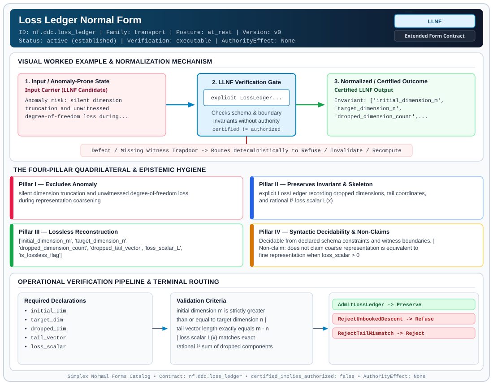

# Loss Ledger Normal Form (`LLNF`)

> **Contract ID:** `nf.ddc.loss_ledger` | **Family:** `transport` | **Index Status:** `active` | **AuthorityEffect:** `None`

**[⬅ Back to Wiki Home](Home)** | **[View SVG Diagram](images/nf.ddc.loss_ledger.svg)**

---

## 1. Executive Summary & Metadata

Loss Ledger Normal Form (LLNF) enforces structural normalization and explicit defect routing in the transport regime.

| Property | Value |
| :--- | :--- |
| **Canonical ID** | `nf.ddc.loss_ledger` |
| **Short Name** | `LLNF` |
| **Full Name** | Loss Ledger Normal Form |
| **Family** | `transport` (Scale Ascent/Descent & Representation Transport Ledgers (`LNLF`, `LLNF`, `GNF`)) |
| **Qualification** | Extended Form Contract (Normal Form Contract) |
| **Data / Math Posture** | at_rest |
| **Index Status** | `active` |
| **Theory Status** | `established` |
| **Verification Status** | `executable` |
| **Contract Version** | `v0` |
| **Governance Fence** | `AuthorityEffect: None` (`certified_implies_authorized: false`) |

### Foundational Treatise Specification

- **Family**: transport
- **Runes**: ['D']
- **Target Runtime Law**: Law 6 (Finite Loss Ledger)
- **Domain**: Scale descent transformations D: H_k -> H_{k-1}.
- **Anomaly Excluded**: Silent dimension truncation and unaccounted projection energy loss.
- **Preserved Invariant**: Booked LossLedger record with dropped coordinates, exact rational l^1 loss, and tail bound.
- **Reconstruction Theorem**: Original state bounded within declared l^1 ball centered at projected state.

---

## 2. Visual Architecture & Normalization Diagram



---

## 3. Concrete Worked Example & Mechanism

### Visual Transition Summary

| Stage | Carrier / Operator | Concrete State / Invariant |
| :--- | :--- | :--- |
| **1. Before / Candidate Input** | `Input Carrier (LLNF Candidate)` | Anomaly risk: silent dimension ; truncation and unwitnessed ; degree-of-freedom loss during... |
| **2. Normalization / Gate** | `LLNF Verification Gate` | `explicit LossLedger...` (`certified_implies_authorized: false`) |
| **3. After / Certified Output** | `Certified LLNF Output` | Invariant: ['initial_dimension_m', ; 'target_dimension_n', ; 'dropped_dimension_count',... |

### Contract-Declared Worked Cases

```yaml
- ref: omega_engine_education/documentation/14_discrete_deformation_calculus_ddc/00_discrete_deformation_calculus_foundations.md
  section: '2.6'
```

---

## 4. The Four-Pillar Quadrilateral & Non-Claims

Every contract in `simplex-normal-forms` is evaluated against the **Four-Pillar Quadrilateral** defined in `contracts/_golden_nfs/standard.yaml`:

| Pillar | Requirement | Contract Specification for `nf.ddc.loss_ledger` |
| :--- | :--- | :--- |
| **Pillar I: Excludes Anomaly** | Name and eliminate a specific class of data or state defects. | silent dimension truncation and unwitnessed degree-of-freedom loss during representation coarsening |
| **Pillar II: Preserves Invariant** | State the structural invariant and protected skeleton preserved across transitions. | **Invariant:** explicit LossLedger recording dropped dimensions, tail coordinates, and rational ℓ¹ loss scalar L(x)<br>**Protected Skeleton:** ['initial_dimension_m', 'target_dimension_n', 'dropped_dimension_count', 'dropped_tail_vector', 'loss_scalar_L', 'is_lossless_flag'] |
| **Pillar III: Lossless Reconstruction** | State the non-loss reconstruction operator (join, direct sum, pullback, or replay). | Lossless reconstruction under declared projection, direct sum, or pullback operators. |
| **Pillar IV: Syntactic Decidability** | State how conformance is decided from declared constraints without unbudgeted scans. | Decidable from declared schema and witness metadata within bounded evaluation budgets. |

### Explicit Non-Claims (`certified_implies_authorized: false`)

- does not claim coarse representation is equivalent to fine representation when loss_scalar > 0
- does not claim descent is reversible without external auxiliary data
- does not confer operational authority; authority_effect is unconditionally None

---

## 5. Operational Verification & Terminal Routing

### 5.1 Required Declarations

- initial_dim
- target_dim
- dropped_dim
- tail_vector
- loss_scalar
- is_lossless

### 5.2 Required Evidence

_None declared._

### 5.3 Validation Criteria

| Criterion ID | Name | Condition |
| :--- | :--- | :--- |
| `criterion` | Check | initial dimension m is strictly greater than or equal to target dimension n |
| `criterion` | Check | tail vector length exactly equals m - n |
| `criterion` | Check | loss scalar L(x) matches exact rational ℓ¹ sum of dropped components |

### 5.4 Terminal Route Map

Every evaluation terminates in a declared local route mapped to a canonical terminal in `standard.yaml`:

| Local Terminal Route | Canonical Terminal |
| :--- | :--- |
| `AdmitLossLedger` | `Preserve` |
| `RejectUnbookedDescent` | `Refuse` |
| `RejectTailMismatch` | `Reject` |

### 5.5 Declared Failure Modes

- **symptom**: dimension reduced without emitting LossLedger record, **diagnosis**: descent without ledger attempted; violates Law 6, **terminal**: RejectUnbookedDescent
- **symptom**: length of tail vector does not match m - n, **diagnosis**: dropped coordinate count mismatch, **terminal**: RejectTailMismatch

---

## 6. Epistemic Claim Hygiene Quadrant

In accordance with the repository's epistemic claim discipline:

1. **What it supports:**
   - Supports syntactic and operational checking of `nf.ddc.loss_ledger` (`LLNF`) against its declared schema, boundary constraints, and witness obligations in this model.
   - Supports deterministic terminal routing (`AdmitLossLedger, RejectUnbookedDescent, RejectTailMismatch`) when required declarations or invariants fail.
2. **What it does not support:**
   - Does not confer operational authority (`AuthorityEffect: None`, `certified_implies_authorized: false`).
   - Does not claim semantic truth of undeclared external processes or unverified upstream inputs beyond the declaredprotected skeleton.
3. **The narrowest defensible claim:**
   - Within the declared substrate `at_rest`, this contract enforces that `silent dimension truncation and unwitnessed degree-of-freedom loss during representation coarsening` is either excluded under `explicit LossLedger recording dropped dimensions, tail coordinates, and rational ℓ¹ loss scalar L(x)` or routed to an explicit refusal/recovery terminal.
4. **The next test needed:**
   - Property-based falsification and mutation testing across boundary edge cases and composed multi-step pipelines for `nf.ddc.loss_ledger`.

---

## 7. Canonical YAML Contract (`contracts/nf.ddc.loss_ledger.yaml`)

<details>
<summary><strong>Click to expand full canonical YAML contract (contracts/nf.ddc.loss_ledger.yaml)</strong></summary>

```yaml
schema_version: smplx.nf.contract.v0
schema_ref: ./normal_form_contract_schema.yaml
contract_kind: normal_form_contract
identity:
  id: nf.ddc.loss_ledger
  name: Loss Ledger Normal Form
  short_name: LLNF
  version: v0
  theory_status: established
  contract_status: active
  status: active
  verification_status: executable
  family: transport
classification:
  hierarchy_level: normal_form
  subject_kind:
    - scale_descent
    - dimension_projection
    - loss_ledger
  data_posture: at_rest
  mathematical_posture: operational
purpose:
  excludes_anomaly: silent dimension truncation and unwitnessed degree-of-freedom loss during representation coarsening
  preserves_invariant: explicit LossLedger recording dropped dimensions, tail coordinates, and rational ℓ¹ loss scalar L(x)
  protected_skeleton:
    - initial_dimension_m
    - target_dimension_n
    - dropped_dimension_count
    - dropped_tail_vector
    - loss_scalar_L
    - is_lossless_flag
  erased_structure:
    - intermediate_subspace_rotation_basis
  non_claims:
    - does not claim coarse representation is equivalent to fine representation when loss_scalar > 0
    - does not claim descent is reversible without external auxiliary data
    - does not confer operational authority; authority_effect is unconditionally None
definition:
  source: omega_engine_education/documentation/14_discrete_deformation_calculus_ddc/normal_forms/README.md
  section: '2.0'
  formal_statement: >
    On a representation projection from dimension m to dimension n (with m > n), Loss Ledger Normal Form (LLNF)
    enforces that all dropped coordinates are booked into an explicit LossLedger L_adapter. Scale descent
    rune D is lawful if and only if the ledger records the exact tail vector x_tail and rational ℓ¹ norm
    loss scalar L(x) = ‖x_tail‖₁.
  quadrilateral:
    qualifies_as_true_normal_form: false
    qualification_gap: projection_with_residual_ledger_not_relational_project_join
    anomaly_exclusion: unwitnessed dimension reduction or unbooked topological phase loss
    lossless_join:
      status: direct_sum_reconstruction
      statement: original vector x ∈ ℚᵐ is losslessly reconstructed by concatenating projected vector x↓ ∈ ℚⁿ and dropped tail x_tail ∈ ℚ^{m-n}
    dependency_preservation:
      status: coordinate_projection_preserved
      statement: norm loss L(x) = ‖x_tail‖₁ is calculated strictly on the dropped coordinates
    syntactic_decision:
      status: rational_arithmetic_decidable
      statement: membership is decidable by asserting len(tail) == m - n and L(x) == sum(abs(v))
declarations_required:
  - initial_dim
  - target_dim
  - dropped_dim
  - tail_vector
  - loss_scalar
  - is_lossless
evidence_required: []
validation_criteria:
  - initial dimension m is strictly greater than or equal to target dimension n
  - tail vector length exactly equals m - n
  - loss scalar L(x) matches exact rational ℓ¹ sum of dropped components
terminal_routes:
  - AdmitLossLedger
  - RejectUnbookedDescent
  - RejectTailMismatch
terminal_route_map:
  AdmitLossLedger: Preserve
  RejectUnbookedDescent: Refuse
  RejectTailMismatch: Reject
certification:
  certificate_required: true
  certificate_kind: loss_ledger_receipt
  obstruction_class_required: false
  loss_ledger_required: true
  verifier_required: true
  loss_ledger_trigger_id: scale_descent_with_loss
authorization:
  authorized_by: null
  certified_implies_authorized: false
failure_modes:
  - symptom: dimension reduced without emitting LossLedger record
    diagnosis: descent without ledger attempted; violates Law 6
    terminal: RejectUnbookedDescent
  - symptom: length of tail vector does not match m - n
    diagnosis: dropped coordinate count mismatch
    terminal: RejectTailMismatch
examples:
  - ref: omega_engine_education/documentation/14_discrete_deformation_calculus_ddc/00_discrete_deformation_calculus_foundations.md
    section: '2.6'
references:
  - omega_engine_governance/contracts/contracts_omega_engine_crates/mathematics/discrete_deformation_algebra/transport_loss_ledger.contract.yaml
```

</details>
