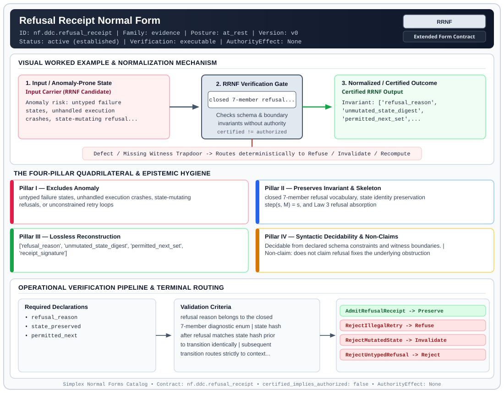

# Refusal Receipt Normal Form (`RRNF`)

> **Contract ID:** `nf.ddc.refusal_receipt` | **Family:** `evidence` | **Index Status:** `active` | **AuthorityEffect:** `None`

**[⬅ Back to Wiki Home](Home)** | **[View SVG Diagram](images/nf.ddc.refusal_receipt.svg)**

---

## 1. Executive Summary & Metadata

Refusal Receipt Normal Form (RRNF) enforces structural normalization and explicit defect routing in the evidence regime.

| Property | Value |
| :--- | :--- |
| **Canonical ID** | `nf.ddc.refusal_receipt` |
| **Short Name** | `RRNF` |
| **Full Name** | Refusal Receipt Normal Form |
| **Family** | `evidence` (Cryptographic Receipts, Dual Witnesses, Loss Ledgers, CDC Logs & Schema Totality) |
| **Qualification** | Extended Form Contract (Normal Form Contract) |
| **Data / Math Posture** | at_rest |
| **Index Status** | `active` |
| **Theory Status** | `established` |
| **Verification Status** | `executable` |
| **Contract Version** | `v0` |
| **Governance Fence** | `AuthorityEffect: None` (`certified_implies_authorized: false`) |

### Foundational Treatise Specification

- **Family**: evidence
- **Runes**: ['M']
- **Target Runtime Law**: Law 3 (Refusal Absorption)
- **Domain**: Operational failure modes, precondition violations, and out-of-budget halts.
- **Anomaly Excluded**: Untyped exceptions, unhandled panics, and silent retries mutating state during failure.
- **Preserved Invariant**: Closed 7-code typed receipt with strict state identity (s' = s) and routing in {C, LAMBDA, T}.
- **Reconstruction Theorem**: Failed attempt factored out of trajectory; re-execution from s is deterministic.

---

## 2. Visual Architecture & Normalization Diagram



---

## 3. Concrete Worked Example & Mechanism

### Visual Transition Summary

| Stage | Carrier / Operator | Concrete State / Invariant |
| :--- | :--- | :--- |
| **1. Before / Candidate Input** | `Input Carrier (RRNF Candidate)` | Anomaly risk: untyped failure ; states, unhandled execution ; crashes, state-mutating refusal... |
| **2. Normalization / Gate** | `RRNF Verification Gate` | `closed 7-member refusal...` (`certified_implies_authorized: false`) |
| **3. After / Certified Output** | `Certified RRNF Output` | Invariant: ['refusal_reason', ; 'unmutated_state_digest', ; 'permitted_next_set',... |

### Contract-Declared Worked Cases

```yaml
- ref: omega_engine_education/documentation/14_discrete_deformation_calculus_ddc/00_discrete_deformation_calculus_foundations.md
  section: '2.7'
```

---

## 4. The Four-Pillar Quadrilateral & Non-Claims

Every contract in `simplex-normal-forms` is evaluated against the **Four-Pillar Quadrilateral** defined in `contracts/_golden_nfs/standard.yaml`:

| Pillar | Requirement | Contract Specification for `nf.ddc.refusal_receipt` |
| :--- | :--- | :--- |
| **Pillar I: Excludes Anomaly** | Name and eliminate a specific class of data or state defects. | untyped failure states, unhandled execution crashes, state-mutating refusals, or unconstrained retry loops |
| **Pillar II: Preserves Invariant** | State the structural invariant and protected skeleton preserved across transitions. | **Invariant:** closed 7-member refusal vocabulary, state identity preservation step(s, M) = s, and Law 3 refusal absorption<br>**Protected Skeleton:** ['refusal_reason', 'unmutated_state_digest', 'permitted_next_set', 'receipt_signature'] |
| **Pillar III: Lossless Reconstruction** | State the non-loss reconstruction operator (join, direct sum, pullback, or replay). | Lossless reconstruction under declared projection, direct sum, or pullback operators. |
| **Pillar IV: Syntactic Decidability** | State how conformance is decided from declared constraints without unbudgeted scans. | Decidable from declared schema and witness metadata within bounded evaluation budgets. |

### Explicit Non-Claims (`certified_implies_authorized: false`)

- does not claim refusal fixes the underlying obstruction
- does not permit retry of the identical failed operation without structural modification
- does not confer operational authority; authority_effect is unconditionally None

---

## 5. Operational Verification & Terminal Routing

### 5.1 Required Declarations

- refusal_reason
- state_preserved
- permitted_next

### 5.2 Required Evidence

_None declared._

### 5.3 Validation Criteria

| Criterion ID | Name | Condition |
| :--- | :--- | :--- |
| `criterion` | Check | refusal reason belongs to the closed 7-member diagnostic enum |
| `criterion` | Check | state hash after refusal matches state hash prior to transition identically |
| `criterion` | Check | subsequent transition routes strictly to context exposure C, structural lift Λ, or terminal sink T |

### 5.4 Terminal Route Map

Every evaluation terminates in a declared local route mapped to a canonical terminal in `standard.yaml`:

| Local Terminal Route | Canonical Terminal |
| :--- | :--- |
| `AdmitRefusalReceipt` | `Preserve` |
| `RejectIllegalRetry` | `Refuse` |
| `RejectMutatedState` | `Invalidate` |
| `RejectUntypedRefusal` | `Reject` |

### 5.5 Declared Failure Modes

- **symptom**: identical refused operation retried without state modification or context expansion, **diagnosis**: illegal retry loop; violates Law 3 refusal absorption, **terminal**: RejectIllegalRetry
- **symptom**: state digest differs across refusal transition, **diagnosis**: refusal mutated active state, **terminal**: RejectMutatedState

---

## 6. Epistemic Claim Hygiene Quadrant

In accordance with the repository's epistemic claim discipline:

1. **What it supports:**
   - Supports syntactic and operational checking of `nf.ddc.refusal_receipt` (`RRNF`) against its declared schema, boundary constraints, and witness obligations in this model.
   - Supports deterministic terminal routing (`AdmitRefusalReceipt, RejectIllegalRetry, RejectMutatedState, RejectUntypedRefusal`) when required declarations or invariants fail.
2. **What it does not support:**
   - Does not confer operational authority (`AuthorityEffect: None`, `certified_implies_authorized: false`).
   - Does not claim semantic truth of undeclared external processes or unverified upstream inputs beyond the declaredprotected skeleton.
3. **The narrowest defensible claim:**
   - Within the declared substrate `at_rest`, this contract enforces that `untyped failure states, unhandled execution crashes, state-mutating refusals, or unconstrained retry loops` is either excluded under `closed 7-member refusal vocabulary, state identity preservation step(s, M) = s, and Law 3 refusal absorption` or routed to an explicit refusal/recovery terminal.
4. **The next test needed:**
   - Property-based falsification and mutation testing across boundary edge cases and composed multi-step pipelines for `nf.ddc.refusal_receipt`.

---

## 7. Canonical YAML Contract (`contracts/nf.ddc.refusal_receipt.yaml`)

<details>
<summary><strong>Click to expand full canonical YAML contract (contracts/nf.ddc.refusal_receipt.yaml)</strong></summary>

```yaml
schema_version: smplx.nf.contract.v0
schema_ref: ./normal_form_contract_schema.yaml
contract_kind: normal_form_contract
identity:
  id: nf.ddc.refusal_receipt
  name: Refusal Receipt Normal Form
  short_name: RRNF
  version: v0
  theory_status: established
  contract_status: active
  status: active
  verification_status: executable
  family: evidence
classification:
  hierarchy_level: normal_form
  subject_kind:
    - operational_refusal
    - typed_receipt
    - state_preservation
  data_posture: at_rest
  mathematical_posture: operational
purpose:
  excludes_anomaly: untyped failure states, unhandled execution crashes, state-mutating refusals, or unconstrained retry loops
  preserves_invariant: closed 7-member refusal vocabulary, state identity preservation step(s, M) = s, and Law 3 refusal absorption
  protected_skeleton:
    - refusal_reason
    - unmutated_state_digest
    - permitted_next_set
    - receipt_signature
  erased_structure:
    - failed_execution_scratchpad
  non_claims:
    - does not claim refusal fixes the underlying obstruction
    - does not permit retry of the identical failed operation without structural modification
    - does not confer operational authority; authority_effect is unconditionally None
definition:
  source: omega_engine_education/documentation/14_discrete_deformation_calculus_ddc/normal_forms/README.md
  section: '2.0'
  formal_statement: >
    When a proposed transition violates pre-conditions or exceeds budget, Refusal Receipt Normal Form (RRNF)
    types the abort under operational rune M. The refusal emits an explicit typed receipt containing one of
    seven closed reasons, leaves the underlying state digest strictly identical (step(s, M) = s), and
    enforces refusal absorption: only {C, Λ, T} may follow a refusal without illegal retry (Law 3).
  quadrilateral:
    qualifies_as_true_normal_form: false
    qualification_gap: failure_algebra_typing_not_relational_project_join
    anomaly_exclusion: untyped exceptions, state corruption during refusal, or self-loop retries without context expansion
    lossless_join:
      status: state_identity_preservation
      statement: the state before refusal is identical to the state after refusal; step is mathematically an identity on state
    dependency_preservation:
      status: invariant_firewall_preserved
      statement: refusal reason is verified locally against the violated pre-condition fence
    syntactic_decision:
      status: closed_vocabulary_decidable
      statement: membership is decidable by membership in the closed 7-element enum and checking permitted_next == {C, Lambda, T}
declarations_required:
  - refusal_reason
  - state_preserved
  - permitted_next
evidence_required: []
validation_criteria:
  - refusal reason belongs to the closed 7-member diagnostic enum
  - state hash after refusal matches state hash prior to transition identically
  - subsequent transition routes strictly to context exposure C, structural lift Λ, or terminal sink T
terminal_routes:
  - AdmitRefusalReceipt
  - RejectIllegalRetry
  - RejectMutatedState
  - RejectUntypedRefusal
terminal_route_map:
  AdmitRefusalReceipt: Preserve
  RejectIllegalRetry: Refuse
  RejectMutatedState: Invalidate
  RejectUntypedRefusal: Reject
certification:
  certificate_required: true
  certificate_kind: refusal_step_receipt
  obstruction_class_required: false
  loss_ledger_required: false
  verifier_required: true
  loss_ledger_trigger_id: null
authorization:
  authorized_by: null
  certified_implies_authorized: false
failure_modes:
  - symptom: identical refused operation retried without state modification or context expansion
    diagnosis: illegal retry loop; violates Law 3 refusal absorption
    terminal: RejectIllegalRetry
  - symptom: state digest differs across refusal transition
    diagnosis: refusal mutated active state
    terminal: RejectMutatedState
examples:
  - ref: omega_engine_education/documentation/14_discrete_deformation_calculus_ddc/00_discrete_deformation_calculus_foundations.md
    section: '2.7'
references:
  - omega_engine_governance/contracts/contracts_omega_engine_crates/mathematics/discrete_deformation_algebra/mutation_operator.contract.yaml
```

</details>
