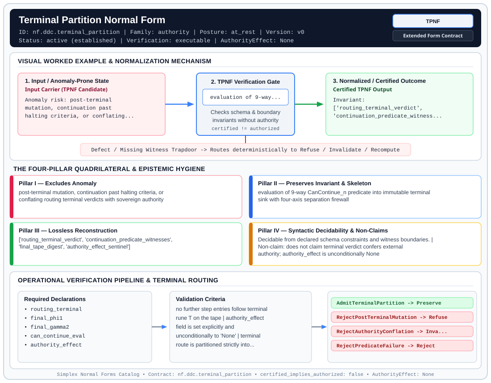

# Terminal Partition Normal Form (`TPNF`)

> **Contract ID:** `nf.ddc.terminal_partition` | **Family:** `authority` | **Index Status:** `active` | **AuthorityEffect:** `None`

**[⬅ Back to Wiki Home](Home)** | **[View SVG Diagram](images/nf.ddc.terminal_partition.svg)**

---

## 1. Executive Summary & Metadata

Terminal Partition Normal Form (TPNF) enforces structural normalization and explicit defect routing in the authority regime.

| Property | Value |
| :--- | :--- |
| **Canonical ID** | `nf.ddc.terminal_partition` |
| **Short Name** | `TPNF` |
| **Full Name** | Terminal Partition Normal Form |
| **Family** | `authority` (Terminal Partition & Authority Boundary Contracts (`TPNF`)) |
| **Qualification** | Extended Form Contract (Normal Form Contract) |
| **Data / Math Posture** | at_rest |
| **Index Status** | `active` |
| **Theory Status** | `established` |
| **Verification Status** | `executable` |
| **Contract Version** | `v0` |
| **Governance Fence** | `AuthorityEffect: None` (`certified_implies_authorized: false`) |

### Foundational Treatise Specification

- **Family**: authority
- **Runes**: ['T']
- **Target Runtime Law**: Law 2 (Terminal Sink)
- **Domain**: Terminal halting states under authority contracts.
- **Anomaly Excluded**: Post-terminal mutation, unauthorized continuation, and authority elevation.
- **Preserved Invariant**: Partition into 4 mutually exclusive axes (SUCCESS, REFUSAL, HALT, ABORT) with can_continue == 0 and AuthorityEffect None.
- **Reconstruction Theorem**: Terminal certificate uniquely seals the trace; no further morphisms can compose.

---

## 2. Visual Architecture & Normalization Diagram



---

## 3. Concrete Worked Example & Mechanism

### Visual Transition Summary

| Stage | Carrier / Operator | Concrete State / Invariant |
| :--- | :--- | :--- |
| **1. Before / Candidate Input** | `Input Carrier (TPNF Candidate)` | Anomaly risk: post-terminal ; mutation, continuation past ; halting criteria, or conflating... |
| **2. Normalization / Gate** | `TPNF Verification Gate` | `evaluation of 9-way...` (`certified_implies_authorized: false`) |
| **3. After / Certified Output** | `Certified TPNF Output` | Invariant: ; ['routing_terminal_verdict', ; 'continuation_predicate_witness... |

### Contract-Declared Worked Cases

```yaml
- ref: omega_engine_education/documentation/14_discrete_deformation_calculus_ddc/00_discrete_deformation_calculus_foundations.md
  section: '2.9'
```

---

## 4. The Four-Pillar Quadrilateral & Non-Claims

Every contract in `simplex-normal-forms` is evaluated against the **Four-Pillar Quadrilateral** defined in `contracts/_golden_nfs/standard.yaml`:

| Pillar | Requirement | Contract Specification for `nf.ddc.terminal_partition` |
| :--- | :--- | :--- |
| **Pillar I: Excludes Anomaly** | Name and eliminate a specific class of data or state defects. | post-terminal mutation, continuation past halting criteria, or conflating routing terminal verdicts with sovereign authority |
| **Pillar II: Preserves Invariant** | State the structural invariant and protected skeleton preserved across transitions. | **Invariant:** evaluation of 9-way CanContinue_n predicate into immutable terminal sink with four-axis separation firewall<br>**Protected Skeleton:** ['routing_terminal_verdict', 'continuation_predicate_witnesses', 'final_tape_digest', 'authority_effect_sentinel'] |
| **Pillar III: Lossless Reconstruction** | State the non-loss reconstruction operator (join, direct sum, pullback, or replay). | Lossless reconstruction under declared projection, direct sum, or pullback operators. |
| **Pillar IV: Syntactic Decidability** | State how conformance is decided from declared constraints without unbudgeted scans. | Decidable from declared schema and witness metadata within bounded evaluation budgets. |

### Explicit Non-Claims (`certified_implies_authorized: false`)

- does not claim terminal verdict confers external authority; authority_effect is unconditionally None
- does not claim open residuals can be sealed as resolved
- does not permit further execution once terminal rune T is emitted

---

## 5. Operational Verification & Terminal Routing

### 5.1 Required Declarations

- routing_terminal
- final_phi1
- final_gamma2
- can_continue_eval
- authority_effect

### 5.2 Required Evidence

_None declared._

### 5.3 Validation Criteria

| Criterion ID | Name | Condition |
| :--- | :--- | :--- |
| `criterion` | Check | no further step entries follow terminal rune T on the tape |
| `criterion` | Check | authority_effect field is set explicitly and unconditionally to 'None' |
| `criterion` | Check | terminal route is partitioned strictly into canonical terminal vocabulary |

### 5.4 Terminal Route Map

Every evaluation terminates in a declared local route mapped to a canonical terminal in `standard.yaml`:

| Local Terminal Route | Canonical Terminal |
| :--- | :--- |
| `AdmitTerminalPartition` | `Preserve` |
| `RejectPostTerminalMutation` | `Refuse` |
| `RejectAuthorityConflation` | `Invalidate` |
| `RejectPredicateFailure` | `Reject` |

### 5.5 Declared Failure Modes

- **symptom**: step entry attempted after terminal rune T has been committed, **diagnosis**: post-terminal mutation attempted; violates Law 2 terminal absorption, **terminal**: RejectPostTerminalMutation
- **symptom**: terminal verdict claims authority_effect other than 'None', **diagnosis**: authority conflation defect; violates four-axis separation, **terminal**: RejectAuthorityConflation

---

## 6. Epistemic Claim Hygiene Quadrant

In accordance with the repository's epistemic claim discipline:

1. **What it supports:**
   - Supports syntactic and operational checking of `nf.ddc.terminal_partition` (`TPNF`) against its declared schema, boundary constraints, and witness obligations in this model.
   - Supports deterministic terminal routing (`AdmitTerminalPartition, RejectPostTerminalMutation, RejectAuthorityConflation, RejectPredicateFailure`) when required declarations or invariants fail.
2. **What it does not support:**
   - Does not confer operational authority (`AuthorityEffect: None`, `certified_implies_authorized: false`).
   - Does not claim semantic truth of undeclared external processes or unverified upstream inputs beyond the declaredprotected skeleton.
3. **The narrowest defensible claim:**
   - Within the declared substrate `at_rest`, this contract enforces that `post-terminal mutation, continuation past halting criteria, or conflating routing terminal verdicts with sovereign authority` is either excluded under `evaluation of 9-way CanContinue_n predicate into immutable terminal sink with four-axis separation firewall` or routed to an explicit refusal/recovery terminal.
4. **The next test needed:**
   - Property-based falsification and mutation testing across boundary edge cases and composed multi-step pipelines for `nf.ddc.terminal_partition`.

---

## 7. Canonical YAML Contract (`contracts/nf.ddc.terminal_partition.yaml`)

<details>
<summary><strong>Click to expand full canonical YAML contract (contracts/nf.ddc.terminal_partition.yaml)</strong></summary>

```yaml
schema_version: smplx.nf.contract.v0
schema_ref: ./normal_form_contract_schema.yaml
contract_kind: normal_form_contract
identity:
  id: nf.ddc.terminal_partition
  name: Terminal Partition Normal Form
  short_name: TPNF
  version: v0
  theory_status: established
  contract_status: active
  status: active
  verification_status: executable
  family: authority
classification:
  hierarchy_level: normal_form
  subject_kind:
    - terminal_sink
    - halting_predicate
    - four_axis_separation
  data_posture: at_rest
  mathematical_posture: operational
purpose:
  excludes_anomaly: post-terminal mutation, continuation past halting criteria, or conflating routing terminal verdicts with sovereign authority
  preserves_invariant: evaluation of 9-way CanContinue_n predicate into immutable terminal sink with four-axis separation firewall
  protected_skeleton:
    - routing_terminal_verdict
    - continuation_predicate_witnesses
    - final_tape_digest
    - authority_effect_sentinel
  erased_structure:
    - post_terminal_execution_proposals
  non_claims:
    - does not claim terminal verdict confers external authority; authority_effect is unconditionally None
    - does not claim open residuals can be sealed as resolved
    - does not permit further execution once terminal rune T is emitted
definition:
  source: omega_engine_education/documentation/14_discrete_deformation_calculus_ddc/normal_forms/README.md
  section: '2.0'
  formal_statement: >
    Terminal Partition Normal Form (TPNF) partitions execution traces into terminal sinks
    via the 9-way CanContinue_n predicate. Terminal rune T closes active mutation (Law 2),
    absorbing all subsequent moves into the identity. TPNF enforces four-axis separation:
    DiagnosticClass != RoutingTerminal != ExtensionStatus != AuthorityStatus, strictly setting
    authority_effect to None.
  quadrilateral:
    qualifies_as_true_normal_form: false
    qualification_gap: halting_sink_partition_not_relational_project_join
    anomaly_exclusion: downstream agent hallucination of continued execution after trace termination, or authority leaks
    lossless_join:
      status: sink_absorption_reconstruction
      statement: once terminalized, any subsequent operation maps identically to the terminal state
    dependency_preservation:
      status: predicate_conjuncts_preserved
      statement: each of the 9 continuation conjuncts is evaluated against explicit step metrics
    syntactic_decision:
      status: boolean_predicate_decidable
      statement: membership is decidable by evaluating CanContinue_n and checking authority_effect == 'None'
declarations_required:
  - routing_terminal
  - final_phi1
  - final_gamma2
  - can_continue_eval
  - authority_effect
evidence_required: []
validation_criteria:
  - no further step entries follow terminal rune T on the tape
  - authority_effect field is set explicitly and unconditionally to 'None'
  - terminal route is partitioned strictly into canonical terminal vocabulary
terminal_routes:
  - AdmitTerminalPartition
  - RejectPostTerminalMutation
  - RejectAuthorityConflation
  - RejectPredicateFailure
terminal_route_map:
  AdmitTerminalPartition: Preserve
  RejectPostTerminalMutation: Refuse
  RejectAuthorityConflation: Invalidate
  RejectPredicateFailure: Reject
certification:
  certificate_required: false
  certificate_kind: null
  obstruction_class_required: true
  loss_ledger_required: false
  verifier_required: true
  loss_ledger_trigger_id: null
authorization:
  authorized_by: null
  certified_implies_authorized: false
failure_modes:
  - symptom: step entry attempted after terminal rune T has been committed
    diagnosis: post-terminal mutation attempted; violates Law 2 terminal absorption
    terminal: RejectPostTerminalMutation
  - symptom: terminal verdict claims authority_effect other than 'None'
    diagnosis: authority conflation defect; violates four-axis separation
    terminal: RejectAuthorityConflation
examples:
  - ref: omega_engine_education/documentation/14_discrete_deformation_calculus_ddc/00_discrete_deformation_calculus_foundations.md
    section: '2.9'
references:
  - omega_engine_governance/contracts/contracts_omega_engine_crates/mathematics/discrete_deformation_algebra/dda_packets.contract.yaml
```

</details>
