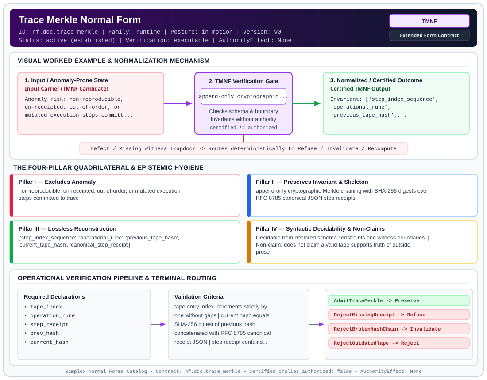

# Trace Merkle Normal Form (`TMNF`)

> **Contract ID:** `nf.ddc.trace_merkle` | **Family:** `runtime` | **Index Status:** `active` | **AuthorityEffect:** `None`

**[⬅ Back to Wiki Home](Home)** | **[View SVG Diagram](images/nf.ddc.trace_merkle.svg)**

---

## 1. Executive Summary & Metadata

Trace Merkle Normal Form (TMNF) enforces structural normalization and explicit defect routing in the runtime regime.

| Property | Value |
| :--- | :--- |
| **Canonical ID** | `nf.ddc.trace_merkle` |
| **Short Name** | `TMNF` |
| **Full Name** | Trace Merkle Normal Form |
| **Family** | `runtime` (Exact Rational Zero-Duality-Gap Certifiers & Merkle Trace Execution Contracts) |
| **Qualification** | Extended Form Contract (Normal Form Contract) |
| **Data / Math Posture** | in_motion |
| **Index Status** | `active` |
| **Theory Status** | `established` |
| **Verification Status** | `executable` |
| **Contract Version** | `v0` |
| **Governance Fence** | `AuthorityEffect: None` (`certified_implies_authorized: false`) |

### Foundational Treatise Specification

- **Family**: runtime
- **Runes**: ['I', 'T']
- **Target Runtime Law**: Laws 1 & 5 (Non-Empty Trace & Monotonic Identity)
- **Domain**: Operational execution tapes tau = (w_0, ..., w_n).
- **Anomaly Excluded**: Un-receipted state transitions, out-of-order execution, and non-reproducible trace execution.
- **Preserved Invariant**: Immutable RFC 8785 canonical JSON and SHA-256 Merkle chain at each step.
- **Reconstruction Theorem**: Deterministic replay from initial state and Merkle chain reconstructs identical terminal state.

---

## 2. Visual Architecture & Normalization Diagram



---

## 3. Concrete Worked Example & Mechanism

### Visual Transition Summary

| Stage | Carrier / Operator | Concrete State / Invariant |
| :--- | :--- | :--- |
| **1. Before / Candidate Input** | `Input Carrier (TMNF Candidate)` | Anomaly risk: non-reproducible, ; un-receipted, out-of-order, or ; mutated execution steps committ... |
| **2. Normalization / Gate** | `TMNF Verification Gate` | `append-only cryptographic...` (`certified_implies_authorized: false`) |
| **3. After / Certified Output** | `Certified TMNF Output` | Invariant: ['step_index_sequence', ; 'operational_rune', ; 'previous_tape_hash',... |

### Contract-Declared Worked Cases

```yaml
- ref: omega_engine_education/documentation/14_discrete_deformation_calculus_ddc/00_discrete_deformation_calculus_foundations.md
  section: '2.4'
```

---

## 4. The Four-Pillar Quadrilateral & Non-Claims

Every contract in `simplex-normal-forms` is evaluated against the **Four-Pillar Quadrilateral** defined in `contracts/_golden_nfs/standard.yaml`:

| Pillar | Requirement | Contract Specification for `nf.ddc.trace_merkle` |
| :--- | :--- | :--- |
| **Pillar I: Excludes Anomaly** | Name and eliminate a specific class of data or state defects. | non-reproducible, un-receipted, out-of-order, or mutated execution steps committed to trace |
| **Pillar II: Preserves Invariant** | State the structural invariant and protected skeleton preserved across transitions. | **Invariant:** append-only cryptographic Merkle chaining with SHA-256 digests over RFC 8785 canonical JSON step receipts<br>**Protected Skeleton:** ['step_index_sequence', 'operational_rune', 'previous_tape_hash', 'current_tape_hash', 'canonical_step_receipt'] |
| **Pillar III: Lossless Reconstruction** | State the non-loss reconstruction operator (join, direct sum, pullback, or replay). | Lossless reconstruction under declared projection, direct sum, or pullback operators. |
| **Pillar IV: Syntactic Decidability** | State how conformance is decided from declared constraints without unbudgeted scans. | Decidable from declared schema and witness metadata within bounded evaluation budgets. |

### Explicit Non-Claims (`certified_implies_authorized: false`)

- does not claim a valid tape supports truth of outside prose
- does not confer operational authority; authority_effect is unconditionally None
- does not permit post-terminal continuation

---

## 5. Operational Verification & Terminal Routing

### 5.1 Required Declarations

- tape_index
- operation_rune
- step_receipt
- prev_hash
- current_hash

### 5.2 Required Evidence

_None declared._

### 5.3 Validation Criteria

| Criterion ID | Name | Condition |
| :--- | :--- | :--- |
| `criterion` | Check | tape entry index increments strictly by one without gaps |
| `criterion` | Check | current hash equals SHA-256 digest of previous hash concatenated with RFC 8785 canonical receipt JSON |
| `criterion` | Check | step receipt contains non-empty input and output state hashes |

### 5.4 Terminal Route Map

Every evaluation terminates in a declared local route mapped to a canonical terminal in `standard.yaml`:

| Local Terminal Route | Canonical Terminal |
| :--- | :--- |
| `AdmitTraceMerkle` | `Preserve` |
| `RejectMissingReceipt` | `Refuse` |
| `RejectBrokenHashChain` | `Invalidate` |
| `RejectOutdatedTape` | `Reject` |

### 5.5 Declared Failure Modes

- **symptom**: step committed to tape without explicit cryptographic receipt, **diagnosis**: un-receipted transition; violates Law 5, **terminal**: RejectMissingReceipt
- **symptom**: recomputed SHA-256 digest does not match declared current_hash, **diagnosis**: corrupted or out-of-order hash chain, **terminal**: RejectBrokenHashChain

---

## 6. Epistemic Claim Hygiene Quadrant

In accordance with the repository's epistemic claim discipline:

1. **What it supports:**
   - Supports syntactic and operational checking of `nf.ddc.trace_merkle` (`TMNF`) against its declared schema, boundary constraints, and witness obligations in this model.
   - Supports deterministic terminal routing (`AdmitTraceMerkle, RejectMissingReceipt, RejectBrokenHashChain, RejectOutdatedTape`) when required declarations or invariants fail.
2. **What it does not support:**
   - Does not confer operational authority (`AuthorityEffect: None`, `certified_implies_authorized: false`).
   - Does not claim semantic truth of undeclared external processes or unverified upstream inputs beyond the declaredprotected skeleton.
3. **The narrowest defensible claim:**
   - Within the declared substrate `in_motion`, this contract enforces that `non-reproducible, un-receipted, out-of-order, or mutated execution steps committed to trace` is either excluded under `append-only cryptographic Merkle chaining with SHA-256 digests over RFC 8785 canonical JSON step receipts` or routed to an explicit refusal/recovery terminal.
4. **The next test needed:**
   - Property-based falsification and mutation testing across boundary edge cases and composed multi-step pipelines for `nf.ddc.trace_merkle`.

---

## 7. Canonical YAML Contract (`contracts/nf.ddc.trace_merkle.yaml`)

<details>
<summary><strong>Click to expand full canonical YAML contract (contracts/nf.ddc.trace_merkle.yaml)</strong></summary>

```yaml
schema_version: smplx.nf.contract.v0
schema_ref: ./normal_form_contract_schema.yaml
contract_kind: normal_form_contract
identity:
  id: nf.ddc.trace_merkle
  name: Trace Merkle Normal Form
  short_name: TMNF
  version: v0
  theory_status: established
  contract_status: active
  status: active
  verification_status: executable
  family: runtime
classification:
  hierarchy_level: normal_form
  subject_kind:
    - execution_tape
    - merkle_hash_chain
    - step_receipt
  data_posture: in_motion
  mathematical_posture: operational
purpose:
  excludes_anomaly: non-reproducible, un-receipted, out-of-order, or mutated execution steps committed to trace
  preserves_invariant: append-only cryptographic Merkle chaining with SHA-256 digests over RFC 8785 canonical JSON step receipts
  protected_skeleton:
    - step_index_sequence
    - operational_rune
    - previous_tape_hash
    - current_tape_hash
    - canonical_step_receipt
  erased_structure:
    - solver_wallclock_execution_time
    - memory_heap_addresses
  non_claims:
    - does not claim a valid tape supports truth of outside prose
    - does not confer operational authority; authority_effect is unconditionally None
    - does not permit post-terminal continuation
definition:
  source: omega_engine_education/documentation/14_discrete_deformation_calculus_ddc/normal_forms/README.md
  section: '2.0'
  formal_statement: >
    On a sequence of discrete operational transitions under alphabet {E, R, C, I, Λ, D, M, T},
    Trace Merkle Normal Form (TMNF) commits transitions into an append-only tape. Integration rune I
    requires an explicit deterministic step receipt (Law 5), computing current tape digest
    h_k = SHA256(h_{k-1} || RFC8785(R_k)). Replay from genesis reproduces the active state losslessly.
  quadrilateral:
    qualifies_as_true_normal_form: false
    qualification_gap: cryptographic_hash_chain_not_relational_project_join
    anomaly_exclusion: missing step receipts, un-recomputed tape digests, silent state mutations, or post-terminal insertions
    lossless_join:
      status: replay_reconstruction
      statement: given initial state s₀ and tape entries T, the full sequence of intermediate states is losslessly and deterministically reconstructed
    dependency_preservation:
      status: step_receipt_hash_preserved
      statement: each step hash h_k = SHA256(h_{k-1} || RFC8785(R_k)) is verifiable locally from adjacent steps
    syntactic_decision:
      status: schema_and_hash_decidable
      statement: membership is decidable by parsing TapeEntry schema and re-evaluating SHA-256 chain equality
declarations_required:
  - tape_index
  - operation_rune
  - step_receipt
  - prev_hash
  - current_hash
evidence_required: []
validation_criteria:
  - tape entry index increments strictly by one without gaps
  - current hash equals SHA-256 digest of previous hash concatenated with RFC 8785 canonical receipt JSON
  - step receipt contains non-empty input and output state hashes
terminal_routes:
  - AdmitTraceMerkle
  - RejectMissingReceipt
  - RejectBrokenHashChain
  - RejectOutdatedTape
terminal_route_map:
  AdmitTraceMerkle: Preserve
  RejectMissingReceipt: Refuse
  RejectBrokenHashChain: Invalidate
  RejectOutdatedTape: Reject
certification:
  certificate_required: true
  certificate_kind: merkle_tape_receipt
  obstruction_class_required: false
  loss_ledger_required: false
  verifier_required: true
  loss_ledger_trigger_id: null
authorization:
  authorized_by: null
  certified_implies_authorized: false
failure_modes:
  - symptom: step committed to tape without explicit cryptographic receipt
    diagnosis: un-receipted transition; violates Law 5
    terminal: RejectMissingReceipt
  - symptom: recomputed SHA-256 digest does not match declared current_hash
    diagnosis: corrupted or out-of-order hash chain
    terminal: RejectBrokenHashChain
examples:
  - ref: omega_engine_education/documentation/14_discrete_deformation_calculus_ddc/00_discrete_deformation_calculus_foundations.md
    section: '2.4'
references:
  - omega_engine_governance/contracts/contracts_omega_engine_crates/mathematics/discrete_deformation_algebra/dda_trace_cochain.contract.yaml
```

</details>
