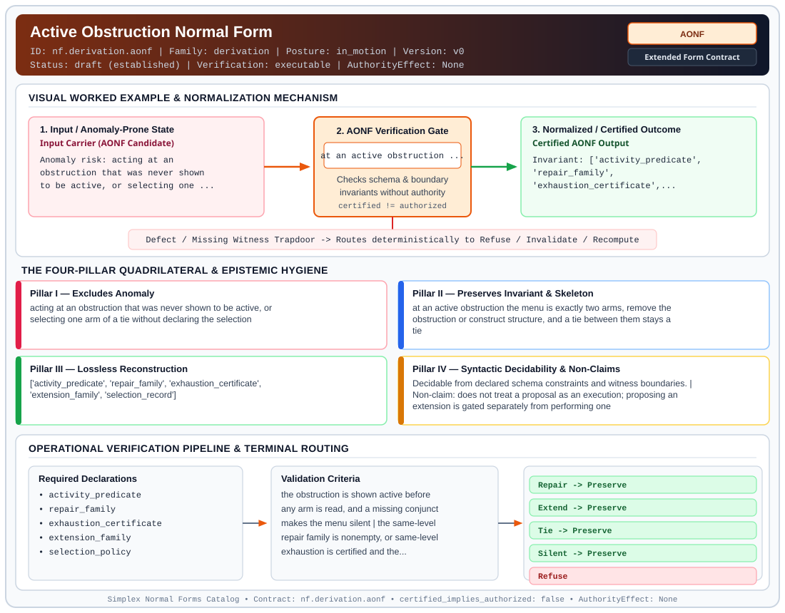

# Active Obstruction Normal Form (`AONF`)

> **Contract ID:** `nf.derivation.aonf` | **Family:** `derivation` | **Index Status:** `draft` | **AuthorityEffect:** `None`

**[⬅ Back to Wiki Home](Home)** | **[View SVG Diagram](images/nf.derivation.aonf.svg)**

---

## 1. Executive Summary & Metadata

Active Obstruction Normal Form (AONF) enforces structural normalization and explicit defect routing in the derivation regime.

| Property | Value |
| :--- | :--- |
| **Canonical ID** | `nf.derivation.aonf` |
| **Short Name** | `AONF` |
| **Full Name** | Active Obstruction Normal Form |
| **Family** | `derivation` (MSS-N Tower Algebraic Derivation, Split Extension-Retraction & Obstruction Contracts) |
| **Qualification** | Extended Form Contract (Normal Form Contract) |
| **Data / Math Posture** | in_motion |
| **Index Status** | `draft` |
| **Theory Status** | `established` |
| **Verification Status** | `executable` |
| **Contract Version** | `v0` |
| **Governance Fence** | `AuthorityEffect: None` (`certified_implies_authorized: false`) |

---

## 2. Visual Architecture & Normalization Diagram



---

## 3. Concrete Worked Example & Mechanism

### Visual Transition Summary

| Stage | Carrier / Operator | Concrete State / Invariant |
| :--- | :--- | :--- |
| **1. Before / Candidate Input** | `Input Carrier (AONF Candidate)` | Anomaly risk: acting at an ; obstruction that was never shown ; to be active, or selecting one ... |
| **2. Normalization / Gate** | `AONF Verification Gate` | `at an active obstruction ...` (`certified_implies_authorized: false`) |
| **3. After / Certified Output** | `Certified AONF Output` | Invariant: ['activity_predicate', ; 'repair_family', ; 'exhaustion_certificate',... |

### Contract-Declared Worked Cases

```yaml
- ref: 19L57G1
  section: paper/primitive_difference_map.md
  note: the two-rule stated at the first active obstruction, under declared hypotheses
```

---

## 4. The Four-Pillar Quadrilateral & Non-Claims

Every contract in `simplex-normal-forms` is evaluated against the **Four-Pillar Quadrilateral** defined in `contracts/_golden_nfs/standard.yaml`:

| Pillar | Requirement | Contract Specification for `nf.derivation.aonf` |
| :--- | :--- | :--- |
| **Pillar I: Excludes Anomaly** | Name and eliminate a specific class of data or state defects. | acting at an obstruction that was never shown to be active, or selecting one arm of a tie without declaring the selection |
| **Pillar II: Preserves Invariant** | State the structural invariant and protected skeleton preserved across transitions. | **Invariant:** at an active obstruction the menu is exactly two arms, remove the obstruction or construct structure, and a tie between them stays a tie<br>**Protected Skeleton:** ['activity_predicate', 'repair_family', 'exhaustion_certificate', 'extension_family', 'selection_record'] |
| **Pillar III: Lossless Reconstruction** | State the non-loss reconstruction operator (join, direct sum, pullback, or replay). | Lossless reconstruction under declared projection, direct sum, or pullback operators. |
| **Pillar IV: Syntactic Decidability** | State how conformance is decided from declared constraints without unbudgeted scans. | Decidable from declared schema and witness metadata within bounded evaluation budgets. |

### Explicit Non-Claims (`certified_implies_authorized: false`)

- does not treat a proposal as an execution; proposing an extension is gated separately from performing one
- does not select between tied arms; a tie is recorded as a tie and the selection stays absent
- does not treat a refusal as a terminal; a refusal is inert and a terminal absorbs
- does not act when any activity conjunct is unverified; the menu is then silent
- does not imply authorization

---

## 5. Operational Verification & Terminal Routing

### 5.1 Required Declarations

- activity_predicate
- repair_family
- exhaustion_certificate
- extension_family
- selection_policy
- cost_measure

### 5.2 Required Evidence

- activity_conjunct_status
- repair_family_membership
- exhaustion_status_at_the_same_level
- extension_proposal_membership
- selection_record

### 5.3 Validation Criteria

| Criterion ID | Name | Condition |
| :--- | :--- | :--- |
| `criterion` | Check | the obstruction is shown active before any arm is read, and a missing conjunct makes the menu silent |
| `criterion` | Check | the same-level repair family is nonempty, or same-level exhaustion is certified and the extension proposal family is nonempty |
| `criterion` | Check | a proposal is recorded as a proposal and is not executed by the same act |
| `criterion` | Check | when both arms are constructible and no declared invariant separates them, the selection is recorded as absent |
| `criterion` | Check | a selection, when made, names the further declaration that made it |
| `criterion` | Check | a refusal is recorded as inert and does not absorb the run |

### 5.4 Terminal Route Map

Every evaluation terminates in a declared local route mapped to a canonical terminal in `standard.yaml`:

| Local Terminal Route | Canonical Terminal |
| :--- | :--- |
| `Repair` | `Preserve` |
| `Extend` | `Preserve` |
| `Tie` | `Preserve` |
| `Silent` | `Preserve` |
| `Refuse` | `Refuse` |
| `Terminal` | `Preserve` |
| `Escalate` | `Preserve` |

### 5.5 Declared Failure Modes

- **symptom**: an arm is taken although one activity conjunct was never checked, **diagnosis**: the obstruction was not shown active, so the menu was silent, **terminal**: Silent
- **symptom**: one of two equally admissible arms is taken with no reason recorded, **diagnosis**: a tie was broken by position rather than by a declaration, **terminal**: Tie
- **symptom**: an extension is performed by the act that proposed it, **diagnosis**: proposal and execution were not separately gated, **terminal**: Refuse
- **symptom**: a refusal ends the run, **diagnosis**: refusal treated as absorbing, which is the behaviour of a terminal, **terminal**: Terminal

---

## 6. Epistemic Claim Hygiene Quadrant

In accordance with the repository's epistemic claim discipline:

1. **What it supports:**
   - Supports syntactic and operational checking of `nf.derivation.aonf` (`AONF`) against its declared schema, boundary constraints, and witness obligations in this model.
   - Supports deterministic terminal routing (`Repair, Extend, Tie, Silent`) when required declarations or invariants fail.
2. **What it does not support:**
   - Does not confer operational authority (`AuthorityEffect: None`, `certified_implies_authorized: false`).
   - Does not claim semantic truth of undeclared external processes or unverified upstream inputs beyond the declaredprotected skeleton.
3. **The narrowest defensible claim:**
   - Within the declared substrate `in_motion`, this contract enforces that `acting at an obstruction that was never shown to be active, or selecting one arm of a tie without declaring the selection` is either excluded under `at an active obstruction the menu is exactly two arms, remove the obstruction or construct structure, and a tie between them stays a tie` or routed to an explicit refusal/recovery terminal.
4. **The next test needed:**
   - Property-based falsification and mutation testing across boundary edge cases and composed multi-step pipelines for `nf.derivation.aonf`.

---

## 7. Canonical YAML Contract (`contracts/nf.derivation.aonf.yaml`)

<details>
<summary><strong>Click to expand full canonical YAML contract (contracts/nf.derivation.aonf.yaml)</strong></summary>

```yaml
schema_version: smplx.nf.contract.v0
contract_kind: form_contract
identity:
  id: nf.derivation.aonf
  name: Active Obstruction Normal Form
  short_name: AONF
  version: v0
  status: draft
  family: derivation
  theory_status: established
  contract_status: draft
  verification_status: executable
classification:
  hierarchy_level: form
  subject_kind:
  - obstruction_claim
  - repair_family
  - extension_family
  data_posture: in_motion
  mathematical_posture: operational
purpose:
  excludes_anomaly: acting at an obstruction that was never shown to be active, or selecting
    one arm of a tie without declaring the selection
  preserves_invariant: at an active obstruction the menu is exactly two arms, remove the obstruction
    or construct structure, and a tie between them stays a tie
  protected_skeleton:
  - activity_predicate
  - repair_family
  - exhaustion_certificate
  - extension_family
  - selection_record
  erased_structure: []
  non_claims:
  - does not treat a proposal as an execution; proposing an extension is gated separately
    from performing one
  - does not select between tied arms; a tie is recorded as a tie and the selection stays
    absent
  - does not treat a refusal as a terminal; a refusal is inert and a terminal absorbs
  - does not act when any activity conjunct is unverified; the menu is then silent
  - does not imply authorization
quadrilateral:
  qualifies_as_true_normal_form: false
  qualification_gap: no_project_join_theorem
  anomaly_exclusion: an arm taken before the obstruction is shown active, or a tie broken
    with no recorded declaration
  lossless_join:
    status: not_a_relational_decomposition
    statement: no project-join theorem is claimed
  dependency_preservation:
    status: menu_and_gate_preserved
    statement: the two-arm menu and the separation of proposal from execution stay intact
  syntactic_decision:
    status: declaration_decidable
    statement: the menu is read from the recorded conjuncts and the declared families
activity_predicate:
  conjuncts:
  - retained
  - observer_zero
  - guarded
  rule: all three conjuncts hold, and each is recorded separately
  independence: no conjunct is implied by the other two
declarations_required:
- activity_predicate
- repair_family
- exhaustion_certificate
- extension_family
- selection_policy
- cost_measure
evidence_required:
- activity_conjunct_status
- repair_family_membership
- exhaustion_status_at_the_same_level
- extension_proposal_membership
- selection_record
validation_criteria:
- the obstruction is shown active before any arm is read, and a missing conjunct makes the
  menu silent
- the same-level repair family is nonempty, or same-level exhaustion is certified and the
  extension proposal family is nonempty
- a proposal is recorded as a proposal and is not executed by the same act
- when both arms are constructible and no declared invariant separates them, the selection
  is recorded as absent
- a selection, when made, names the further declaration that made it
- a refusal is recorded as inert and does not absorb the run
proof_obligations:
- id: aonf.two_rule_at_an_active_obstruction
  status: upstream_theorem
  ref: 19L57G1
  section: lean4/Derivation/PrimitivePassage.lean
- id: aonf.proposal_is_not_execution
  status: upstream_theorem
  ref: 19L57G1
  section: lean4/Derivation/PrimitivePassage.lean
- id: aonf.extension_resolves
  status: upstream_theorem
  ref: 19L57G1
  section: lean4/Derivation/PrimitivePassage.lean
- id: aonf.refusal_inert_terminal_absorbing
  status: upstream_theorem
  ref: 19L57G1
  section: lean4/Derivation/PrimitivePassage.lean
- id: aonf.station_order_is_supplied_not_derived
  status: declared_upstream
  ref: 19L57G1
  section: paper/primitive_difference_passage.md
terminal_routes:
- Repair
- Extend
- Tie
- Silent
- Refuse
- Terminal
- Escalate
certification:
  certificate_required: true
  certificate_kind: passage_certificate
  obstruction_class_required: true
  loss_ledger_required: true
  verifier_required: true
  loss_ledger_trigger_id: null
authorization:
  authorized_by: null
  certified_implies_authorized: false
failure_modes:
- symptom: an arm is taken although one activity conjunct was never checked
  diagnosis: the obstruction was not shown active, so the menu was silent
  terminal: Silent
- symptom: one of two equally admissible arms is taken with no reason recorded
  diagnosis: a tie was broken by position rather than by a declaration
  terminal: Tie
- symptom: an extension is performed by the act that proposed it
  diagnosis: proposal and execution were not separately gated
  terminal: Refuse
- symptom: a refusal ends the run
  diagnosis: refusal treated as absorbing, which is the behaviour of a terminal
  terminal: Terminal
examples:
- ref: 19L57G1
  section: paper/primitive_difference_map.md
  note: the two-rule stated at the first active obstruction, under declared hypotheses
references:
- 19L/PIN.md
- ./nf.derivation.obnf.yaml
- ./README.md
schema_ref: ./normal_form_contract_schema.yaml
terminal_route_map:
  Repair: Preserve
  Extend: Preserve
  Tie: Preserve
  Silent: Preserve
  Refuse: Refuse
  Terminal: Preserve
  Escalate: Preserve
```

</details>
