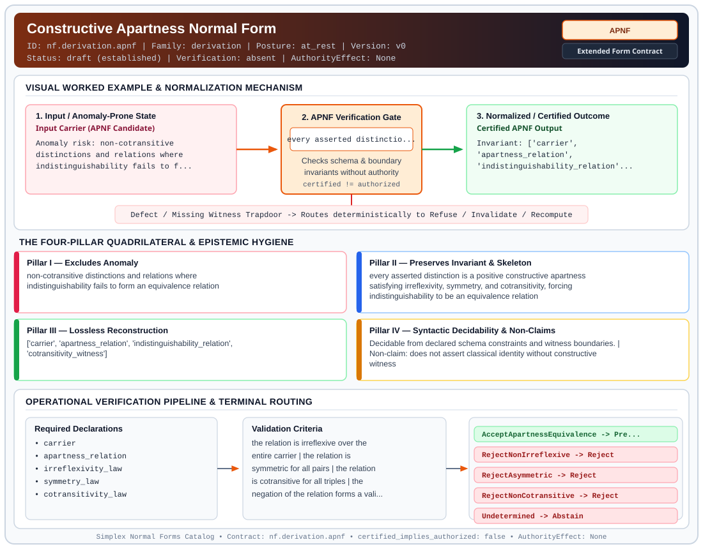

# Constructive Apartness Normal Form (`APNF`)

> **Contract ID:** `nf.derivation.apnf` | **Family:** `derivation` | **Index Status:** `draft` | **AuthorityEffect:** `None`

**[⬅ Back to Wiki Home](Home)** | **[View SVG Diagram](images/nf.derivation.apnf.svg)**

---

## 1. Executive Summary & Metadata

Constructive Apartness Normal Form (APNF) enforces structural normalization and explicit defect routing in the derivation regime.

| Property | Value |
| :--- | :--- |
| **Canonical ID** | `nf.derivation.apnf` |
| **Short Name** | `APNF` |
| **Full Name** | Constructive Apartness Normal Form |
| **Family** | `derivation` (MSS-N Tower Algebraic Derivation, Split Extension-Retraction & Obstruction Contracts) |
| **Qualification** | Extended Form Contract (Normal Form Contract) |
| **Data / Math Posture** | at_rest |
| **Index Status** | `draft` |
| **Theory Status** | `established` |
| **Verification Status** | `absent` |
| **Contract Version** | `v0` |
| **Governance Fence** | `AuthorityEffect: None` (`certified_implies_authorized: false`) |

---

## 2. Visual Architecture & Normalization Diagram



---

## 3. Concrete Worked Example & Mechanism

### Visual Transition Summary

| Stage | Carrier / Operator | Concrete State / Invariant |
| :--- | :--- | :--- |
| **1. Before / Candidate Input** | `Input Carrier (APNF Candidate)` | Anomaly risk: non-cotransitive ; distinctions and relations where ; indistinguishability fails to f... |
| **2. Normalization / Gate** | `APNF Verification Gate` | `every asserted distinctio...` (`certified_implies_authorized: false`) |
| **3. After / Certified Output** | `Certified APNF Output` | Invariant: ['carrier', ; 'apartness_relation', ; 'indistinguishability_relation'... |

### Contract-Declared Worked Cases

```yaml
- ref: https://github.com/dbccpage/19L57G1/blob/f1d56c010e6ba10a3b9418bd7cc5953c067250f2/lean4/Derivation/Apartness.lean
  section: lean4/Derivation/Apartness.lean
  note: the equivalence theorem and the three minimal countermodels
```

---

## 4. The Four-Pillar Quadrilateral & Non-Claims

Every contract in `simplex-normal-forms` is evaluated against the **Four-Pillar Quadrilateral** defined in `contracts/_golden_nfs/standard.yaml`:

| Pillar | Requirement | Contract Specification for `nf.derivation.apnf` |
| :--- | :--- | :--- |
| **Pillar I: Excludes Anomaly** | Name and eliminate a specific class of data or state defects. | non-cotransitive distinctions and relations where indistinguishability fails to form an equivalence relation |
| **Pillar II: Preserves Invariant** | State the structural invariant and protected skeleton preserved across transitions. | **Invariant:** every asserted distinction is a positive constructive apartness satisfying irreflexivity, symmetry, and cotransitivity, forcing indistinguishability to be an equivalence relation<br>**Protected Skeleton:** ['carrier', 'apartness_relation', 'indistinguishability_relation', 'cotransitivity_witness'] |
| **Pillar III: Lossless Reconstruction** | State the non-loss reconstruction operator (join, direct sum, pullback, or replay). | Lossless reconstruction under declared projection, direct sum, or pullback operators. |
| **Pillar IV: Syntactic Decidability** | State how conformance is decided from declared constraints without unbudgeted scans. | Decidable from declared schema and witness metadata within bounded evaluation budgets. |

### Explicit Non-Claims (`certified_implies_authorized: false`)

- does not assert classical identity without constructive witness
- does not assume points with distance zero are identical without an explicit metric separation axiom
- does not derive continuous topology or metric spaces
- does not imply operational authority

---

## 5. Operational Verification & Terminal Routing

### 5.1 Required Declarations

- carrier
- apartness_relation
- irreflexivity_law
- symmetry_law
- cotransitivity_law

### 5.2 Required Evidence

- carrier_size
- relation_matrix
- countermodel_exclusion_receipt

### 5.3 Validation Criteria

| Criterion ID | Name | Condition |
| :--- | :--- | :--- |
| `criterion` | Check | the relation is irreflexive over the entire carrier |
| `criterion` | Check | the relation is symmetric for all pairs |
| `criterion` | Check | the relation is cotransitive for all triples |
| `criterion` | Check | the negation of the relation forms a valid reflexive, symmetric, and transitive equivalence relation |

### 5.4 Terminal Route Map

Every evaluation terminates in a declared local route mapped to a canonical terminal in `standard.yaml`:

| Local Terminal Route | Canonical Terminal |
| :--- | :--- |
| `AcceptApartnessEquivalence` | `Preserve` |
| `RejectNonIrreflexive` | `Reject` |
| `RejectAsymmetric` | `Reject` |
| `RejectNonCotransitive` | `Reject` |
| `Undetermined` | `Abstain` |

### 5.5 Declared Failure Modes

- **symptom**: a point is asserted apart from itself, **diagnosis**: irreflexivity failed, breaking reflexivity of indistinguishability, **terminal**: RejectNonIrreflexive
- **symptom**: point x is apart from y but y is not apart from x, **diagnosis**: symmetry failed, breaking symmetry of indistinguishability, **terminal**: RejectAsymmetric
- **symptom**: x is apart from y but neither x is apart from z nor z apart from y, **diagnosis**: cotransitivity failed, breaking transitivity of indistinguishability, **terminal**: RejectNonCotransitive

---

## 6. Epistemic Claim Hygiene Quadrant

In accordance with the repository's epistemic claim discipline:

1. **What it supports:**
   - Supports syntactic and operational checking of `nf.derivation.apnf` (`APNF`) against its declared schema, boundary constraints, and witness obligations in this model.
   - Supports deterministic terminal routing (`AcceptApartnessEquivalence, RejectNonIrreflexive, RejectAsymmetric, RejectNonCotransitive`) when required declarations or invariants fail.
2. **What it does not support:**
   - Does not confer operational authority (`AuthorityEffect: None`, `certified_implies_authorized: false`).
   - Does not claim semantic truth of undeclared external processes or unverified upstream inputs beyond the declaredprotected skeleton.
3. **The narrowest defensible claim:**
   - Within the declared substrate `at_rest`, this contract enforces that `non-cotransitive distinctions and relations where indistinguishability fails to form an equivalence relation` is either excluded under `every asserted distinction is a positive constructive apartness satisfying irreflexivity, symmetry, and cotransitivity, forcing indistinguishability to be an equivalence relation` or routed to an explicit refusal/recovery terminal.
4. **The next test needed:**
   - Property-based falsification and mutation testing across boundary edge cases and composed multi-step pipelines for `nf.derivation.apnf`.

---

## 7. Canonical YAML Contract (`contracts/nf.derivation.apnf.yaml`)

<details>
<summary><strong>Click to expand full canonical YAML contract (contracts/nf.derivation.apnf.yaml)</strong></summary>

```yaml
# Draft declaration: no bound local contract evaluator is supplied; upstream mathematics and schema checks are separate evidence.
schema_version: smplx.nf.contract.v0
contract_kind: form_contract
identity:
  id: nf.derivation.apnf
  name: Constructive Apartness Normal Form
  short_name: APNF
  version: v0
  status: draft
  family: derivation
  theory_status: established
  contract_status: draft
  verification_status: absent
classification:
  hierarchy_level: form
  subject_kind:
  - apartness_relation
  - indistinguishability_relation
  - carrier
  data_posture: at_rest
  mathematical_posture: formal_algebraic
purpose:
  excludes_anomaly: non-cotransitive distinctions and relations where indistinguishability fails to form
    an equivalence relation
  preserves_invariant: every asserted distinction is a positive constructive apartness satisfying irreflexivity,
    symmetry, and cotransitivity, forcing indistinguishability to be an equivalence relation
  protected_skeleton:
  - carrier
  - apartness_relation
  - indistinguishability_relation
  - cotransitivity_witness
  erased_structure:
  - classical_excluded_middle_assumption
  non_claims:
  - does not assert classical identity without constructive witness
  - does not assume points with distance zero are identical without an explicit metric separation axiom
  - does not derive continuous topology or metric spaces
  - does not imply operational authority
quadrilateral:
  qualifies_as_true_normal_form: false
  qualification_gap: no_project_join_theorem
  anomaly_exclusion: distinctions failing cotransitivity or symmetry, causing indistinguishability transitivity
    or symmetry breakdowns
  lossless_join:
    status: quotient_reconstruction
    statement: the original relation is recovered modulo indistinguishability equivalence classes on the
      quotient carrier
  dependency_preservation:
    status: preserved_locally
    statement: cotransitivity is verified over all triples in the carrier without cross-regime joins
  syntactic_decision:
    status: declaration_decidable
    statement: decided exhaustively from the finite relation matrix and carrier size
declarations_required:
- carrier
- apartness_relation
- irreflexivity_law
- symmetry_law
- cotransitivity_law
evidence_required:
- carrier_size
- relation_matrix
- countermodel_exclusion_receipt
validation_criteria:
- the relation is irreflexive over the entire carrier
- the relation is symmetric for all pairs
- the relation is cotransitive for all triples
- the negation of the relation forms a valid reflexive, symmetric, and transitive equivalence relation
proof_obligations:
- id: apnf.indist_equivalence_theorem
  status: upstream_theorem
  ref: https://github.com/dbccpage/19L57G1/blob/f1d56c010e6ba10a3b9418bd7cc5953c067250f2/lean4/Derivation/Apartness.lean
  section: lean4/Derivation/Apartness.lean
- id: apnf.minimal_countermodel_exhaustion
  status: finite_computation
  ref: https://github.com/dbccpage/19L57G1/blob/f1d56c010e6ba10a3b9418bd7cc5953c067250f2/code/derivation/apartness.py
  section: finite relation-table exhaustion; inspect the source enumeration bound
terminal_routes:
- AcceptApartnessEquivalence
- RejectNonIrreflexive
- RejectAsymmetric
- RejectNonCotransitive
- Undetermined
terminal_route_map:
  AcceptApartnessEquivalence: Preserve
  RejectNonIrreflexive: Reject
  RejectAsymmetric: Reject
  RejectNonCotransitive: Reject
  Undetermined: Abstain
certification:
  certificate_required: true
  certificate_kind: apartness_certificate
  obstruction_class_required: false
  loss_ledger_required: false
  verifier_required: true
authorization:
  authorized_by: null
  certified_implies_authorized: false
failure_modes:
- symptom: a point is asserted apart from itself
  diagnosis: irreflexivity failed, breaking reflexivity of indistinguishability
  terminal: RejectNonIrreflexive
- symptom: point x is apart from y but y is not apart from x
  diagnosis: symmetry failed, breaking symmetry of indistinguishability
  terminal: RejectAsymmetric
- symptom: x is apart from y but neither x is apart from z nor z apart from y
  diagnosis: cotransitivity failed, breaking transitivity of indistinguishability
  terminal: RejectNonCotransitive
examples:
- ref: https://github.com/dbccpage/19L57G1/blob/f1d56c010e6ba10a3b9418bd7cc5953c067250f2/lean4/Derivation/Apartness.lean
  section: lean4/Derivation/Apartness.lean
  note: the equivalence theorem and the three minimal countermodels
references:
- https://github.com/dbccpage/19L57G1/blob/f1d56c010e6ba10a3b9418bd7cc5953c067250f2/docs/GENESIS_CLOSEOUT.md
- ./README.md
```

</details>
