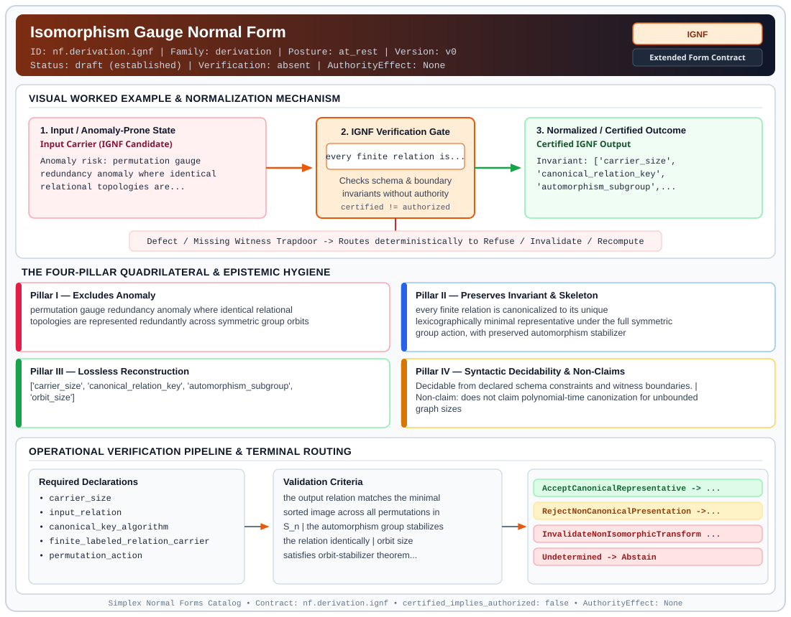

# Isomorphism Gauge Normal Form (`IGNF`)

> **Contract ID:** `nf.derivation.ignf` | **Family:** `derivation` | **Index Status:** `draft` | **AuthorityEffect:** `None`

**[⬅ Back to Wiki Home](Home)** | **[View SVG Diagram](images/nf.derivation.ignf.svg)**

---

## 1. Executive Summary & Metadata

Isomorphism Gauge Normal Form (IGNF) enforces structural normalization and explicit defect routing in the derivation regime.

| Property | Value |
| :--- | :--- |
| **Canonical ID** | `nf.derivation.ignf` |
| **Short Name** | `IGNF` |
| **Full Name** | Isomorphism Gauge Normal Form |
| **Family** | `derivation` (MSS-N Tower Algebraic Derivation, Split Extension-Retraction & Obstruction Contracts) |
| **Qualification** | Extended Form Contract (Normal Form Contract) |
| **Data / Math Posture** | at_rest |
| **Index Status** | `draft` |
| **Theory Status** | `established` |
| **Verification Status** | `absent` |
| **Contract Version** | `v0` |
| **Governance Fence** | `AuthorityEffect: None` (`certified_implies_authorized: false`) |

---

## 2. Visual Architecture & Normalization Diagram



---

## 3. Concrete Worked Example & Mechanism

### Visual Transition Summary

| Stage | Carrier / Operator | Concrete State / Invariant |
| :--- | :--- | :--- |
| **1. Before / Candidate Input** | `Input Carrier (IGNF Candidate)` | Anomaly risk: permutation gauge ; redundancy anomaly where identical ; relational topologies are... |
| **2. Normalization / Gate** | `IGNF Verification Gate` | `every finite relation is...` (`certified_implies_authorized: false`) |
| **3. After / Certified Output** | `Certified IGNF Output` | Invariant: ['carrier_size', ; 'canonical_relation_key', ; 'automorphism_subgroup',... |

### Contract-Declared Worked Cases

```yaml
- ref: https://github.com/dbccpage/19L57G1/blob/f1d56c010e6ba10a3b9418bd7cc5953c067250f2/lean4/Derivation/RenamingStructure.lean
  section: lean4/Derivation/RenamingStructure.lean
  note: canonical key minimization and Aut(r) computation
```

---

## 4. The Four-Pillar Quadrilateral & Non-Claims

Every contract in `simplex-normal-forms` is evaluated against the **Four-Pillar Quadrilateral** defined in `contracts/_golden_nfs/standard.yaml`:

| Pillar | Requirement | Contract Specification for `nf.derivation.ignf` |
| :--- | :--- | :--- |
| **Pillar I: Excludes Anomaly** | Name and eliminate a specific class of data or state defects. | permutation gauge redundancy anomaly where identical relational topologies are represented redundantly across symmetric group orbits |
| **Pillar II: Preserves Invariant** | State the structural invariant and protected skeleton preserved across transitions. | **Invariant:** every finite relation is canonicalized to its unique lexicographically minimal representative under the full symmetric group action, with preserved automorphism stabilizer<br>**Protected Skeleton:** ['carrier_size', 'canonical_relation_key', 'automorphism_subgroup', 'orbit_size'] |
| **Pillar III: Lossless Reconstruction** | State the non-loss reconstruction operator (join, direct sum, pullback, or replay). | Lossless reconstruction under declared projection, direct sum, or pullback operators. |
| **Pillar IV: Syntactic Decidability** | State how conformance is decided from declared constraints without unbudgeted scans. | Decidable from declared schema and witness metadata within bounded evaluation budgets. |

### Explicit Non-Claims (`certified_implies_authorized: false`)

- does not claim polynomial-time canonization for unbounded graph sizes
- does not derive continuous gauge theories or Lie algebras
- does not assert physical identity beyond relational isomorphism
- does not imply operational authority

---

## 5. Operational Verification & Terminal Routing

### 5.1 Required Declarations

- carrier_size
- input_relation
- canonical_key_algorithm
- finite_labeled_relation_carrier
- permutation_action
- exact_or_bounded_decision_mode
- transport_permutation

### 5.2 Required Evidence

- canonical_representative_tuple
- automorphism_generators
- coset_transport_permutation

### 5.3 Validation Criteria

| Criterion ID | Name | Condition |
| :--- | :--- | :--- |
| `criterion` | Check | the output relation matches the minimal sorted image across all permutations in S_n |
| `criterion` | Check | the automorphism group stabilizes the relation identically |
| `criterion` | Check | orbit size satisfies orbit-stabilizer theorem |Orb(r)| * |Aut(r)| == n! |
| `criterion` | Check | the retained transport is a bijection of the complete declared vertex carrier; its inverse reconstructs the labeled relation |
| `criterion` | Check | automorphism groups are conjugated by transport; label-specific queries use the transport |
| `criterion` | Check | resource exhaustion yields Undetermined, not a certified canonical minimum |

### 5.4 Terminal Route Map

Every evaluation terminates in a declared local route mapped to a canonical terminal in `standard.yaml`:

| Local Terminal Route | Canonical Terminal |
| :--- | :--- |
| `AcceptCanonicalRepresentative` | `Preserve` |
| `RejectNonCanonicalPresentation` | `Recompute` |
| `InvalidateNonIsomorphicTransform` | `Invalidate` |
| `Undetermined` | `Abstain` |

### 5.5 Declared Failure Modes

- **symptom**: a relation is presented in non-minimal form within its isomorphism orbit, **diagnosis**: arbitrary labeling was not canonicalized modulo S_n, **terminal**: RejectNonCanonicalPresentation
- **symptom**: a claimed isomorphism transformation alters edge cardinality or connectivity, **diagnosis**: invalid mapping failed to preserve relational structure, **terminal**: InvalidateNonIsomorphicTransform

---

## 6. Epistemic Claim Hygiene Quadrant

In accordance with the repository's epistemic claim discipline:

1. **What it supports:**
   - Supports syntactic and operational checking of `nf.derivation.ignf` (`IGNF`) against its declared schema, boundary constraints, and witness obligations in this model.
   - Supports deterministic terminal routing (`AcceptCanonicalRepresentative, RejectNonCanonicalPresentation, InvalidateNonIsomorphicTransform, Undetermined`) when required declarations or invariants fail.
2. **What it does not support:**
   - Does not confer operational authority (`AuthorityEffect: None`, `certified_implies_authorized: false`).
   - Does not claim semantic truth of undeclared external processes or unverified upstream inputs beyond the declaredprotected skeleton.
3. **The narrowest defensible claim:**
   - Within the declared substrate `at_rest`, this contract enforces that `permutation gauge redundancy anomaly where identical relational topologies are represented redundantly across symmetric group orbits` is either excluded under `every finite relation is canonicalized to its unique lexicographically minimal representative under the full symmetric group action, with preserved automorphism stabilizer` or routed to an explicit refusal/recovery terminal.
4. **The next test needed:**
   - Property-based falsification and mutation testing across boundary edge cases and composed multi-step pipelines for `nf.derivation.ignf`.

---

## 7. Canonical YAML Contract (`contracts/nf.derivation.ignf.yaml`)

<details>
<summary><strong>Click to expand full canonical YAML contract (contracts/nf.derivation.ignf.yaml)</strong></summary>

```yaml
# Draft declaration: no bound local contract evaluator is supplied; upstream mathematics and schema checks are separate evidence.
schema_version: smplx.nf.contract.v0
contract_kind: form_contract
identity:
  id: nf.derivation.ignf
  name: Isomorphism Gauge Normal Form
  short_name: IGNF
  version: v0
  status: draft
  family: derivation
  theory_status: established
  contract_status: draft
  verification_status: absent
classification:
  hierarchy_level: form
  subject_kind:
  - relational_carrier
  - permutation_orbit
  - gauge_invariant_observable
  data_posture: at_rest
  mathematical_posture: formal_algebraic
purpose:
  excludes_anomaly: permutation gauge redundancy anomaly where identical relational topologies are represented
    redundantly across symmetric group orbits
  preserves_invariant: every finite relation is canonicalized to its unique lexicographically minimal
    representative under the full symmetric group action, with preserved automorphism stabilizer
  protected_skeleton:
  - carrier_size
  - canonical_relation_key
  - automorphism_subgroup
  - orbit_size
  erased_structure:
  - arbitrary_node_labeling_permutations
  non_claims:
  - does not claim polynomial-time canonization for unbounded graph sizes
  - does not derive continuous gauge theories or Lie algebras
  - does not assert physical identity beyond relational isomorphism
  - does not imply operational authority
quadrilateral:
  qualifies_as_true_normal_form: false
  qualification_gap: no_project_join_theorem
  anomaly_exclusion: redundant isomorphic representations of relational states causing combinatorial search
    tree explosion
  lossless_join:
    status: orbit_coset_reconstruction
    statement: the original labeled relation is recovered exactly from the canonical representative, the
      automorphism stabilizer, and the coset permutation
  dependency_preservation:
    status: graph_structure_preserved
    statement: edge adjacency and node degrees are preserved identically under the canonicalization map
  syntactic_decision:
    status: declaration_decidable
    statement: decidable via exhaustive or canonical permutation search over S_n on finite carriers
declarations_required:
- carrier_size
- input_relation
- canonical_key_algorithm
- finite_labeled_relation_carrier
- permutation_action
- exact_or_bounded_decision_mode
- transport_permutation
evidence_required:
- canonical_representative_tuple
- automorphism_generators
- coset_transport_permutation
validation_criteria:
- the output relation matches the minimal sorted image across all permutations in S_n
- the automorphism group stabilizes the relation identically
- orbit size satisfies orbit-stabilizer theorem |Orb(r)| * |Aut(r)| == n!
- the retained transport is a bijection of the complete declared vertex carrier; its inverse reconstructs
  the labeled relation
- automorphism groups are conjugated by transport; label-specific queries use the transport
- resource exhaustion yields Undetermined, not a certified canonical minimum
terminal_routes:
- AcceptCanonicalRepresentative
- RejectNonCanonicalPresentation
- InvalidateNonIsomorphicTransform
- Undetermined
terminal_route_map:
  AcceptCanonicalRepresentative: Preserve
  RejectNonCanonicalPresentation: Recompute
  InvalidateNonIsomorphicTransform: Invalidate
  Undetermined: Abstain
certification:
  certificate_required: true
  certificate_kind: gauge_canon_certificate
  obstruction_class_required: false
  loss_ledger_required: false
  verifier_required: true
authorization:
  authorized_by: null
  certified_implies_authorized: false
failure_modes:
- symptom: a relation is presented in non-minimal form within its isomorphism orbit
  diagnosis: arbitrary labeling was not canonicalized modulo S_n
  terminal: RejectNonCanonicalPresentation
- symptom: a claimed isomorphism transformation alters edge cardinality or connectivity
  diagnosis: invalid mapping failed to preserve relational structure
  terminal: InvalidateNonIsomorphicTransform
examples:
- ref: https://github.com/dbccpage/19L57G1/blob/f1d56c010e6ba10a3b9418bd7cc5953c067250f2/lean4/Derivation/RenamingStructure.lean
  section: lean4/Derivation/RenamingStructure.lean
  note: canonical key minimization and Aut(r) computation
references:
- https://github.com/dbccpage/19L57G1/blob/f1d56c010e6ba10a3b9418bd7cc5953c067250f2/docs/GENESIS_CLOSEOUT.md
- ./README.md
```

</details>
