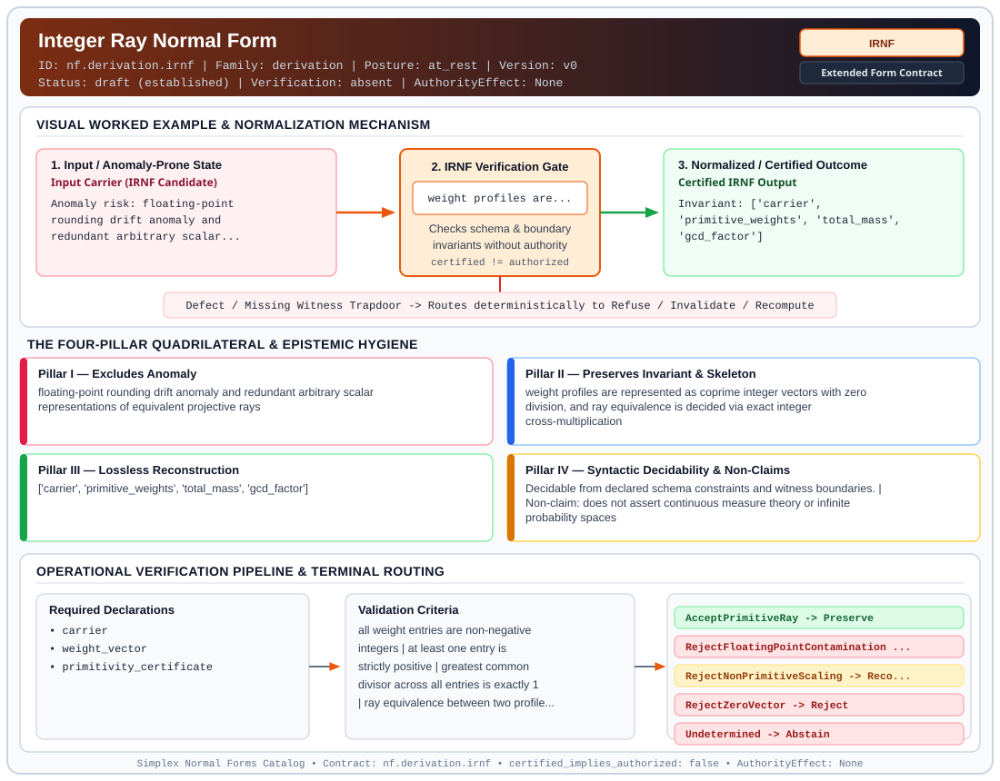

# Integer Ray Normal Form (`IRNF`)

> **Contract ID:** `nf.derivation.irnf` | **Family:** `derivation` | **Index Status:** `draft` | **AuthorityEffect:** `None`

**[⬅ Back to Wiki Home](Home)** | **[View SVG Diagram](images/nf.derivation.irnf.svg)**

---

## 1. Executive Summary & Metadata

Integer Ray Normal Form (IRNF) enforces structural normalization and explicit defect routing in the derivation regime.

| Property | Value |
| :--- | :--- |
| **Canonical ID** | `nf.derivation.irnf` |
| **Short Name** | `IRNF` |
| **Full Name** | Integer Ray Normal Form |
| **Family** | `derivation` (MSS-N Tower Algebraic Derivation, Split Extension-Retraction & Obstruction Contracts) |
| **Qualification** | Extended Form Contract (Normal Form Contract) |
| **Data / Math Posture** | at_rest |
| **Index Status** | `draft` |
| **Theory Status** | `established` |
| **Verification Status** | `absent` |
| **Contract Version** | `v0` |
| **Governance Fence** | `AuthorityEffect: None` (`certified_implies_authorized: false`) |

---

## 2. Visual Architecture & Normalization Diagram



---

## 3. Concrete Worked Example & Mechanism

### Visual Transition Summary

| Stage | Carrier / Operator | Concrete State / Invariant |
| :--- | :--- | :--- |
| **1. Before / Candidate Input** | `Input Carrier (IRNF Candidate)` | Anomaly risk: floating-point ; rounding drift anomaly and ; redundant arbitrary scalar... |
| **2. Normalization / Gate** | `IRNF Verification Gate` | `weight profiles are...` (`certified_implies_authorized: false`) |
| **3. After / Certified Output** | `Certified IRNF Output` | Invariant: ['carrier', ; 'primitive_weights', 'total_mass', ; 'gcd_factor'] |

### Contract-Declared Worked Cases

```yaml
- ref: https://github.com/dbccpage/19L57G1/blob/f1d56c010e6ba10a3b9418bd7cc5953c067250f2/lean4/Derivation/WeightProfile.lean
  section: lean4/Derivation/WeightProfile.lean
  note: ray equivalence without float division
```

---

## 4. The Four-Pillar Quadrilateral & Non-Claims

Every contract in `simplex-normal-forms` is evaluated against the **Four-Pillar Quadrilateral** defined in `contracts/_golden_nfs/standard.yaml`:

| Pillar | Requirement | Contract Specification for `nf.derivation.irnf` |
| :--- | :--- | :--- |
| **Pillar I: Excludes Anomaly** | Name and eliminate a specific class of data or state defects. | floating-point rounding drift anomaly and redundant arbitrary scalar representations of equivalent projective rays |
| **Pillar II: Preserves Invariant** | State the structural invariant and protected skeleton preserved across transitions. | **Invariant:** weight profiles are represented as coprime integer vectors with zero division, and ray equivalence is decided via exact integer cross-multiplication<br>**Protected Skeleton:** ['carrier', 'primitive_weights', 'total_mass', 'gcd_factor'] |
| **Pillar III: Lossless Reconstruction** | State the non-loss reconstruction operator (join, direct sum, pullback, or replay). | Lossless reconstruction under declared projection, direct sum, or pullback operators. |
| **Pillar IV: Syntactic Decidability** | State how conformance is decided from declared constraints without unbudgeted scans. | Decidable from declared schema and witness metadata within bounded evaluation budgets. |

### Explicit Non-Claims (`certified_implies_authorized: false`)

- does not assert continuous measure theory or infinite probability spaces
- does not claim physical probability or Born rule uniqueness
- does not allow division by zero or negative weight components
- does not imply operational authority

---

## 5. Operational Verification & Terminal Routing

### 5.1 Required Declarations

- carrier
- weight_vector
- primitivity_certificate

### 5.2 Required Evidence

- primitive_integer_weights
- gcd_reduction_factor
- total_mass_sum

### 5.3 Validation Criteria

| Criterion ID | Name | Condition |
| :--- | :--- | :--- |
| `criterion` | Check | all weight entries are non-negative integers |
| `criterion` | Check | at least one entry is strictly positive |
| `criterion` | Check | greatest common divisor across all entries is exactly 1 |
| `criterion` | Check | ray equivalence between two profiles satisfies w(p) * total(v) == v(p) * total(w) |
| `criterion` | Check | same_ray may accept two zero vectors, but this primitive-representative contract rejects zero mass before gcd reduction |

### 5.4 Terminal Route Map

Every evaluation terminates in a declared local route mapped to a canonical terminal in `standard.yaml`:

| Local Terminal Route | Canonical Terminal |
| :--- | :--- |
| `AcceptPrimitiveRay` | `Preserve` |
| `RejectFloatingPointContamination` | `Reject` |
| `RejectNonPrimitiveScaling` | `Recompute` |
| `RejectZeroVector` | `Reject` |
| `Undetermined` | `Abstain` |

### 5.5 Declared Failure Modes

- **symptom**: weights are provided with floating-point values or rounding epsilon, **diagnosis**: floating-point contamination violates exact rational arithmetic, **terminal**: RejectFloatingPointContamination
- **symptom**: weights share a common non-trivial integer divisor greater than 1, **diagnosis**: representation is not primitive within its projective ray, **terminal**: RejectNonPrimitiveScaling
- **symptom**: weight vector contains only zeros, **diagnosis**: zero vector does not define a projective ray, **terminal**: RejectZeroVector

---

## 6. Epistemic Claim Hygiene Quadrant

In accordance with the repository's epistemic claim discipline:

1. **What it supports:**
   - Supports syntactic and operational checking of `nf.derivation.irnf` (`IRNF`) against its declared schema, boundary constraints, and witness obligations in this model.
   - Supports deterministic terminal routing (`AcceptPrimitiveRay, RejectFloatingPointContamination, RejectNonPrimitiveScaling, RejectZeroVector`) when required declarations or invariants fail.
2. **What it does not support:**
   - Does not confer operational authority (`AuthorityEffect: None`, `certified_implies_authorized: false`).
   - Does not claim semantic truth of undeclared external processes or unverified upstream inputs beyond the declaredprotected skeleton.
3. **The narrowest defensible claim:**
   - Within the declared substrate `at_rest`, this contract enforces that `floating-point rounding drift anomaly and redundant arbitrary scalar representations of equivalent projective rays` is either excluded under `weight profiles are represented as coprime integer vectors with zero division, and ray equivalence is decided via exact integer cross-multiplication` or routed to an explicit refusal/recovery terminal.
4. **The next test needed:**
   - Property-based falsification and mutation testing across boundary edge cases and composed multi-step pipelines for `nf.derivation.irnf`.

---

## 7. Canonical YAML Contract (`contracts/nf.derivation.irnf.yaml`)

<details>
<summary><strong>Click to expand full canonical YAML contract (contracts/nf.derivation.irnf.yaml)</strong></summary>

```yaml
# Draft declaration: no bound local contract evaluator is supplied; upstream mathematics and schema checks are separate evidence.
schema_version: smplx.nf.contract.v0
contract_kind: form_contract
identity:
  id: nf.derivation.irnf
  name: Integer Ray Normal Form
  short_name: IRNF
  version: v0
  status: draft
  family: derivation
  theory_status: established
  contract_status: draft
  verification_status: absent
classification:
  hierarchy_level: form
  subject_kind:
  - weight_profile
  - projective_premeasure
  - integer_carrier
  data_posture: at_rest
  mathematical_posture: formal_algebraic
purpose:
  excludes_anomaly: floating-point rounding drift anomaly and redundant arbitrary scalar representations
    of equivalent projective rays
  preserves_invariant: weight profiles are represented as coprime integer vectors with zero division,
    and ray equivalence is decided via exact integer cross-multiplication
  protected_skeleton:
  - carrier
  - primitive_weights
  - total_mass
  - gcd_factor
  erased_structure:
  - arbitrary_positive_scalar_multiples
  - floating_point_approximations
  non_claims:
  - does not assert continuous measure theory or infinite probability spaces
  - does not claim physical probability or Born rule uniqueness
  - does not allow division by zero or negative weight components
  - does not imply operational authority
quadrilateral:
  qualifies_as_true_normal_form: false
  qualification_gap: no_project_join_theorem
  anomaly_exclusion: numerical rounding drift and redundant representation of identical relative weight
    profiles
  lossless_join:
    status: projective_scaling_reconstruction
    statement: the unreduced weight vector is reconstructed losslessly by multiplying the primitive representative
      by the scalar factor gcd(w)
  dependency_preservation:
    status: exact_ratios_preserved
    statement: pairwise ratios between all carrier components are preserved identically without precision
      loss
  syntactic_decision:
    status: declaration_decidable
    statement: decided via integer greatest common divisor and cross-multiplication identities over Z
declarations_required:
- carrier
- weight_vector
- primitivity_certificate
evidence_required:
- primitive_integer_weights
- gcd_reduction_factor
- total_mass_sum
validation_criteria:
- all weight entries are non-negative integers
- at least one entry is strictly positive
- greatest common divisor across all entries is exactly 1
- ray equivalence between two profiles satisfies w(p) * total(v) == v(p) * total(w)
- same_ray may accept two zero vectors, but this primitive-representative contract rejects zero mass before
  gcd reduction
terminal_routes:
- AcceptPrimitiveRay
- RejectFloatingPointContamination
- RejectNonPrimitiveScaling
- RejectZeroVector
- Undetermined
terminal_route_map:
  AcceptPrimitiveRay: Preserve
  RejectFloatingPointContamination: Reject
  RejectNonPrimitiveScaling: Recompute
  RejectZeroVector: Reject
  Undetermined: Abstain
certification:
  certificate_required: true
  certificate_kind: integer_ray_certificate
  obstruction_class_required: false
  loss_ledger_required: false
  verifier_required: true
authorization:
  authorized_by: null
  certified_implies_authorized: false
failure_modes:
- symptom: weights are provided with floating-point values or rounding epsilon
  diagnosis: floating-point contamination violates exact rational arithmetic
  terminal: RejectFloatingPointContamination
- symptom: weights share a common non-trivial integer divisor greater than 1
  diagnosis: representation is not primitive within its projective ray
  terminal: RejectNonPrimitiveScaling
- symptom: weight vector contains only zeros
  diagnosis: zero vector does not define a projective ray
  terminal: RejectZeroVector
examples:
- ref: https://github.com/dbccpage/19L57G1/blob/f1d56c010e6ba10a3b9418bd7cc5953c067250f2/lean4/Derivation/WeightProfile.lean
  section: lean4/Derivation/WeightProfile.lean
  note: ray equivalence without float division
references:
- https://github.com/dbccpage/19L57G1/blob/f1d56c010e6ba10a3b9418bd7cc5953c067250f2/docs/GENESIS_CLOSEOUT.md
- ./README.md
```

</details>
