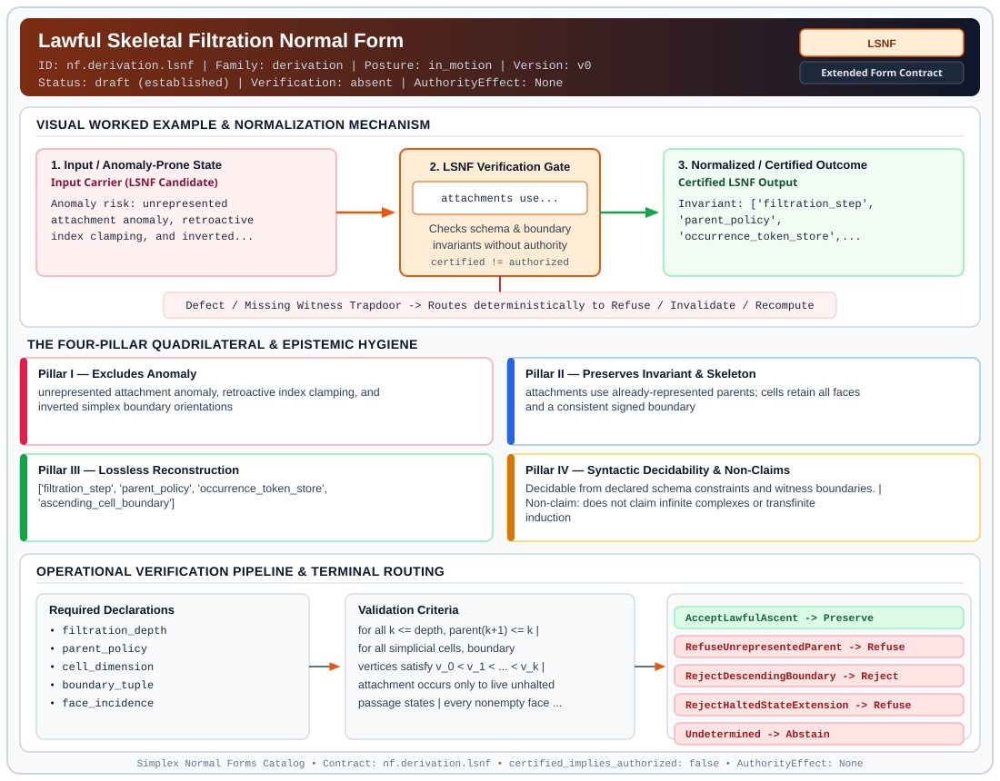

# Lawful Skeletal Filtration Normal Form (`LSNF`)

> **Contract ID:** `nf.derivation.lsnf` | **Family:** `derivation` | **Index Status:** `draft` | **AuthorityEffect:** `None`

**[⬅ Back to Wiki Home](Home)** | **[View SVG Diagram](images/nf.derivation.lsnf.svg)**

---

## 1. Executive Summary & Metadata

Lawful Skeletal Filtration Normal Form (LSNF) enforces structural normalization and explicit defect routing in the derivation regime.

| Property | Value |
| :--- | :--- |
| **Canonical ID** | `nf.derivation.lsnf` |
| **Short Name** | `LSNF` |
| **Full Name** | Lawful Skeletal Filtration Normal Form |
| **Family** | `derivation` (MSS-N Tower Algebraic Derivation, Split Extension-Retraction & Obstruction Contracts) |
| **Qualification** | Extended Form Contract (Normal Form Contract) |
| **Data / Math Posture** | in_motion |
| **Index Status** | `draft` |
| **Theory Status** | `established` |
| **Verification Status** | `absent` |
| **Contract Version** | `v0` |
| **Governance Fence** | `AuthorityEffect: None` (`certified_implies_authorized: false`) |

---

## 2. Visual Architecture & Normalization Diagram



---

## 3. Concrete Worked Example & Mechanism

### Visual Transition Summary

| Stage | Carrier / Operator | Concrete State / Invariant |
| :--- | :--- | :--- |
| **1. Before / Candidate Input** | `Input Carrier (LSNF Candidate)` | Anomaly risk: unrepresented ; attachment anomaly, retroactive ; index clamping, and inverted... |
| **2. Normalization / Gate** | `LSNF Verification Gate` | `attachments use...` (`certified_implies_authorized: false`) |
| **3. After / Certified Output** | `Certified LSNF Output` | Invariant: ['filtration_step', ; 'parent_policy', ; 'occurrence_token_store',... |

### Contract-Declared Worked Cases

```yaml
- ref: https://github.com/dbccpage/19L57G1/blob/f1d56c010e6ba10a3b9418bd7cc5953c067250f2/lean4/Derivation/AttachmentLadder.lean
  section: lean4/Derivation/AttachmentLadder.lean
  note: lawful_to policy check and shell_guard
```

---

## 4. The Four-Pillar Quadrilateral & Non-Claims

Every contract in `simplex-normal-forms` is evaluated against the **Four-Pillar Quadrilateral** defined in `contracts/_golden_nfs/standard.yaml`:

| Pillar | Requirement | Contract Specification for `nf.derivation.lsnf` |
| :--- | :--- | :--- |
| **Pillar I: Excludes Anomaly** | Name and eliminate a specific class of data or state defects. | unrepresented attachment anomaly, retroactive index clamping, and inverted simplex boundary orientations |
| **Pillar II: Preserves Invariant** | State the structural invariant and protected skeleton preserved across transitions. | **Invariant:** attachments use already-represented parents; cells retain all faces and a consistent signed boundary<br>**Protected Skeleton:** ['filtration_step', 'parent_policy', 'occurrence_token_store', 'ascending_cell_boundary'] |
| **Pillar III: Lossless Reconstruction** | State the non-loss reconstruction operator (join, direct sum, pullback, or replay). | Lossless reconstruction under declared projection, direct sum, or pullback operators. |
| **Pillar IV: Syntactic Decidability** | State how conformance is decided from declared constraints without unbudgeted scans. | Decidable from declared schema and witness metadata within bounded evaluation budgets. |

### Explicit Non-Claims (`certified_implies_authorized: false`)

- does not claim infinite complexes or transfinite induction
- does not derive manifold differential forms or smooth curvatures
- does not synthesize attachments without an explicit parent policy
- does not imply operational authority

---

## 5. Operational Verification & Terminal Routing

### 5.1 Required Declarations

- filtration_depth
- parent_policy
- cell_dimension
- boundary_tuple
- face_incidence
- boundary_orientation_convention

### 5.2 Required Evidence

- lawfulness_certificate
- ascent_proof_receipt
- post_state_audit

### 5.3 Validation Criteria

| Criterion ID | Name | Condition |
| :--- | :--- | :--- |
| `criterion` | Check | for all k <= depth, parent(k+1) <= k |
| `criterion` | Check | for all simplicial cells, boundary vertices satisfy v_0 < v_1 < ... < v_k |
| `criterion` | Check | attachment occurs only to live unhalted passage states |
| `criterion` | Check | every nonempty face of every declared cell is present |
| `criterion` | Check | the declared signed boundary matrices compose to zero; ascending vertices alone are insufficient |

### 5.4 Terminal Route Map

Every evaluation terminates in a declared local route mapped to a canonical terminal in `standard.yaml`:

| Local Terminal Route | Canonical Terminal |
| :--- | :--- |
| `AcceptLawfulAscent` | `Preserve` |
| `RefuseUnrepresentedParent` | `Refuse` |
| `RejectDescendingBoundary` | `Reject` |
| `RejectHaltedStateExtension` | `Refuse` |
| `Undetermined` | `Abstain` |

### 5.5 Declared Failure Modes

- **symptom**: child node k+1 specifies parent index exceeding k, **diagnosis**: attachment refers to an unrepresented future node, **terminal**: RefuseUnrepresentedParent
- **symptom**: cell boundary tuple is not strictly ascending, **diagnosis**: boundary vertices violate canonical ascending orientation, **terminal**: RejectDescendingBoundary

---

## 6. Epistemic Claim Hygiene Quadrant

In accordance with the repository's epistemic claim discipline:

1. **What it supports:**
   - Supports syntactic and operational checking of `nf.derivation.lsnf` (`LSNF`) against its declared schema, boundary constraints, and witness obligations in this model.
   - Supports deterministic terminal routing (`AcceptLawfulAscent, RefuseUnrepresentedParent, RejectDescendingBoundary, RejectHaltedStateExtension`) when required declarations or invariants fail.
2. **What it does not support:**
   - Does not confer operational authority (`AuthorityEffect: None`, `certified_implies_authorized: false`).
   - Does not claim semantic truth of undeclared external processes or unverified upstream inputs beyond the declaredprotected skeleton.
3. **The narrowest defensible claim:**
   - Within the declared substrate `in_motion`, this contract enforces that `unrepresented attachment anomaly, retroactive index clamping, and inverted simplex boundary orientations` is either excluded under `attachments use already-represented parents; cells retain all faces and a consistent signed boundary` or routed to an explicit refusal/recovery terminal.
4. **The next test needed:**
   - Property-based falsification and mutation testing across boundary edge cases and composed multi-step pipelines for `nf.derivation.lsnf`.

---

## 7. Canonical YAML Contract (`contracts/nf.derivation.lsnf.yaml`)

<details>
<summary><strong>Click to expand full canonical YAML contract (contracts/nf.derivation.lsnf.yaml)</strong></summary>

```yaml
# Draft declaration: no bound local contract evaluator is supplied; upstream mathematics and schema checks are separate evidence.
schema_version: smplx.nf.contract.v0
contract_kind: form_contract
identity:
  id: nf.derivation.lsnf
  name: Lawful Skeletal Filtration Normal Form
  short_name: LSNF
  version: v0
  status: draft
  family: derivation
  theory_status: established
  contract_status: draft
  verification_status: absent
classification:
  hierarchy_level: form
  subject_kind:
  - skeletal_filtration
  - attachment_ladder
  - simplicial_boundary
  data_posture: in_motion
  mathematical_posture: operational
purpose:
  excludes_anomaly: unrepresented attachment anomaly, retroactive index clamping, and inverted simplex
    boundary orientations
  preserves_invariant: attachments use already-represented parents; cells retain all faces and a consistent
    signed boundary
  protected_skeleton:
  - filtration_step
  - parent_policy
  - occurrence_token_store
  - ascending_cell_boundary
  erased_structure:
  - retroactive_clamping_heuristics
  non_claims:
  - does not claim infinite complexes or transfinite induction
  - does not derive manifold differential forms or smooth curvatures
  - does not synthesize attachments without an explicit parent policy
  - does not imply operational authority
quadrilateral:
  qualifies_as_true_normal_form: false
  qualification_gap: no_project_join_theorem
  anomaly_exclusion: future parent references, missing faces, repeated vertices, and inconsistent orientation
    signs
  lossless_join:
    status: filtration_replay_reconstruction
    statement: the complete skeletal complex is reconstructed losslessly by replaying the lawful UpFamily
      attachment blocks from genesis
  dependency_preservation:
    status: predecessor_dependency_preserved
    statement: parent availability is checked locally at step k without inspecting future extensions
  syntactic_decision:
    status: declaration_decidable
    statement: finite parent and vertex-index checks plus face closure and signed incidence verification
declarations_required:
- filtration_depth
- parent_policy
- cell_dimension
- boundary_tuple
- face_incidence
- boundary_orientation_convention
evidence_required:
- lawfulness_certificate
- ascent_proof_receipt
- post_state_audit
validation_criteria:
- for all k <= depth, parent(k+1) <= k
- for all simplicial cells, boundary vertices satisfy v_0 < v_1 < ... < v_k
- attachment occurs only to live unhalted passage states
- every nonempty face of every declared cell is present
- the declared signed boundary matrices compose to zero; ascending vertices alone are insufficient
terminal_routes:
- AcceptLawfulAscent
- RefuseUnrepresentedParent
- RejectDescendingBoundary
- RejectHaltedStateExtension
- Undetermined
terminal_route_map:
  AcceptLawfulAscent: Preserve
  RefuseUnrepresentedParent: Refuse
  RejectDescendingBoundary: Reject
  RejectHaltedStateExtension: Refuse
  Undetermined: Abstain
certification:
  certificate_required: true
  certificate_kind: skeletal_filtration_certificate
  obstruction_class_required: false
  loss_ledger_required: false
  verifier_required: true
authorization:
  authorized_by: null
  certified_implies_authorized: false
failure_modes:
- symptom: child node k+1 specifies parent index exceeding k
  diagnosis: attachment refers to an unrepresented future node
  terminal: RefuseUnrepresentedParent
- symptom: cell boundary tuple is not strictly ascending
  diagnosis: boundary vertices violate canonical ascending orientation
  terminal: RejectDescendingBoundary
examples:
- ref: https://github.com/dbccpage/19L57G1/blob/f1d56c010e6ba10a3b9418bd7cc5953c067250f2/lean4/Derivation/AttachmentLadder.lean
  section: lean4/Derivation/AttachmentLadder.lean
  note: lawful_to policy check and shell_guard
references:
- https://github.com/dbccpage/19L57G1/blob/f1d56c010e6ba10a3b9418bd7cc5953c067250f2/docs/GENESIS_CLOSEOUT.md
- ./README.md
```

</details>
