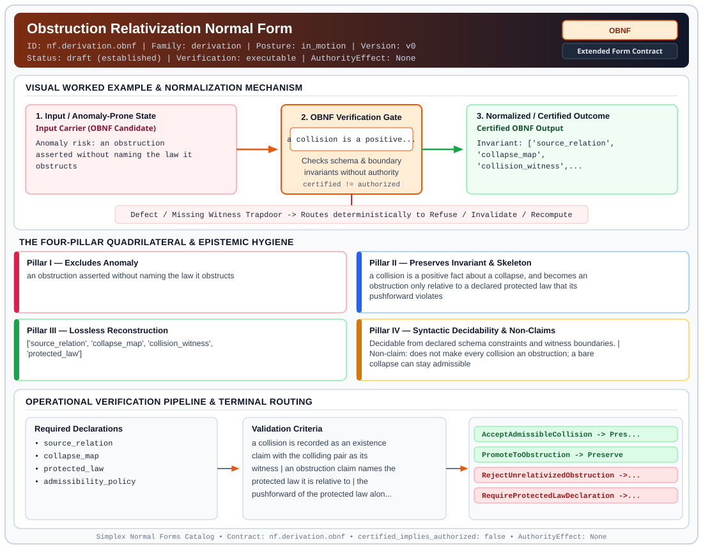

# Obstruction Relativization Normal Form (`OBNF`)

> **Contract ID:** `nf.derivation.obnf` | **Family:** `derivation` | **Index Status:** `draft` | **AuthorityEffect:** `None`

**[⬅ Back to Wiki Home](Home)** | **[View SVG Diagram](images/nf.derivation.obnf.svg)**

---

## 1. Executive Summary & Metadata

Obstruction Relativization Normal Form (OBNF) enforces structural normalization and explicit defect routing in the derivation regime.

| Property | Value |
| :--- | :--- |
| **Canonical ID** | `nf.derivation.obnf` |
| **Short Name** | `OBNF` |
| **Full Name** | Obstruction Relativization Normal Form |
| **Family** | `derivation` (MSS-N Tower Algebraic Derivation, Split Extension-Retraction & Obstruction Contracts) |
| **Qualification** | Extended Form Contract (Normal Form Contract) |
| **Data / Math Posture** | in_motion |
| **Index Status** | `draft` |
| **Theory Status** | `established` |
| **Verification Status** | `executable` |
| **Contract Version** | `v0` |
| **Governance Fence** | `AuthorityEffect: None` (`certified_implies_authorized: false`) |

---

## 2. Visual Architecture & Normalization Diagram



---

## 3. Concrete Worked Example & Mechanism

### Visual Transition Summary

| Stage | Carrier / Operator | Concrete State / Invariant |
| :--- | :--- | :--- |
| **1. Before / Candidate Input** | `Input Carrier (OBNF Candidate)` | Anomaly risk: an obstruction ; asserted without naming the law it ; obstructs |
| **2. Normalization / Gate** | `OBNF Verification Gate` | `a collision is a positive...` (`certified_implies_authorized: false`) |
| **3. After / Certified Output** | `Certified OBNF Output` | Invariant: ['source_relation', ; 'collapse_map', ; 'collision_witness',... |

### Contract-Declared Worked Cases

```yaml
- ref: 19L57G1
  section: paper/primitive_difference.md S3
  note: collision defined prior to any law; obstruction defined relative to one
```

---

## 4. The Four-Pillar Quadrilateral & Non-Claims

Every contract in `simplex-normal-forms` is evaluated against the **Four-Pillar Quadrilateral** defined in `contracts/_golden_nfs/standard.yaml`:

| Pillar | Requirement | Contract Specification for `nf.derivation.obnf` |
| :--- | :--- | :--- |
| **Pillar I: Excludes Anomaly** | Name and eliminate a specific class of data or state defects. | an obstruction asserted without naming the law it obstructs |
| **Pillar II: Preserves Invariant** | State the structural invariant and protected skeleton preserved across transitions. | **Invariant:** a collision is a positive fact about a collapse, and becomes an obstruction only relative to a declared protected law that its pushforward violates<br>**Protected Skeleton:** ['source_relation', 'collapse_map', 'collision_witness', 'protected_law'] |
| **Pillar III: Lossless Reconstruction** | State the non-loss reconstruction operator (join, direct sum, pullback, or replay). | Lossless reconstruction under declared projection, direct sum, or pullback operators. |
| **Pillar IV: Syntactic Decidability** | State how conformance is decided from declared constraints without unbudgeted scans. | Decidable from declared schema and witness metadata within bounded evaluation budgets. |

### Explicit Non-Claims (`certified_implies_authorized: false`)

- does not make every collision an obstruction; a bare collapse can stay admissible
- does not fix which law is protected; that is a declaration, and a different declaration gives a different verdict on the same collapse
- does not derive the collapse map from the relation it collapses
- does not imply authorization

---

## 5. Operational Verification & Terminal Routing

### 5.1 Required Declarations

- source_relation
- collapse_map
- protected_law
- admissibility_policy

### 5.2 Required Evidence

- colliding_pair
- pushforward_of_the_law
- law_status_before_and_after

### 5.3 Validation Criteria

| Criterion ID | Name | Condition |
| :--- | :--- | :--- |
| `criterion` | Check | a collision is recorded as an existence claim with the colliding pair as its witness |
| `criterion` | Check | an obstruction claim names the protected law it is relative to |
| `criterion` | Check | the pushforward of the protected law along the collapse is evaluated, not assumed |
| `criterion` | Check | a collapse whose protected law survives is recorded as an admissible collision, not an obstruction |
| `criterion` | Check | identification of two terms is recorded as always colliding, which is a fact about the map and not yet a defect |

### 5.4 Terminal Route Map

Every evaluation terminates in a declared local route mapped to a canonical terminal in `standard.yaml`:

| Local Terminal Route | Canonical Terminal |
| :--- | :--- |
| `AcceptAdmissibleCollision` | `Preserve` |
| `PromoteToObstruction` | `Preserve` |
| `RejectUnrelativizedObstruction` | `Reject` |
| `RequireProtectedLawDeclaration` | `Refuse` |

### 5.5 Declared Failure Modes

- **symptom**: a merge is reported as an obstruction with no law named, **diagnosis**: obstruction asserted absolutely rather than relative to a protected property, **terminal**: RejectUnrelativizedObstruction
- **symptom**: a collapse is refused although every declared law survives it, **diagnosis**: collision treated as defect, **terminal**: AcceptAdmissibleCollision
- **symptom**: the same collapse is an obstruction in one report and not in another, **diagnosis**: two different protected laws were in force and only one was recorded, **terminal**: RequireProtectedLawDeclaration

---

## 6. Epistemic Claim Hygiene Quadrant

In accordance with the repository's epistemic claim discipline:

1. **What it supports:**
   - Supports syntactic and operational checking of `nf.derivation.obnf` (`OBNF`) against its declared schema, boundary constraints, and witness obligations in this model.
   - Supports deterministic terminal routing (`AcceptAdmissibleCollision, PromoteToObstruction, RejectUnrelativizedObstruction, RequireProtectedLawDeclaration`) when required declarations or invariants fail.
2. **What it does not support:**
   - Does not confer operational authority (`AuthorityEffect: None`, `certified_implies_authorized: false`).
   - Does not claim semantic truth of undeclared external processes or unverified upstream inputs beyond the declaredprotected skeleton.
3. **The narrowest defensible claim:**
   - Within the declared substrate `in_motion`, this contract enforces that `an obstruction asserted without naming the law it obstructs` is either excluded under `a collision is a positive fact about a collapse, and becomes an obstruction only relative to a declared protected law that its pushforward violates` or routed to an explicit refusal/recovery terminal.
4. **The next test needed:**
   - Property-based falsification and mutation testing across boundary edge cases and composed multi-step pipelines for `nf.derivation.obnf`.

---

## 7. Canonical YAML Contract (`contracts/nf.derivation.obnf.yaml`)

<details>
<summary><strong>Click to expand full canonical YAML contract (contracts/nf.derivation.obnf.yaml)</strong></summary>

```yaml
schema_version: smplx.nf.contract.v0
contract_kind: form_contract
identity:
  id: nf.derivation.obnf
  name: Obstruction Relativization Normal Form
  short_name: OBNF
  version: v0
  status: draft
  family: derivation
  theory_status: established
  contract_status: draft
  verification_status: executable
classification:
  hierarchy_level: form
  subject_kind:
  - collapse_map
  - protected_law
  - obstruction_claim
  data_posture: in_motion
  mathematical_posture: operational
purpose:
  excludes_anomaly: an obstruction asserted without naming the law it obstructs
  preserves_invariant: a collision is a positive fact about a collapse, and becomes an obstruction
    only relative to a declared protected law that its pushforward violates
  protected_skeleton:
  - source_relation
  - collapse_map
  - collision_witness
  - protected_law
  erased_structure: []
  non_claims:
  - does not make every collision an obstruction; a bare collapse can stay admissible
  - does not fix which law is protected; that is a declaration, and a different declaration
    gives a different verdict on the same collapse
  - does not derive the collapse map from the relation it collapses
  - does not imply authorization
quadrilateral:
  qualifies_as_true_normal_form: false
  qualification_gap: no_project_join_theorem
  anomaly_exclusion: an obstruction named without the law it is claimed to obstruct
  lossless_join:
    status: not_a_relational_decomposition
    statement: the collapse map is recorded; it is not reconstructed by a natural join
  dependency_preservation:
    status: law_stays_attached_to_the_verdict
    statement: a change of protected law is a different declaration and a different verdict
  syntactic_decision:
    status: declaration_decidable
    statement: the verdict is computed from the collapse, the colliding pair, and the named
      law
declarations_required:
- source_relation
- collapse_map
- protected_law
- admissibility_policy
evidence_required:
- colliding_pair
- pushforward_of_the_law
- law_status_before_and_after
validation_criteria:
- a collision is recorded as an existence claim with the colliding pair as its witness
- an obstruction claim names the protected law it is relative to
- the pushforward of the protected law along the collapse is evaluated, not assumed
- a collapse whose protected law survives is recorded as an admissible collision, not an obstruction
- identification of two terms is recorded as always colliding, which is a fact about the map
  and not yet a defect
proof_obligations:
- id: obnf.identification_always_collides
  status: upstream_theorem
  ref: 19L57G1
  section: paper/primitive_difference.md S3
- id: obnf.collision_becomes_obstruction_under_irreflexivity
  status: upstream_theorem
  ref: 19L57G1
  section: paper/primitive_difference.md S3
terminal_routes:
- AcceptAdmissibleCollision
- PromoteToObstruction
- RejectUnrelativizedObstruction
- RequireProtectedLawDeclaration
certification:
  certificate_required: true
  certificate_kind: collision_certificate
  obstruction_class_required: true
  loss_ledger_required: true
  verifier_required: true
  loss_ledger_trigger_id: null
authorization:
  authorized_by: null
  certified_implies_authorized: false
failure_modes:
- symptom: a merge is reported as an obstruction with no law named
  diagnosis: obstruction asserted absolutely rather than relative to a protected property
  terminal: RejectUnrelativizedObstruction
- symptom: a collapse is refused although every declared law survives it
  diagnosis: collision treated as defect
  terminal: AcceptAdmissibleCollision
- symptom: the same collapse is an obstruction in one report and not in another
  diagnosis: two different protected laws were in force and only one was recorded
  terminal: RequireProtectedLawDeclaration
examples:
- ref: 19L57G1
  section: paper/primitive_difference.md S3
  note: collision defined prior to any law; obstruction defined relative to one
references:
- 19L/PIN.md
- ./nf.derivation.pdnf.yaml
- ./README.md
schema_ref: ./normal_form_contract_schema.yaml
terminal_route_map:
  AcceptAdmissibleCollision: Preserve
  PromoteToObstruction: Preserve
  RejectUnrelativizedObstruction: Reject
  RequireProtectedLawDeclaration: Refuse
```

</details>
