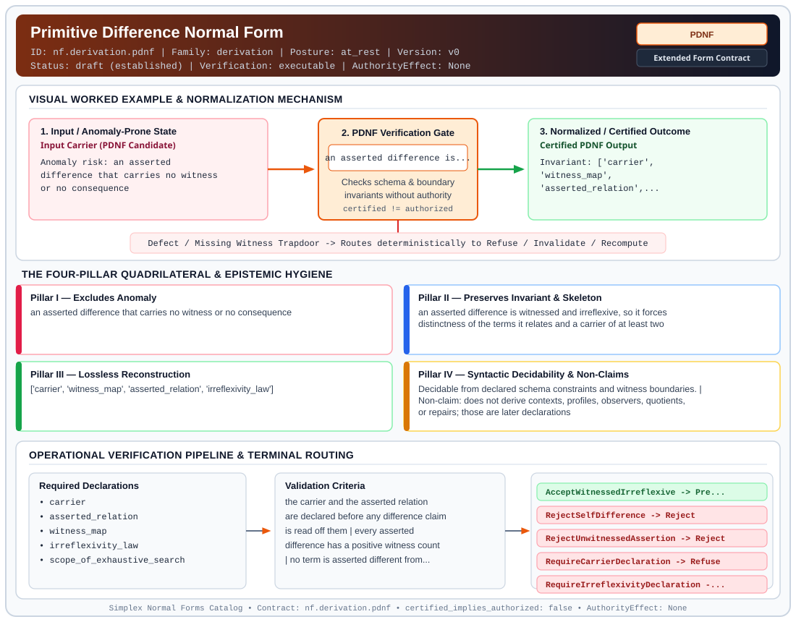

# Primitive Difference Normal Form (`PDNF`)

> **Contract ID:** `nf.derivation.pdnf` | **Family:** `derivation` | **Index Status:** `draft` | **AuthorityEffect:** `None`

**[⬅ Back to Wiki Home](Home)** | **[View SVG Diagram](images/nf.derivation.pdnf.svg)**

---

## 1. Executive Summary & Metadata

Primitive Difference Normal Form (PDNF) enforces structural normalization and explicit defect routing in the derivation regime.

| Property | Value |
| :--- | :--- |
| **Canonical ID** | `nf.derivation.pdnf` |
| **Short Name** | `PDNF` |
| **Full Name** | Primitive Difference Normal Form |
| **Family** | `derivation` (MSS-N Tower Algebraic Derivation, Split Extension-Retraction & Obstruction Contracts) |
| **Qualification** | Extended Form Contract (Normal Form Contract) |
| **Data / Math Posture** | at_rest |
| **Index Status** | `draft` |
| **Theory Status** | `established` |
| **Verification Status** | `executable` |
| **Contract Version** | `v0` |
| **Governance Fence** | `AuthorityEffect: None` (`certified_implies_authorized: false`) |

---

## 2. Visual Architecture & Normalization Diagram



---

## 3. Concrete Worked Example & Mechanism

### Visual Transition Summary

| Stage | Carrier / Operator | Concrete State / Invariant |
| :--- | :--- | :--- |
| **1. Before / Candidate Input** | `Input Carrier (PDNF Candidate)` | Anomaly risk: an asserted ; difference that carries no witness ; or no consequence |
| **2. Normalization / Gate** | `PDNF Verification Gate` | `an asserted difference is...` (`certified_implies_authorized: false`) |
| **3. After / Certified Output** | `Certified PDNF Output` | Invariant: ['carrier', ; 'witness_map', ; 'asserted_relation',... |

### Contract-Declared Worked Cases

```yaml
- ref: 19L57G1
  section: paper/primitive_difference.md
  note: the five candidate readings and the terminal reading among them
```

---

## 4. The Four-Pillar Quadrilateral & Non-Claims

Every contract in `simplex-normal-forms` is evaluated against the **Four-Pillar Quadrilateral** defined in `contracts/_golden_nfs/standard.yaml`:

| Pillar | Requirement | Contract Specification for `nf.derivation.pdnf` |
| :--- | :--- | :--- |
| **Pillar I: Excludes Anomaly** | Name and eliminate a specific class of data or state defects. | an asserted difference that carries no witness or no consequence |
| **Pillar II: Preserves Invariant** | State the structural invariant and protected skeleton preserved across transitions. | **Invariant:** an asserted difference is witnessed and irreflexive, so it forces distinctness of the terms it relates and a carrier of at least two<br>**Protected Skeleton:** ['carrier', 'witness_map', 'asserted_relation', 'irreflexivity_law'] |
| **Pillar III: Lossless Reconstruction** | State the non-loss reconstruction operator (join, direct sum, pullback, or replay). | Lossless reconstruction under declared projection, direct sum, or pullback operators. |
| **Pillar IV: Syntactic Decidability** | State how conformance is decided from declared constraints without unbudgeted scans. | Decidable from declared schema and witness metadata within bounded evaluation budgets. |

### Explicit Non-Claims (`certified_implies_authorized: false`)

- does not derive contexts, profiles, observers, quotients, or repairs; those are later declarations
- does not treat a bare positive apartness datum as a difference, because a one-point carrier can assert one of itself
- does not treat non-factorization through the point as primitive, because that re-expresses the metatheory's own identity
- does not extend its exhaustive scope sweeps beyond the carrier sizes the upstream repository searched
- does not close the upstream open obligations recorded under proof_obligations
- does not imply authorization

---

## 5. Operational Verification & Terminal Routing

### 5.1 Required Declarations

- carrier
- asserted_relation
- witness_map
- irreflexivity_law
- scope_of_exhaustive_search

### 5.2 Required Evidence

- witness_count_per_pair
- carrier_size
- axiom_set_in_force

### 5.3 Validation Criteria

| Criterion ID | Name | Condition |
| :--- | :--- | :--- |
| `criterion` | Check | the carrier and the asserted relation are declared before any difference claim is read off them |
| `criterion` | Check | every asserted difference has a positive witness count |
| `criterion` | Check | no term is asserted different from itself |
| `criterion` | Check | a carrier admitting an asserted difference has at least two terms |
| `criterion` | Check | a claim of minimality names the axiom set it is minimal within |
| `criterion` | Check | the multiplicity of witnesses is not read as further structure, only their presence |

### 5.4 Terminal Route Map

Every evaluation terminates in a declared local route mapped to a canonical terminal in `standard.yaml`:

| Local Terminal Route | Canonical Terminal |
| :--- | :--- |
| `AcceptWitnessedIrreflexive` | `Preserve` |
| `RejectSelfDifference` | `Reject` |
| `RejectUnwitnessedAssertion` | `Reject` |
| `RequireCarrierDeclaration` | `Refuse` |
| `RequireIrreflexivityDeclaration` | `Refuse` |
| `Undetermined` | `Abstain` |

### 5.5 Declared Failure Modes

- **symptom**: a single term is reported as different from itself, **diagnosis**: irreflexivity was not declared, so the assertion has no consequence, **terminal**: RejectSelfDifference
- **symptom**: a difference is asserted with no occurrence recorded for the pair, **diagnosis**: presence was read from the assertion rather than from a witness, **terminal**: RejectUnwitnessedAssertion
- **symptom**: a minimality claim is made with no axiom set named, **diagnosis**: minimal within an undeclared scope is not a claim that can be checked, **terminal**: Undetermined
- **symptom**: a presentation collapses every pair and the difference disappears, **diagnosis**: fidelity of the presentation was assumed rather than imposed, **terminal**: RequireCarrierDeclaration

---

## 6. Epistemic Claim Hygiene Quadrant

In accordance with the repository's epistemic claim discipline:

1. **What it supports:**
   - Supports syntactic and operational checking of `nf.derivation.pdnf` (`PDNF`) against its declared schema, boundary constraints, and witness obligations in this model.
   - Supports deterministic terminal routing (`AcceptWitnessedIrreflexive, RejectSelfDifference, RejectUnwitnessedAssertion, RequireCarrierDeclaration`) when required declarations or invariants fail.
2. **What it does not support:**
   - Does not confer operational authority (`AuthorityEffect: None`, `certified_implies_authorized: false`).
   - Does not claim semantic truth of undeclared external processes or unverified upstream inputs beyond the declaredprotected skeleton.
3. **The narrowest defensible claim:**
   - Within the declared substrate `at_rest`, this contract enforces that `an asserted difference that carries no witness or no consequence` is either excluded under `an asserted difference is witnessed and irreflexive, so it forces distinctness of the terms it relates and a carrier of at least two` or routed to an explicit refusal/recovery terminal.
4. **The next test needed:**
   - Property-based falsification and mutation testing across boundary edge cases and composed multi-step pipelines for `nf.derivation.pdnf`.

---

## 7. Canonical YAML Contract (`contracts/nf.derivation.pdnf.yaml`)

<details>
<summary><strong>Click to expand full canonical YAML contract (contracts/nf.derivation.pdnf.yaml)</strong></summary>

```yaml
schema_version: smplx.nf.contract.v0
contract_kind: form_contract
identity:
  id: nf.derivation.pdnf
  name: Primitive Difference Normal Form
  short_name: PDNF
  version: v0
  status: draft
  family: derivation
  theory_status: established
  contract_status: draft
  verification_status: executable
classification:
  hierarchy_level: form
  subject_kind:
  - difference_datum
  - carrier
  - witness_map
  data_posture: at_rest
  mathematical_posture: operational
purpose:
  excludes_anomaly: an asserted difference that carries no witness or no consequence
  preserves_invariant: an asserted difference is witnessed and irreflexive, so it forces distinctness
    of the terms it relates and a carrier of at least two
  protected_skeleton:
  - carrier
  - witness_map
  - asserted_relation
  - irreflexivity_law
  erased_structure:
  - witness_multiplicity
  non_claims:
  - does not derive contexts, profiles, observers, quotients, or repairs; those are later
    declarations
  - does not treat a bare positive apartness datum as a difference, because a one-point carrier
    can assert one of itself
  - does not treat non-factorization through the point as primitive, because that re-expresses
    the metatheory's own identity
  - does not extend its exhaustive scope sweeps beyond the carrier sizes the upstream repository
    searched
  - does not close the upstream open obligations recorded under proof_obligations
  - does not imply authorization
quadrilateral:
  qualifies_as_true_normal_form: false
  qualification_gap: no_project_join_theorem
  anomaly_exclusion: a difference asserted with no witness, or a difference of a term from
    itself
  lossless_join:
    status: not_a_relational_decomposition
    statement: witness presence is kept and witness multiplicity is erased; that is not a
      lossless join
  dependency_preservation:
    status: irreflexivity_retained
    statement: the irreflexivity law is part of the declaration and is not derived later
  syntactic_decision:
    status: declaration_decidable
    statement: the check reads the carrier, the witness counts, and the irreflexivity law
obstruction_substrate:
  finite_carrier:
    description: a finite carrier with an asserted relation and a witness map to occurrence
      counts
    max_rank: null
  presence_rule: x is present-different from y iff the witness count of the pair is greater
    than zero
  irreflexivity_rule: no term is asserted different from itself
declarations_required:
- carrier
- asserted_relation
- witness_map
- irreflexivity_law
- scope_of_exhaustive_search
evidence_required:
- witness_count_per_pair
- carrier_size
- axiom_set_in_force
validation_criteria:
- the carrier and the asserted relation are declared before any difference claim is read off
  them
- every asserted difference has a positive witness count
- no term is asserted different from itself
- a carrier admitting an asserted difference has at least two terms
- a claim of minimality names the axiom set it is minimal within
- the multiplicity of witnesses is not read as further structure, only their presence
proof_obligations:
- id: pdnf.irreflexivity_forces_distinctness
  status: upstream_theorem
  ref: 19L57G1
  section: lean4/Derivation/PrimDiff.lean
- id: pdnf.no_witness_on_subsingleton
  status: upstream_theorem
  ref: 19L57G1
  section: lean4/Derivation/PrimDiff.lean
- id: pdnf.two_element_realization_classification
  status: upstream_theorem
  ref: 19L57G1
  section: lean4/Derivation/PrimDiff.lean
- id: pdnf.horn_axiom_lattice_classification
  status: open_upstream
  ref: 19L57G1
  section: S9
- id: pdnf.morphism_class_initiality
  status: open_upstream
  ref: 19L57G1
  section: S9
- id: pdnf.proof_relevant_witness_types
  status: open_upstream
  ref: 19L57G1
  section: S9
terminal_routes:
- AcceptWitnessedIrreflexive
- RejectSelfDifference
- RejectUnwitnessedAssertion
- RequireCarrierDeclaration
- RequireIrreflexivityDeclaration
- Undetermined
certification:
  certificate_required: true
  certificate_kind: witness_certificate
  obstruction_class_required: false
  loss_ledger_required: false
  verifier_required: true
  loss_ledger_trigger_id: null
authorization:
  authorized_by: null
  certified_implies_authorized: false
failure_modes:
- symptom: a single term is reported as different from itself
  diagnosis: irreflexivity was not declared, so the assertion has no consequence
  terminal: RejectSelfDifference
- symptom: a difference is asserted with no occurrence recorded for the pair
  diagnosis: presence was read from the assertion rather than from a witness
  terminal: RejectUnwitnessedAssertion
- symptom: a minimality claim is made with no axiom set named
  diagnosis: minimal within an undeclared scope is not a claim that can be checked
  terminal: Undetermined
- symptom: a presentation collapses every pair and the difference disappears
  diagnosis: fidelity of the presentation was assumed rather than imposed
  terminal: RequireCarrierDeclaration
examples:
- ref: 19L57G1
  section: paper/primitive_difference.md
  note: the five candidate readings and the terminal reading among them
references:
- 19L/PIN.md
- ./README.md
schema_ref: ./normal_form_contract_schema.yaml
terminal_route_map:
  AcceptWitnessedIrreflexive: Preserve
  RejectSelfDifference: Reject
  RejectUnwitnessedAssertion: Reject
  RequireCarrierDeclaration: Refuse
  RequireIrreflexivityDeclaration: Refuse
  Undetermined: Abstain
```

</details>
