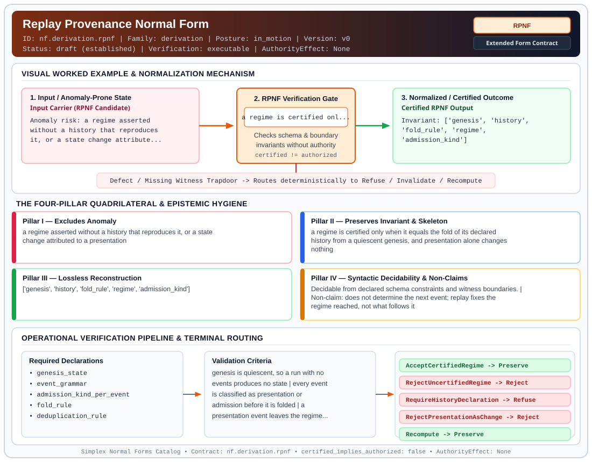

# Replay Provenance Normal Form (`RPNF`)

> **Contract ID:** `nf.derivation.rpnf` | **Family:** `derivation` | **Index Status:** `draft` | **AuthorityEffect:** `None`

**[⬅ Back to Wiki Home](Home)** | **[View SVG Diagram](images/nf.derivation.rpnf.svg)**

---

## 1. Executive Summary & Metadata

Replay Provenance Normal Form (RPNF) enforces structural normalization and explicit defect routing in the derivation regime.

| Property | Value |
| :--- | :--- |
| **Canonical ID** | `nf.derivation.rpnf` |
| **Short Name** | `RPNF` |
| **Full Name** | Replay Provenance Normal Form |
| **Family** | `derivation` (MSS-N Tower Algebraic Derivation, Split Extension-Retraction & Obstruction Contracts) |
| **Qualification** | Extended Form Contract (Normal Form Contract) |
| **Data / Math Posture** | in_motion |
| **Index Status** | `draft` |
| **Theory Status** | `established` |
| **Verification Status** | `executable` |
| **Contract Version** | `v0` |
| **Governance Fence** | `AuthorityEffect: None` (`certified_implies_authorized: false`) |

---

## 2. Visual Architecture & Normalization Diagram



---

## 3. Concrete Worked Example & Mechanism

### Visual Transition Summary

| Stage | Carrier / Operator | Concrete State / Invariant |
| :--- | :--- | :--- |
| **1. Before / Candidate Input** | `Input Carrier (RPNF Candidate)` | Anomaly risk: a regime asserted ; without a history that reproduces ; it, or a state change attribute... |
| **2. Normalization / Gate** | `RPNF Verification Gate` | `a regime is certified onl...` (`certified_implies_authorized: false`) |
| **3. After / Certified Output** | `Certified RPNF Output` | Invariant: ['genesis', 'history', ; 'fold_rule', 'regime', ; 'admission_kind'] |

### Contract-Declared Worked Cases

```yaml
- ref: 19L57G1
  section: paper/paper.md
  note: admission events, the fold from genesis, and the certified-replay condition
```

---

## 4. The Four-Pillar Quadrilateral & Non-Claims

Every contract in `simplex-normal-forms` is evaluated against the **Four-Pillar Quadrilateral** defined in `contracts/_golden_nfs/standard.yaml`:

| Pillar | Requirement | Contract Specification for `nf.derivation.rpnf` |
| :--- | :--- | :--- |
| **Pillar I: Excludes Anomaly** | Name and eliminate a specific class of data or state defects. | a regime asserted without a history that reproduces it, or a state change attributed to a presentation |
| **Pillar II: Preserves Invariant** | State the structural invariant and protected skeleton preserved across transitions. | **Invariant:** a regime is certified only when it equals the fold of its declared history from a quiescent genesis, and presentation alone changes nothing<br>**Protected Skeleton:** ['genesis', 'history', 'fold_rule', 'regime', 'admission_kind'] |
| **Pillar III: Lossless Reconstruction** | State the non-loss reconstruction operator (join, direct sum, pullback, or replay). | Lossless reconstruction under declared projection, direct sum, or pullback operators. |
| **Pillar IV: Syntactic Decidability** | State how conformance is decided from declared constraints without unbudgeted scans. | Decidable from declared schema and witness metadata within bounded evaluation budgets. |

### Explicit Non-Claims (`certified_implies_authorized: false`)

- does not determine the next event; replay fixes the regime reached, not what follows it
- does not treat presentation as admission; supplying a datum is presentation only
- does not select between the available readings of an admission event; no internal fact selects one
- does not certify a regime whose history is partly undeclared
- does not imply authorization

---

## 5. Operational Verification & Terminal Routing

### 5.1 Required Declarations

- genesis_state
- event_grammar
- admission_kind_per_event
- fold_rule
- deduplication_rule

### 5.2 Required Evidence

- full_event_history
- genesis_quiescence
- fold_result
- regime_under_test

### 5.3 Validation Criteria

| Criterion ID | Name | Condition |
| :--- | :--- | :--- |
| `criterion` | Check | genesis is quiescent, so a run with no events produces no state |
| `criterion` | Check | every event is classified as presentation or admission before it is folded |
| `criterion` | Check | a presentation event leaves the regime unchanged |
| `criterion` | Check | an admitted datum already present does not appear twice |
| `criterion` | Check | the regime under test equals the fold of the declared history, recomputed, not compared by summary |
| `criterion` | Check | a history that does not reproduce the regime terminalizes rather than being repaired in place |

### 5.4 Terminal Route Map

Every evaluation terminates in a declared local route mapped to a canonical terminal in `standard.yaml`:

| Local Terminal Route | Canonical Terminal |
| :--- | :--- |
| `AcceptCertifiedRegime` | `Preserve` |
| `RejectUncertifiedRegime` | `Reject` |
| `RequireHistoryDeclaration` | `Refuse` |
| `RejectPresentationAsChange` | `Reject` |
| `Recompute` | `Preserve` |

### 5.5 Declared Failure Modes

- **symptom**: a regime is reported with no history that reaches it, **diagnosis**: certification by assertion rather than by fold, **terminal**: RejectUncertifiedRegime
- **symptom**: state changes when a datum is shown but not admitted, **diagnosis**: presentation treated as admission, **terminal**: RejectPresentationAsChange
- **symptom**: two runs of the same history reach different regimes, **diagnosis**: the fold rule depends on something outside the declared history, **terminal**: RequireHistoryDeclaration
- **symptom**: an empty history produces a nonempty regime, **diagnosis**: genesis was not quiescent, **terminal**: Recompute

---

## 6. Epistemic Claim Hygiene Quadrant

In accordance with the repository's epistemic claim discipline:

1. **What it supports:**
   - Supports syntactic and operational checking of `nf.derivation.rpnf` (`RPNF`) against its declared schema, boundary constraints, and witness obligations in this model.
   - Supports deterministic terminal routing (`AcceptCertifiedRegime, RejectUncertifiedRegime, RequireHistoryDeclaration, RejectPresentationAsChange`) when required declarations or invariants fail.
2. **What it does not support:**
   - Does not confer operational authority (`AuthorityEffect: None`, `certified_implies_authorized: false`).
   - Does not claim semantic truth of undeclared external processes or unverified upstream inputs beyond the declaredprotected skeleton.
3. **The narrowest defensible claim:**
   - Within the declared substrate `in_motion`, this contract enforces that `a regime asserted without a history that reproduces it, or a state change attributed to a presentation` is either excluded under `a regime is certified only when it equals the fold of its declared history from a quiescent genesis, and presentation alone changes nothing` or routed to an explicit refusal/recovery terminal.
4. **The next test needed:**
   - Property-based falsification and mutation testing across boundary edge cases and composed multi-step pipelines for `nf.derivation.rpnf`.

---

## 7. Canonical YAML Contract (`contracts/nf.derivation.rpnf.yaml`)

<details>
<summary><strong>Click to expand full canonical YAML contract (contracts/nf.derivation.rpnf.yaml)</strong></summary>

```yaml
schema_version: smplx.nf.contract.v0
contract_kind: form_contract
identity:
  id: nf.derivation.rpnf
  name: Replay Provenance Normal Form
  short_name: RPNF
  version: v0
  status: draft
  family: derivation
  theory_status: established
  contract_status: draft
  verification_status: executable
classification:
  hierarchy_level: form
  subject_kind:
  - history
  - regime
  - admission_event
  data_posture: in_motion
  mathematical_posture: operational
purpose:
  excludes_anomaly: a regime asserted without a history that reproduces it, or a state change
    attributed to a presentation
  preserves_invariant: a regime is certified only when it equals the fold of its declared
    history from a quiescent genesis, and presentation alone changes nothing
  protected_skeleton:
  - genesis
  - history
  - fold_rule
  - regime
  - admission_kind
  erased_structure:
  - event_order_beyond_the_declared_fold
  non_claims:
  - does not determine the next event; replay fixes the regime reached, not what follows it
  - does not treat presentation as admission; supplying a datum is presentation only
  - does not select between the available readings of an admission event; no internal fact
    selects one
  - does not certify a regime whose history is partly undeclared
  - does not imply authorization
quadrilateral:
  qualifies_as_true_normal_form: false
  qualification_gap: reconstruction_is_replay_not_a_relational_join
  anomaly_exclusion: a regime with no history that folds to it, or a state change credited
    to a presentation
  lossless_join:
    status: replay
    statement: recomputing the declared fold from genesis reproduces the regime
  dependency_preservation:
    status: presentation_does_not_admit
    statement: presentation events are required to leave the regime unchanged
  syntactic_decision:
    status: declaration_decidable
    statement: the check replays the declared history; it does not accept a summary in place
      of the fold
declarations_required:
- genesis_state
- event_grammar
- admission_kind_per_event
- fold_rule
- deduplication_rule
evidence_required:
- full_event_history
- genesis_quiescence
- fold_result
- regime_under_test
validation_criteria:
- genesis is quiescent, so a run with no events produces no state
- every event is classified as presentation or admission before it is folded
- a presentation event leaves the regime unchanged
- an admitted datum already present does not appear twice
- the regime under test equals the fold of the declared history, recomputed, not compared
  by summary
- a history that does not reproduce the regime terminalizes rather than being repaired in
  place
proof_obligations:
- id: rpnf.replay_is_deterministic
  status: upstream_theorem
  ref: 19L57G1
  section: lean4/Derivation/PrimitivePassage.lean
- id: rpnf.presentation_is_not_admission
  status: upstream_theorem
  ref: 19L57G1
  section: paper/paper.md
- id: rpnf.reading_of_admission_unresolved
  status: open_upstream
  ref: 19L57G1
  section: paper/paper.md
terminal_routes:
- AcceptCertifiedRegime
- RejectUncertifiedRegime
- RequireHistoryDeclaration
- RejectPresentationAsChange
- Recompute
certification:
  certificate_required: true
  certificate_kind: replay_certificate
  obstruction_class_required: false
  loss_ledger_required: false
  verifier_required: true
  loss_ledger_trigger_id: null
authorization:
  authorized_by: null
  certified_implies_authorized: false
failure_modes:
- symptom: a regime is reported with no history that reaches it
  diagnosis: certification by assertion rather than by fold
  terminal: RejectUncertifiedRegime
- symptom: state changes when a datum is shown but not admitted
  diagnosis: presentation treated as admission
  terminal: RejectPresentationAsChange
- symptom: two runs of the same history reach different regimes
  diagnosis: the fold rule depends on something outside the declared history
  terminal: RequireHistoryDeclaration
- symptom: an empty history produces a nonempty regime
  diagnosis: genesis was not quiescent
  terminal: Recompute
examples:
- ref: 19L57G1
  section: paper/paper.md
  note: admission events, the fold from genesis, and the certified-replay condition
references:
- 19L/PIN.md
- ./nf.derivation.aonf.yaml
- ./README.md
schema_ref: ./normal_form_contract_schema.yaml
terminal_route_map:
  AcceptCertifiedRegime: Preserve
  RejectUncertifiedRegime: Reject
  RequireHistoryDeclaration: Refuse
  RejectPresentationAsChange: Reject
  Recompute: Preserve
```

</details>
