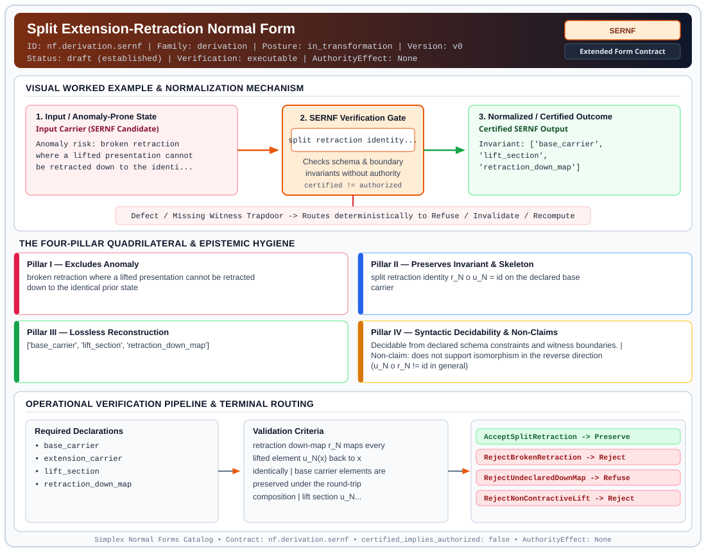

# Split Extension-Retraction Normal Form (`SERNF`)

> **Contract ID:** `nf.derivation.sernf` | **Family:** `derivation` | **Index Status:** `draft` | **AuthorityEffect:** `None`

**[⬅ Back to Wiki Home](Home)** | **[View SVG Diagram](images/nf.derivation.sernf.svg)**

---

## 1. Executive Summary & Metadata

Split Extension-Retraction Normal Form (SERNF) enforces structural normalization and explicit defect routing in the derivation regime.

| Property | Value |
| :--- | :--- |
| **Canonical ID** | `nf.derivation.sernf` |
| **Short Name** | `SERNF` |
| **Full Name** | Split Extension-Retraction Normal Form |
| **Family** | `derivation` (MSS-N Tower Algebraic Derivation, Split Extension-Retraction & Obstruction Contracts) |
| **Qualification** | Extended Form Contract (Normal Form Contract) |
| **Data / Math Posture** | in_transformation |
| **Index Status** | `draft` |
| **Theory Status** | `established` |
| **Verification Status** | `executable` |
| **Contract Version** | `v0` |
| **Governance Fence** | `AuthorityEffect: None` (`certified_implies_authorized: false`) |

---

## 2. Visual Architecture & Normalization Diagram



---

## 3. Concrete Worked Example & Mechanism

### Visual Transition Summary

| Stage | Carrier / Operator | Concrete State / Invariant |
| :--- | :--- | :--- |
| **1. Before / Candidate Input** | `Input Carrier (SERNF Candidate)` | Anomaly risk: broken retraction ; where a lifted presentation cannot ; be retracted down to the identi... |
| **2. Normalization / Gate** | `SERNF Verification Gate` | `split retraction identity...` (`certified_implies_authorized: false`) |
| **3. After / Certified Output** | `Certified SERNF Output` | Invariant: ['base_carrier', ; 'lift_section', ; 'retraction_down_map'] |

---

## 4. The Four-Pillar Quadrilateral & Non-Claims

Every contract in `simplex-normal-forms` is evaluated against the **Four-Pillar Quadrilateral** defined in `contracts/_golden_nfs/standard.yaml`:

| Pillar | Requirement | Contract Specification for `nf.derivation.sernf` |
| :--- | :--- | :--- |
| **Pillar I: Excludes Anomaly** | Name and eliminate a specific class of data or state defects. | broken retraction where a lifted presentation cannot be retracted down to the identical prior state |
| **Pillar II: Preserves Invariant** | State the structural invariant and protected skeleton preserved across transitions. | **Invariant:** split retraction identity r_N o u_N = id on the declared base carrier<br>**Protected Skeleton:** ['base_carrier', 'lift_section', 'retraction_down_map'] |
| **Pillar III: Lossless Reconstruction** | State the non-loss reconstruction operator (join, direct sum, pullback, or replay). | Lossless reconstruction under declared projection, direct sum, or pullback operators. |
| **Pillar IV: Syntactic Decidability** | State how conformance is decided from declared constraints without unbudgeted scans. | Decidable from declared schema and witness metadata within bounded evaluation budgets. |

### Explicit Non-Claims (`certified_implies_authorized: false`)

- does not support isomorphism in the reverse direction (u_N o r_N != id in general)
- does not grant execution authority

---

## 5. Operational Verification & Terminal Routing

### 5.1 Required Declarations

- base_carrier
- extension_carrier
- lift_section
- retraction_down_map

### 5.2 Required Evidence

- base_carrier_size
- point_evaluation_receipts

### 5.3 Validation Criteria

| Criterion ID | Name | Condition |
| :--- | :--- | :--- |
| `criterion` | Check | retraction down-map r_N maps every lifted element u_N(x) back to x identically |
| `criterion` | Check | base carrier elements are preserved under the round-trip composition |
| `criterion` | Check | lift section u_N introduces no ungrounded extra symbols outside declared alphabet |

### 5.4 Terminal Route Map

Every evaluation terminates in a declared local route mapped to a canonical terminal in `standard.yaml`:

| Local Terminal Route | Canonical Terminal |
| :--- | :--- |
| `AcceptSplitRetraction` | `Preserve` |
| `RejectBrokenRetraction` | `Reject` |
| `RejectUndeclaredDownMap` | `Refuse` |
| `RejectNonContractiveLift` | `Reject` |

### 5.5 Declared Failure Modes

- **symptom**: evaluating r_N(u_N(x)) on base element x yields y != x, **diagnosis**: broken split retraction, **terminal**: RejectBrokenRetraction
- **symptom**: lift u_N declared without an explicit retraction down-map r_N, **diagnosis**: undeclared down-map, **terminal**: RejectUndeclaredDownMap

---

## 6. Epistemic Claim Hygiene Quadrant

In accordance with the repository's epistemic claim discipline:

1. **What it supports:**
   - Supports syntactic and operational checking of `nf.derivation.sernf` (`SERNF`) against its declared schema, boundary constraints, and witness obligations in this model.
   - Supports deterministic terminal routing (`AcceptSplitRetraction, RejectBrokenRetraction, RejectUndeclaredDownMap, RejectNonContractiveLift`) when required declarations or invariants fail.
2. **What it does not support:**
   - Does not confer operational authority (`AuthorityEffect: None`, `certified_implies_authorized: false`).
   - Does not claim semantic truth of undeclared external processes or unverified upstream inputs beyond the declaredprotected skeleton.
3. **The narrowest defensible claim:**
   - Within the declared substrate `in_transformation`, this contract enforces that `broken retraction where a lifted presentation cannot be retracted down to the identical prior state` is either excluded under `split retraction identity r_N o u_N = id on the declared base carrier` or routed to an explicit refusal/recovery terminal.
4. **The next test needed:**
   - Property-based falsification and mutation testing across boundary edge cases and composed multi-step pipelines for `nf.derivation.sernf`.

---

## 7. Canonical YAML Contract (`contracts/nf.derivation.sernf.yaml`)

<details>
<summary><strong>Click to expand full canonical YAML contract (contracts/nf.derivation.sernf.yaml)</strong></summary>

```yaml
schema_version: smplx.nf.contract.v0
contract_kind: form_contract
identity:
  id: nf.derivation.sernf
  name: Split Extension-Retraction Normal Form
  short_name: SERNF
  version: v0
  status: draft
  family: derivation
  theory_status: established
  contract_status: draft
  verification_status: executable
classification:
  hierarchy_level: form
  subject_kind:
  - presentation_tower
  - lift_section
  - retraction_down_map
  data_posture: in_transformation
  mathematical_posture: operational
purpose:
  excludes_anomaly: broken retraction where a lifted presentation cannot be retracted down to the identical prior state
  preserves_invariant: split retraction identity r_N o u_N = id on the declared base carrier
  protected_skeleton:
  - base_carrier
  - lift_section
  - retraction_down_map
  erased_structure:
  - ambient_presentation_padding
  non_claims:
  - does not support isomorphism in the reverse direction (u_N o r_N != id in general)
  - does not grant execution authority
declarations_required:
- base_carrier
- extension_carrier
- lift_section
- retraction_down_map
evidence_required:
- base_carrier_size
- point_evaluation_receipts
validation_criteria:
- retraction down-map r_N maps every lifted element u_N(x) back to x identically
- base carrier elements are preserved under the round-trip composition
- lift section u_N introduces no ungrounded extra symbols outside declared alphabet
proof_obligations:
- id: sernf.split_retraction_identity
  status: upstream_theorem
  ref: 002_s_n
  section: grammar/sn.ebnf
terminal_routes:
- AcceptSplitRetraction
- RejectBrokenRetraction
- RejectUndeclaredDownMap
- RejectNonContractiveLift
terminal_route_map:
  AcceptSplitRetraction: Preserve
  RejectBrokenRetraction: Reject
  RejectUndeclaredDownMap: Refuse
  RejectNonContractiveLift: Reject
certification:
  certificate_required: true
  certificate_kind: split_retraction_certificate
  obstruction_class_required: false
  loss_ledger_required: false
  verifier_required: true
authorization:
  authorized_by: null
  certified_implies_authorized: false
failure_modes:
- symptom: evaluating r_N(u_N(x)) on base element x yields y != x
  diagnosis: broken split retraction
  terminal: RejectBrokenRetraction
- symptom: lift u_N declared without an explicit retraction down-map r_N
  diagnosis: undeclared down-map
  terminal: RejectUndeclaredDownMap
definition:
  formal_statement: a presentation extension u_N from S(n) to S(n+1) is in Split Extension-Retraction Normal Form iff there exists a retraction down-map r_N such that r_N(u_N(x)) = x for all x in S(n)
  quadrilateral:
    qualifies_as_true_normal_form: false
    qualification_gap: reconstruction_via_retraction_not_relational_project_join
    anomaly_exclusion: broken retraction leaving prior levels irrecoverable
    lossless_join:
      status: retraction_reconstruction
      statement: prior level state is recovered identically via down-map retraction r_N
    dependency_preservation:
      status: preserved_on_base
      statement: base relations and constraints are preserved under the section lift
    syntactic_decision:
      status: declaration_decidable
      statement: decidable by evaluating the composition on finite generators of the base carrier
schema_ref: ./normal_form_contract_schema.yaml
```

</details>
