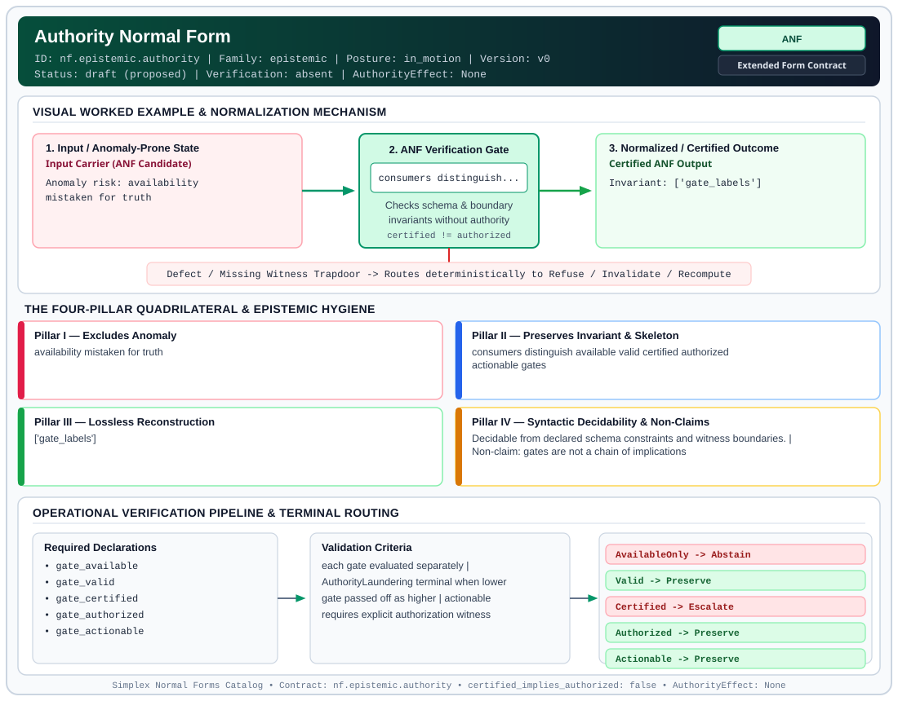

# Authority Normal Form (`ANF`)

> **Contract ID:** `nf.epistemic.authority` | **Family:** `epistemic` | **Index Status:** `draft` | **AuthorityEffect:** `None`

**[⬅ Back to Wiki Home](Home)** | **[View SVG Diagram](images/nf.epistemic.authority.svg)**

---

## 1. Executive Summary & Metadata

Authority Normal Form (ANF) enforces structural normalization and explicit defect routing in the epistemic regime.

| Property | Value |
| :--- | :--- |
| **Canonical ID** | `nf.epistemic.authority` |
| **Short Name** | `ANF` |
| **Full Name** | Authority Normal Form |
| **Family** | `epistemic` (Observer-Relative Epistemic, Freshness, Context, Provenance & Distinguishability Contracts) |
| **Qualification** | Extended Form Contract (Normal Form Contract) |
| **Data / Math Posture** | in_motion |
| **Index Status** | `draft` |
| **Theory Status** | `proposed` |
| **Verification Status** | `absent` |
| **Contract Version** | `v0` |
| **Governance Fence** | `AuthorityEffect: None` (`certified_implies_authorized: false`) |

---

## 2. Visual Architecture & Normalization Diagram



---

## 3. Concrete Worked Example & Mechanism

### Visual Transition Summary

| Stage | Carrier / Operator | Concrete State / Invariant |
| :--- | :--- | :--- |
| **1. Before / Candidate Input** | `Input Carrier (ANF Candidate)` | Anomaly risk: availability ; mistaken for truth |
| **2. Normalization / Gate** | `ANF Verification Gate` | `consumers distinguish...` (`certified_implies_authorized: false`) |
| **3. After / Certified Output** | `Certified ANF Output` | Invariant: ['gate_labels'] |

---

## 4. The Four-Pillar Quadrilateral & Non-Claims

Every contract in `simplex-normal-forms` is evaluated against the **Four-Pillar Quadrilateral** defined in `contracts/_golden_nfs/standard.yaml`:

| Pillar | Requirement | Contract Specification for `nf.epistemic.authority` |
| :--- | :--- | :--- |
| **Pillar I: Excludes Anomaly** | Name and eliminate a specific class of data or state defects. | availability mistaken for truth |
| **Pillar II: Preserves Invariant** | State the structural invariant and protected skeleton preserved across transitions. | **Invariant:** consumers distinguish available valid certified authorized actionable gates<br>**Protected Skeleton:** ['gate_labels'] |
| **Pillar III: Lossless Reconstruction** | State the non-loss reconstruction operator (join, direct sum, pullback, or replay). | Lossless reconstruction under declared projection, direct sum, or pullback operators. |
| **Pillar IV: Syntactic Decidability** | State how conformance is decided from declared constraints without unbudgeted scans. | Decidable from declared schema and witness metadata within bounded evaluation budgets. |

### Explicit Non-Claims (`certified_implies_authorized: false`)

- gates are not a chain of implications
- available does not imply valid
- certified does not imply authorized

---

## 5. Operational Verification & Terminal Routing

### 5.1 Required Declarations

- gate_available
- gate_valid
- gate_certified
- gate_authorized
- gate_actionable

### 5.2 Required Evidence

- per_gate boolean or enum with witness ref

### 5.3 Validation Criteria

| Criterion ID | Name | Condition |
| :--- | :--- | :--- |
| `criterion` | Check | each gate evaluated separately |
| `criterion` | Check | AuthorityLaundering terminal when lower gate passed off as higher |
| `criterion` | Check | actionable requires explicit authorization witness |

### 5.4 Terminal Route Map

Every evaluation terminates in a declared local route mapped to a canonical terminal in `standard.yaml`:

| Local Terminal Route | Canonical Terminal |
| :--- | :--- |
| `AvailableOnly` | `Abstain` |
| `Valid` | `Preserve` |
| `Certified` | `Escalate` |
| `Authorized` | `Preserve` |
| `Actionable` | `Preserve` |
| `AuthorityLaundering` | `Refuse` |
| `Refuse` | `Refuse` |

### 5.5 Declared Failure Modes

_All defects route explicitly through the Terminal Route Map above._

---

## Deep-Dive Level Treatise

**AuthorityEffect:** None.  
**Level:** Level 15 (Data under Observation / Freshness Posets & Authority Stacks)  
**Evidential Grade:** NATIVE IMPLEMENTED  
**Contract References:** [`nf.epistemic.authority`](../../../../omega_engine_pfp/infrastructure/yaml/normal_forms/nf.epistemic.authority.yaml), [`nf.epistemic.freshness`](../../../../omega_engine_pfp/infrastructure/yaml/normal_forms/nf.epistemic.freshness.yaml)  
**Mathematical Posture:** Causal Poset Bounds & Multi-Tier Authority Stacks  
**Data Posture:** Under Observation  

---

## 1. Schematic & Conceptual Architecture

In distributed, cached, or agent-mediated systems, data does not directly exist; it is **observed** under specific visibility, temporal, and authority bounds:
- **Freshness Normal Form:** Asserts that a read claim is governed by an explicit invalidation frontier ($\tau_{\text{inv}}$) and bounded age $(\Delta t \le t_{\text{max}})$. A raw timestamp is *never* authority without an explicit invalidation check.
- **Authority Stack:** Partitions truth status into five non-conflated tiers:
  $$\text{Declared} \longrightarrow \text{Available} \longrightarrow \text{Valid} \longrightarrow \text{Certified} \longrightarrow \text{Authorized}$$
- **The Golden Rule of Authority:**
  $$\boxed{\text{Certified} \centernot\implies \text{Authorized}}$$
  A certificate is a mathematical receipt that an invariant was checked; authorization is an operational decision granted only by an authorized policy engine.

```text
       Raw Observed Data
               │
               ▼
       Freshness Invariant: age <= t_max AND no invalidation receipt
               │
               ▼
       Certificate Verification (e.g. BQNF / CODA-MUR)
               │
               ▼
       Policy Engine Authorization (Checks Lineage & Permissions)
               │
               ▼
       Actionable Operational Output
```

---

## 2. Mathematical Invariants & Quadrilateral Properties

1. **Freshness Poset Bound:**
   An observation $O$ at physical time $t$ over entity $E$ is fresh with respect to threshold $\Delta t_{\text{max}}$ if and only if:
   $$t - O.\text{snapshot\_time} \le \Delta t_{\text{max}} \quad \land \quad \forall e \in \text{CDC}(E): e.\text{time} \le O.\text{snapshot\_time}$$

2. **The Quadrilateral Invariants:**
   - **Anomaly Excluded:** Reading stale cached facts, authority laundering from unverified certificates, timestamp manipulation.
   - **Protected Skeleton:** Snapshot identifiers, invalidation frontiers, and cryptographic certificate digests.
   - **Erased Structure:** Volatile network delivery delays and uncertified intermediate cache layers.
   - **Reconstruction:** Pull through verified invalidation frontiers.

---

## 3. Terminal Routes & Verification Logic

```text
Observed Data Claim & Freshness Assertion
      │
      ├── Fresh within bound, certificate verified ──► Preserve (AuthorityValid)
      │
      ├── Age exceeds bound or invalidation logged ──► Refuse (StaleReadRefused)
      │
      ├── Certificate present but policy rejects ────► Quarantine (UnauthorisedCertificate)
      │
      └── Bypassed verifier detected ────────────────► Refuse (AuthorityLaundering)
```

---

## 4. Test Evidence & Local Execution

Verified in [`test_observer_freshness_certificate_property.py`](../../../tests/normal_forms/test_observer_freshness_certificate_property.py) and [`test_tranche8_epistemic_and_authority.py`](../../../tests/normal_forms/test_tranche8_epistemic_and_authority.py):
- `test_freshness_timestamp_without_invalidation_fails`: Verifies that supplying a timestamp without active invalidation evidence fails closed.
- `test_certified_does_not_imply_authorized`: Asserts that setting `certified_implies_authorized: true` trips schema refusal.

---

## 5. Epistemic Claim Quadrant

1. **What it supports:**
   - Formal boundary defense against stale reads in distributed cache networks.
   - Strict separation between mathematical verification and operational authority.
2. **What it does not support:**
   - Perfect clock synchronization across Byzantine asynchronous networks without consensus protocols.
3. **The narrowest defensible claim:**
   - Freshness and authority contracts prevent any cached representation from acting as an authoritative source without an active invalidation check.
4. **The next test needed:**
   - Property tests under simulated network partitions verifying that partitioned observers degrade gracefully to typed refusal (`Abstain`).

---

## 6. Epistemic Claim Hygiene Quadrant

In accordance with the repository's epistemic claim discipline:

1. **What it supports:**
   - Supports syntactic and operational checking of `nf.epistemic.authority` (`ANF`) against its declared schema, boundary constraints, and witness obligations in this model.
   - Supports deterministic terminal routing (`AvailableOnly, Valid, Certified, Authorized`) when required declarations or invariants fail.
2. **What it does not support:**
   - Does not confer operational authority (`AuthorityEffect: None`, `certified_implies_authorized: false`).
   - Does not claim semantic truth of undeclared external processes or unverified upstream inputs beyond the declaredprotected skeleton.
3. **The narrowest defensible claim:**
   - Within the declared substrate `in_motion`, this contract enforces that `availability mistaken for truth` is either excluded under `consumers distinguish available valid certified authorized actionable gates` or routed to an explicit refusal/recovery terminal.
4. **The next test needed:**
   - Property-based falsification and mutation testing across boundary edge cases and composed multi-step pipelines for `nf.epistemic.authority`.

---

## 7. Canonical YAML Contract (`contracts/nf.epistemic.authority.yaml`)

<details>
<summary><strong>Click to expand full canonical YAML contract (contracts/nf.epistemic.authority.yaml)</strong></summary>

```yaml
schema_version: smplx.nf.contract.v0
contract_kind: normal_form_contract
identity:
  id: nf.epistemic.authority
  name: Authority Normal Form
  short_name: ANF
  version: v0
  status: draft
  family: epistemic
  theory_status: proposed
  contract_status: draft
  verification_status: absent
classification:
  hierarchy_level: normal_form
  subject_kind:
  - distributed_claim
  data_posture: in_motion
  mathematical_posture: operational
purpose:
  excludes_anomaly: availability mistaken for truth
  preserves_invariant: consumers distinguish available valid certified authorized
    actionable gates
  protected_skeleton:
  - gate_labels
  erased_structure: []
  non_claims:
  - gates are not a chain of implications
  - available does not imply valid
  - certified does not imply authorized
declarations_required:
- gate_available
- gate_valid
- gate_certified
- gate_authorized
- gate_actionable
evidence_required:
- per_gate boolean or enum with witness ref
validation_criteria:
- each gate evaluated separately
- AuthorityLaundering terminal when lower gate passed off as higher
- actionable requires explicit authorization witness
proof_obligations: []
terminal_routes:
- AvailableOnly
- Valid
- Certified
- Authorized
- Actionable
- AuthorityLaundering
- Refuse
certification:
  certificate_required: true
  certificate_kind: authority_gate_packet
  obstruction_class_required: false
  loss_ledger_required: false
  verifier_required: true
authorization:
  authorized_by: null
  certified_implies_authorized: false
references:
- ../1_normal_forms.md
- ../nf.coda.mur.transport.yaml
terminal_route_map:
  AvailableOnly: Abstain
  Valid: Preserve
  Certified: Escalate
  Authorized: Preserve
  Actionable: Preserve
  AuthorityLaundering: Refuse
  Refuse: Refuse
definition:
  source: coda_all_universe/mssn_sn_tower/definitions.md
  formal_statement: availability mistaken for truth. consumers distinguish available
    valid certified authorized actionable gates
  quadrilateral:
    qualifies_as_true_normal_form: false
    qualification_gap: reconstruction_is_not_a_relational_project_join
    anomaly_exclusion: availability mistaken for truth
    lossless_join:
      status: declared_reconstruction
      statement: consumers distinguish available valid certified authorized actionable
        gates
    dependency_preservation:
      status: declared_with_the_invariant
      statement: The preserved invariant stays on the declared schema. This form does
        not state a functional-dependency projection of a flat relvar decomposition.
    syntactic_decision:
      status: declaration_decidable
      statement: The check reads the declared constraints and validation criteria.
        One unrecorded runtime image is not the decider.
schema_ref: ./normal_form_contract_schema.yaml
```

</details>
