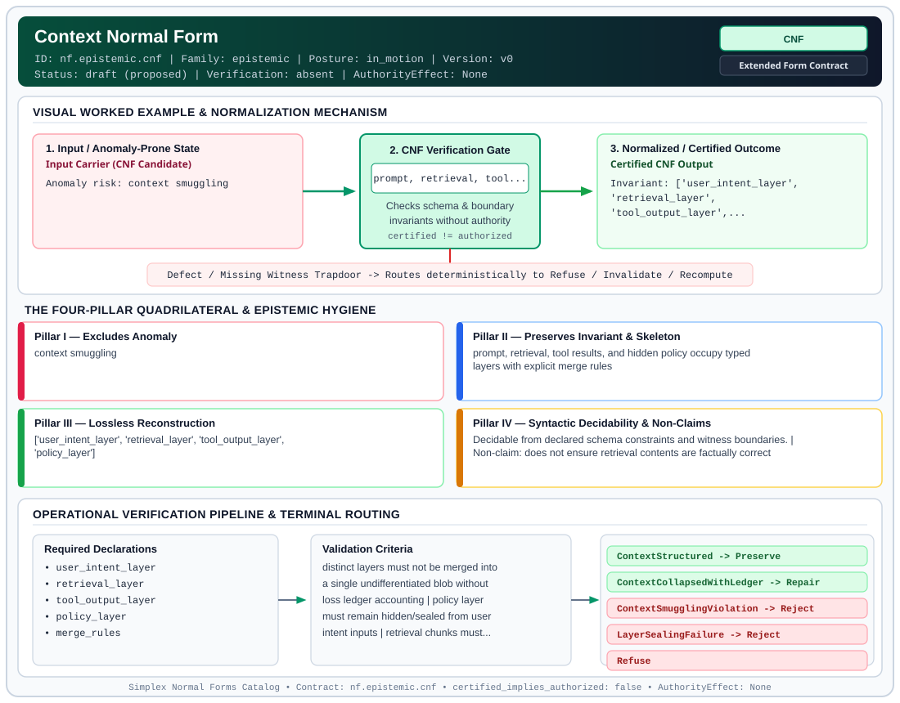

# Context Normal Form (`CNF`)

> **Contract ID:** `nf.epistemic.cnf` | **Family:** `epistemic` | **Index Status:** `draft` | **AuthorityEffect:** `None`

**[⬅ Back to Wiki Home](Home)** | **[View SVG Diagram](images/nf.epistemic.cnf.svg)**

---

## 1. Executive Summary & Metadata

Context Normal Form (CNF) enforces structural normalization and explicit defect routing in the epistemic regime.

| Property | Value |
| :--- | :--- |
| **Canonical ID** | `nf.epistemic.cnf` |
| **Short Name** | `CNF` |
| **Full Name** | Context Normal Form |
| **Family** | `epistemic` (Observer-Relative Epistemic, Freshness, Context, Provenance & Distinguishability Contracts) |
| **Qualification** | Extended Form Contract (Normal Form Contract) |
| **Data / Math Posture** | in_motion |
| **Index Status** | `draft` |
| **Theory Status** | `proposed` |
| **Verification Status** | `absent` |
| **Contract Version** | `v0` |
| **Governance Fence** | `AuthorityEffect: None` (`certified_implies_authorized: false`) |

---

## 2. Visual Architecture & Normalization Diagram



---

## 3. Concrete Worked Example & Mechanism

### Visual Transition Summary

| Stage | Carrier / Operator | Concrete State / Invariant |
| :--- | :--- | :--- |
| **1. Before / Candidate Input** | `Input Carrier (CNF Candidate)` | Anomaly risk: context smuggling |
| **2. Normalization / Gate** | `CNF Verification Gate` | `prompt, retrieval, tool...` (`certified_implies_authorized: false`) |
| **3. After / Certified Output** | `Certified CNF Output` | Invariant: ['user_intent_layer', ; 'retrieval_layer', ; 'tool_output_layer',... |

---

## 4. The Four-Pillar Quadrilateral & Non-Claims

Every contract in `simplex-normal-forms` is evaluated against the **Four-Pillar Quadrilateral** defined in `contracts/_golden_nfs/standard.yaml`:

| Pillar | Requirement | Contract Specification for `nf.epistemic.cnf` |
| :--- | :--- | :--- |
| **Pillar I: Excludes Anomaly** | Name and eliminate a specific class of data or state defects. | context smuggling |
| **Pillar II: Preserves Invariant** | State the structural invariant and protected skeleton preserved across transitions. | **Invariant:** prompt, retrieval, tool results, and hidden policy occupy typed layers with explicit merge rules<br>**Protected Skeleton:** ['user_intent_layer', 'retrieval_layer', 'tool_output_layer', 'policy_layer'] |
| **Pillar III: Lossless Reconstruction** | State the non-loss reconstruction operator (join, direct sum, pullback, or replay). | Lossless reconstruction under declared projection, direct sum, or pullback operators. |
| **Pillar IV: Syntactic Decidability** | State how conformance is decided from declared constraints without unbudgeted scans. | Decidable from declared schema and witness metadata within bounded evaluation budgets. |

### Explicit Non-Claims (`certified_implies_authorized: false`)

- does not ensure retrieval contents are factually correct

---

## 5. Operational Verification & Terminal Routing

### 5.1 Required Declarations

- user_intent_layer
- retrieval_layer
- tool_output_layer
- policy_layer
- merge_rules

### 5.2 Required Evidence

- source_id per retrieval chunk
- signature or seal for policy layer
- sequence_index of interaction

### 5.3 Validation Criteria

| Criterion ID | Name | Condition |
| :--- | :--- | :--- |
| `criterion` | Check | distinct layers must not be merged into a single undifferentiated blob without loss ledger accounting |
| `criterion` | Check | policy layer must remain hidden/sealed from user intent inputs |
| `criterion` | Check | retrieval chunks must carry source identifiers |

### 5.4 Terminal Route Map

Every evaluation terminates in a declared local route mapped to a canonical terminal in `standard.yaml`:

| Local Terminal Route | Canonical Terminal |
| :--- | :--- |
| `ContextStructured` | `Preserve` |
| `ContextCollapsedWithLedger` | `Repair` |
| `ContextSmugglingViolation` | `Reject` |
| `LayerSealingFailure` | `Reject` |
| `Refuse` | `Refuse` |

### 5.5 Declared Failure Modes

- **symptom**: prompt injection or smuggling via undifferentiated block of user and tool text, **diagnosis**: context smuggling, **terminal**: ContextSmugglingViolation

---

## 6. Epistemic Claim Hygiene Quadrant

In accordance with the repository's epistemic claim discipline:

1. **What it supports:**
   - Supports syntactic and operational checking of `nf.epistemic.cnf` (`CNF`) against its declared schema, boundary constraints, and witness obligations in this model.
   - Supports deterministic terminal routing (`ContextStructured, ContextCollapsedWithLedger, ContextSmugglingViolation, LayerSealingFailure`) when required declarations or invariants fail.
2. **What it does not support:**
   - Does not confer operational authority (`AuthorityEffect: None`, `certified_implies_authorized: false`).
   - Does not claim semantic truth of undeclared external processes or unverified upstream inputs beyond the declaredprotected skeleton.
3. **The narrowest defensible claim:**
   - Within the declared substrate `in_motion`, this contract enforces that `context smuggling` is either excluded under `prompt, retrieval, tool results, and hidden policy occupy typed layers with explicit merge rules` or routed to an explicit refusal/recovery terminal.
4. **The next test needed:**
   - Property-based falsification and mutation testing across boundary edge cases and composed multi-step pipelines for `nf.epistemic.cnf`.

---

## 7. Canonical YAML Contract (`contracts/nf.epistemic.cnf.yaml`)

<details>
<summary><strong>Click to expand full canonical YAML contract (contracts/nf.epistemic.cnf.yaml)</strong></summary>

```yaml
schema_version: smplx.nf.contract.v0
contract_kind: normal_form_contract
identity:
  id: nf.epistemic.cnf
  name: Context Normal Form
  short_name: CNF
  version: v0
  status: draft
  family: epistemic
  theory_status: proposed
  contract_status: draft
  verification_status: absent
classification:
  hierarchy_level: normal_form
  subject_kind:
  - distributed_claim
  data_posture: in_motion
  mathematical_posture: operational
purpose:
  excludes_anomaly: context smuggling
  preserves_invariant: prompt, retrieval, tool results, and hidden policy occupy typed
    layers with explicit merge rules
  protected_skeleton:
  - user_intent_layer
  - retrieval_layer
  - tool_output_layer
  - policy_layer
  erased_structure:
  - collapsed_context_history
  non_claims:
  - does not ensure retrieval contents are factually correct
declarations_required:
- user_intent_layer
- retrieval_layer
- tool_output_layer
- policy_layer
- merge_rules
evidence_required:
- source_id per retrieval chunk
- signature or seal for policy layer
- sequence_index of interaction
validation_criteria:
- distinct layers must not be merged into a single undifferentiated blob without loss
  ledger accounting
- policy layer must remain hidden/sealed from user intent inputs
- retrieval chunks must carry source identifiers
proof_obligations: []
terminal_routes:
- ContextStructured
- ContextCollapsedWithLedger
- ContextSmugglingViolation
- LayerSealingFailure
- Refuse
certification:
  certificate_required: true
  certificate_kind: context_certificate
  obstruction_class_required: false
  loss_ledger_required: true
  verifier_required: true
authorization:
  authorized_by: null
  certified_implies_authorized: false
failure_modes:
- symptom: prompt injection or smuggling via undifferentiated block of user and tool
    text
  diagnosis: context smuggling
  terminal: ContextSmugglingViolation
references:
- ../1_normal_forms.md
terminal_route_map:
  ContextStructured: Preserve
  ContextCollapsedWithLedger: Repair
  ContextSmugglingViolation: Reject
  LayerSealingFailure: Reject
  Refuse: Refuse
definition:
  source: coda_all_universe/mssn_sn_tower/definitions.md
  formal_statement: context smuggling. prompt, retrieval, tool results, and hidden
    policy occupy typed layers with explicit merge rules
  quadrilateral:
    qualifies_as_true_normal_form: false
    qualification_gap: reconstruction_is_not_a_relational_project_join
    anomaly_exclusion: context smuggling
    lossless_join:
      status: declared_reconstruction
      statement: prompt, retrieval, tool results, and hidden policy occupy typed layers
        with explicit merge rules
    dependency_preservation:
      status: declared_with_the_invariant
      statement: The preserved invariant stays on the declared schema. This form does
        not state a functional-dependency projection of a flat relvar decomposition.
    syntactic_decision:
      status: declaration_decidable
      statement: The check reads the declared constraints and validation criteria.
        One unrecorded runtime image is not the decider.
schema_ref: ./normal_form_contract_schema.yaml
```

</details>
