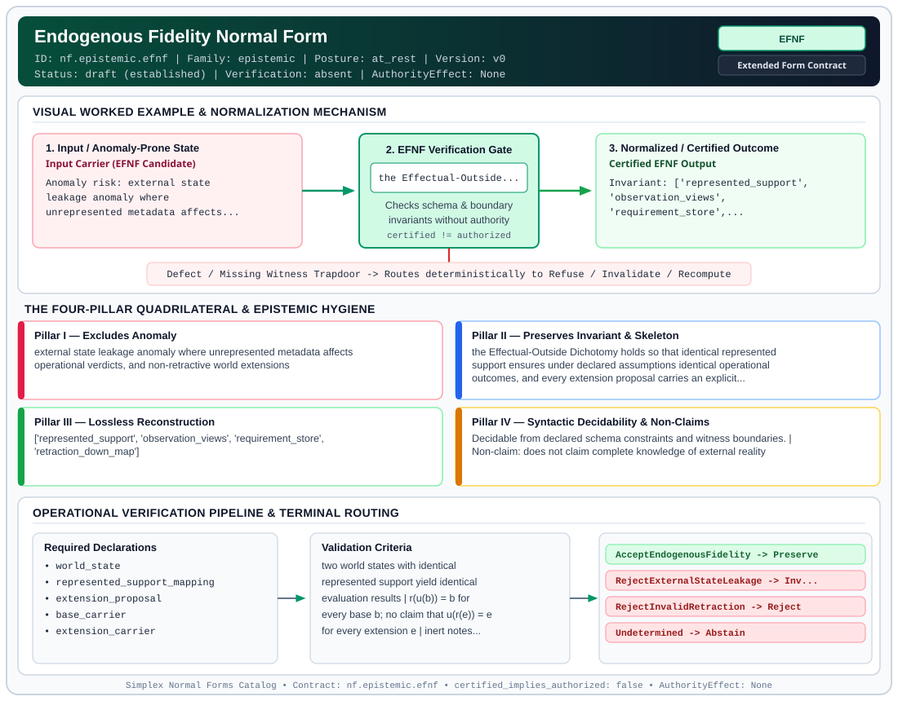

# Endogenous Fidelity Normal Form (`EFNF`)

> **Contract ID:** `nf.epistemic.efnf` | **Family:** `epistemic` | **Index Status:** `draft` | **AuthorityEffect:** `None`

**[⬅ Back to Wiki Home](Home)** | **[View SVG Diagram](images/nf.epistemic.efnf.svg)**

---

## 1. Executive Summary & Metadata

Endogenous Fidelity Normal Form (EFNF) enforces structural normalization and explicit defect routing in the epistemic regime.

| Property | Value |
| :--- | :--- |
| **Canonical ID** | `nf.epistemic.efnf` |
| **Short Name** | `EFNF` |
| **Full Name** | Endogenous Fidelity Normal Form |
| **Family** | `epistemic` (Observer-Relative Epistemic, Freshness, Context, Provenance & Distinguishability Contracts) |
| **Qualification** | Extended Form Contract (Normal Form Contract) |
| **Data / Math Posture** | at_rest |
| **Index Status** | `draft` |
| **Theory Status** | `established` |
| **Verification Status** | `absent` |
| **Contract Version** | `v0` |
| **Governance Fence** | `AuthorityEffect: None` (`certified_implies_authorized: false`) |

---

## 2. Visual Architecture & Normalization Diagram



---

## 3. Concrete Worked Example & Mechanism

### Visual Transition Summary

| Stage | Carrier / Operator | Concrete State / Invariant |
| :--- | :--- | :--- |
| **1. Before / Candidate Input** | `Input Carrier (EFNF Candidate)` | Anomaly risk: external state ; leakage anomaly where ; unrepresented metadata affects... |
| **2. Normalization / Gate** | `EFNF Verification Gate` | `the Effectual-Outside...` (`certified_implies_authorized: false`) |
| **3. After / Certified Output** | `Certified EFNF Output` | Invariant: ['represented_support', ; 'observation_views', ; 'requirement_store',... |

### Contract-Declared Worked Cases

```yaml
- ref: https://github.com/dbccpage/19L57G1/blob/f1d56c010e6ba10a3b9418bd7cc5953c067250f2/lean4/Derivation/NoOutside.lean
  section: lean4/Derivation/NoOutside.lean
  note: the Effectual-Outside Dichotomy check and retraction down-map
```

---

## 4. The Four-Pillar Quadrilateral & Non-Claims

Every contract in `simplex-normal-forms` is evaluated against the **Four-Pillar Quadrilateral** defined in `contracts/_golden_nfs/standard.yaml`:

| Pillar | Requirement | Contract Specification for `nf.epistemic.efnf` |
| :--- | :--- | :--- |
| **Pillar I: Excludes Anomaly** | Name and eliminate a specific class of data or state defects. | external state leakage anomaly where unrepresented metadata affects operational verdicts, and non-retractive world extensions |
| **Pillar II: Preserves Invariant** | State the structural invariant and protected skeleton preserved across transitions. | **Invariant:** the Effectual-Outside Dichotomy holds so that identical represented support ensures under declared assumptions identical operational outcomes, and every extension proposal carries an explicit retraction down-map<br>**Protected Skeleton:** ['represented_support', 'observation_views', 'requirement_store', 'retraction_down_map'] |
| **Pillar III: Lossless Reconstruction** | State the non-loss reconstruction operator (join, direct sum, pullback, or replay). | Lossless reconstruction under declared projection, direct sum, or pullback operators. |
| **Pillar IV: Syntactic Decidability** | State how conformance is decided from declared constraints without unbudgeted scans. | Decidable from declared schema and witness metadata within bounded evaluation budgets. |

### Explicit Non-Claims (`certified_implies_authorized: false`)

- does not claim complete knowledge of external reality
- does not grant operational authority to unrepresented variables
- does not allow proposals without base-carrier retractions
- does not imply operational authority

---

## 5. Operational Verification & Terminal Routing

### 5.1 Required Declarations

- world_state
- represented_support_mapping
- extension_proposal
- base_carrier
- extension_carrier
- inclusion_u
- retraction_r
- evaluator_factorization

### 5.2 Required Evidence

- support_equality_receipt
- evaluator_invariance_receipt
- retraction_identity_proof

### 5.3 Validation Criteria

| Criterion ID | Name | Condition |
| :--- | :--- | :--- |
| `criterion` | Check | two world states with identical represented support yield identical evaluation results |
| `criterion` | Check | r(u(b)) = b for every base b; no claim that u(r(e)) = e for every extension e |
| `criterion` | Check | inert notes cannot alter requirement satisfaction or quiescence |

### 5.4 Terminal Route Map

Every evaluation terminates in a declared local route mapped to a canonical terminal in `standard.yaml`:

| Local Terminal Route | Canonical Terminal |
| :--- | :--- |
| `AcceptEndogenousFidelity` | `Preserve` |
| `RejectExternalStateLeakage` | `Invalidate` |
| `RejectInvalidRetraction` | `Reject` |
| `Undetermined` | `Abstain` |

### 5.5 Declared Failure Modes

- **symptom**: modifying unrepresented notes alters an operational evaluation, **diagnosis**: operational evaluator violates the No-Outside contract, **terminal**: RejectExternalStateLeakage
- **symptom**: proposal down-map mutates an element of the base carrier, **diagnosis**: the supplied maps fail r composed with u equals id_B, **terminal**: RejectInvalidRetraction

---

## 6. Epistemic Claim Hygiene Quadrant

In accordance with the repository's epistemic claim discipline:

1. **What it supports:**
   - Supports syntactic and operational checking of `nf.epistemic.efnf` (`EFNF`) against its declared schema, boundary constraints, and witness obligations in this model.
   - Supports deterministic terminal routing (`AcceptEndogenousFidelity, RejectExternalStateLeakage, RejectInvalidRetraction, Undetermined`) when required declarations or invariants fail.
2. **What it does not support:**
   - Does not confer operational authority (`AuthorityEffect: None`, `certified_implies_authorized: false`).
   - Does not claim semantic truth of undeclared external processes or unverified upstream inputs beyond the declaredprotected skeleton.
3. **The narrowest defensible claim:**
   - Within the declared substrate `at_rest`, this contract enforces that `external state leakage anomaly where unrepresented metadata affects operational verdicts, and non-retractive world extensions` is either excluded under `the Effectual-Outside Dichotomy holds so that identical represented support ensures under declared assumptions identical operational outcomes, and every extension proposal carries an explicit retraction down-map` or routed to an explicit refusal/recovery terminal.
4. **The next test needed:**
   - Property-based falsification and mutation testing across boundary edge cases and composed multi-step pipelines for `nf.epistemic.efnf`.

---

## 7. Canonical YAML Contract (`contracts/nf.epistemic.efnf.yaml`)

<details>
<summary><strong>Click to expand full canonical YAML contract (contracts/nf.epistemic.efnf.yaml)</strong></summary>

```yaml
# Draft declaration: no bound local contract evaluator is supplied; upstream mathematics and schema checks are separate evidence.
schema_version: smplx.nf.contract.v0
contract_kind: form_contract
identity:
  id: nf.epistemic.efnf
  name: Endogenous Fidelity Normal Form
  short_name: EFNF
  version: v0
  status: draft
  family: epistemic
  theory_status: established
  contract_status: draft
  verification_status: absent
classification:
  hierarchy_level: form
  subject_kind:
  - world_state
  - represented_support
  - retraction_down_map
  data_posture: at_rest
  mathematical_posture: operational
purpose:
  excludes_anomaly: external state leakage anomaly where unrepresented metadata affects operational verdicts,
    and non-retractive world extensions
  preserves_invariant: the Effectual-Outside Dichotomy holds so that identical represented support ensures under declared assumptions
    identical operational outcomes, and every extension proposal carries an explicit retraction down-map
  protected_skeleton:
  - represented_support
  - observation_views
  - requirement_store
  - retraction_down_map
  erased_structure:
  - unrepresented_external_notes
  - ambient_environmental_metadata
  non_claims:
  - does not claim complete knowledge of external reality
  - does not grant operational authority to unrepresented variables
  - does not allow proposals without base-carrier retractions
  - does not imply operational authority
quadrilateral:
  qualifies_as_true_normal_form: false
  qualification_gap: no_project_join_theorem
  anomaly_exclusion: operational verdicts depending on unrepresented external variables, and non-contractive
    extension proposals
  lossless_join:
    status: support_projection_reconstruction
    statement: the operational behavior is reconstructed identically from the represented support tuple
      without external notes
  dependency_preservation:
    status: base_carrier_identity_preserved
    statement: the supplied inclusion and retraction satisfy r composed with u equals the identity on
      the base
  syntactic_decision:
    status: declaration_decidable
    statement: finite map checks when carriers and evaluator table are supplied; arbitrary evaluator invariance
      requires proof
declarations_required:
- world_state
- represented_support_mapping
- extension_proposal
- base_carrier
- extension_carrier
- inclusion_u
- retraction_r
- evaluator_factorization
evidence_required:
- support_equality_receipt
- evaluator_invariance_receipt
- retraction_identity_proof
validation_criteria:
- two world states with identical represented support yield identical evaluation results
- r(u(b)) = b for every base b; no claim that u(r(e)) = e for every extension e
- inert notes cannot alter requirement satisfaction or quiescence
terminal_routes:
- AcceptEndogenousFidelity
- RejectExternalStateLeakage
- RejectInvalidRetraction
- Undetermined
terminal_route_map:
  AcceptEndogenousFidelity: Preserve
  RejectExternalStateLeakage: Invalidate
  RejectInvalidRetraction: Reject
  Undetermined: Abstain
certification:
  certificate_required: true
  certificate_kind: endogenous_fidelity_certificate
  obstruction_class_required: false
  loss_ledger_required: false
  verifier_required: true
authorization:
  authorized_by: null
  certified_implies_authorized: false
failure_modes:
- symptom: modifying unrepresented notes alters an operational evaluation
  diagnosis: operational evaluator violates the No-Outside contract
  terminal: RejectExternalStateLeakage
- symptom: proposal down-map mutates an element of the base carrier
  diagnosis: the supplied maps fail r composed with u equals id_B
  terminal: RejectInvalidRetraction
examples:
- ref: https://github.com/dbccpage/19L57G1/blob/f1d56c010e6ba10a3b9418bd7cc5953c067250f2/lean4/Derivation/NoOutside.lean
  section: lean4/Derivation/NoOutside.lean
  note: the Effectual-Outside Dichotomy check and retraction down-map
references:
- https://github.com/dbccpage/19L57G1/blob/f1d56c010e6ba10a3b9418bd7cc5953c067250f2/docs/GENESIS_CLOSEOUT.md
- ./README.md
```

</details>
